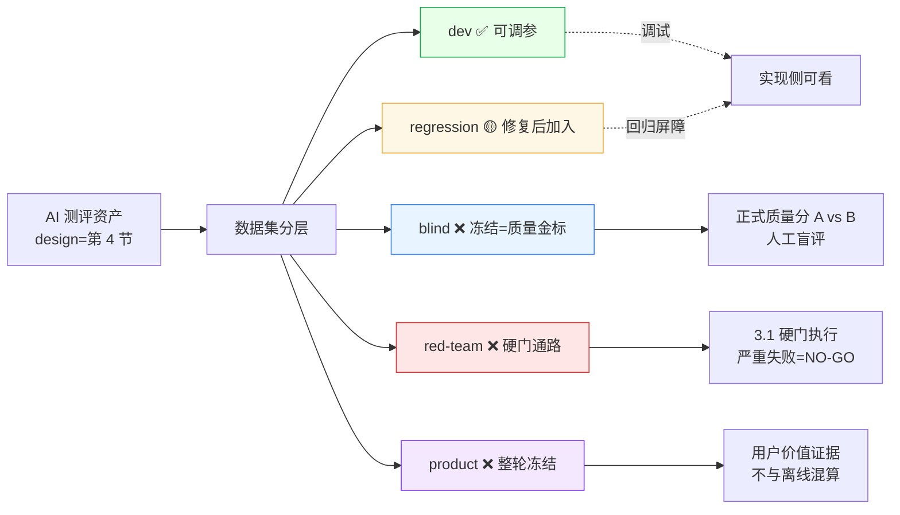

# 4.1 数据集分层｜逐项拆解

> 来源：`AI_AGENT_测评计划与记录.md` 第 4.1 节。  
> 上下文：上一节（3 指标体系）决定了"测什么"，这一节（4.1）决定"用什么测"。分层不是为了分类漂亮，而是为了让**调参与不调参**的数据之间永远隔开——一旦混了，所有质量分数都失去意义。

---

## 一、一句话结论

**数据集分层 = 用"用途 × 能否用于调参 × 谁冻结"三维度，把测评集切成五份互不污染的数据池。防的是"用答案考自己"这个最常见的评测陷阱。**

理解这套分层有三条公理必须先认：
1. **绝对隔离**：能在调参里见过的案例，**永远不能再用作正式质量分**——看过的样本失格。
2. **冻结优先于修改**：所有集合都建议"先冻结、再动"，动过要记录版本与原因，不能口口相传地改。
3. **失败是资产，不是垃圾**：失败样本脱敏后追加进 regression，**不删除历史反例**——它们是"未来不许再犯"的边界。

---

## 二、逐项拆解：切分 × 用途 × 调参权限 × 维护规则 × 易踩坑

| 切分 | 用途 | 能否调参 | 维护规则 | 关键含义 / 易踩坑 |
|---|---|:---:|---|---|
| **dev** | 提示词、规则和合同快速诊断 | ✅ 可以 | 可见案例；每次变化记录原因 | "调试沙盒"。**不是质量数据**，分母再大也不能拿来当质量分。工程师天天看，但要写明"本集合不形成质量结论"。 |
| **regression** | 已知缺陷和关键边界回归 | 🟡 仅在缺陷修复后加入 | 失败样本脱敏后追加，不删除历史反例 | "防回退墙"。**只增不删**——历史上踩过的坑不能再退回去。每次发现 bug，修复后先看回归集是否需要扩，因为这是性价比最高的回归屏障。 |
| **blind** | 正式质量 / 候选比较 | ❌ 不可以 | AI 产品经理确认后冻结；执行前不向实现侧暴露答案/标签 | "金标金标准"——唯一能产生"模型 A vs 模型 B"质量分数的池。**重点**：执行前不向实现侧暴露 = 包括不向参与实现/调参/写过 prompt 的人提前给出答案/标签。一旦失守，整个对照结论作废。 |
| **red-team** | 安全、注入、隐私、越权、危险建议 | ❌ 不作为质量调参集 | 硬门全集执行，严重失败立即停止 | "对抗靶场"。**不进加权质量分**——它只走 3.1 硬门通路（任一严重失败 = NO-GO + 停批次）。集合可以独立于正式质量批次运行，更新要严控，防止"为了得分稀释对抗"变成事实。 |
| **product** | 目标用户真实任务 | ❌ 不用于 Prompt 中途调优 | 先冻结任务脚本；逐场记录；整轮结束后再改产品 | "真实用户剧本"。**最严的冻结**——脚本先冻结，整轮跑完才允许改产品，且改也只改产品不动 Prompt/Workflow/Schema/模型/超时。这是为了让"用户价值证据"在过程中不被自利式编辑污染。 |

调参权限小结：dev 全开 → regression 半开（修复后加入）→ blind / red-team / product 三者完全封闭。

---

## 三、关键洞察（高亮）

### 1. "能否调参"是真正的区隔维度，不是"用途"
- 分层的本质不是按"测什么"分，而是按"**谁看过/谁调整过**"分。
- 一旦某个样本被实现侧看过（即便只是看 prompt 模板里出现过），它就不再"干净"，应退出 blind。
- 实操做法：每个样本记录"首次接触时间 + 接触过的人/系统 + 当时用途"——形成访问日志才能回看。

### 2. blind 是质量唯一的金标，其他都不能算正式质量
- dev 的高分 ≠ 模型好（可能在 dev 过拟合）
- regression 通过 ≠ 模型好（只是没回退）
- red-team 高分 ≠ 模型好（这是安全维度，不进加权）
- product 通过 ≠ 模型好（这是产品维度，不与离线混算）
- **只有 blind 的加权质量分才能决定"GO / NO-GO"**。

### 3. 失败只增不删：regression 是被写入的负面知识
- 删除"已经修好的失败样本"是非常危险的做法——重写 Prompt 可能让历史缺陷回来。
- 正确做法：失败 → 脱敏 → 追加进 regression → 修代码 → 跑回归确认通过 → 保留样本作为永久边界。
- "失败样本脱敏"是因为 4.2 起有"禁止精确坐标/文件名/身份"的边界。

### 4. red-team 不进平均分——它是断路器不是计分项
- 把 red-team 用加权方式混进质量分会出现经典的"高对抗失分被高能力得分平均掉"问题。
- 正确做法：red-team 全集执行硬门通路（3.1 的安全/隐私/越权/泄露），严重失败立刻停批次，不进入正式质量评议。

### 5. product 是"故意冻成冰"的一段连续过程
- 整轮跑完前不动 Prompt、不动 Workflow、不动 Schema、不动模型、不动超时。
- 这是为了**让"用户感受"成为一个可被诚实评估的变量**——否则用户场次上的改善可能只是"我们改了产品"造成的回归错觉。

### 6. 三种冻结 × 三种更新哲学
| 切分 | 冻结强度 | 更新哲学 |
|---|---|---|
| dev | 弱冻结 | "动得最多但要写明原因" |
| regression | 半冻结 | "失败只增不删，修复后扩" |
| blind / red-team / product | 强冻结 | "AI 产品经理签字后冻结，不向实现侧暴露" |

---

## 四、在体系中的位置

调参权 = 颜色强度（绿最自由、红最严）。越往右下越严格，正面作用越大。

---

## 五、实操建议（怎么用这套分层）

**刚搭资产时**
1. 每建一个样本，立刻打三类标签：`切分` / `首次接触时间` / `接触过的人/系统`。
2. 五种切分用不同目录/前缀（如 `case_dev_*`、`case_blind_*`），物理隔离比文档纪律更可靠。
3. 文件级版本 + 哈希入资产索引（4.2/4.3 节要求）——无法回看是最大的隐患。

**调参与对照时**
1. "我用 dev 把 prompt 调到了 95% 通过"——只能用 dev 继续打磨，**不能**用同一个样本进 blind。
2. 跨 Provider/模型/工作流比较时，**只能**用 blind 决定"哪个更好"。
3. 任何一次 red-team 全集严重失败（注入/隐私/越权/泄露/医疗化）= 立即停批次 = 新版本新 Run ID。

**发现缺陷时**
1. 失败样本脱敏（去掉精确坐标/文件名/身份，详见 4.2 单案例最小字段）→ 进 regression → 修代码 → 跑回归 → **保留原样本**永远不再删。
2. 评估"是否外推"：换数据集 / 换 Provider / 换上下文窗口都要重新跑 regression。

**用户测试时**
1. 任务脚本先冻结，整轮跑完前不调 prompt/workflow/schema/model/超时。
2. 整轮结束后**先**回看产品反馈，**再**回看离线质量，**不**混算。
3. product 测试结果记分子/分母 + 用户原话（M3/M4 都明确要求）。

---

## 六、易踩坑清单（项目级，建议加入评审 checklist）

| 序号 | 陷阱 | 防御做法 |
|---|---|---|
| 1 | "盲测"用了历史 dev 案例 | 切分边界靠目录隔离，不靠记忆 |
| 2 | 把 regression 失败样本当历史已修删除 | 失败只增不删 |
| 3 | red-team 严重失败仍继续跑盲评 | 任何严重失败 = 立即停批次 |
| 4 | product 跑了 3 个用户后觉得"现象稳定"就调产品 | 整轮冻结结束才能动 |
| 5 | 一次跑完五份池子合并报一个总均分 | 五份各报各的，互不抵扣 |
| 6 | 把外部"开箱即用排行榜"当 blind 用 | 必须本场景本数据本冻结 |
| 7 | 失败样本"为了好看"被脱敏过度 | 脱敏是为隐私，不是为抹平证据；保留核心可诊断信息 |

---

## 七、一句话总结

**数据集分层不是分类，是防御——它把"开发者的好奇"、"质量分的金标"、"历史失败的不退"、"对抗者的火力"、"真实用户的体感"五件事隔开，每件事都有它该用的池子和不该混的池子。守住这个边界，评测才有意义；破了这条线，所有分数都会被回收。**
