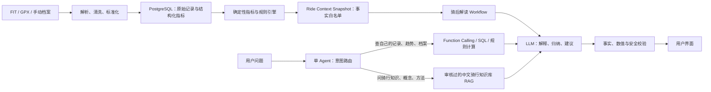
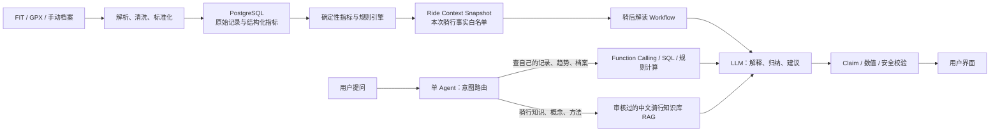

# AI 骑行伙伴：Agent 架构学习笔记

> 记录日期：2026-08-17  
> 主题：为什么 PRD 中的“全量向量检索”与 Demo 中的“当前骑行 JSON 不使用 RAG”并不冲突

## 1. 结论先行

AI 骑行伙伴应采用**结构化数据 + 确定性计算 + RAG 的混合架构**，而不是将所有用户数据统一向量化后交给检索。

- PostgreSQL、指标计算与规则引擎负责回答：**用户的事实是什么。**
- RAG 负责回答：**通用骑行知识、概念和原则是什么。**
- LLM 负责回答：**如何基于已验证事实，用用户能理解的语言解释和表达。**

因此，Demo 中“当前骑行 JSON 不走 RAG”是对 PRD 概念架构的落地细化。

## 2. 两份架构图的关系

PRD 的图表达了一个早期的通用 RAG 思路：将骑行记录、体能档案和中文骑行知识库向量化，用户问题也向量化，经 Top-K 召回后交给 LLM，再检查数值事实。

这张图适合说明 AI 能把用户历史与专业知识结合起来，但不应直接作为生产实现。它把三种性质完全不同的数据放进了同一条检索链路：精确事实、原始时序数据和通用知识。

Demo 方案将其拆开：用户骑行数据通过受控工具与规则层读取；审核过的中文骑行知识通过 RAG 检索。第二种方案是第一种方案的工程化收敛，而非能力缩减。



## 3. 第一性原理：按“答案类型”选择技术

| 答案类型 | 典型问题 | 首选机制 | 原因 |
| --- | --- | --- | --- |
| 精确事实 | “这次平均功率是多少？” | SQL / Function Calling | 必须精确命中该用户、该记录、该版本的数据 |
| 计算结论 | “近四周负荷是否增长过快？” | 规则引擎 / 指标计算 | 需要明确公式、时间窗口与阈值 |
| 通用知识 | “Zone 2 有什么作用？” | RAG | 需要引用审核过的专业内容并减少幻觉 |
| 个性化表达 | “帮我写骑行分享文案。” | 事实白名单 + LLM | 需要语言生成，但数字必须来自真实数据 |
| 医疗与高风险问题 | “膝盖疼还能继续练吗？” | 固定安全分支 | 不应由模型诊断或给出高风险训练决策 |

### 为什么不能把所有骑行数据都作为 RAG 的事实源

1. **语义相似不等于记录正确。** 检索可能召回“类似的一次骑行”，而不是用户所问的这一次。
2. **数值不适合靠语义找回。** 功率、距离、时间窗口、FTP 等需要精确筛选与计算。
3. **FIT 是高频时序数据。** 逐秒功率、心率、GPS 点不应直接嵌入；先计算有意义的指标更有效。
4. **体能档案有版本和时效性。** 应读取最新、已确认的 FTP、心率区间与偏好，而不是检索到旧档案。
5. **成本、延迟和权限更难控制。** 对私有数据全量向量化会增加索引、更新、隔离和删除治理成本。

## 4. 数据分层与向量化边界

| 数据 | 存储/处理方式 | 是否向量化 |
| --- | --- | --- |
| FIT/GPX 原始时序数据 | 原始文件与标准化表；按需计算 | 否 |
| 骑行核心指标 | PostgreSQL + 指标层 | 否 |
| 体能档案（FTP、分区、偏好等） | PostgreSQL，按版本和更新时间管理 | 否 |
| 当前骑行 JSON / Ride Context Snapshot | 一次 Workflow 的受控输入 | 否 |
| 中文骑行知识 | 审核、切分、嵌入、向量数据库 | 是 |
| 历史自然语言摘要（可选） | 从结构化数据生成、审核、脱敏后的摘要 | 可选 |

最后一行是未来可扩展项。例如“近两次长距离后恢复较慢”“爬坡表现持续改善”这类语义记忆，可建立向量索引辅助对话。但它只能是补充线索，不能替代数据库中的数值事实。

## 5. 两条首期工作流（对应两个典型场景）

### 5.1 骑后自动解读：`ride_analysis_v1`

1. 用户上传 FIT/GPX 或选择样例。
2. 解析、清洗并计算距离、时长、爬升、功率、心率、训练负荷等指标。
3. 规则引擎检查数据质量、异常值和风险标记。
4. 服务端生成 `Ride Context Snapshot`，其中只有被允许引用的真实事实。
5. LLM 基于该快照生成骑后解读与保守建议。
6. 校验输出中的数值声明、数据引用和安全边界；失败时重生成或降级为确定性模板。

该流程通常**不需要先检索 RAG**。只有需要补充解释某个通用训练概念时，才检索知识库。

### 5.2 对话问答：`ride_chat_v1`

单 Agent 先识别用户意图，再选择明确路径：

- “我这次在哪段掉功率最明显？”：调用骑行详情/分段分析工具。
- “近四周训练量是否增长太快？”：调用趋势查询和规则计算工具。
- “Zone 2 到底有什么用？”：RAG 检索中文骑行知识库。
- “帮我写朋友圈文案。”：读取当前骑行事实快照，LLM 生成文案。
- “膝盖疼还能练吗？”：进入固定安全兜底，不做诊断或训练处方。

首期采用“**一个用户可见的 Agent + 两条显式 Workflow**”，不需要多 Agent 自主协作。这样链路可观察、可测试、可控制，适合个人完成 Demo 验证。

## 6. Function Calling、RAG 与 LLM 的协作规则

### Function Calling

用于按权限精确读取或计算用户私有数据。工具应只读、参数受约束、结果采用固定 Schema，例如：

- `get_ride_detail(ride_id)`
- `get_recent_training_summary(date_range)`
- `get_current_fitness_profile()`
- `analyze_power_segments(ride_id)`

LLM 不直接写 SQL，也不直接访问数据库；它只能提出工具调用请求，服务端负责权限、查询、计算与审计。

### RAG

用于审核过的中文骑行知识，例如训练概念、补给原则、器材基础和安全知识。检索结果需要带来源、版本和适用边界，并在低置信度时不强行回答。

### LLM

用于意图理解、选择工具或知识检索、组织解释、问答和文案表达。它不是指标计算器、数据库或医疗专家。

## 7. 数值校验的正确做法

不要采用“模型先自由写，发现不对后直接自动修改数字”的方式。更安全的校验链路是：

1. 在调用模型前提供 `Ride Context Snapshot` 事实白名单。
2. 要求模型按结构化 Schema 输出结论与事实引用标识。
3. 服务端将输出中的数值/声明与白名单及规则结果比对。
4. 不一致时，删除不一致声明或携带校验错误重生成一次。
5. 仍失败、模型超时或数据缺失时，展示确定性模板和数据不足提示。

这样能避免“纠正了一个数字却保留错误结论”的问题。

## 8. 可用于后续判断的决策口诀

> 能用确定性数据回答的，不让 RAG 回答；  
> 能用规则计算的，不让 LLM 计算；  
> 需要专业知识解释的，才让 RAG 提供依据；  
> 需要语言表达的，才让 LLM 生成；  
> 涉及医疗、安全或数据不足时，优先兜底而非猜测。

## 9. 后续演进方向

Demo 阶段先验证 FIT/GPX 解析、指标计算、骑后解读和基础问答。验证价值后，再依次补充：历史骑行摘要语义记忆、更多数据接入、长期趋势分析和经过充分安全验证的训练计划能力。

每增加一种能力，都应先明确其事实源、工具边界、RAG 资料来源、模型可说与不可说的范围，以及失败时的降级方式。

## 10. 什么是“事实合同”

### 结论

事实合同是 AI 开始生成前，研发侧用**版本化数据结构与确定性规则**固定“哪些数据是真的、可如何使用、不能得出什么结论”的约束协议。它不是面向用户展示的文案，而是 AI 解读的事实地基。

### 在骑行产品中的数据链路

```text
FIT / GPX 原始记录
  → RideActivity / RideSeries：记录值、来源、单位、质量
  → AtomicCapabilityProfile：这条记录实际支持哪些分析
  → RideFeatureSnapshot：波动、前后段变化等可复算特征
  → HistoricalComparisonSnapshot：通过可比性规则的历史对比（后续）
  → RideAnalysisContext：提供给模型的最小事实白名单（后续）
  → LLM：只负责解释、归纳和表达
```

例如，设备记录“平均功率198 W、NP 211 W”后，确定性规则计算出“NP/平均功率比=1.07”，同时保留公式版本和两项证据。AI可以解释为“输出存在一定波动”，但不能直接称为“高质量间歇训练”，因为后者需要额外的区段识别与真实样本校准证据。

### 一份合同至少应回答

| 内容 | 要解决的问题 |
| --- | --- |
| 字段、单位、来源 | 数字从哪里来，含义是否明确？ |
| 质量状态和不可用原因 | 缺失、异常或不可靠时是否停止推导？ |
| 公式/规则版本与输入 | 未来能否复算、排查和迭代？ |
| `claimId` / `evidenceId` | AI 的个性化结论能否回查依据？ |
| 能力门与禁止结论 | 有什么数据就分析什么，哪些结论仍不允许说？ |

### 与 RAG、Function Calling、LLM 的分工

- 事实合同：定义并约束“本次可证明的用户事实”。
- Function Calling：按权限精确读取当前或历史的结构化事实。
- RAG：检索审核过的通用骑行知识，不作为用户数值事实源。
- LLM：在事实合同的白名单内组织解释与表达，不自行计算、补齐或猜测。

记忆口诀：**先把事实锁住，再让模型把事实讲明白。**


----
# 原对话：
## 用户：
有个问题：这个agent架构是怎样的呢？我看prd里定义的agent架构表明骑行记录和体能档案都进行向量化用于知识库检索，demo搭建方案里定义了当前骑行 JSON等内容不使用rag，prd和demo方案的架构有什么区别？

## 回答：
两者不是目标冲突，而是架构从 PRD 的“概念性 RAG 方案”收敛为更适合骑行场景的“结构化数据 + RAG 混合架构”。

核心原则是：**需要精确计算的事实，不能依赖向量检索；需要语义理解和经验知识的内容，才使用 RAG。**



## PRD 图中架构的含义与问题

PRD 图的逻辑是：

- 将骑行记录、体能档案、骑行知识库统一向量化；
- 用户问题向量化；
- 检索 Top-K 后交给 LLM；
- 再做数值校验。

这是一个易理解的通用 RAG 架构，适合在方案初期说明“AI 能结合用户历史和专业知识回答问题”。但若直接落地，会有几个关键问题：

1. **向量检索不是精确查询。**  
   例如用户问“我这次平均功率是多少”“近四周 TSS 趋势如何”，不能接受召回到一条“语义相似但不是这次”的记录。

2. **FIT 的高频时序数据不适合直接向量化。**  
   逐秒功率、心率、轨迹点等数据量大，向量化成本高，也无法替代区间功率、爬升、心率漂移等确定性计算。

3. **体能档案是状态，不是知识。**  
   FTP、心率分区、最大心率、伤病/偏好等，应按最新版本精确读取，而非从相似文本中“找一个像的”。

4. **“LLM 生成后自动修正数值”风险偏高。**  
   更可靠的做法不是让模型自由生成后再改数字，而是先将允许引用的事实传给它，并对输出的数值声明做校验。

因此，Demo 方案中的“当前骑行 JSON 不走 RAG”，是对 PRD 的必要细化，不是弱化能力。

## 三类数据应如何处理

| 数据类型 | 例子 | 正确访问方式 | 是否向量化 |
|---|---|---|---|
| 精确、结构化、会变化的用户事实 | 本次均功率、FTP、近 28 天骑行、疲劳状态 | PostgreSQL + 规则计算 + Function Calling | 不作为事实源 |
| 原始时序数据 | FIT 中逐秒功率/心率/GPS | 存储、按需计算指标 | 不直接向量化 |
| 通用专业知识 | Zone 2 解释、补给原则、训练概念 | RAG | 是 |
| 历史语义记忆（可选） | “上次长距离后膝盖不适”“近期爬坡表现改善” | 从结构化数据生成、审核后的摘要，再做语义检索 | 可选 |

这里的关键区别是：

- **PostgreSQL/工具调用回答“事实是什么”。**
- **RAG 回答“这件事通常意味着什么、有哪些原则”。**
- **LLM 回答“如何用自然语言向这个用户解释，并给出边界内建议”。**

## 对两个典型场景的处理差异

### 场景一：骑行结束后的自动解读

不需要先检索 RAG。

流程是：FIT → 解析与计算 → 得到本次的 `Ride Context Snapshot` → LLM 解读。

`Ride Context Snapshot` 可包含：

- 距离、时长、爬升、均速；
- 平均/标准化功率、心率、训练负荷；
- 与个人 FTP、心率区间的关系；
- 与近期基线的确定性对比；
- 数据质量和风险标记。

LLM 只基于这份“事实白名单”写出可读解读，不能自行发明指标。若需要解释“为什么恢复骑重要”，才补充检索骑行知识库。

### 场景二：用户对话提问

由单 Agent 先判断意图，再选择路径：

- “我这次在哪段掉功率最明显？”  
  调用 `get_ride_detail` / `analyze_power_segments` 等数据工具。

- “我近四周训练是否增长过快？”  
  调用趋势查询工具和规则引擎。

- “Zone 2 骑行到底有什么用？”  
  检索骑行知识库 RAG。

- “帮我把这次骑行写成朋友圈文案。”  
  读取本次事实快照，LLM 生成文案；无需 RAG。

- “膝盖疼还能不能继续训练？”  
  触发安全兜底：不诊断、不做医疗结论，建议停止加量并寻求专业医疗意见。

## 因而 Demo 的 Agent 应是怎样的

首期采用“**单 Agent + 两条显式工作流**”，而不是多个互相对话的 Agent：

- `ride_analysis_v1`：骑后自动解读  
  输入是确定性计算出来的快照，输出是结构化解读与保守建议。

- `ride_chat_v1`：骑行问答  
  Agent 负责意图路由，按需调用用户数据工具或骑行知识 RAG。

这样对个人 Demo 最合适：链路短、可测、容易定位问题，也方便未来逐步拆出数据分析、训练规划等专门能力。

## 对 PRD 架构的建议修订

建议把 PRD 中“骑行记录/体能档案 → 向量化 → Top-K”改成：

> 骑行记录与体能档案以结构化数据库和确定性指标层为主，通过受权限控制的 Function Calling 按需读取；可将经脱敏、聚合、审核的历史骑行摘要建立向量索引，作为语义记忆的补充。中文骑行知识库采用 RAG。

同时把“自动修正数值”改为：

> 对 LLM 输出执行事实声明、数值、风险边界校验；校验失败时优先删除不一致声明或基于事实快照重生成一次，仍失败则使用确定性模板降级。

这样，第二张图就是第一张图的落地版：它保留了 RAG，但将 RAG 从“所有数据的统一入口”调整为“适合它的知识入口”；将用户私有骑行数据改由工具和规则可靠获取。

---

## 学习补充｜什么是“原子能力”（2026-08-20）

原子能力是指：在**某一条骑行记录 + 当前用户资料 + 已实现规则**的组合下，系统能够用确定性代码证明“可用”或“不可用”的最小分析条件。

它不是用户等级、页面功能，也不是由大模型自行判断的结论。L1/L2/L3可以继续作为样例和评测分组，但不能作为业务或模型的能力门。

| 原子能力 | 需要的前提 | 能支持的内容 |
| --- | --- | --- |
| `heartRate` | 可靠心率记录与质量通过 | 解读本次心率事实和变化 |
| `maxHeartRateBaseline` | 用户资料中有估算或手动最大心率 | 作为心率区间的前置基线 |
| `heartRateZones` | 心率 + 最大心率基线 + 已实现的区间规则 | 展示、解释心率区间 |
| `power` | 可靠功率记录与质量通过 | 解读功率输出和波动 |
| `verifiedFtp` | 用户主动保存并确认的FTP | 作为功率区间/负荷的前置基线 |
| `powerZones` | 功率 + 可信FTP + 已实现的区间规则 | 功率区间分析 |
| `historyComparison` | 合格、可比的历史比较快照 | 说“相对过去发生了什么变化” |
| `trend` | 满足规则的连续可比历史样本 | 说“近期趋势” |

### 为什么要拆成原子能力

- 有功率但没有心率：功率能力应继续可用，不能被旧等级降级。
- 有心率、填写了年龄：可以得到最大心率估算；但心率区间规则未实现时，`heartRateZones`仍必须关闭。
- 有用户确认的FTP：FTP事实可用；但IF、TSS、训练负荷仍要等规则实现后才可开启。
- 第一次骑行：本次骑行能力可用；历史比较和趋势能力关闭。

原子能力的价值是把“模型是否可以说某句话”前移为可测试的系统判断：只有能力成立，相关分析维度、claim和建议才允许进入模型上下文；能力不成立时，系统静默跳过该维度或走确定性降级，不能让模型补猜。
