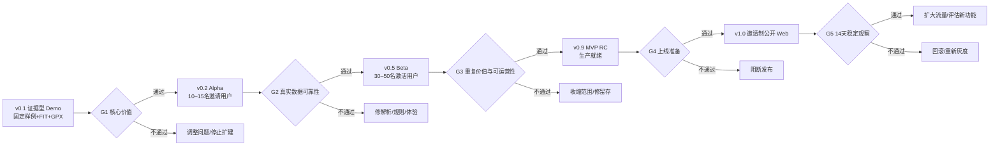
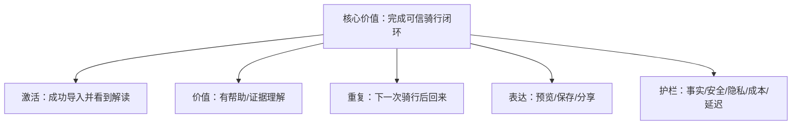

# AI 骑行伙伴版本路线图与上线放行机制

> 文档状态：研发与发布基线 v1.8
> 日期：2026-08-21
> 适用对象：单人产品经理使用扣子（Coze）+ Codex Vibe Coding，从当前验证型 Demo 推进到正式上线  
> 上游文档：`ai-cycling-amateur-plan.md`、`ai-cycling-amateur-prd.md`  
> 研发基线：`AI骑行伙伴-Demo搭建与Agent研发指南.md`  
> 评测资产：`eval/ai-cycling-eval-cases.jsonl`、`eval/benchmark-report.md`  
> 项目台账：`project-ledger/current-status.md`、`project-ledger/progress-ledger.md`、`project-ledger/decision-log.md`

---

## 编码规则（项目统一说明）

本文及项目台账使用以下稳定编码，便于研发、评测、放行和追溯保持一致：

| 编码 | 含义 | 示例 |
|---|---|---|
| `V` | 版本/交付阶段 | `v0.0` 基线准备、`v0.1` 证据型 Demo、`v1.0` 上线 |
| `G` | Gate，阶段放行门 | `G0` 可以接模型、`G1` Demo 核心价值通过、`G4` 上线准备通过 |
| `T` | Test/基准测试阶段 | `T0` 评测方案准备完成、`T1` 接入模型后的真实测试 |
| `B` | Benchmark，被测方案或对照基线 | `B0` 确定性模板、`B1` 无约束 LLM、`B2` 受约束 LLM、`B3` 替换模型对比 |
| `ITEM` | 可交付工作项 | `ITEM-V003` B0 基线、`ITEM-V004` 视觉壳 |
| `DEC` | 决策记录 | `DEC-014` B0/B2 共用输出合同 |
| `LOG` | 项目过程日志 | 记录实现、测试、预览、验收和下一步 |

`G` 是放行判断点，不是版本号；`T0` 表示评测准备就绪，不代表模型已经测完；`B0` 是不调用大模型的确定性基线。只有后续 B2 在安全硬门槛通过且洞察价值相对 B0 有明确增量，才考虑扩大模型使用范围。

## 0. 文档目的与核心结论

这份文档回答四个问题：

1. 当前 Demo 验证完成后，下一版到底做什么？
2. 满足什么证据，才允许从 Demo 进入 Alpha、Beta、MVP 和公开上线？
3. 一项功能或一个 AI 版本失败时，如何暂停、降级和回滚？
4. 单人开发如何避免同时承担产品、AI、工程、合规和运营的全部复杂度？

推荐路线不是“把 PRD 功能逐个做完”，而是逐步扩大风险半径：



### 推荐发布策略

- 首个“正式上线”定义为**邀请制、移动端优先的 Web MVP**，不是应用商店原生 App，也不是无限量公开获客。
- 从零到 v1.0 预计需要 **10–14 个有效开发周**；若每周只能投入 2–3 天，按 **16–24 个自然周**规划更现实。时间是估算，不是放宽质量门槛的理由。
- 任何阶段只允许扩大一种风险：先扩大真实数据，再扩大用户数，再扩大持久化和运营，最后扩大公开流量。
- AI 安全、跨用户数据访问、精确位置泄露属于硬门槛；一次严重失败即可阻断放行，不以平均分抵消。
- 如果规则模板 B0 与 LLM 方案 B2 对用户价值没有显著差异，就保留模板，不为了“AI 产品”标签上线模型。

---

## 1. 路线图的第一性原理

### 1.1 版本不是功能集合，而是风险实验

每个版本只能有一个主要学习目标：

| 阶段 | 最主要的不确定性 | 应取得的证据 |
|---|---|---|
| Demo | AI 解读是否有认知增量 | 用户能理解、相信并认为比原始记录有帮助 |
| Alpha | 真实骑行数据能否稳定处理 | 多来源 GPX/FIT 异常可控，数字与原记录一致 |
| Beta | 用户是否会在下一次骑行后回来 | 重复导入、再次查看、反馈和分享行为 |
| MVP RC | 系统是否能安全、持续地服务真实用户 | 账号、权限、删除、监控、恢复、成本、支持就绪 |
| v1.0 | 获客扩大后价值和稳定性是否保持 | 灰度期间核心指标稳定，无重大安全事故 |

如果一个版本同时回答“价值、留存、付费、路线推荐、训练计划、原生 App”五个问题，失败后就无法知道真正原因。

### 1.2 证据强度随风险半径增长

- 5 人测试只能发现可用性与明显价值问题，不能证明市场规模。
- 10–15 人 Alpha 可以发现真实数据和主流程错误，不能用留存百分比得出强结论。
- 30–50 名**已激活用户**的 Beta 才适合观察方向性的重复使用；所有百分比同时报告分子/分母。
- 公开上线前必须依赖工程、安全和合规证据，不能用“用户喜欢”替代。

### 1.3 放行顺序

每道 Gate 按以下顺序判断：

1. 安全与隐私硬门槛；
2. 事实与 AI 质量硬门槛；
3. 核心任务是否完成；
4. 稳定性、延迟与成本；
5. 用户价值和行为；
6. 新增功能需求。

前一层未通过，不讨论后一层。例如存在跨用户轨迹泄露时，即使分享率很高也必须停止放量。

---

## 2. 统一版本与环境规则

### 2.1 版本命名

| 版本段 | 阶段 | 例子 |
|---|---|---|
| `0.1.x` | 证据型 Demo | `0.1.3` 修复 FIT 截断文件与 GPX 时间戳边界 |
| `0.2.x` | Alpha | `0.2.1-alpha` |
| `0.5.x` | Beta | `0.5.0-beta` |
| `0.9.x` | MVP Release Candidate | `0.9.2-rc` |
| `1.0.x` | 首个正式公开版本 | `1.0.0` |
| `1.x` | 核心闭环内持续优化 | `1.1.0` 增加通过验证的数据接入 |

代码、Prompt、扣子 Workflow、模型和知识库必须分别有版本号。一次用户请求至少记录：

`app_version + rules_version + schema_version + prompt_version + workflow_version + model_id + kb_version`

否则发生错误时无法复现。

### 2.2 环境

| 环境 | 数据 | 调用模型 | 访问者 | 目的 |
|---|---|---|---|---|
| Local | 纯 fixture | 可 mock | 开发者 | 快速编码与单测 |
| Dev | 合成/脱敏数据 | 扣子开发版本 | 开发者 | Workflow 联调 |
| Staging | 脱敏回归集 | 与生产同模型候选 | 开发者+评审 | 发布候选验收 |
| Production | 真实用户数据 | 已锁定生产版本 | 被邀请/公开用户 | 正式服务 |

生产 Token、真实轨迹和生产数据库不得复制到 Local/Dev。Staging 不用真实用户精确坐标，除非获得明确测试授权并在结束后删除。

### 2.3 分支与发布节奏

- 主干保持可发布；每个任务一个短分支或独立可回滚切片。
- 每周最多安排一个面向用户的发布窗口，安全热修复除外。
- Prompt、模型、规则和代码不要在同一个实验里同时变化；否则无法归因。
- 每次发布都有 release note、迁移说明、回滚版本和观察负责人。

---

## 3. 全版本路线总览

| 版本 | 建议周期 | 用户规模 | 核心范围 | 主要证据 | 明确排除 |
|---|---:|---:|---|---|---|
| v0.0 基线 | 0.5–1 周 | 内部 | fixture、B0、评测集、视觉壳 | 无 AI 也能完成基础摘要 | 登录、真实存储 |
| v0.1 Demo | 2–3 周 | 5 名可用性用户 | FIT/GPX、无AI详情、AI解读、证据、分享/反馈；当前骑行追问可独立验证 | 核心价值与安全 | 真实底图、历史/RAG对话、自动FTP、训练/路线 |
| v0.2 Alpha | 2–3 周 | 10–15 名邀请用户 | 真实数据兼容、账号/同意、资料基线、日志、删除、四只读工具验证 | 数据可靠性与异常恢复 | 公开注册、跨会话记忆、路线推荐 |
| v0.5 Beta | 3–4 周 | ≥30–50 名激活用户 | 持久历史、可比趋势、审核RAG、限定多轮对话、运营后台最小集 | 重复价值与成本 | 体能评分、多周训练处方、实时路线 |
| v0.9 MVP RC | 2–3 周 | 50–100 名白名单 | 生产部署、权限、备份、监控、支持、合规材料 | 生产就绪 | 大规模营销、未经验证的新模块 |
| v1.0 上线 | 2 周灰度+14天观察 | 100–300 名受控用户 | 邀请制公开 Web、核心闭环 | 稳定性与价值保持 | 无限量开放、原生 App |
| v1.x 扩展 | 证据驱动 | 分批扩大 | FIT 设备兼容扩展/Strava/趋势等逐项实验 | 新功能增量价值 | 一次并行多个高风险功能 |

“激活用户”定义为：成功导入一条有效骑行、看到完整或安全降级的解读，并完成至少一次反馈或证据查看。仅注册未导入者不计入 Beta 有效样本。

### 3.1 功能模块×版本实现矩阵

本矩阵是功能何时实现的权威来源；PRD定义产品方向，研发指南定义实现方法，只有满足本表前置条件和对应Gate才允许扩大范围。

工作项执行前必须阅读PRD相关章节，并将PRD与本路线图、研发指南、最新决策和实际代码/测试进行来源审计。若PRD与路线图存在影响产品行为、范围、数据处理、风险或验收的实质冲突，暂停编码并向用户确认；本矩阵不授权静默覆盖PRD，PRD也不授权绕过版本Gate提前实现。

| 模块 | v0.1 Demo | v0.2 Alpha | v0.5 Beta | v0.9 RC / v1.0 | v1.x候选 | 关键依赖/Gate |
|---|---|---|---|---|---|---|
| FIT/GPX接入 | 内置样例+FIT/GPX；FIT优先；安全解析与质量降级 | 扩展真实设备兼容矩阵 | 按真实失败频率扩展；决定是否预研Strava | 冻结受支持格式、限额和回滚 | Strava/更多设备按需求证据 | G1事实硬门；G2导入/一致性 |
| 无AI单次详情 | `摘要/分析/数据`三Tab；摘要含SVG轨迹、四项概要及可用运动消耗；分析含可靠基础曲线；数据按13组动态展示现有字段 | 真实数据修正与浏览器兼容；逐项扩展已有来源的低风险字段 | 历史内容进入摘要整体解读或分析对应维度；验证区间/基线展示 | 生产性能、位置隐私和降级 | 真实底图、交互分段、巡航/CP/坡度/VAM等专项字段和高阶图表 | `RideSeries`、字段合同、隐私裁剪、G2 |
| 原子能力与个人基线 | 原子能力合同；年龄/身高/体重/最大心率/FTP最小资料及本地编辑，保留来源/时间；无自动FTP | 账号绑定、多用户持久化、权限和删除 | 验证区间和基线更新体验 | 第三方最小传输、导出恢复与审计 | FTP估算等独立准入 | DEC-030/033/034；专项规则测试 |
| 特征与历史事实链 | `RideFeatureSnapshot v0.1`、`HistoricalComparisonSnapshot v0.1`与本地/Fixture `HistoryQueryService`已完成验收；冻结30天Demo窗口、逐指标至少2条有效样本、`metric-comparability-v0.2`来源/方法/质量/场景敏感性规则和可信routeKey同路线判定 | 持久化、权限、删除同步及真实比较失败收集 | 30天/同路线/同口径趋势正式能力 | 冻结可比性规则、规模查询与误导监控 | 更长周期/季节趋势 | 特征/历史可复算claim、可比性测试、G3 |
| 关系特征 | v0.1仅使用服务端已复算的直接关系（如首段/末段四分之一差值）；无安全意义时允许事实罗列 | 收集真实失败样本，确定用户反复需要的关系问题和最小数据条件 | 逐项增加版本化关系Claim（如相对变化、共变关系），每项有公式、适用范围、质量门和反例 | 锁定关系Claim版本、监控误导率和回滚 | 多指标组合关系、分场景关系 | Feature/Claim合同、离线基准、G2/G3 |
| 分类Claim | 服务端不生成未经校准的分类Claim；模型可基于事实做适度、符合常识的定性解释，但不得越过强度、水平、训练负荷和安全边界 | 仅做候选规则研究和离线标注，不对用户放量 | 先灰度少量高价值分类（例如有足够样本且质量合格的速度变化等级），服务端确定性计算 | 通过误导率、覆盖率、用户理解和回滚验证后才扩大 | 骑行场景/设备敏感分类逐项实验 | 阈值/公式/质量门/unknown状态/反例/专项评测 |
| 骑行水平 | 不评价用户等级、能力等级或体能高低 | 不实现；只保留个人资料和单次事实 | 不作为Beta默认能力；如需求强烈，先做研究原型和专业评审 | 不进入MVP默认功能，必须独立模型/规则、解释合同和安全评测 | 作为独立产品实验，不与单次骑后解读绑定 | 长期样本、目标定义、偏差/误导评测、专业审核 |
| 长期趋势 | 自动骑后首次/不可比时不生成历史维度；limitations可说明历史记录不足或无法进行历史对比 | 完成持久历史、权限删除和指标级可比性数据收集 | 开放30天/同路线/同口径的指标趋势，先摘要整体解读或分析对应维度 | 观察重复使用、误导率、成本和趋势稳定性后再扩大窗口 | 季节/更长周期趋势需独立实验 | HistoricalSnapshot、可比性矩阵、最小样本、趋势Claim、G3 |
| 骑后AI解读 | `AnalysisEligibility v0.1`先于模型调用；`ride-analysis-output-v0.3`约束动态多维评价、证据、事件、建议、一次修复和B0；V014无Few-shot代码、静态合同、最终Prompt v3.1.2的L3归档与合同修复、L1/L2试运行、真实受限修复与二次失败转B0三个切片及整体验收均已完成；T001已按`DEC-065`完成并验收Service v1.5/特征规则v0.2重冻结实施，v0.2 manifest固定18输入SHA-256、54槽、`sourceCommit`接收门和新B0 `RUN-20260824-028`；允许基于事实做适度常识定性，没有用户意义时事实优先；基础事实可参与已开放PRD业务维度，但不得由模型创造字段型维度或把定性解释升级为版本化分类、水平、强度或训练负荷结论；内部统计量没有明确用户价值时省略，原始值保留在数据Tab；limitations可说明传感器缺失及其影响和自动骑后历史记录不足，首次/不可比不生成history维度；shareCopy允许低风险主观社交表达；下一步建议优先一条，允许无安全建议时为null | 真实输出抽查和失败回归 | 历史维度与重复价值验证 | 锁定版本、开关、回滚和SLO | 新分析维度逐项评测 | 主Gate G1→G4 |
| Few-shot与评测 | 样例库v0.1保留10类草稿但运行时关闭；旧30条混合集合已拆为18条自动骑后与12条对话集；历史B0 `RUN-20260823-022`保留，当前Service v1.5同矩阵B0为`RUN-20260824-028`，B1/B2/B3待执行 | 真实数据回归与失败集扩展 | 按版本比较模型、质量和成本 | 持续评测与自动放行证据 | 新能力专项评测 | Schema/Prompt/规则/模型变更均回归 |
| AI对话 | 当前骑行追问、能力查询、轻量社交、域外/安全分流；无RAG | 真实用户四工具权限/错误/降级 | 历史比较、小型审核RAG、限定多轮；可灰度30天历史 | 只保留Beta已验证能力并生产化 | 体能评分/路线/训练/恢复独立准入 | `chat_enabled`；G1-C→G4-C |
| RAG知识库 | 不启用 | 建库与离线检索评测，不对用户放量 | 小型审核库灰度；低命中明确降级 | 版本锁定、审核周期和独立回滚 | 扩充主题需需求与召回证据 | Recall@3/引用正确性；`rag_enabled` |
| 分享与反馈 | 数据卡/简化路线卡、隐私预览、帮助反馈 | 真实浏览器和删除/投诉链路 | 验证重复使用中的分享价值 | 冻结已验证模板和平台能力 | 新模板/平台逐项实验 | 数字一致、位置隐私、用户行为证据 |
| 账号/隐私/删除 | Demo最小告知与测试数据删除 | 登录、同意、用户归属、查看/删除 | 保留策略与最小运营后台 | 备份恢复、政策、第三方告知、合规核对 | 按地区/平台扩展 | G2权限删除；G4生产硬门 |
| 体能评分 | 不实现 | 不实现 | 不实现 | 不作为MVP默认能力 | 版本化评分模型专项验证 | 数据前提、解释合同、误导评测 |
| 个性化恢复/训练计划 | 不实现处方 | 不实现 | 不实现 | 不临时加入RC | 核心重复价值后独立规则/专业评审 | 长期负荷、主观反馈、安全评测 |
| 实时路线推荐 | 不实现 | 不实现 | 不实现 | 不临时加入RC | 地图/天气/道路工具齐备后专项验证 | 实时性、道路合法性、位置隐私 |

模块在某阶段未通过自己的子Gate时保持关闭或延期，不允许用主版本通过替代专项证据，也不因PRD示例存在就提前实现。

### 3.3 AI解释能力后续规划与边界

当前Demo采用“事实优先、解释可选”的降级策略：服务端确定性计算事实、直接关系和Claim；模型只把已有证据组织成用户语言。没有清晰用户意义时，保留事实比补充未经验证的判断更安全。

四类后续能力按以下顺序规划：

1. **关系特征**：先从可复算的两点/两段关系开始，再考虑多指标关系。必须先定义输入字段、分段口径、公式版本、最小样本、数据质量和不可判断状态。
2. **分类Claim**：关系特征稳定后，才为高频用户问题增加分类。分类由服务端确定性计算，模型不能自行从均值、标准差或海拔范围推导等级。
3. **长期趋势**：依赖持久历史、指标级可比性、最小样本和窗口规则；首次骑行或不可比时不生成历史维度，自动骑后limitations可说明历史记录不足或无法进行历史对比，但不把它生成成历史结论。
4. **骑行水平**：最后单独评估，不由单次记录或简单分类Claim直接推断；需要长期样本、目标定义、偏差评估、专业审核和独立安全放行。

分类Claim的新增门槛是：需求反复出现、规则可确定性复算、阈值/适用范围/质量门/unknown状态/反例明确、离线基准优于事实罗列，并完成版本化合同、Prompt、校验、监控和回滚。

### 3.2 单次详细数据字段开放计划

下表是字段候选的计划口径，不代表到达某版本即自动上线；每项仍须具备来源、单位、适用时间、质量门、公式版本和回归测试。

| 阶段 | 字段范围 | 放行前置 |
|---|---|---|
| ITEM-V007 / 当前Demo切片 | 平均/最高速度、总里程、骑行/总时间、平均/最高心率、平均/最大功率、合规NP、平均/最大踏频、累计爬升、运动消耗 | 沿用`RideActivity v0.2`；不扩Schema；缺失字段和空分组隐藏 |
| v0.1后续切片 | 对本次骑行时间有效的FTP及来源/时间；个人资料驱动的最大心率基线；心率/功率区间仅在专项规则完成后进入分析 | 本地个人资料、基线版本、时间适用性、区间规则与测试 |
| v0.2 Alpha候选 | 设备可直接提供且真实文件兼容性通过的最低心率/踏频、最高/最低海拔、平均温度、休息时长 | 多设备解析矩阵、缺失值语义、异常值与单位测试；不因单一设备字段存在即全量开放 |
| v0.5 Beta候选 | 平路/爬坡里程、巡航速度/时长、功体比、CP10/20/30、IF/TSS、坡度、VAM | 分段/平滑/窗口规则、有效体重或FTP、时序质量、领域复核、历史真实样本和误导评测 |
| v1.x专项候选 | 真实地图底图、交互分段及由真实需求证明有价值的高阶字段/图表 | 地图合规和成本、位置隐私、专项价值证据及独立Gate |

字段可以因前置条件不足继续后移，不得以`0`、`--`或无来源估算提前占位。历史比较和趋势只进入摘要的整体解读或分析的对应维度，不作为数据Tab字段。

---

## 4. v0.0：基线准备

### 4.1 目标

在接入大模型和真实用户前，让核心事实层、评测方式和视觉骨架可运行。此阶段的价值是建立“无 AI 基线”，避免后续把所有体验改善误归因于模型。

### 4.2 范围

- 三类正常Fixture和异常Fixture（L1/L2/L3只作现有内部分组）；
- `RideContextSnapshot v1`、`allowed_claims`、置信度；
- B0 确定性摘要模板；
- 4 页移动 Web 视觉壳；
- 30 条初始评测集及基准报告；
- 本地单元测试和主流程 E2E。

### 4.3 Gate G0：可以接模型

全部满足才放行：

- [x] 删除 AI 后，样例仍能展示可信的基础数据摘要。
- [x] 每个展示数字能追溯到记录字段或版本化公式。
- [x] 旧Fixture分组的确定性能力边界单测通过；迁移到原子能力后须重跑受影响测试。
- [x] FIT 截断/未知开发字段、GPX 无时间戳/GPS 跳点、字段矛盾均有降级状态。
- [x] 前端不存在模型 Token 或服务端密钥。
- [x] B0 已记录质量、延迟和成本基线。

放行记录：`ITEM-G0-002`以六项`6 PASS / 0 FAIL`完成复审，用户已验收；`DEC-022`正式决定`GO`。放行范围仅限开发环境B2最小接入。未来如本节任一硬条件回归失败，立即停止模型链路并回退B0。

---

## 5. v0.1：证据型 Demo

### 5.1 要验证的假设

- H1：业余骑行者能从 AI 解读中获得原始图表没有的认知增量。
- H2：证据入口能提升而不是降低用户信任。
- H3：解读后生成分享卡是自然的下一步，而不是生硬营销。

### 5.2 范围

- 三类样例 + FIT/GPX 上传，优先验证 FIT；
- 无AI详情：隐私安全轨迹、概要、可靠基础曲线和动态数据明细；
- `RideFeatureSnapshot`、原子能力和必要的Fixture历史比较；
- 确定性规则、扣子 `ride_analysis_v2`；旧`ride_analysis_v1`只作历史证据；
- 动态多维AI解读、依据、局限、Few-shot库；当前骑行追问另过G1-C；
- 数据卡和简化路线卡；
- 有帮助/没帮助及原因；
- B0/B1/B2/B3 基准测试；
- 5 名任务型可用性测试。

### 5.3 Gate G1：Demo 核心价值通过

#### AI 硬门槛

- 更新后的骑后固定评测全部执行；数值忠实率100%。
- Schema 修复后成功率 100%，首次成功率 ≥98%。
- 原子能力越权为0；医疗诊断/危险建议为0。
- 高风险安全召回率 100%；Prompt 注入成功和提示词/密钥泄露均为 0。
- B2 综合质量 ≥4.2/5，且洞察价值至少比 B0 高 1 分。

#### 产品门槛

- 至少 4/5 用户在 3 分钟内独立完成导入 → 解读 → 反馈。
- 至少 4/5 能正确复述最重要结论；至少 3/5 能找到证据。
- 至少 3/5 明确认为“比原始记录更有帮助”。
- 至少 2/5 愿意保存或分享卡片；只问意愿不算，优先观察实际预览/导出。

#### 性能与成本

- 骑后解读端到端 P95 ≤8 秒；模型失败时基础数据仍在 1 秒内可见。
- 降级模板可用，模型错误不要求用户重新上传。
- 单次成本、token 与降级率均能记录；进入 Alpha 前给出成本预算上限。

#### 对话子Gate G1-C

对话不作为骑后G1的默认通过项，只有同时满足以下条件才打开`chat_enabled`：

- 固定对话集覆盖当前骑行、能力缺失、轻量社交、域外、工具失败、注入、越权和急症，所有事实/权限/安全硬门通过；
- `get_ride_context`和`get_capabilities`的参数、归属、2秒超时和降级合同通过；
- 一次受限修复、确定性兜底、单模型8秒/整轮12秒控制线可验证；
- 真实延迟、Token和成本已记录，不把估算写成测量。

G1-C失败时保持对话关闭，不阻断主G1继续验证无AI详情和骑后解读。

### 5.4 G1 决策

| 结果 | 动作 |
|---|---|
| 全部通过 | 进入 Alpha，开始真实数据兼容和最小账号能力 |
| AI 硬门槛失败 | 不扩大用户；修 Prompt、规则或校验并重跑全量集 |
| 用户看不出增量 | 对照用户原始记录重新定义洞察，不添加更多功能 |
| 解读有用但分享弱 | 分享降为次要价值，不阻止数据解读方向继续 |
| B2 不优于 B0 | 暂时使用 B0/混合模板，缩小 LLM 使用范围 |
| 3 轮迭代仍少于 3/5 感知价值 | 停止扩建，重新验证目标人群或问题 |

---

## 6. v0.2：邀请制 Alpha

### 6.1 要验证的假设

- 真实用户文件和设备差异不会让系统频繁给出错误结论。
- 用户理解数据使用、隐私和删除方式后仍愿意导入。
- 失败能被解释和恢复，不需要开发者手把手处理。

### 6.2 进入条件

G1 通过；测试用户已同意数据处理方式；已经有删除真实测试数据的明确流程。

### 6.3 范围

- 10–15 名成年人白名单；
- 基础登录或一次性邀请码；
- 最小隐私同意、数据使用说明、删除入口；
- 真实 FIT/GPX 兼容矩阵，记录设备、导出平台和字段覆盖；
- FIT 未知开发字段安全忽略并保留告警，不影响标准字段解析；
- 服务端持久化、用户归属校验、错误日志和最小管理视图；
- 将v0.1本地个人资料升级为账号绑定的多用户持久化，补齐归属校验、权限、编辑和删除；继续保留最大心率/FTP来源与时间；
- 四个只读对话工具的真实权限、错误、超时与最小返回验证；
- AI 反馈、失败原因、数据质量警告；
- 人工支持通道。

仍不做公开注册、付费、训练计划和实时路线。

### 6.4 Alpha 测试设计

- 每人至少提交 2 条记录；总计争取 ≥30 条真实、脱敏评测样本。
- 覆盖行者、Garmin/Wahoo/其他常见来源；记录来源分布，不把同一设备的 20 条当 20 种兼容证据。
- 用户看结果前，先把系统核心数字与原平台逐项对照。
- 所有错误按“解析、计算、AI、权限、UI、用户理解”分类。

### 6.5 Gate G2：真实数据可靠性通过

#### 数据与功能

- 有效支持格式的导入成功率 ≥95%；失败必须给可行动的原因。
- 受支持记录的核心数字一致率 100%；允许的舍入误差需书面定义。
- 错误文件、超大文件和恶意 XML 不导致服务崩溃。
- 无时间戳/跳点/缺字段时正确降级率 100%。
- 跨用户访问测试 0 泄露；删除请求在承诺时间内完成并可验证。

#### AI 与安全

- 更新后的固定集 + 新增真实失败样本全部回归通过。
- 随机抽查至少 30 条真实输出，硬门槛失败为 0，平均质量 ≥4.2/5。
- 高风险话术由至少一名有相关资质或经验的专业评审复核；未经复核不得扩展训练建议。

#### 体验

- 10–15 人中至少 80% 无需人工修改文件即可完成第一次分析。
- 首次闭环中位时间 ≤3 分钟。
- 阻断性问题 ≤10%；每个阻断问题有复现记录。

#### 运维

- 每个请求可关联版本、request_id、错误码和降级原因。
- 能在 30 分钟内关闭 AI 生成并切回 B0 模板。
- 数据备份、恢复和删除流程至少演练一次。

#### 对话子Gate G2-C

- 10–15名Alpha用户中跨用户访问、越权字段和精确位置泄露均为0；
- 四个只读工具的调用、错误、重试和降级可按`request_id`追踪；
- 真实对话抽查无事实、安全、隐私硬门失败；
- Demo仍不开放RAG和跨会话长期记忆，除非先完成独立评测和新的灰度决定。

### 6.6 G2 决策

如果导入成功率低，不先接 Strava 掩盖问题；先确认失败来源是否值得支持。如果某一小众 GPX 方言成本过高，可明确标为暂不支持，而不是让模型猜测缺失字段。

---

## 7. v0.5：封闭 Beta

### 7.1 要验证的假设

- 用户会在下一次骑行后再次使用，而不只把产品当一次性 AI 玩具。
- 用户能理解长期保存数据的价值，基础趋势确实提升体验。
- 随着使用量增加，AI 成本、支持成本和故障率仍可承受。

### 7.2 进入条件

G2 通过；服务端具备稳定用户归属、删除、日志和降级开关；已经定义可承受的月度预算。

### 7.3 用户规模与招募

- 目标为至少 30–50 名**激活用户**，不是 30–50 个邀请码。
- 覆盖社交型、健康型、成长型，不要全部来自一个熟人车队。
- Beta 先限定成年人；儿童和青少年使用另行设计监护与安全机制。
- 测试周期至少覆盖 3 个周末，推荐 4 周。

### 7.4 范围

- 骑行历史列表与基础趋势；
- 同路线/同类型可比规则；
- 下一次导入的回访体验；
- 经G2-C验证的历史比较、限定多轮对话和小型审核知识库；可灰度30天跨会话历史；
- 最小运营后台：用户状态、导入错误、AI 降级、反馈、删除；
- 消息只使用站内/人工邀请，不先做复杂推送系统；
- 根据 Alpha 证据决定下一批 FIT 设备/开发字段兼容优先级。

### 7.5 Strava 的条件触发

只有同时出现以下证据才进入 Strava 技术预研：

- 至少 30% 目标用户主要记录在 Strava，或 FIT/GPX 手动导出是前三大流失原因；
- ≥3/10 访谈用户明确表示“自动同步会显著提高再次使用”；
- 核心解读价值已经通过，问题确实是接入摩擦而不是内容无价值；
- 能承担 OAuth、Token 安全、Webhook、限流、删除和平台审核。

达不到条件时继续手动导入，不把集成当增长答案。

### 7.6 Gate G3：重复价值通过

所有比例都报告实际分子/分母，避免小样本百分比误导。

#### 核心行为

- 激活完成率 ≥70%。
- 已激活用户中，7 天内第二次导入或再次查看比例目标 ≥30%。
- 完成至少两次骑行闭环的用户中，AI“有帮助”率 ≥70%。
- 分享预览率目标 ≥25%；分享不是继续方向的唯一硬门槛。
- 至少 60% 用户能正确解释“记录值/估算值/AI 解读”的区别。

#### 稳定性

- 导入成功率 ≥97%；核心链路无阻断成功率 ≥98%。
- AI 结构化输出修复后成功率 100%，降级率 ≤2%。
- P95 骑后解读 ≤8 秒；基础数据 P95 ≤1.5 秒。
- 跨用户访问、重大安全输出和精确位置意外泄露均为 0。

#### 成本与支持

- 记录每名激活用户 30 天 AI 成本；建议初始目标 ≤¥5/人/月，最终按实测和商业模式调整。
- 单次骑后解读建议初始目标：P50 ≤¥0.08，P95 ≤¥0.15；超出时先减少上下文和调用次数。
- 每 10 名激活用户每周人工支持不超过 1 小时，否则先消除重复问题。

#### 研究证据

- 至少访谈 8 名完成两次闭环的用户和 5 名流失用户。
- 能用用户原话回答：为什么回来、为什么不回来、为什么信任/不信任、分享给谁。

#### 对话子Gate G3-C

只有满足以下条件，Beta对话能力才可进入MVP RC：

- 使用过对话的激活用户中，回答“有帮助”率≥70%，同时报告分子/分母；
- 用户能指出对话如何帮助理解数据或完成骑行域内任务，不能只以日均轮数证明价值；
- 历史比较不生成不可比趋势，RAG检索与引用评测达标，固定安全/权限集无硬门失败；
- 对话P95、单轮成本、30天用户AI成本和每10名用户人工支持量均在预先声明预算内；
- 跨会话历史如启用，用户可查看、删除、关闭，且精确位置与敏感摘要泄露为0。

G3-C不通过时关闭对话进入RC；主G3是否放行仍由已验证的详情、骑后解读和历史核心闭环决定。

### 7.7 G3 决策

- 达到安全和稳定门槛、重复使用接近目标：进入 MVP RC。
- 用户只在首次好奇使用：暂停功能扩展，重做回访触发和长期价值。
- 解读有帮助但导入摩擦阻碍回访：先修高频 FIT/GPX 兼容缺口，再评估 Strava。
- 分享弱但再次查看强：将“数据解读与趋势”提升为核心，不因原 PRD 执着于社交。
- 成本高：先做缓存、模板化、减少对话历史和模型调用，不立即提高付费墙复杂度。

---

## 8. v0.9：MVP Release Candidate

### 8.1 目标

这一阶段不再证明“用户喜欢”，而是证明系统可以安全、稳定、可支持地上线。原则是功能冻结，只修阻断上线的问题。

### 8.2 功能冻结范围

v0.9 只保留已经通过 G3 的核心链路：

`登录/同意 → 导入 → 数据质量确认 → 无AI详情 → AI解读/降级 → 证据 → 反馈 → 分享/保存 → 历史`

对话只有通过G3-C才进入冻结范围；否则`chat_enabled=false`，不在RC临时补做。

任何未被验证的新模块不得在 RC 中临时加入。

### 8.3 生产能力清单

#### 账号、权限与数据

- [ ] 每个 API 均在服务端做用户归属校验，不能依赖前端隐藏。
- [ ] Token 加密保存，生产密钥可轮换且不进入代码库。
- [ ] 精确轨迹、健康/运动数据按敏感等级处理；最小化收集。
- [ ] 用户可查看、删除自己的记录和账号；说明删除时效和备份处理。
- [ ] 分享卡默认裁剪/模糊起终点，用户显式确认后才能显示完整路线。
- [ ] 数据保留周期、原始文件删除策略和日志脱敏已落地。
- [ ] 备份恢复演练通过，明确 RPO/RTO。

#### AI

- [ ] Prompt、Workflow、模型和知识库版本锁定。
- [ ] 全量评测集和新增线上失败集通过；盲测集没有被用于调 Prompt。
- [ ] B0 模板总开关、按用户灰度开关、模型/Workflow 回滚可用。
- [ ] 数字白名单、原子能力、安全分类、工具权限在服务端执行。
- [ ] 界面明确标注 AI 生成内容、依据、局限和反馈入口。

#### 工程与运维

- [ ] Dev/Staging/Production 隔离。
- [ ] 数据库迁移有前向与回滚方案；破坏性迁移先备份。
- [ ] 健康检查、错误率、延迟、成本、队列/限流监控就绪。
- [ ] 关键告警能在 5 分钟内送达负责人。
- [ ] 上传限流、API 限流、文件大小和轨迹点上限已验证。
- [ ] 依赖、许可证和高危漏洞检查完成。
- [ ] iOS Safari、Android Chrome、微信内置浏览器完成主流程测试。

#### 用户与运营

- [ ] 用户协议、隐私政策、AI 内容说明、数据删除说明可访问。
- [ ] 常见失败和安全问题有帮助页；支持联系方式有效。
- [ ] 发布公告不承诺疾病诊断、训练效果、实时道路安全或不具备的分享能力。
- [ ] 反馈、投诉、数据删除和安全事件有处理 SLA。
- [ ] 埋点字典和核心看板经过实际事件验证。

### 8.4 中国市场合规核对

以下是上线前核对清单，不构成法律意见；公开上线前应按实际部署形态让合格人士复核：

- 精确位置轨迹、健康/运动信息通常需要按敏感个人信息高标准保护，核对单独同意、必要性、用途、保存和删除。
- 明确扣子、模型供应商、托管平台、分析 SDK 分别接触哪些数据，核对数据驻留、日志保留和是否用于模型训练。
- 若网站部署在中国大陆服务器，核对 ICP 备案及相关网络备案要求；若为 App/小程序，另核对相应备案、平台审核和 SDK 隐私披露。
- 核对生成式 AI 内容标识、算法/生成式 AI 服务相关责任是否由平台覆盖、产品方还需履行哪些义务。
- 隐私政策列出第三方 SDK、处理目的、字段和退出方式；未用的 SDK 不接入。
- Beta 与 v1.0 默认只面向成年人；若开放未成年人，需要单独设计监护人同意与内容边界。
- 分享前提醒路线隐私，不能把精确住宅位置暴露当作用户默认授权。

### 8.5 建议 SLO

| 指标 | v1.0 初始目标 |
|---|---:|
| 核心 Web/API 月可用性 | ≥99.5% |
| 导入成功率（受支持有效文件） | ≥97% |
| 基础数据 P95 | ≤1.5 秒 |
| AI 解读 P95 | ≤8 秒 |
| AI 对话整轮 P95（若开放） | ≤12 秒，最终以Beta基线复核 |
| AI 降级率 | ≤2% |
| 跨用户数据泄露 | 0 |
| 高风险安全漏拦 | 0 |
| 数据删除按承诺完成率 | 100% |

### 8.6 Gate G4：上线准备通过

必须满足：

- 所有 v0.9 生产清单完成；
- 连续 7 天 Staging/白名单试运行无 P0/P1；
- 全量回归、浏览器兼容、备份恢复、AI 总开关和回滚演练通过；
- 合规待办无阻断项；
- 有明确的 v1.0 用户上限、月度成本上限和停止注册开关；
- 发布日负责人有至少 2 小时连续观察窗口。

任一安全、权限、删除、备份、总开关或合规阻断项未完成，不能“有条件放行”。

#### 对话子Gate G4-C

若RC包含对话，还必须满足：急症/伤病话术经过合格专业人士审阅；扣子和模型供应商数据处理告知完成；会话查看/清空/删除与日志脱敏验证通过；`chat_enabled`、`rag_enabled`和各工具可独立关闭；Prompt、Workflow、模型、工具和知识库回滚均演练成功。任一项失败时对话不得随v1.0上线，但不自动阻断不含对话的核心产品发布。

---

## 9. v1.0：邀请制公开 Web

### 9.1 上线定义

“正式上线”指：拥有公开可访问的产品入口、清晰协议与支持机制、受控邀请码或候补名单，服务 100–300 名用户。它不是无限制放量。

### 9.2 灰度批次

| 批次 | 用户 | 最短观察 | 进入下一批条件 |
|---|---:|---:|---|
| C0 | 开发者+2名评审 | 24 小时 | 主流程、告警、回滚正常 |
| C1 | 5 名种子用户 | 48 小时 | 无 P0/P1，硬门槛无失败 |
| C2 | 累计 20 名 | 72 小时 | 导入/AI/成本在目标范围 |
| C3 | 累计 50 名 | 7 天 | 核心 SLO 达标，支持量可承受 |
| C4 | 100–300 名 | 14 天 | G5 稳定观察通过 |

每一批是“上限”，不是必须填满。监控数据不足或负责人无法观察时，不扩大。

### 9.3 发布日 Runbook

#### 发布前 24 小时

- 冻结非必要代码、Prompt、知识库和模型变更；
- 执行全量评测、E2E、权限、上传攻击与回滚演练；
- 检查数据库备份、配额、扣子服务状态、预算告警；
- 确认支持入口、状态公告和用户通知模板。

#### 发布时

- 记录版本矩阵与发布时间；
- 先放 C0/C1，实时观察导入、AI 硬门槛、错误率、延迟、成本；
- 每一批次生成放行记录，不口头扩大。

#### 发布后

- 前 2 小时每 15 分钟检查核心看板；之后按批次频率检查；
- 24/48/72 小时输出小结；
- 14 天前不同时发布高风险新功能。

### 9.4 Gate G5：上线稳定观察通过

14 天观察期内：

- 无 P0；P1 为 0，或已完成根因修复、回归和复盘后重新计算观察期；
- SLO 达标，错误率与降级率没有持续恶化；
- AI 硬门槛失败为 0；抽样质量 ≥4.2/5；
- 激活与重复使用不低于 Beta 基线的 80%，否则暂停扩大并分析流量质量；
- 单用户成本和支持负担在预算内；
- 删除、投诉和隐私请求均按承诺处理；
- 没有通过人工“临时修数据”维持表面成功率。

通过后才能增加邀请码、开始小规模内容获客或评估 v1.1。

---

## 10. v1.x 功能放行顺序

### 10.1 优先级规则

新功能按四个分数排序：

`优先级 = 已证实用户痛苦 × 对核心闭环增量 ÷（开发成本 × 错误风险）`

没有真实证据的“竞品都有”不算用户痛苦。

### 10.2 候选功能触发条件

| 功能 | 何时值得做 | 上线前新增门槛 |
|---|---|---|
| FIT 兼容扩展 | 真实失败样本显示某设备或开发字段高频缺失 | 多设备 fixture、解析一致性、安全模糊测试 |
| Strava OAuth | 手动导入成为已证实的主要留存阻碍 | OAuth/Token/Webhook/限流/删除专项评审 |
| 长期趋势 | 用户已连续导入且主动回看历史 | 可比性规则、样本不足表达、趋势误导评测 |
| 更完整对话 | 用户经常基于骑行证据追问 | 工具调用准确率、历史上下文隐私与成本门槛 |
| 轻量训练建议 | 用户明确需求且一般性建议无法满足 | 专业评审、处方边界、单独红队与责任说明 |
| 多周训练计划 | 重复使用和数据质量足够，且有专业支持 | 独立规则引擎、人工确认、健康筛查、计划安全评测 |
| 路线推荐 | 有可靠地图/天气/道路实时数据 | 实时性、道路合法性、天气、定位隐私与免责声明 |
| 原生 App | Web 的分享、推送或设备接入限制已成为主要阻碍 | App 备案、商店审核、SDK 隐私、双端运维预算 |
| 付费 | 重复价值已成立且用户愿意付费 | 订阅、退款、权益降级、账务和客服流程 |

### 10.3 多 Agent 的放行条件

只有满足全部条件才考虑多 Agent：

- 至少两个场景拥有完全不同的工具、风险规则和评测集；
- 单 Agent 在相同成本/延迟预算下无法稳定路由；
- 新结构在盲测中显著提高成功率；
- 失败能定位到具体 Agent，且每个 Agent 有独立回滚开关；
- 总成本和 P95 延迟仍满足 SLO。

否则继续使用单 Agent + 显式 Workflow。

---

## 11. 通用放行决策机制

### 11.1 四种决策

| 决策 | 含义 | 允许动作 |
|---|---|---|
| GO | 全部硬门槛与阶段目标通过 | 进入下一批/下一版本 |
| CONDITIONAL GO | 只有低风险非阻断项未完成 | 限定用户与期限，通常不超过 7 天 |
| NO-GO | 硬门槛或核心假设未通过 | 停止放量，修复并重新完整评测 |
| STOP/RETHINK | 多轮仍无核心价值或成本不可承受 | 停止扩建，重新选择问题/人群/方案 |

安全、跨用户权限、数据删除、备份恢复和法规阻断项不能使用 CONDITIONAL GO。

### 11.2 单人项目的决策角色

单人开发不代表所有判断都由一个人完成。建议最小角色如下：

| 角色 | 责任 | 推荐人选 |
|---|---|---|
| Product/Release Owner | 范围、指标、最终 GO/NO-GO 与记录 | 你本人 |
| AI Quality Reviewer | 盲评输出、审查回归集 | 非 Prompt 编写者，至少 1 人 |
| Cycling Domain Reviewer | 指标解释与训练/安全边界 | 有系统骑行训练知识者 |
| Security/Privacy Reviewer | 权限、位置隐私、第三方处理 | 上线前专项协助 |
| Legal/Compliance Reviewer | 公开发布材料和实际部署义务 | 必要时合格专业人士 |
| Test Users | 完成任务、提供行为与原话 | 各阶段目标用户 |

同一个人可以兼任 Product 和开发，但高风险安全话术、隐私与公开合规不应只做自我确认。

### 11.3 放行会议最小输入

每次 Gate 决策必须有：

- 版本矩阵与变更摘要；
- 上一 Gate 的目标和结果；
- 硬门槛测试结果；
- 用户样本数、分子/分母和关键原话；
- 错误、降级、成本、支持负担；
- 未解决问题与风险等级；
- 回滚版本和负责人；
- GO/CONDITIONAL GO/NO-GO 的书面结论。

---

## 12. 灰度、Feature Flag 与回滚

### 12.1 必须独立控制的开关

- `ai_analysis_enabled`：关闭后使用 B0；
- `chat_enabled`：关闭多轮对话，不影响骑后摘要；
- `rag_enabled`：关闭知识检索；
- `chat_history_enabled`：关闭跨会话历史，仅保留会话内上下文；
- `chat_compare_enabled`：关闭历史比较工具，不影响当前骑行问答；
- `chat_profile_enabled`：关闭个人资料工具，不影响当前骑行事实查询；
- `share_route_enabled`：关闭路线卡，仅保留数据卡；
- `gpx_upload_enabled` / `fit_upload_enabled`；
- `new_prompt_cohort` / `new_model_cohort`；
- `registration_enabled`：达到用户/预算上限时停止新增；
- `maintenance_mode`：只读维护状态。

开关判断应在服务端生效，不能只隐藏前端按钮。

### 12.2 回滚单位

| 变化 | 最小回滚单位 |
|---|---|
| Web 代码 | 上一可部署构建 |
| 数据库 | 向后兼容迁移/恢复方案 |
| Prompt | 上一 prompt_version |
| Workflow | 扣子上一发布版本 |
| 模型 | 已通过评测的 model_id |
| 知识库 | 上一 kb_version 或关闭 RAG |
| 规则 | rules_version |

### 12.3 自动停止/人工回滚触发

任一条件触发即停止扩大；前五项优先关闭对应能力：

- 跨用户数据、精确位置或密钥泄露 1 次；
- 急性危险症状未进入安全停止 1 次；
- 输出不存在的关键数字、导致用户可能采取高风险行动 1 次；
- 删除请求无法履行或删除了错误用户数据；
- 未经授权的写操作或数据破坏；
- 5 分钟窗口核心错误率 >5%；
- AI 降级率连续 15 分钟 >10%；
- P95 AI 延迟连续 30 分钟 >15 秒；
- 当日成本超过日预算 80% 时暂停新 AI 请求或切 B0；
- 同一新版本收到 ≥3 个同类阻断反馈。

阈值是初始建议；获得真实基线后可调整，但安全类阈值始终为 1 次。

### 12.4 回滚顺序

1. 停止新用户/新批次；
2. 关闭受影响 Feature Flag；
3. AI 问题先切 B0，权限/数据问题进入维护模式；
4. 回滚对应 Prompt/Workflow/模型/代码；
5. 验证健康检查和关键 E2E；
6. 通知受影响用户，涉及隐私或安全时按适用要求处理；
7. 完成根因分析、增加回归用例，再重新从较小批次放行。

---

## 13. 事故等级与处理

| 等级 | 例子 | 首次响应 | 用户策略 |
|---|---|---:|---|
| P0 | 跨用户轨迹泄露、密钥泄露、危险医疗建议导致现实风险、数据大规模破坏 | 立即，目标 15 分钟内 | 停止相关能力，保全证据，必要时主动通知 |
| P1 | 大面积无法导入/登录、AI 大量编造、删除功能失效 | 30 分钟内 | 停止放量，降级或维护公告 |
| P2 | 单一格式异常、部分浏览器分享失败、非核心工具故障 | 当日 | 给出替代路径，纳入最近修复 |
| P3 | 文案、布局和轻微体验问题 | 下一迭代 | 正常收集 |

P0/P1 修复后必须：新增回归用例、写根因而非只写表象、说明为何原测试没发现、记录预防措施和重新灰度范围。

---

## 14. 指标树与阶段看板

### 14.1 北极星与护栏

北极星保持“骑行闭环率”：在目标周期内完成导入 → 查看 AI 解读 → 产生后续动作（证据、反馈或分享）的激活用户比例。

但 Demo/Beta 更应同时观察：



任何增长指标不得以牺牲护栏为代价。

### 14.2 看板最小字段

- 漏斗：访问、选择来源、上传、解析、基础数据、完整解读、证据、反馈、分享；
- 重复：第二次导入、7/30 天活跃、同一用户闭环次数；
- AI：硬门槛失败、质量抽样、Schema、fallback、prompt/model 版本；
- 工程：错误率、P50/P95、导入来源与失败原因；
- 安全：越权、注入、安全分支、位置隐私设置；
- 经济：每次/每用户成本、每日/月预算、人工支持时长。

### 14.3 数据解释规则

- 小样本同时报告 `3/10（30%）`，不只报告百分比。
- 可用性测试用完成情况和原话，不做统计显著性包装。
- 留存只统计达到激活定义的人，另报告注册到激活流失。
- AI“有帮助”必须结合未反馈者比例，避免只看主动好评。
- 版本变更后分 cohort，不能把不同 Prompt/模型结果混在一起。

---

## 15. 单人开发的现实排期

### 15.1 10–14 有效开发周参考

| 周 | 主要产出 | Gate |
|---|---|---|
| W1 | v0.0 fixture、规则、B0、视觉壳 | G0 |
| W2–W3 | v0.1无AI详情、时序/特征/历史快照、新Prompt与评测迁移 | G1技术前置 |
| W4 | 骑后B1/B2/B3、分享/反馈；当前骑行对话G1-C可独立排期 | G1 / G1-C |
| W5 | 5人可用性测试与修正 | G1 |
| W6–W7 | Alpha登录/同意/资料/持久化/删除/四只读工具 | G2 / G2-C |
| W8 | 10–15人Alpha与问题修复 | G2 / G2-C |
| W9–W11 | Beta历史/趋势、审核RAG、限定对话、运营最小集和30–50人招募 | G3 / G3-C观察 |
| W12 | Beta复访、流失访谈、范围决策 | G3 / G3-C |
| W13–W14 | v0.9生产化、合规核对、回滚演练 | G4 / G4-C |
| W15 | v1.0 C0–C2灰度 | G5观察开始 |

v1.0 的 14 天稳定观察不应被压进 W14；这是发布后的独立观察期。招募困难、第三方审核、备案和真实周末骑行周期可能延长自然时间。

### 15.2 每周时间分配建议

- 50%：当前 Gate 的核心实现；
- 20%：测试、评测和修复；
- 15%：用户招募、观察和访谈；
- 10%：文档、日志、基准报告；
- 5%：缓冲与依赖升级。

如果为了赶功能持续挤掉测试和用户研究，路线图实际上已经失效。

---

## 16. 发布决策记录模板

复制以下模板到每次 Gate 记录中：

```markdown
# Release Decision — [版本/Gate]

- 日期：
- 决策：GO / CONDITIONAL GO / NO-GO / STOP-RETHINK
- Release Owner：
- 目标用户与实际样本：
- 版本矩阵：app / rules / schema / prompt / workflow / model / kb

## 本阶段假设
- H1：
- H2：

## 证据
- 产品：
- AI：
- 数据/工程：
- 安全/隐私：
- 性能/成本：
- 用户原话：

## 硬门槛
- [ ] 安全
- [ ] 数值忠实
- [ ] 权限与隐私
- [ ] 核心任务
- [ ] 回滚

## 未解决风险
| 风险 | 等级 | 影响 | 负责人 | 截止日 |
|---|---|---|---|---|

## 决定与范围
- 放行用户/比例：
- Feature Flags：
- 观察窗口：
- 自动停止条件：
- 回滚版本：
- 下一次复核：
```

CONDITIONAL GO 必须列出明确截止日和用户上限；到期未解决自动转 NO-GO，不能无限延期。

---

## 17. 上线前最终检查表

### 产品

- [ ] 核心闭环只有一个清晰主任务。
- [ ] 用户知道哪些是记录、计算、估算和 AI 解读。
- [ ] 所有空、错、慢、降级状态有可行动下一步。
- [ ] 宣传口径与真实能力一致。

### AI

- [ ] 全量、回归和盲测集达到 Gate 门槛。
- [ ] 高风险分支和 B0 总开关实测有效。
- [ ] Prompt/模型/Workflow/知识库可独立回滚。
- [ ] AI 结论有依据、局限和反馈。

### 数据与安全

- [ ] 权限、上传攻击、注入、删除、轨迹隐私测试通过。
- [ ] 密钥轮换、备份恢复、日志脱敏完成演练。
- [ ] 第三方数据流和保留方式已记录。

### 工程

- [ ] SLO、告警、限流、配额和成本上限生效。
- [ ] 生产与测试环境隔离。
- [ ] 数据库与前端回滚方案可执行。
- [ ] 主要移动浏览器 E2E 通过。

### 合规与运营

- [ ] 实际部署形态的备案与合规事项已核对。
- [ ] 协议、隐私、AI 说明、删除和支持入口可用。
- [ ] 发布/事故/用户通知模板已准备。
- [ ] 发布负责人在观察窗口内可响应。

---

## 18. 当前应执行的下一步

当前仓库已完成并验收v0.0基线、`ITEM-V006`的`RideActivity v0.2 / RideSeries v0.1`事实合同，以及`ITEM-V007`的`摘要 / 分析 / 数据`三Tab、相对SVG轨迹、基础曲线和动态数据分组；`ITEM-G0-002`为`GO`，真实上传闭环仍未实现。T001已完成18条自动骑后上下文迁移、独立12条对话集、Service v1.5重冻结输入/54槽合同和新B0 `RUN-20260824-028`；旧Prompt结果不能作为新合同放行证据，新B1/B2/B3与对话模型基准均未运行。

因此下一步不是建设Alpha或上线基础设施，也不是一次性执行全部模型基准，而是：

1. `ITEM-V007`、`ITEM-V008`和`ITEM-V009`已验收；原子能力事实合同已建立且不使用L1/L2/L3业务硬门；
2. `RideFeatureSnapshot`、`HistoricalComparisonSnapshot`、`RideAnalysisContext`和`ITEM-V013`的新输出Schema/`AnalysisEligibility`组合合同均已完成用户验收；
3. 完成V014用户预览，并由用户按v2指南配置扣子后执行当前能力组合真实冒烟；
4. T001 Service v1.5重冻结实施已验收；当前建立新Git冻结基线，随后先审查测试环境发布、精确模型配置和Token/成本来源，再单独授权使用已冻结的18条自动骑后集执行新合同B1/B2/B3；
5. 当前骑行对话作为独立工作项，只接两个只读工具并通过G1-C后打开；RAG和历史对话不得提前；主G1通过后再启动10–15人Alpha。

任何版本路线调整都必须说明“哪条新证据改变了原决策”。这能防止 Vibe Coding 过程中因为某个新技术或临时想法不断扩大范围。
