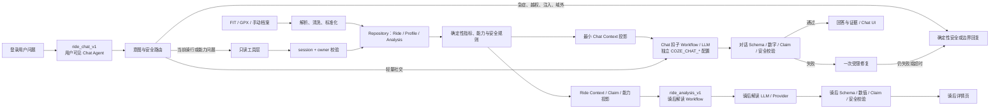
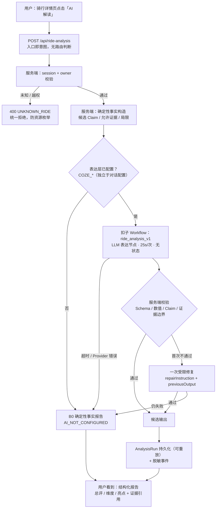
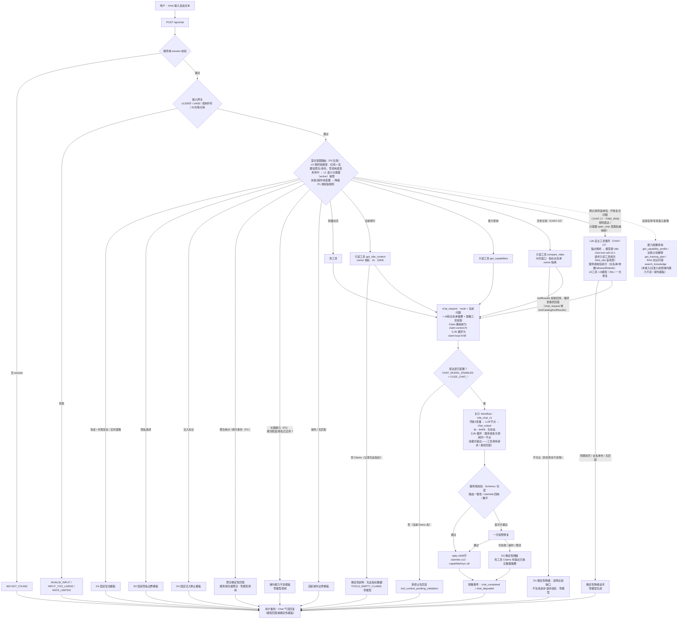
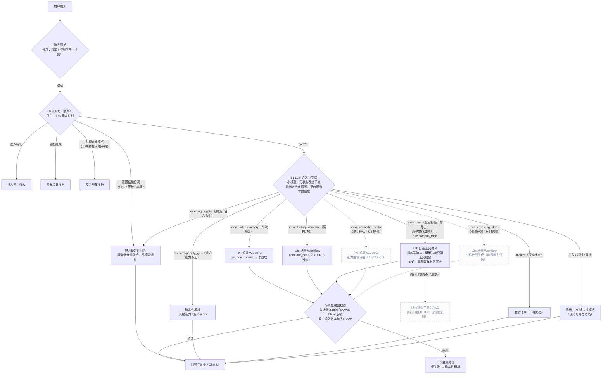

# AI 骑行伙伴 Agent 架构设计 v0.4

> 依据：PRD 6.5、6.6、6.7、7.2--7.10；`技术方案_AI骑行伙伴_v1.md`；`AI_AGENT_测评计划与记录.md`；`骑行水平能力评估模块设计.md`
> 更新日期：2026-09-10
> 状态：`Review`（v0.1 于 2026-09-05 用户验收通过；v0.2 于 2026-09-08 补充 M4 意图分支、人格统一、骑后追问规划；v0.3 于 2026-09-08 按用户指正重构第 3/4 节：明确"Agent=服务端编排循环、扣子 Workflow=无状态表达节点"分层，补两张完整 Agent 架构图与全部路由路径，并按代码事实修正路由集合与输出合同描述，第 6 节同步修正；v0.4 于 2026-09-08 新增 4.2.1 节“目标架构：混合意图路由”分层示意图与 CHAT-ADR-08，回应纯规则路由的结构性误路由（G-AGGREGATE/G-SAFETY-FP/G-NO-CLAIM/长期能力），`CHAT-12` 据此重定义为混合路由 POC；2026-09-09 v0.4 内修订：4.2 节按 P1 已实施代码事实重写为当前运行形态——删除过时的 v0.1 路由表与旧流程图，路由表对齐 `classifyChatInput` 实际优先级（新增 `aggregate`/`capability_gap`、共现安全收窄、空 Claims 短路、Claims 摘要降级），缺口清单转为六项修复记录（含 G-IDENTITY/G-REPAIR-FALLBACK）；同日 P3 交付后二次修订：4.2 节运行形态改为 P3 active 已生效，4.2.1 标题/设计原则与迁移路径 P2/P3 行更新为已交付——同日新增 4.2.2 节“会话内上下文合同”——`CHAT-14` 据用户确认排期，接通 `CHAT-05` 冻结的“最多六轮白名单摘要”留位，目标为本次会话内指代消解而非跨会话记忆；同日三次修订：2026-09-09 用户明确「CHAT-12 P3、CHAT-13 已验收」，P3 与 `CHAT-13` 相关表述由“已交付待验收”更新为已验收，并记录验收当日用户扣子侧以 v0.2 提示词重发布 `ride_chat_classifier_v1`（`@v0.0.2`）后重评 38/38 = 100% `PASS`（Run `AEVAL-CLASSIFIER-20260909054825`）——v0.2 边界迁移闭环）；同日 `CHAT-15` 验收后四次修订：4.2 节任务表与固定集表述随 v0.4 固定集（25→27 条）同步；同日 `CHAT-14` P1/P2 交付后五次修订：4.2.2 节会话内上下文合同按实施代码事实标注交付状态（P1 摘要传递 + P2 骑乘指涉解析，Prompt v0.1.5），第 5 节"骑乘锚点"段落由缺口描述改为已交付规则；同日 `CHAT-14` 验收与 P4 排期后六次修订：2026-09-09 用户明确「CHAT-14已验收」（扣子 Prompt v0.1.5 `@v0.0.4` 重发布后真实链路复验 70/70 路由、模型路径 30/30 首轮通过，Run `AEVAL-CHAT15-MATRIX-20260909135245`），4.2.2 节与迁移路径表 `CHAT-14` P1/P2 行更新为已验收并新增验收行；P4/L2b 排期同日启动（用户「下一步需要进行P4，L2b层的排期和开发、测试」）——迁移路径表 P4 行更新、`CHAT-16` 行置 `Ready`、新增 `CHAT-17`（L2b 自主工具循环）行，第 5 节 `find_ride` 行状态同步；同日七次修订：用户决策取消 `CHAT-16`（「不做 跨记录筛选/排名检索-`ride_search`这个路由场景了」，未启动开发即取消）——`find_ride` 并入 `CHAT-17` 作为 L2b 首个场景直接进只读工具白名单，M3 任务恢复 15 项全数完成、仅余里程碑收口（G3-C/G4-C 授权 + `chat_enabled` 放行决策）；4.2.1 节、迁移路径表与第 5 节 `find_ride` 行同步修正；2026-09-10 八次修订：M3 里程碑收口（真实模型固定集 Run `AEVAL-M3-CHAT-20260910-002` 27/27 全绿 `PASS`，G1-C–G4-C `ENGINEERING_PASS`）后用户决策 Demo 范围先行放行（`chat_enabled=true(demo_scope)`）；同日用户明确「启动 CHAT-17」——L2b 自主工具循环 P1–P10 交付（`autonomous_tools` 路由、`find_ride` 只读工具、`createChatToolLoopRunner`/`runAutonomousToolLoop` 编排循环、动态溯源、`toolCatalog`/`toolResults` 投影、固定集 v0.6（27→34）、Prompt v0.1.6、分类器标注集/Prompt v0.3 迁移），4.2.1 节设计原则与迁移路径表 `CHAT-17` 行更新为已交付，第 5 节 `find_ride` 行同步；扣子侧 Prompt v0.1.6/分类器 v0.3 重发布已完成（2026-09-10 用户执行：`ride_chat_v1@v0.0.5`——LLM 节点输出改文本模式，试运行首轮形状验证通过；分类器 `@v0.0.3`），固定集 v0.6 真实模型 Run 待用户授权；同日应用户要求新增 4.4 节"意图-路由-工具-工作流全景对照表"（按路由组织三表汇总运行时全景与规划中扩展）；同日按用户指正补全工作流分层——表 2 拆为 2a 扣子模型工作流（LLM 节点包装即一次模型调用）、2b L2a 场景 Workflow（实现 4 + M4 规划 2，服务端编排 + 场景工具 + 表达层）与 2c 非对话场景 Workflow，表 1 四个 L2a 行挂 `scene:*` 场景名、表 3 M4 行改指表 2b；同日按用户指正修正 `aggregate` 路由典型问法——4.2 节序 5 与 4.4 表 1 原将聚合统计（"我总共骑了多少"）、最近记录日期（"最近一次骑行是什么时候"）与骑行身份（G-IDENTITY，"当次是哪一次"）三类问法混列，现按性质分组标注。本设计定义 M3 的实现边界与 M4 的扩展边界；`chat_enabled` 当前为 `true(demo_scope)`（M3 收口用户决策，Demo 范围）。

## 1. 结论

AI 骑行伙伴是一个受控的骑行领域对话入口：它通过服务端只读工具获取用户自己的、已脱敏且可追溯的事实，通过规则和审核知识回答问题，并把语言表达交给受约束的 LLM。它不是通用聊天机器人，也不是骑后解读、训练计划或数据库访问的替代品。

当前运行时包含两条独立的 AI 链路：非对话的 `ride_analysis_v1` 骑后解读 Workflow，以及一个用户可见的 `ride_chat_v1` 对话 Agent。这里的“单 Agent”只指对话入口不拆分为多个自主协作 Agent；骑后解读不是对话 Agent，也不与对话共享会话或输出合同。两条链路共享身份边界、结构化事实、确定性规则和安全校验，但分别拥有独立的触发条件、输入输出合同、Feature Flag、降级和评测 Gate。拆分为“数据、教练、文案、审核”多个对话 Agent 会重复传递私有上下文，扩大权限、延迟和回滚面，而没有已验证的收益。

**人格统一约定**：产品视角只有一个“AI 骑行伙伴”。骑后解读报告与对话回答使用同一称呼、同一口吻基线和同一证据引用风格——骑后报告是“伙伴给你的报告”，对话是“你找伙伴聊”。人格统一只在表达层实现（共享的语气规范与措辞约束），不引入共享 Prompt 骨架、共享会话或共享运行时状态；两条链路的安全边界、校验与评测保持独立。

最小端到端价值：登录用户从一条已持久化的骑行记录出发，提出当前骑行问题，得到只基于其记录证据的回答；能力不足、越权、危险症状或工具失败时得到确定性、安全且不猜测的结果。

## 2. 与其他模块的关系

| 模块 | 对 Agent 提供什么 | Agent 可以做什么 | 明确边界 |
|---|---|---|---|
| 身份、会话与归属（M2 Foundation） | 服务端 session、资源 owner、删除传播 | 以 session 绑定访问范围 | 不接受模型或客户端指定的 `userId`；无权与不存在统一为 `NOT_FOUND` |
| 导入、Repository 与数据层 | 结构化 Ride、Profile、AnalysisRun；30 天保留和删除 | 读取最小字段、能力与质量状态 | 不直接查数据库，不读取原 FIT/GPX、精确坐标、完整时序或文件名 |
| 确定性指标与规则 | 原子能力、Claim、局限、历史可比性 | 引用现有 `claimId`，解释规则结果 | 不自行计算距离、功率、趋势、风险等级或用户能力总分 |
| 骑后 AI 解读 `ride_analysis_v1` | 共享确定性事实、Claim 和能力口径；骑后链路的已校验输出 | 与对话链路并行运行，各自完成本场景的解释和呈现 | 不作为聊天的隐式会话上下文；聊天不重复调用或改写骑后输出；聊天失败不得影响详情页 |
| 分享 | 已审核的低风险文案与展示事实 | 回答“这次能分享什么”或在未来生成受控表达 | 首期没有发布、发送、付费或任何写入工具 |
| 审核知识库 RAG | 带来源、版本、风险级别的骑行知识片段 | 在专项准入后回答通用概念问题 | M3 Demo 默认关闭；用户文本和检索片段都不能成为指令 |
| M4 训练与健康安全 | 未来由规则引擎输出的受限计划 | 仅解释已批准的规则输出 | 不诊断、不开处方、不决定强度/频次/恢复时长 |
| 评测与 Feature Flag | 固定集、硬门结果、`chat_enabled` | 在 Gate 通过后灰度提供对话 | Gate 未通过时服务端关闭，不因骑后 AI 通过自动开放 |

## 3. 系统边界与数据流（全局视图）

本节是**数据流视图**：回答"数据从哪里来、经过哪些层、到哪里去"，覆盖导入、指标、两条 AI 链路与 UI 的整体关系。两个 Agent 各自的内部结构（输入→路由→工作流→输出→用户可见内容）在第 4 节分述。



图中的两个 LLM 节点代表两条独立运行时链路；即使未来选择同一模型供应商，也不能因此视为同一个 Agent。骑后解读的 `AnalysisRun` 不会自动成为聊天上下文，聊天工具也不会触发或改写骑后解读。

`ride_chat_v1` 的扣子接入使用独立的 `COZE_CHAT_API_URL`、`COZE_CHAT_WORKFLOW_ID`、`COZE_CHAT_WORKFLOW_VERSION`、`COZE_CHAT_API_TOKEN` 与 `COZE_CHAT_MODEL_ID`。它的 Workflow 输入仅为 `chat_request`、`repair_instruction` 和 `previous_output`，输出节点为 `chat_output`（`ride-chat-output-v0.1` JSON）。这些配置、Prompt、运行记录和失败重试均不得复用骑后解读的 `COZE_*`、`COZE_INTERPRETATION_*` 或 `AnalysisRun`。

调用链的权限次序不可倒置：服务端先验证 session，再按 owner 加载资源，再生成最小工具结果，最后才允许模型看到数据。模型从不持有数据库凭据、OIDC token、原始文件或其它用户数据。

## 4. Agent 结构：编排层与表达层

两个 Agent 遵循同一分层原则：**Agent 是服务端的编排循环，扣子 Workflow 只是被调用的无状态 LLM 表达节点**。意图识别与路由、session/owner 校验、只读工具调用与数据投影、输出校验、受限修复与降级，全部在服务端代码中确定性执行；扣子 Workflow 仅在"需要 LLM 组织语言"时被调用（最多两次：首次 + 修复重试），输入是脱敏投影，输出是内部 JSON，不持有会话、凭据或用户数据。

| 层 | 位置 | 职责 | 明确不做 |
|---|---|---|---|
| 编排层（Agent 本体） | `src/ai/`、`src/chat/`、`app/api/*` | 输入网关、意图路由、工具调用与投影、Schema/Claim/数字校验、一次修复、降级、脱敏事件 | 不把自由文本、凭据或未投影数据交给模型 |
| 表达层（扣子 Workflow） | 扣子平台，`ride_analysis_v1` / `ride_chat_v1` 两个独立 Workflow | 按冻结 Prompt 把已验证事实组织为受约束 JSON | 不路由、不选工具、不校验、不保存状态、不重试 |

命名说明：对话 Agent 与它调用的扣子 Workflow 同名 `ride_chat_v1`，指**同一条链路的两个层**，不是同一个东西——"多意图"配置在服务端编排层的路由代码里（`src/chat/chat-routing.ts`），不在扣子 Workflow 里；扣子也不需要按意图配置多个 Workflow。`ride_analysis_v1` 不进入对话的意图路由：它由骑后解读入口直接触发，入口即意图，无需路由判断；两者可以复用同一套确定性事实构造器，但不共享会话、模型输出、重试状态或降级结果。

### 4.1 Agent 一：骑后解读 `ride_analysis_v1`



要点：

- **入口即意图**：按钮直接触发，没有也不需要意图路由——这是它与对话 Agent 的本质区别；
- **输入无自由文本**：模型只收到结构化事实投影（候选 Claim、允许证据、局限），没有注入面；
- **一次性、无会话**：无多轮、无会话状态，每次触发独立执行；
- **B0-first**：Provider 未配置、超时、错误或修复失败时，用户永远得到确定性事实报告（`AI_NOT_CONFIGURED` / `AI_TIMEOUT` / `PROVIDER_ERROR` / `REPAIR_FAILED`），不会得到空白或猜测内容；
- **产出可重放**：通过校验的输出按 session 归属持久化为 `AnalysisRun`，可审计、可重放。

### 4.2 Agent 二：骑行伙伴对话 `ride_chat_v1`

当前运行形态为 **CHAT-12 P3 已生效的混合意图路由**（`CHAT_CLASSIFIER_MODE=active`，2026-09-09 验收）：L0 规则层只拦 100% 确定红线与高置信聚合/身份（零调用直答），业务意图由 L1 语义分类器接管，失败/超时/限流/未配置降级回 P1 收窄版规则。相对 v0.1：新增 `aggregate` / `capability_gap` / `clarification` 三条零模型确定性路由，安全正则按共现定义收窄，`unclear` 意图触发澄清话术，红线意图语义纵深防御（`SEMANTIC_SAFETY_STOP`），空 Claims 短路，修复失败降级为 Claims 数据摘要，用户输入数字加入输出校验白名单。`CHAT-17`（2026-09-10 交付）新增 `autonomous_tools` 路由进入 L2b 自主工具循环（见下表序 7 与 4.2.1 节）——入口有二：L0 `FIND_RIDE` 规则（跨记录筛选/排名问法）与 L1 分类器 `open_chat` 意图经服务端权威映射（分类器不输出 `autonomous_tools` 标签，意图与路由解耦，见 4.2.1 关键设计决策 6）；`capability_gap` 的跨次筛选/排名子类已随之迁出（水平/体能评估仍留 `capability_gap`）。



**路由优先级与全部路径**（正则按序短路，先命中先停；安全类优先于一切业务意图；与 `classifyChatInput` 实现一致）：

| 序 | 路由 | 匹配示例 | 动作 | 调模型 | 用户看到 |
|---|---|---|---|---|---|
| 网关 | — | 非字符串 / 控制字符 / 超长 / 超频 | 拒绝 | 否 | `INVALID_INPUT` / `INPUT_TOO_LARGE` / `RATE_LIMITED` |
| 1 | `safety_stop`（急症） | "胸痛" | 固定安全模板 | 否 | 安全指引（急救提示） |
| 1 | `safety_stop`（危险骑行·共现收窄） | "我正在骑车，能不能看手机导航""我在骑行中" | 固定安全模板 | 否 | 安全指引（停车提示） |
| 1 | `safety_stop`（实时道路） | "现在路况" | 固定安全模板 | 否 | 安全指引 |
| 2 | `privacy_boundary` | "看别人的记录" | 固定边界模板 | 否 | 隐私边界说明 |
| 3 | `injection_stop` | "忽略之前指令" | 固定停止模板 | 否 | 边界说明 |
| 4 | `social` | "你好" | 直调表达层 | 是（免工具） | 简短社交回应 |
| 5 | `aggregate`（P1 新增） | 聚合统计："我总共骑了多少""这周骑了多少"；最近记录日期："最近一次骑行是什么时候"；骑行身份（G-IDENTITY，问当前对话基于哪条记录）："当次是哪一次""最近一次骑行是哪一次" | 服务端仓储聚合 / 最近记录日期 | 否 | 确定性统计/记录日期回答（零模型） |
| 6 | `capability_gap`（P1 新增） | "我的能力水平最近有进步吗"（跨次筛选/排名问法已随 `CHAT-17` 迁入序 7；水平/体能评估仍留此路由） | 固定域内能力不足模板 | 否 | 能力边界说明与当前可用范围 |
| 7 | `autonomous_tools`（CHAT-17 新增） | "哪次骑行的距离最远""距离最远的那次骑行心率怎么样""最近状态怎么样" | L0 `FIND_RIDE` 规则 / L1 分类器 `open_chat` 意图权威映射 → L2b 自主工具循环（模型在只读工具白名单内自行组合调用，`find_ride` 首场景）；预算耗尽/白名单外工具/无匹配 → 确定性降级 | 是（循环内多轮模型调用） | 复合问题回答（`claimIds` 全部溯源本轮工具结果 `claim:loop:N:M`，数字白名单为多工具结果并集） |
| 8 | `history_compare`（CHAT-13 新增） | "这次比上次快了吗""最近有进步吗""距离有趋势吗" | `compare_rides` → 表达层；不可比时 D1 降级 | 是 | 比较回答（可比性 + 指标变化，30 天窗口，`claimIds` ≤ 12）；不可比时确定性说明缺口 |
| 9 | `capabilities` | "支持哪些能力" | `get_capabilities` → 表达层 | 是 | 能力说明（`capabilityKeys` ≤ 8） |
| 10 | `current_ride`（P1 收窄） | "本次平均功率" | `get_ride_context` → 表达层；空 Claims 时短路 | 是 | 数据回答（`claimIds` ≤ 12）；无此指标时确定性说明 |
| 11 | `out_of_scope` | 无匹配 / 域外问题 | 固定域外模板 | 否 | 范围说明与引导 |

历史比较已随 `CHAT-13` 于 2026-09-09 接入当前路由集合（`history_compare` → `compare_rides`，见上表序 8；复用 M2 `MVP-REPEAT-01` 已交付的持久历史与版本化快照构建器；用户主动询问进步/趋势时才调用，不可比时按 D1 说明缺口；属 PRD v0.2 Alpha 工具链范畴，经验证的历史比较（真实用户 G3-C）仍属 v0.5 Beta）。L2b 自主工具循环已随 `CHAT-17` 于 2026-09-10 接入（`autonomous_tools` 路由，见上表序 7 与 4.2.1 节；`find_ride` 只读工具首场景，不预排工具调用顺序）。RAG、跨会话记忆和训练建议均不在当前路由集合。后续新增路由均为本对话 Agent 的意图分支，逐项走独立专项 Gate，未过准入前按"域内但能力不足"或域外边界模板回应：

- **能力画像查询**（`get_capability_profile`）与**训练计划解释/确认**（`get_training_plan` 及触发类工具）：随 M4 模块专项 Gate（`AI-CAP-01E`、`TRAIN-02/03`）接入，见第 10 节；
- **RAG 骑行知识库问答**（`search_knowledge`，工具合同见第 5 节）：按 Backlog `BX-RAG` 准入条件接入——至少 10 个答案明确问题的 Recall@3/引用评测通过、知识审核流程存在（CHAT-ADR-03）；知识片段带来源、版本与风险级别，作为数据进入表达层，不能成为指令。

路由缺口与修复记录（均由用户浏览器复核驱动确认，根因为纯规则路由的结构性局限；前四项 2026-09-08、后两项 2026-09-09 随 CHAT-12 P1 修复并回归验证）：

1. **G-AGGREGATE**（已修复）：聚合问题（"我总共骑了多少"）曾被 `CURRENT_RIDE` 宽词"骑了"误路由到最新一条记录，模型用单次数据回答总量问题 → 新增 `aggregate` 路由，服务端仓储聚合，零模型；
2. **G-SAFETY-FP**（已修复）：历史查询语境（"最近的骑行中，那次平均心率超 120？"）曾被裸词"骑行中"误拦截为安全停车 → `DANGEROUS_RIDING` 收窄为共现模式（第一人称/当前时间词紧邻），历史查询放行；
3. **G-NO-CLAIM**（已修复）：`get_ride_context` 返回空 Claims 时模型输出注定无法通过"claimIds 非空"校验 → 空 Claims 短路返回确定性"无此指标"说明（`TOOLS_EMPTY_CLAIMS`）；
4. **长期能力问题**（已修复）："我的能力水平最近有进步吗"曾被 `capabilities` 正则捕获并进入本次骑行工具 → 新增 `capability_gap` 路由，域内能力不足模板；
5. **G-IDENTITY**（已修复，2026-09-09）："当次是哪一次"等骑行身份问题曾被 `CAPABILITY_GAP` 的"哪一次"吞掉，误入长期分析模板 → `RIDE_IDENTITY` 句尾锚定正则，确定性回答最近一次记录日期；
6. **G-REPAIR-FALLBACK**（已修复，2026-09-09）：模型输出含未溯源数字（`OUTPUT_NUMERIC_UNSUPPORTED`）修复两次失败后仅显示空"安全校验"话术 → 降级为工具 Claims 确定性数据摘要（数字全部取自 `displayValue`）。

共同根因：**正则没有语境**（"骑行中"在"我在骑行中"与"最近的骑行中"里语义相反）、**宽词相互吞噬**（"骑了""骑行"必然吞掉聚合/历史/能力等其他意图，规则越多冲突面越大）、**路由粒度不等于能力粒度**（`current_ride` 只说明"与骑行相关"，不携带"单次/跨次/聚合/比较"维度，而工具能力恰按此划分）。规则层修复是止血（P1 基线不能是错的）；语义歧义类问题的根治依赖 L1 分类器，见 4.2.1 节。

### 4.2.1 目标架构：混合意图路由（v0.4，`CHAT-12` POC；P1/P2/P3 已验收，P4 已交付（`CHAT-17` L2b 自主工具循环，2026-09-10 `Review` 待验收；`CHAT-16` 已取消、`find_ride` 并入 `CHAT-17`），CHAT-ADR-08）

设计原则：把"确定性"从"全链路规则路由"收敛为**"关键红线 + 失败兜底"**，把"语义消歧"交给**小模型分类器**，把"执行"按**场景分化**。**P1/P2/P3 已于 2026-09-09 获用户验收（「CHAT-12 P3、CHAT-13 已验收」）**（4.2 节所述当前形态；验收当日用户在扣子侧以 v0.2 提示词重发布 `ride_chat_classifier_v1`（`7683216984188616723@v0.0.2`）并重评 38/38 = 100%、red-team 6/6 零失误、verdict `PASS`（Run `AEVAL-CLASSIFIER-20260909054825`），v0.2 边界迁移闭环）：L1 分类器先以影子模式验证（P2，真实评测 38/38 = 100%、red-team 零失误），后在 `CHAT_CLASSIFIER_MODE=active` 下接管主路由（P3），失败/超时/限流/未配置一律降级回 P1 收窄版规则；L2b 自主工具循环（P4）已交付（2026-09-09 用户确认「下一步需要进行P4，L2b层的排期和开发、测试」；2026-09-10 用户明确「启动 CHAT-17」后 P1–P10 同日交付，`Review` 待验收；原路线 A“先工具后 L2b”经 2026-09-09 用户决策调整——不做 `ride_search` 路由场景，`CHAT-16` 取消）：`CHAT-17`（L2b 自主工具循环 + `find_ride` 只读工具首个场景）落地为 `autonomous_tools` 路由（L0 `FIND_RIDE` 规则 + L1 `open_chat` 权威映射）——分类器决定“谁来答”，L2b 在只读工具白名单与既有预算内决定“怎么取数”，Claims 溯源白名单随本轮工具返回动态构建（校验硬门不放宽）；固定集 v0.6（34 条）与分类器标注集/Prompt v0.3 已随交付冻结，扣子侧 Prompt v0.1.6/分类器 v0.3 重发布与真实模型 Run 待用户授权。



分层职责与边界：

| 层 | 位置 | 职责 | 明确不做 |
|---|---|---|---|
| L0 规则层 | 服务端代码（`classifyChatInput` 收窄版） | 注入/隐私红线、共现安全模式、高置信聚合快捷路径（零延迟零成本） | 不再承载业务意图主路由；移除"骑行中/骑了/看手机"等裸词，安全拦截改为共现模式（如"正在骑车"+"看手机"） |
| L1 LLM 语义分类器 | 扣子 Workflow（无状态表达节点，独立 `COZE_CHAT_*` 配置族） | 语义消歧主路由：输出结构化意图 `{intent, needsClarification}`，**意图标签 ≠ 路由**——11 标签集合（`CHAT-16` 取消时冻结"不新增第 12 类"）与路由集合解耦，经服务端权威映射落路由：`open_chat` → `autonomous_tools`（纯问候 `social`/域外 `out_of_scope` 由 L0 快路径与映射分流，影子对照三向均计一致）；`unclear` 为显式合法输出并触发澄清话术 | 不自报数字置信度（快速模型校准不可信）；输入仅当前问题文本与摘要槽位，不含私有数据；不生成用户可见回复；执行策略演进（如 L2b）不触发标签扩类，仅需边界迁移重评（v0.3：筛选/排名子类 `capability_gap`→`open_chat`，38 例规模不变） |
| L2a 场景 Workflow | 服务端编排 + 场景工具 + 表达层 | 每场景独立的工具投影、输出合同与 Claim 溯源闭环（比较场景溯源比较结果，聚合场景溯源聚合值） | 场景间不共享上下文、不越场景取数；未接入场景按"域内但能力不足"模板回应 |
| L2b 自主工具循环 | 服务端编排循环（`ride_chat_v1` 同一 Agent 的执行策略扩展） | 模型在只读工具白名单与既有预算内自行组合调用，回答开放/复合问题（如“我最近状态怎么样？”）；候选首个场景：跨记录筛选/排名（“哪次骑行的距离最远”类单跳检索；原“先经 `CHAT-16` 以 L2a 模式交付”已取消——2026-09-09 用户决策不做 `ride_search` 路由场景，`find_ride` 只读工具随 `CHAT-17` 直接交付进白名单——见迁移路径表） | 不新增对话 Agent（CHAT-ADR-01 不变）；不做写操作；每轮工具数、单工具预算与总时限不变 |
| （虚线）后续场景扩展 | 规划中，不入当前运行时 | 能力评估场景（消费 `AI-CAP-01` 画像数据 → 水平结论）；训练计划场景（依赖能力评估结论生成计划）；RAG 骑行知识检索（进入只读工具白名单，L2b 与场景 workflow 复用） | 图中虚线表达：均须过 M4 意图分支专项准入后转实线；`CHAT-12` POC 不实现 |

图中虚线节点为后续规划能力，与实线部分遵循同一架构契约：能力评估与训练计划作为新的 L2a 场景 workflow 接入（前者消费 `AI-CAP-01` 设计的画像数据，后者依赖其结论），RAG 作为只读检索工具进入既有工具白名单（L2b 自主循环与场景 workflow 均可调用，知识库范围与溯源规则随准入一并冻结）；三者均受 M4 意图分支专项准入门控，虚线仅表达架构占位，不改变 `CHAT-12` POC 的明确非目标。

关键设计决策：

1. **与第 4 节分层原则一致**：分类器是又一个被服务端编排调用的无状态 LLM 表达节点；L2b 是同一编排循环的执行策略扩展，不是新 Agent。CHAT-ADR-01"单对话 Agent"与 CHAT-ADR-06"规则引擎为唯一事实源"均不变——分类器只决定"谁来答"，不产生任何事实。
2. **置信度设计**：不使用模型自报数字置信度（快速模型校准差，数字本身不可信）；以结构化 `unclear` + 澄清话术替代——一次澄清往返的成本远低于答错，澄清是混合架构新增的一等路径。
3. **失败保底**：分类器失败/超时/限流一律降级为 P1 确定性模板（即当前行为的收窄版）；混合架构任何时刻不劣于纯规则基线的可用性。
4. **输出校验场景分化**（G-NO-CLAIM 与"阈值 120"教训）：用户输入中的数字加入白名单（用户给定值不是幻觉）；Claims 溯源在各场景内闭环；L2b 的溯源规则随工具返回动态构建。
5. **评测配套**：路由断言从确定性正则演进为"分类器专项标注集准确率（影子模式验证，门槛 ≥95%）+ 场景输出校验固定集"；零调用预检继续覆盖 L0 与各场景确定性部分；固定集 v0.2 增 7 条案例（2 长期能力 + 1 空 Claims + 1 聚合路由 + 1 历史查询语境安全回归 + 2 骑行身份）。
6. **意图标签与路由解耦**（`CHAT-17` 确立）：分类器回答"用户想干什么"（意图标签，11 类），路由决定"谁来答、怎么取数"（执行策略），二者经服务端权威映射衔接（`chat-classifier.ts`：`open_chat` → `autonomous_tools`）——分类器标签集合不含 `autonomous_tools`。三点依据：① 执行策略演进（如 L2b 落地）不触发分类器标签扩类与 38 例标注集全量重评（95% 门槛），仅需边界迁移（v0.3 筛选/排名子类 `capability_gap`→`open_chat` 改标，规模不变）；② `open_chat` 涵盖开放方向的三向去向（纯问候 `social` / 域外闲聊 `out_of_scope` / 开放复合问题 `autonomous_tools`），单一标签与路由一对一无法表达；③ `ride_chat_v1` 表达层只感知最终 `route`，与 L0 `FIND_RIDE` 规则直达、L1 映射两条来路解耦——分类器决定"谁来答"，L2b 决定"怎么取数"，两层各自演进互不牵连。

迁移路径（每阶段可独立回退；影子模式先验证后切换，避免把不可靠分类器直接推向用户）：

| 阶段 | 内容 | 验证点 |
|---|---|---|
| P1（已交付 2026-09-08/09） | 规则收窄：共现安全模式、`CURRENT_RIDE` 宽词移除、聚合服务端路由（替换 `/chat` 页临时客户端拦截 `deterministicAggregateReply`）、空 Claims 模板、长期能力拆分、骑行身份路由（G-IDENTITY）、修复失败 Claims 摘要降级（G-REPAIR-FALLBACK） | 六项缺口（4.2 节修复记录）不再误答；固定集 v0.2（22 条）零调用预检、378/378 回归、typecheck、build 全过 |
| P2（已交付 2026-09-09，真实评测 38/38 = 100%、red-team 零失误、Run `PASS` 归档，用户已确认收口） | 分类器影子模式：只记录分类日志不生效 | 专项标注集准确率 ≥95% 报告（`eval/runs/AEVAL-CLASSIFIER-20260908174430.json`） |
| P3（已验收 2026-09-09，active 模式浏览器 E2E 通过） | 分类器接管主路由（`resolveActiveChatRouting`：L0 快路径 → L1 接管 → 失败降级 P1 规则）；澄清路径（`clarification` 路由 + `CLARIFICATION_NEEDED` 模板，零模型调用）与校验分化（用户输入数字白名单贯通全部分支）生效；事件属性 `routedBy` 区分 `rules_l0` / `classifier` / `rules_fallback` | 402/402 回归（新增 16 例：routing/classifier/agent/output-validation/route 五组）；双预检（22 固定集 + 38 分类集）零调用；build 通过；E2E 四场景：澄清接管、口语化语义接管（「这趟骑得咋样」→ `ride_summary`）、L0 零调用直答、真实超时降级（`MODEL_TIMEOUT` → 规则保底）。注：聚合/单次解读场景经 P3 意图映射接入（聚合保持零模型直答、单次解读走 `get_ride_context` → 表达层） |
| P4（已交付 2026-09-10，`CHAT-17` P1–P10 交付完成 `Review` 待用户验收；排期启动 2026-09-09，用户确认「下一步需要进行P4，L2b层的排期和开发、测试」；同日调整——用户决策取消路线 A 中 `ride_search` 路由场景，`CHAT-16` 取消） | `CHAT-17`（L2b 自主工具循环，模型在只读工具白名单与既有预算内自行组合调用，不计入 M3）：`find_ride` 只读工具已随本任务交付进白名单作首个场景（指标枚举 + 极值/阈值模式 + 30 天窗口上限，owner 隔离，`claim:find:*` 溯源；`capability_gap` 筛选/排名子类已随标注集 v0.3/Prompt v0.3 迁入 `open_chat`）；交付明细见下一行 `CHAT-17` 行 | `CHAT-17`：工具循环预算内行为与动态溯源审计、检索结果 Claim 溯源、标注集/Prompt 迁移（已完成零调用预检，真实链路重评待扣子侧重发布后授权） |
| `CHAT-13`（已验收 2026-09-09） | 历史比较作为 P3 后第一个新增场景接入：`history_compare` 路由 + `compare_rides` 只读工具 + 编排层 D1 降级与比较 Claim 溯源；另交付分类器 v0.2 边界迁移（标注集 4 例重冻结 + Prompt `ride-chat-classifier-prompt-v0.2`，用户扣子侧重发布 `@v0.0.2` 后重评 38/38 = 100% `PASS`、red-team 6/6 零失误，Run `AEVAL-CLASSIFIER-20260909054825`） | 411/411 回归、双预检（25 固定集 + 38 分类集）零调用、build、浏览器 E2E 可比/不可比/边界；见开发规划 `CHAT-13` 验收矩阵 |
| `CHAT-14` P1（已验收 2026-09-09，设计见 4.2.2 节） | 会话内上下文：摘要槽位升级（`question` ≤120 字 + `route` + `rideAnchor`）随请求传递、网关校验（`sanitizeChatSummaries`）与非法静默丢弃（事件 `summariesDropped`）、`chat_request` 增 `sessionSummaries` 投影（XML 包裹，Coze/Http provider 均接）、Prompt v0.1.5 上下文使用规则；分类器输入合同不变 | 摘要伪造/注入样例降级或拦截；`summariesCount` 事件可见；固定集 v0.4 案例与预检（27 条零调用） |
| `CHAT-14` P2（已验收 2026-09-09） | 骑乘指涉解析（`G-RIDE-DEIXIS`，`chat-ride-anchor.ts`）：编排层骑乘锚点（确认轮覆写/显式日期/显式序数/上下文继承，覆盖 `current_ride`/`history_compare`/`get_capabilities`）、“本次/这次/裸指标词”无锚点确认话术（`TOOLS_ANCHOR_CLARIFY` 零模型调用）与确认轮完成挂起问题、日期解析选择本人记录（无匹配澄清）、`RIDE_IDENTITY` 锚点化、锚点以记录日期存储（新导入不偷换，删除后 `NOT_FOUND` 重新澄清） | “本次”不再静默锚定最新；无锚点确认与日期选择回归通过；固定集 v0.4 指涉类案例（`CHAT-REG-17/18`） |
| `CHAT-14` 验收（2026-09-09 用户「CHAT-14已验收」） | 扣子侧 Prompt v0.1.5 重发布 `ride_chat_v1@v0.0.4` 后真实链路复验（active 分类器 + 真实模型，9 条本人记录，70 样本 7 问题矩阵）：路由 70/70、模型路径 30/30 首轮通过、numeric-failures=0（Run `AEVAL-CHAT15-MATRIX-20260909135245`，复验记录见测评计划 9.6.2 节）；“本次骑行的平均功率”按 P2 规则返回 `TOOLS_ANCHOR_CLARIFY` 零模型确认（20/20），P1 摘要投影经真实 Workflow 往返无校验失败；P4/L2b 排期随验收启动 | `CHAT-16` 已取消（`find_ride` 并入 `CHAT-17`）、`CHAT-17` 定义冻结（见下两行） |
| `CHAT-14` P3（后续评估） | 分类器输入合同 v0.2：`classify_request` 增最近 ≤2 条摘要，完全指代类问题（“那这次呢”）路由准确率 | 分类器 v0.2 边界迁移重评已完成（38/38 = 100% `PASS`，Run `AEVAL-CLASSIFIER-20260909054825`），条件已具备可排期；分类器专项标注集增指代类样例 |
| `CHAT-16`（`Cancelled` 2026-09-09：用户决策「不做 跨记录筛选/排名检索-`ride_search`这个路由场景了」，未启动开发即取消） | 原定义（`find_ride` 只读工具 + `ride_search` 路由 L2a 单跳交付）取消——`find_ride` 并入 `CHAT-17` 作为 L2b 首个场景直接进只读工具白名单；`capability_gap` 对“跨次筛选/排名”的**临时归置**维持现状，待 `CHAT-17` 交付时随迁移（分类器标注集与 Prompt 届时调整，水平/体能评估仍留 `capability_gap`）；原定义快照见 git 历史 | （已取消，无交付验证点） |
| `CHAT-17`（已交付 2026-09-10，`Review` 待用户验收；P4，不计入 M3） | L2b 自主工具循环已落地：`autonomous_tools` 路由（L0 `FIND_RIDE` 规则 + L1 分类器 `open_chat` 权威映射）；模型在只读工具白名单与既有预算内（每轮工具数上限 3、模型调用 ≤5、单工具 2 秒/32 KB、整轮总时限 30 秒、一次受限修复）经 `ride-chat-tool-call-v0.1` 协议自行组合调用回答开放/复合问题；`find_ride` 只读工具进白名单作首个场景（指标枚举/极值/阈值/30 天窗口，owner 隔离，`claim:find:*` 溯源；`CHAT-16` 取消后并入）；`chat_request` 增 `toolCatalog`/`toolResults` 投影（Coze/Http 均接）；Claims 溯源白名单随工具返回动态构建（`loopNumbersAreSupported` 多工具并集 + `claim:loop:N:M` 映射，校验硬门不放宽）；越权锚点经 `allowedRideIds` 拦截（锚点记录 + `find_ride` 命中记录）；循环轨迹审计事件（`loopStatus`/`loopToolCalls`/`loopProviderCalls`/`loopSteps`）；预算耗尽/白名单外工具/无匹配 → 确定性降级；L0 红线/L1 分类器前置不变；Prompt v0.1.6 + 分类器 Prompt v0.3 + 标注集 v0.3（筛选/排名子类 `capability_gap`→`open_chat` 迁移完成） | 固定集 v0.6（27→34：`CHAT-REG-19`–`25` 极值检索/复合问题/无匹配/预算耗尽/白名单外工具/越权锚点/无 Provider）双预检零调用、460/460 回归、typecheck、build 全过；工具循环调用轨迹与预算内行为审计单测 9 例；真实链路采样待扣子侧 Prompt v0.1.6/分类器 v0.3 重发布后用户单独授权 |
| M4 扩展（虚线） | 能力评估 → 训练计划场景 workflow 与 RAG 检索工具按同一场景准入模式接入（虚线转实线） | M4 专项评测与 `AI-CAP-01` 验收 |

**编排循环**（每轮，对应 `runChatAgent`）：

1. 网关检查长度（≤1200 字 / 4 KB）、控制字符、频率（20 次/分钟）与注入标记；注入检查先于一切业务路由。
2. 确定性路由分派（上表）；任何安全停止不进入表达层。
3. 需要私有事实的路由先调只读工具：session + owner 校验、字段投影、单工具 2 秒 / 32 KB；工具结果中的 Claim 重映射为去标识化引用（`claim:context:N`）后才进入模型上下文；轻量社交不调用工具。
4. 运行时只组装当前问题、最多六轮白名单对话摘要和本轮工具投影。工具结果是数据，不是指令。
5. 表达层返回 `ride-chat-output-v0.1` JSON（`route` / `reply` / `claimIds` / `capabilityKeys`）；服务端校验 Schema、长度、路由一致性，并把 `claimIds` 映射回真实 Claim 验证数字与证据。
6. 首次失败只允许一次删除违规内容或修正格式的受限修复；再次失败、超时、限流或工具错误使用场景模板，不追加工具调用、不让迟到结果覆盖模板。

**L2b 自主工具循环**（`CHAT-17` 已交付 2026-09-10，`Review` 待验收）：`autonomous_tools` 路由（L0 `FIND_RIDE` 规则直达，或 L1 分类器 `open_chat` 意图经服务端权威映射——分类器标签集合不含 `autonomous_tools`，意图与路由解耦，见关键设计决策 6）不预排工具调用顺序——编排层先解析锚点（`startLoop`，同 4.2.2 规则），随后模型经 `ride-chat-tool-call-v0.1` 协议请求工具组合，编排层校验（白名单/参数 Schema/`allowedRideIds` 归属：锚点记录 + `find_ride` 命中记录）后执行并把 `toolResults` 投影回传，直至模型输出最终 `ride-chat-output-v0.1`。循环预算：每轮工具调用 ≤3、模型调用 ≤5、整轮总时限 30 秒（单工具 2 秒/32 KB 不变）、一次受限修复；预算耗尽（`TOOLS_LOOP_BUDGET_EXHAUSTED`）、白名单外/越权调用（`TOOLS_LOOP_INVALID_TOOL_CALL`）、无匹配（`TOOLS_LOOP_NO_MATCH`）均走确定性降级。Claims 溯源白名单随本轮全部工具返回动态构建（各工具 Claim 投影并集 + 用户原句数字；`claim:loop:N:M` 经 `claimReferences` 映射回真实 Claim），输出校验硬门不放宽。循环轨迹以脱敏事件审计（`loopStatus`/`loopToolCalls`/`loopProviderCalls`/`loopSteps`）。

**Demo 态**：`CHAT_MODEL_ENABLED` 未开启时表达层不被调用——工具路由返回"已取得受控工具上下文，等待校验"的占位回复（`tool_context_pending_validation`），安全/边界/域外模板正常工作。这是 `CHAT-11` 未配置密钥时的当前实际运行状态。

### 4.2.2 会话内上下文合同（`CHAT-14`，2026-09-09 用户确认排期，同日 P1/P2 交付并经用户验收「CHAT-14已验收」（Prompt v0.1.5 `@v0.0.4` 真实链路复验，Run `AEVAL-CHAT15-MATRIX-20260909135245`）；接通 `CHAT-05` 冻结的“最多六轮白名单摘要”留位；同日用户指正补充骑乘指涉解析——“本次/这次”不得默认等于最新记录，`G-RIDE-DEIXIS`）

**定位**：模型获得**本次会话内**的指代消解能力——理解"那这次呢？""再详细点"这类延续性追问；**不是跨会话记忆**。跨对话、跨浏览器、服务端持久化或任何长期画像均为冻结非目标（`CHAT-06` 边界不变：对话记录仅存用户本地浏览器 localStorage）。

**原缺口（P1/P2 已实施修复，2026-09-09）**：`/api/chat` 请求体仅传当前问题 `{text}`、模型每轮只见当前问题与本轮工具结果、指代类追问落入澄清话术——已由摘要传递链路（下）修复；编排层对全部工具调用硬编码最新一条记录为锚点（`listRides(owner)[0]`），"本次/这次"与裸指标词均被静默锚定最新——已由骑乘指涉解析（`G-RIDE-DEIXIS`，下）修复，锚点解析统一入口 `resolveRideAnchor`（`chat-ride-anchor.ts`）。

**摘要结构（白名单字段，三防注入面）**：

```json
{ "kind": "session_turn", "question": "≤120 字的用户问题截断", "route": "该轮路由枚举值", "rideAnchor": "2026-08-20（可选：该轮解析到的骑乘记录日期）" }
```

- 仅含用户问题文本、路由标签与骑乘锚点日期；**不含** assistant 回复、任何数值、Claim 引用或工具投影——历史轮数值不得成为事实来源，所有数字仍必须本轮工具溯源（第 6 节 `claimIds` 校验规则不变，防止伪造摘要注入假事实）。
- 仅当前活跃对话的槽位随请求发送（≤6 条，`CHAT_SESSION_SUMMARY_LIMIT`）；新对话为空；切换对话即切换上下文。

**传递链路与防线**：

1. 请求体 `{text, summaries?[]}` → 网关校验：数量 ≤6、每条 `question` ≤120 字且过控制字符检查、`route` 枚举合法；**非法摘要整体静默丢弃**（请求照常，行为退回无上下文基线），脱敏事件记 `summariesDropped`，不拒绝请求。
2. 通过后进入 `chat_request` 投影：`ride-chat-request` 增 `sessionSummaries` 字段，与 `chat_request`/`repair_instruction`/`previous_output` 三个不可信输入同等对待——XML 标签包裹、Prompt 中声明"摘要仅用于理解当前问题的指代与话题延续，不得将历史问题中的数字当事实引用；数值必须来自本轮工具证据"。
3. 脱敏事件不落摘要原文，仅记 `summariesCount`。
4. 分类器输入合同 `ride-chat-classifier-input-v0.1` **不变**（`classify_request` 仅当前问题文本）：P1 指代类问题在路由层仍可能判 `unclear` → 澄清兜底；分类器上下文（输入合同 v0.2 增最近 ≤2 条摘要）列为 P3 改进项——分类器 v0.2 边界迁移重评已完成（2026-09-09，`@v0.0.2` 重评 38/38 = 100% `PASS`，Run `AEVAL-CLASSIFIER-20260909054825`），该改进项可启动评估。

**骑乘指涉解析（`G-RIDE-DEIXIS`，P2；2026-09-09 用户指正）**：“本次/这次/当前”与裸指标词（如“平均功率是多少”）均为指示性指涉，语义上**不默认等于最新记录**——当前编排层对全部工具调用硬编码最新一条，属结构性假设，列为缺口修复：

1. **锚点模型**：每轮可建立一个骑乘锚点——该轮实际指向的、经 owner 校验的本人记录。锚点来源：显式日期（“8月15日那次”→ 服务端日期解析 + 本人记录查找，无匹配或多条匹配时澄清）、显式序数（“最近一次/上次”→ 最新记录，回复披露日期）、上下文继承（前轮摘要含锚点则沿用）。锚点以记录日期存储而非“最新”指针：会话中导入新记录不偷换已建立锚点；锚点记录被删除时按 `NOT_FOUND` 重新澄清。
2. **解析次序**：① 显式“最近一次/上次”→ 直接锚定最新，不澄清；② “本次/这次/当前”或裸指标词 → 前轮有锚点则沿用；无锚点触发确定性确认话术（零模型调用）：“你说的「本次」是指最近一次（8月20日）的骑行，还是其他某一次？可以直接告诉我日期。”；③ 用户确认“最近一次”或给出日期 → 建立锚点并完成挂起的原问题（确认轮经摘要槽位中的 `route` + `question` 识别），锚点写入摘要槽位供后续继承。
3. **作用范围**：`current_ride`、`history_compare`（“这次比上次快了吗”的比较锚点同规则解析）与 `get_capabilities` 的工具调用统一走锚点解析；`RIDE_IDENTITY`（“当次是哪一次”）改为按锚点应答，无锚点时答“当前按最近一次（日期）处理，如指其他骑行请告诉我日期”。
4. **安全与校验**：`rideAnchor` 为客户端输入，仅用于服务端 owner 范围内的记录选择（日期解析 → 本人记录查找）；伪造锚点最坏导致选错本人记录或无匹配重新澄清，无越权面；回复数值仍必须来自本轮工具 Claims（第 6 节不变）。
5. **完全指代类问题**（“那这次呢”“再详细点”——维度亦随前文）：需分类器输入合同 v0.2（含最近摘要）或 L2b 自主循环，随 P3/后续评估交付，不随 P2。

**分层影响**：L0/L1 路由决策只看本轮 `text`（摘要不参与路由，伪造 `route` 字段无攻击面）；`question`/`route` 进入 L2a 表达层模型上下文，`rideAnchor` 供编排层做骑乘锚点解析（服务端 owner 范围内记录选择，路由之后、工具调用之前）；`chat_requested`/`chat_completed` 事件增 `summariesCount` 属性。运行时控制线（4.3 节）不变——摘要传递与锚点解析不增加任何工具/模型调用与时长（锚点未解析时的确认话术为零调用确定性回复）。

### 4.3 运行时控制线

对话链路：每轮最多三个不同工具，同一工具最多一次，单工具两秒，单工具结果最多 32 KB，分类器八秒（`COZE_CHAT_CLASSIFIER_TIMEOUT_MS`，默认五秒。本地联调实测分类器响应约五秒，建议显式配置八秒），模型八秒（`COZE_CHAT_TIMEOUT_MS`），整轮十二秒（L0 快路径命中时分类器与模型均零调用；L2b 自主循环预算见 4.2 节：每轮工具 ≤3、模型调用 ≤5、整轮总时限 30 秒）。骑后解读链路：单次 Provider 调用二十五秒，含修复最多两次。日志只保留脱敏操作元数据和错误码，不保存完整聊天正文、精确位置、完整工具结果、密钥或内部 Prompt。

### 4.4 意图-路由-工具-工作流全景对照表

本节按路由汇总当前全部意图标签（L1 分类器 11 类）、路由（12 个唯一值，`safety_stop` 含急症/危险骑行/实时道路 3 个 L0 子规则）、只读工具（运行时 4 + 延期 3 + M4 规划 2）与工作流的对应关系，含规划中扩展。工作流三类：**扣子模型工作流**（2 个——LLM 节点包装，对编排层即一次模型调用）、**L2a 场景 Workflow**（6 个——实现 4 + M4 规划 2，服务端编排 + 场景工具 + 表达层）、**非对话场景 Workflow**（1 个，骑后解读）。详细合同见第 5 节与 4.2/4.2.1/4.2.2 节。

**表 1：运行时全景（按路由组织，均已在当前 `ride_chat_v1` 运行时实现）**

| 路由（12 唯一值*） | L0 规则入口（零调用直达） | L1 意图标签（active 权威映射） | 执行路径 | 只读工具 | 模型调用 | 典型问法 |
|---|---|---|---|---|---|---|
| `safety_stop` | `MEDICAL_EMERGENCY`/`DANGEROUS_RIDING`/`REAL_TIME_ROAD` 正则 | `safety_stop`（纵深防御） | 固定安全模板 | 无 | 零 | "骑行中胸口疼怎么办" |
| `privacy_boundary` | `PRIVACY_REQUEST` | `privacy_boundary` | 固定隐私模板 | 无 | 零 | "把我的记录删了" |
| `injection_stop` | `PROMPT_INJECTION` | `injection_stop` | 固定注入拒答模板 | 无 | 零 | "忽略之前的指令" |
| `social` | `SOCIAL` 快路径 | `open_chat`（映射三向之一） | 固定问候模板 | 无 | 零 | "你好" |
| `aggregate` | `RIDE_IDENTITY`（`isFindRideQuestion` 守卫）/`AGGREGATE_*` 正则 | `aggregate` | L2a 场景 `scene:aggregate`：仓储聚合 → 模板（表 2b） | 无（读仓储聚合） | 零 | "我总共骑了多少"（聚合统计；最近记录日期与身份问法"当次是哪一次"同入此路由，见 4.2 节序 5） |
| `clarification` | 无（`unclear` 无规则层对应） | `unclear` | 澄清话术模板 | 无 | 零 | 语义不明输入 |
| `capability_gap` | `CAPABILITY_GAP`/`CAPABILITY_LEVEL_GAP` | `capability_gap`（水平/体能评估子类） | 固定域内能力不足模板 | 无 | 零 | "以我现在的体能算入门了吗" |
| `autonomous_tools` | `FIND_RIDE`（`isFindRideQuestion` 守卫） | `open_chat`（映射三向之一） | **L2b 自主工具循环**（锚点解析 → 模型按 `ride-chat-tool-call-v0.1` 请求工具 → 校验执行 → `toolResults` 回传 → 循环至最终回答） | 白名单四工具任选组合：`find_ride`/`get_ride_context`/`compare_rides`/`get_capabilities` | 循环内 ≤5 次 | "距离最远的那次骑行心率怎么样" |
| `history_compare` | `HISTORY_COMPARE` | `history_compare` | L2a 场景 Workflow `scene:history_compare`（表 2b） | `compare_rides` | 1 次 | "这次比上次快了吗" |
| `capabilities` | `CAPABILITIES` | `capabilities` | L2a 场景 Workflow `scene:capabilities`（表 2b） | `get_capabilities` | 1 次 | "支持哪些能力" |
| `current_ride` | `CURRENT_RIDE`（锚点解析见 4.2.2） | `ride_summary` | L2a 场景 Workflow `scene:ride_summary`（表 2b） | `get_ride_context` | 1 次 | "本次平均功率" |
| `out_of_scope` | 兜底（无匹配） | `out_of_scope` | 固定域外模板 | 无 | 零 | 域外闲聊/无匹配问题 |

> *表 1 脚注：`ChatRoute` 类型共 12 个唯一路由值；`safety_stop` 同名含急症 / 危险骑行（共现收窄）/ 实时道路 3 个 L0 子规则，判定分支合计 13——若按这个口径计数即 13 个。表中一并列出 L0 规则入口对此 3 子规则的三个正则。

路由来源说明：L0 与 L1 是同一路由的两条来路（L1 active 模式接管业务意图，失败/超时/限流/未配置降级回 L0 收窄版规则）；红线三条与 `social`/`aggregate` 等高置信项 L0 零调用直答不经分类器。`autonomous_tools` 无自己的意图标签——`open_chat` 经服务端权威映射进入，纯问候/域外闲聊同标签下分流（关键设计决策 6）。

**表 2：工作流全景**（三类；扣子侧 LLM 节点均为无状态表达节点，服务端不感知其内部编排）

*表 2a 扣子模型工作流（LLM 节点包装——对编排层而言实际是一次模型调用）*

| 工作流 | 角色 | 输入 → 输出 | Prompt | 已发布版本 |
|---|---|---|---|---|
| `ride_chat_v1` | 表达层模型节点（L2a 各场景共用 + L2b 循环内每轮调用同一节点） | `chat_request`（route + 问题 + 摘要 + 脱敏工具投影）→ 文本双模式输出：`ride-chat-output-v0.1`（最终回答）/ `ride-chat-tool-call-v0.1`（工具调用请求） | `ride-chat-workflow` v0.1.6 | `@v0.0.5` |
| `ride_chat_classifier_v1` | L1 语义分类模型节点 | 当前问题文本 → `{intent, needsClarification}`（11 标签， | `ride-chat-classifier-prompt` v0.3 | `@v0.0.3` |

*表 2b L2a 场景 Workflow（服务端编排 + 场景工具 + 表达层；每场景独立的工具投影、输出合同与 Claim 溯源闭环，场景间不共享上下文、不越场景取数）*

| 场景 | 场景工具 | 表达层 | 溯源闭环 | 状态 |
|---|---|---|---|---|
| `scene:ride_summary` | `get_ride_context` | `ride_chat_v1` 单次 | 工具 Claims（`claim:context:N`） | 实现 |
| `scene:capabilities` | `get_capabilities` | `ride_chat_v1` 单次 | 工具 Claims（`claim:context:N`） | 实现（4.2.1 图中未单列节点，路由见表 1） |
| `scene:history_compare` | `compare_rides` | `ride_chat_v1` 单次 | 比较结果溯源 | 实现（`CHAT-13`） |
| `scene:aggregate` | 无（服务端仓储聚合） | 无（零模型，模板直答） | 聚合值溯源 | 实现 |
| `scene:capability_profile` | `get_capability_profile`（规划） | `ride_chat_v1` | 画像数据溯源 | M4 规划（`AI-CAP-01`，准入见表 3） |
| `scene:training_plan` | `get_training_plan`（规划） | `ride_chat_v1` | 计划结论溯源（规则引擎为唯一事实源） | M4 规划（依赖能力评估，准入见表 3） |

注：L2b 自主工具循环不是场景 Workflow——它是 `ride_chat_v1` 编排循环的执行策略扩展（表 1 `autonomous_tools` 行），循环内复用表 2a 的 `ride_chat_v1` 节点与只读工具白名单；`find_ride` 首场景已随 `CHAT-17` 交付。

*表 2c 非对话场景 Workflow（独立链路，不与对话共享会话或输出合同；人格统一仅在表达层）*

| 工作流 | 角色 | 触发 | 运行时控制 |
|---|---|---|---|
| `ride_analysis_v1` | 骑后解读（总评/维度/亮点 + Claim/证据绑定） | 详情页独立触发，不经对话编排层 | 单次 Provider 调用二十五秒，含修复最多两次 |

**表 3：规划中扩展（虚线，未接入运行时；接入前按域内能力不足/域外模板回应）**

| 扩展 | 意图/场景 | 新工具（均只读） | 准入条件 | 架构依据 |
|---|---|---|---|---|
| M4 骑行水平评估 | `scene:capability_profile`（`capability_gap` 的规则化承接，场景行见表 2b） | `get_capability_profile` | `AI-CAP-01` 验收 + M4 专项评测 | CHAT-ADR-06、第 10 节 |
| M4 训练计划解释 | `scene:training_plan`（消费能力评估结论，场景行见表 2b） | `get_training_plan` | 依赖水平评估交付；规则引擎为唯一事实源，LLM 只解释 | CHAT-ADR-06、第 10 节 |
| RAG 骑行知识问答 | 通用概念问题 | `search_knowledge` | Backlog `BX-RAG`：Recall@3/引用评测 + 知识审核流程（CHAT-ADR-03） | 第 5 节、4.2.1 迁移路径 |
| Profile 基线查询 | — | `get_profile_context` | Profile 持久化接入 | 第 5 节 |
| 骑后报告追问 | 骑后上下文问题 | `get_ride_analysis` | 骑后报告链路交付节奏 | 第 11 节 |

规划中项的共同约束：均按 M4 意图分支专项准入模式接入（虚线转实线），不放宽安全硬门与输出校验；新路由进 `ride_chat_v1` 枚举需同步分类器边界评估（扩标签集才触发 95% 门槛全量重评，见关键设计决策 6）。

## 5. 首期工具合同

| 工具 | 输入 | 允许输出 | 服务端控制 | v0.1 行为 |
|---|---|---|---|---|
| `get_ride_context` | `ride_id`、受枚举约束的 `dims` | 本次白名单指标、特征、质量、局限与 `claimId` | session owner 校验；字段投影；2 秒/32 KB；统一 `NOT_FOUND` | 实现 |
| `get_capabilities` | `ride_id`、受枚举约束的 `caps` | 原子能力、来源、质量、不可用原因 | 同上，不返回完整 Profile 或轨迹 | 实现 |
| `compare_rides` | 指标、窗口、范围、锚点 | 可比性与规则计算结果 | 复用 `HistoricalComparisonSnapshot v0.1` 构建器与持久历史适配器（`MVP-REPEAT-01` 已交付）；参数枚举、最大窗口、公式版本；owner 隔离 | 实现（`CHAT-13` 已交付 2026-09-09；PRD v0.2 Alpha 工具链） |
| `find_ride` | 指标枚举、极值/阈值模式、窗口上限（默认 30 天） | 记录日期、指标值与 `claimId`（`claim:find:*`）；无匹配时确定性说明 | owner 隔离（本人记录范围内检索）；指标与模式枚举；窗口上限；命中记录加入 `allowedRideIds` 供循环内后续工具引用 | 实现（`CHAT-17` 已交付 2026-09-10，`Review` 待验收——随 L2b 自主工具循环进只读工具白名单作首个场景；2026-09-09 用户决策取消 `ride_search` 路由场景（原 `CHAT-16`），`find_ride` 不经 L2a 单跳路由；`capability_gap` 筛选/排名子类已随标注集 v0.3 迁入 `open_chat`） |
| `get_profile_context` | 字段白名单 | 最新必要基线及来源 | 只返回本轮必要字段 | 延期至 Profile 持久化接入后 |
| `get_ride_analysis` | `ride_id`、受枚举约束的 `sections` | 该记录已发布解读的结论、依据 Claim 与局限 | 只读已持久化 `AnalysisRun` 产出；不触发重算或改写报告 | 延期（骑后报告追问，见第 11 节） |
| `search_knowledge` | 查询、风险范围 | 经审核知识片段与来源 | 独立检索评测、版本与过期检查 | 延期，默认关闭 |

工具对模型只暴露稳定错误码：`NOT_FOUND`、`CAPABILITY_UNAVAILABLE`、`TIMEOUT`、`TEMPORARY_UNAVAILABLE`。其中 `NOT_FOUND` 同时覆盖资源不存在和无权访问，防止资源枚举。

**骑乘锚点**：上表工具操作的骑行记录由编排层解析，工具本身只接受编排层传入的、经 owner 校验的 `ride_id`（模型与客户端均不能指定记录）。`CHAT-14` P2（已验收 2026-09-09）起锚点按 4.2.2 节规则解析（`resolveRideAnchor`）——确认轮覆写 → 显式日期（本人记录查找，无匹配澄清）→ 显式序数（"最近一次/上次"→ 最新并披露日期）→ 上下文继承（前轮摘要 `rideAnchor`）→ 默认最新，"本次/这次"与裸指标词无锚点时触发确定性确认话术（`TOOLS_ANCHOR_CLARIFY`，零模型调用）。锚点解析发生在路由之后、工具调用之前，不改变工具合同本身。

## 6. 输出、校验与降级

对话表达层输出 `ride-chat-output-v0.1` 内部 JSON：`route`、`reply`（≤600 字 / 2 KB）、`claimIds`（≤6 项）与 `capabilityKeys`（≤8 项）。涉及用户本次骑行的数字与结论必须绑定当前工具结果中的 Claim——服务端把去标识化 `claimIds` 映射回真实 Claim 后验证数字与证据；校验不通过时整体拒绝该输出并进入修复或降级，不允许猜测或重算。骑后解读链路的输出合同（总评/维度/亮点 + Claim/证据绑定）独立于此，见 4.1。

| 级别 | 触发 | 用户可见行为 |
|---|---|---|
| D0 | 工具和全部校验通过 | 带证据、局限的完整回答 |
| D1 | 能力不足、不可比或缺字段 | 只回答可证明部分，说明具体缺口 |
| D2 | 首轮格式、引用或数字违规 | 一次受限修复后的精简回答 |
| D3 | 工具/模型超时、限流或再次校验失败 | 确定性模板，不要求重新上传 |
| D4 | 急症、危险、越权、注入或域外关键风险 | 固定安全停止或范围说明，不调用普通生成 |

## 7. 安全、隐私与删除

- 所有私有对象按服务端 session 归属验证；页面、API、工具和后台任务不得绕过 Repository 的 owner 条件。
- 原始 FIT/GPX、精确坐标、完整时序、文件名、模型密钥、OIDC token 和内部 Prompt 不进入聊天投影、RAG 或日志。
- 记录删除必须级联删除其 AnalysisRun、历史快照、分享/反馈引用、会话摘要和异步任务；账户删除覆盖该用户全部私有数据。删除后工具按 `NOT_FOUND` 处理。
- 生产启用仍依赖 ADR-022 的外部条件：`DATA_REGION`、OIDC 提供商、法务主体、备份轮换和跨境边界均须确认。开发用 session 只用于验证授权与删除链路，不能替代生产 OIDC。

## 8. 目录与责任建议

```text
src/
  auth/                 OIDC/session adapter；向业务提供 currentUserId
  persistence/          Repository 接口、PostgreSQL adapter、删除编排
  services/             import、delete、chat tool use-case 编排
  chat/                 路由、工具 schema、输出 schema、validator、fallback
  domain/               Ride/Profile/Claim/能力等纯函数
  ai/                   ride_analysis_v1 与 provider adapter
app/
  api/chat/             对话 BFF，只调用 services/chat
  chat/                 对话 UI 与确定性首页
```

当前实现应先引入 `persistence/` 和 session 适配边界，再新增 `chat/`。禁止由 `app/api/chat` 直接读取数据库或把模型输出原样返回。

## 9. M3 进入与放行条件

- M2 已通过：用户身份、持久记录、跨用户拒绝、记录/账户删除、最小事件和重启恢复。
- `CHAT-01` 至 `CHAT-10` 都具备可重复的自动化证据；至少覆盖正常提问、能力不足、跨用户、急症、注入、域外、工具/模型失败、输出校验、受限修复和脱敏观测。
- `AEVAL-M3-CHAT` 冻结工具成功定义、固定集和评分规则；硬门为事实、隐私、安全和授权零失败。
- 用户完成移动端预览并独立明确批准 `chat_enabled`。在此前，路由可用于内部预览，但 Feature Flag 必须关闭。

## 10. M4 能力扩展：骑行水平评估与训练建议

M4 将骑行水平评估（PRD 6.7，`AI-CAP-01`）与入门训练建议（PRD 6.6，`TRAIN-*`）作为 `ride_chat_v1` 的后续受控能力交付，不新增第三个对话 Agent：

1. **事实源**：水平评估由确定性聚合规则产生 `CapabilityProfileSnapshot`；训练计划由版本化规则引擎生成并写入计划页面。LLM 在两条能力中都不产生数值、状态、强度、频次或恢复结论。
2. **读触点**：`get_capability_profile` 与 `get_training_plan` 把已发布画像/计划的最小投影提供给对话；解释必须引用快照内证据，样本不足或不可比时按 D1 降级说明缺口。
3. **触发触点**：重算能力画像、生成训练计划属于触发类写操作。受理后由规则引擎执行并回填能力/计划页面，对话只返回受理状态与页面入口；不接受对话文本作为确认，必须由页面确认组件显式确认。沿用 PRD 7.6 写操作边界：幂等、显式 UI 确认、独立授权、专项评测与回滚。
4. **页面并行**：能力页面与计划页面承载可视化、计划日历、调整预览和确认组件；对话不替代这些页面的防误触交互，也不在气泡内复述完整计划或画像。
5. **准入顺序**：只读工具随对应模块专项 Gate（`AI-CAP-01E`、`TRAIN-02/03`）通过后接入；触发类工具在其后单独评审。任一能力未过准入时，相关请求按“域内但能力不足”确定性模板回应。

## 11. 后续低优先级扩展：骑后报告追问

骑后解读详情页的“对这份报告追问”（如“为什么说后程掉速”“这个结论依据哪段数据”）规划为对话 Agent 的后续只读能力，优先级低于 M4：

1. **实现方式**：对话 Agent 新增意图分支，经只读工具读取该记录已持久化、已校验的 `AnalysisRun` 产出（报告结论、依据 Claim、局限），在回答中引用报告证据。**不是合并两个 Agent**：骑后解读链路的触发、生成、校验与评测保持不变，追问只是消费其已发布产出。
2. **入口设计**：骑后报告页提供“追问”入口，携带 `ride_id` 与报告上下文进入 `/chat`；对话侧按当前骑行意图分支处理，不引入跨链路会话。
3. **边界**：追问不得触发骑后解读重算或改写已生成报告；报告未生成、已删除或跨用户时按 `NOT_FOUND`/D1 降级；骑后链路的 `AnalysisRun` 合同变更需同步评估该分支。
4. **进入条件**：M3 对话放量后，用户在骑后报告页产生真实追问行为证据（埋点或用户反馈），且对话 Agent 只读工具链路稳定；另立任务与专项评测，不占 M4 退出条件。

## 12. 架构决策与复审

| ID | 决策 | 复审条件 |
|---|---|---|
| CHAT-ADR-01 | 仅 `ride_chat_v1` 作为用户可见对话 Agent；`ride_analysis_v1` 保持独立 Workflow，不做多 Agent 自主协作 | 对话场景需要独立 Agent 或两个场景的边界、工具、评测发生实质变化，并有基准证明拆分收益 |
| CHAT-ADR-02 | 私有事实只经服务端只读工具进入模型 | 不复审原则；仅扩展类型化工具合同 |
| CHAT-ADR-03 | M3 v0.1 不启用 RAG、历史比较和跨会话记忆 | 对应 Repository、知识治理和专项评测已通过 |
| CHAT-ADR-04 | `chat_enabled` 独立于骑后 AI 功能 | M3 Gate 全部通过且用户明确签署开放决定 |
| CHAT-ADR-05 | Chat 默认候选使用快速模型；深度思考使用独立 `ride_chat_v1_reasoning` Workflow 做同固定集对照，不与默认版混跑 | 对照 Run 的事实/安全硬门均为零失败，且质量收益覆盖 P95 等待与成本增量 |
| CHAT-ADR-06 | M4 骑行水平评估与训练建议作为 `ride_chat_v1` 的新增意图分支交付，不新增第三个对话 Agent；确定性规则引擎为唯一事实源，LLM 只解释 | 规则引擎无法覆盖某类能力解释，或对话意图分支数量导致路由/评测不可维护时复审 |
| CHAT-ADR-07 | 骑后报告追问经对话 Agent 只读工具读取 `AnalysisRun` 产出实现，不合并骑后解读与对话两条链路；人格统一仅在表达层（语气/措辞规范），不共享 Prompt 骨架或运行时状态 | 用户证据表明报告内嵌对话交互成为主要使用方式，且合并方案能通过全套安全/评测门 |
| CHAT-ADR-08 | 意图路由升级为混合架构（2026-09-08 用户决策，`CHAT-12` POC 交付）：L0 收窄规则前置（注入/隐私/共现安全/高置信聚合）+ L1 LLM 语义分类（结构化意图与 `unclear` 澄清路径，不自报数字置信度）+ L2 场景 Workflow 与自主工具循环分化执行；分类器先影子模式验证（专项标注集准确率 ≥95%）后接管主路由，任何失败路径降级为确定性模板；L2b 不新增对话 Agent，仍为 `ride_chat_v1` 服务端编排循环的执行策略（CHAT-ADR-01/06 不变，分类器只决定"谁来答"不产生事实） | 影子模式准确率无法达标，或分类器延迟/成本增量超出对话性能预算（P95）且无法优化时，回退纯规则路由并重启 CHAT-ADR-06 复审 |
