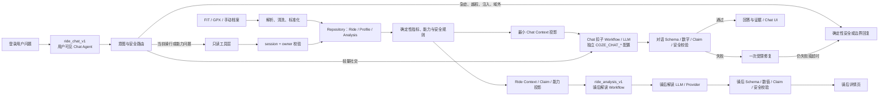
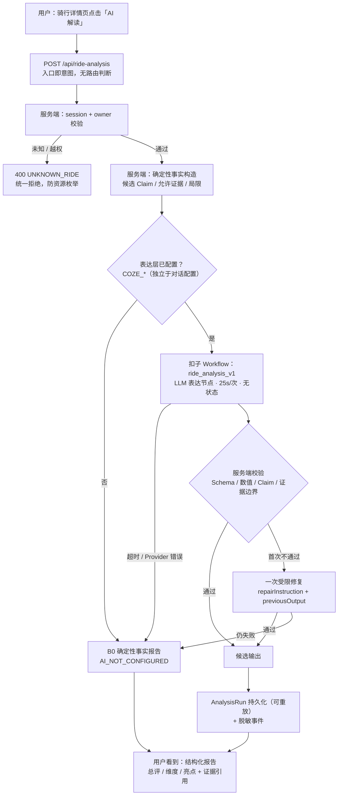
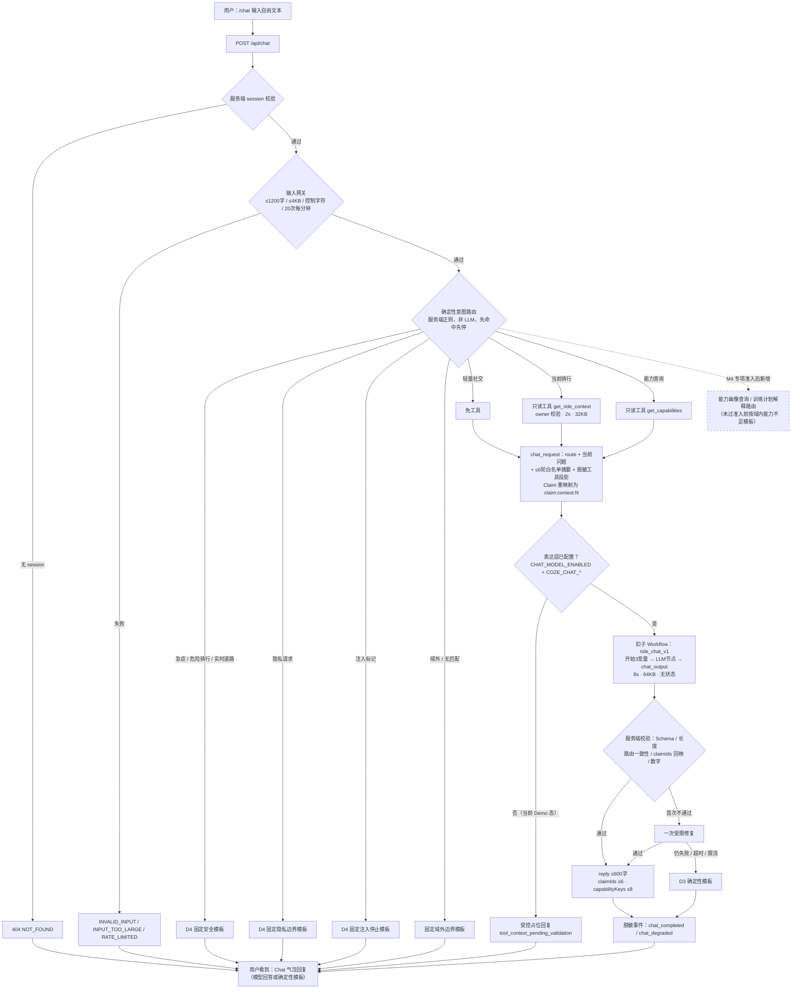

# AI 骑行伙伴 Agent 架构设计 v0.3

> 依据：PRD 6.5、6.6、6.7、7.2--7.10；`技术方案_AI骑行伙伴_v1.md`；`AI_AGENT_测评计划与记录.md`；`骑行水平能力评估模块设计.md`
> 更新日期：2026-09-08
> 状态：`Review`（v0.1 于 2026-09-05 用户验收通过；v0.2 于 2026-09-08 补充 M4 意图分支、人格统一、骑后追问规划；v0.3 于 2026-09-08 按用户指正重构第 3/4 节：明确"Agent=服务端编排循环、扣子 Workflow=无状态表达节点"分层，补两张完整 Agent 架构图与全部路由路径，并按代码事实修正路由集合与输出合同描述，第 6 节同步修正）。本设计定义 M3 的实现边界与 M4 的扩展边界，不代表 `chat_enabled` 已开放。

## 1. 结论

AI 骑行伙伴是一个受控的骑行领域对话入口：它通过服务端只读工具获取用户自己的、已脱敏且可追溯的事实，通过规则和审核知识回答问题，并把语言表达交给受约束的 LLM。它不是通用聊天机器人，也不是骑后解读、训练计划或数据库访问的替代品。

当前运行时包含两条独立的 AI 链路：非对话的 `ride_analysis_v1` 骑后解读 Workflow，以及一个用户可见的 `ride_chat_v1` 对话 Agent。这里的“单 Agent”只指对话入口不拆分为多个自主协作 Agent；骑后解读不是对话 Agent，也不与对话共享会话或输出合同。两条链路共享身份边界、结构化事实、确定性规则和安全校验，但分别拥有独立的触发条件、输入输出合同、Feature Flag、降级和评测 Gate。拆分为“数据、教练、文案、审核”多个对话 Agent 会重复传递私有上下文，扩大权限、延迟和回滚面，而没有已验证的收益。

**人格统一约定**：产品视角只有一个“AI 骑行伙伴”。骑后解读报告与对话回答使用同一称呼、同一口吻基线和同一证据引用风格——骑后报告是“伙伴给你的报告”，对话是“你找伙伴聊”。人格统一只在表达层实现（共享的语气规范与措辞约束），不引入共享 Prompt 骨架、共享会话或共享运行时状态；两条链路的安全边界、校验与评测保持独立。

最小端到端价值：登录用户从一条已持久化的骑行记录出发，提出当前骑行问题，得到只基于其记录证据的回答；能力不足、越权、危险症状或工具失败时得到确定性、安全且不猜测的结果。

## 2. 与其他模块的关系

| 模块 | 对 Agent 提供什么 | Agent 可以做什么 | 明确边界 |
|---|---|---|---|
| 身份、会话与归属（M2 Foundation） | 服务端 session、资源 owner、删除传播 | 以 session 绑定访问范围 | 不接受模型或客户端指定的 `userId`；无权与不存在统一为 `NOT_FOUND` |
| 导入、Repository 与数据层 | 结构化 Ride、Profile、AnalysisRun；30 天保留和删除 | 读取最小字段、能力与质量状态 | 不直接查数据库，不读取原 FIT/GPX、精确坐标、完整时序或文件名 |
| 确定性指标与规则 | 原子能力、Claim、局限、历史可比性 | 引用现有 `claimId`，解释规则结果 | 不自行计算距离、功率、趋势、风险等级或用户能力总分 |
| 骑后 AI 解读 `ride_analysis_v1` | 共享确定性事实、Claim 和能力口径；骑后链路的已校验输出 | 与对话链路并行运行，各自完成本场景的解释和呈现 | 不作为聊天的隐式会话上下文；聊天不重复调用或改写骑后输出；聊天失败不得影响详情页 |
| 分享 | 已审核的低风险文案与展示事实 | 回答“这次能分享什么”或在未来生成受控表达 | 首期没有发布、发送、付费或任何写入工具 |
| 审核知识库 RAG | 带来源、版本、风险级别的骑行知识片段 | 在专项准入后回答通用概念问题 | M3 Demo 默认关闭；用户文本和检索片段都不能成为指令 |
| M4 训练与健康安全 | 未来由规则引擎输出的受限计划 | 仅解释已批准的规则输出 | 不诊断、不开处方、不决定强度/频次/恢复时长 |
| 评测与 Feature Flag | 固定集、硬门结果、`chat_enabled` | 在 Gate 通过后灰度提供对话 | Gate 未通过时服务端关闭，不因骑后 AI 通过自动开放 |

## 3. 系统边界与数据流（全局视图）

本节是**数据流视图**：回答"数据从哪里来、经过哪些层、到哪里去"，覆盖导入、指标、两条 AI 链路与 UI 的整体关系。两个 Agent 各自的内部结构（输入→路由→工作流→输出→用户可见内容）在第 4 节分述。



图中的两个 LLM 节点代表两条独立运行时链路；即使未来选择同一模型供应商，也不能因此视为同一个 Agent。骑后解读的 `AnalysisRun` 不会自动成为聊天上下文，聊天工具也不会触发或改写骑后解读。

`ride_chat_v1` 的扣子接入使用独立的 `COZE_CHAT_API_URL`、`COZE_CHAT_WORKFLOW_ID`、`COZE_CHAT_WORKFLOW_VERSION`、`COZE_CHAT_API_TOKEN` 与 `COZE_CHAT_MODEL_ID`。它的 Workflow 输入仅为 `chat_request`、`repair_instruction` 和 `previous_output`，输出节点为 `chat_output`（`ride-chat-output-v0.1` JSON）。这些配置、Prompt、运行记录和失败重试均不得复用骑后解读的 `COZE_*`、`COZE_INTERPRETATION_*` 或 `AnalysisRun`。

调用链的权限次序不可倒置：服务端先验证 session，再按 owner 加载资源，再生成最小工具结果，最后才允许模型看到数据。模型从不持有数据库凭据、OIDC token、原始文件或其它用户数据。

## 4. Agent 结构：编排层与表达层

两个 Agent 遵循同一分层原则：**Agent 是服务端的编排循环，扣子 Workflow 只是被调用的无状态 LLM 表达节点**。意图识别与路由、session/owner 校验、只读工具调用与数据投影、输出校验、受限修复与降级，全部在服务端代码中确定性执行；扣子 Workflow 仅在"需要 LLM 组织语言"时被调用（最多两次：首次 + 修复重试），输入是脱敏投影，输出是内部 JSON，不持有会话、凭据或用户数据。

| 层 | 位置 | 职责 | 明确不做 |
|---|---|---|---|
| 编排层（Agent 本体） | `src/ai/`、`src/chat/`、`app/api/*` | 输入网关、意图路由、工具调用与投影、Schema/Claim/数字校验、一次修复、降级、脱敏事件 | 不把自由文本、凭据或未投影数据交给模型 |
| 表达层（扣子 Workflow） | 扣子平台，`ride_analysis_v1` / `ride_chat_v1` 两个独立 Workflow | 按冻结 Prompt 把已验证事实组织为受约束 JSON | 不路由、不选工具、不校验、不保存状态、不重试 |

命名说明：对话 Agent 与它调用的扣子 Workflow 同名 `ride_chat_v1`，指**同一条链路的两个层**，不是同一个东西——"多意图"配置在服务端编排层的路由代码里（`src/chat/chat-routing.ts`），不在扣子 Workflow 里；扣子也不需要按意图配置多个 Workflow。`ride_analysis_v1` 不进入对话的意图路由：它由骑后解读入口直接触发，入口即意图，无需路由判断；两者可以复用同一套确定性事实构造器，但不共享会话、模型输出、重试状态或降级结果。

### 4.1 Agent 一：骑后解读 `ride_analysis_v1`



要点：

- **入口即意图**：按钮直接触发，没有也不需要意图路由——这是它与对话 Agent 的本质区别；
- **输入无自由文本**：模型只收到结构化事实投影（候选 Claim、允许证据、局限），没有注入面；
- **一次性、无会话**：无多轮、无会话状态，每次触发独立执行；
- **B0-first**：Provider 未配置、超时、错误或修复失败时，用户永远得到确定性事实报告（`AI_NOT_CONFIGURED` / `AI_TIMEOUT` / `PROVIDER_ERROR` / `REPAIR_FAILED`），不会得到空白或猜测内容；
- **产出可重放**：通过校验的输出按 session 归属持久化为 `AnalysisRun`，可审计、可重放。

### 4.2 Agent 二：骑行伙伴对话 `ride_chat_v1`



**路由优先级与全部路径**（正则按序短路，先命中先停；安全类优先于一切业务意图）：

| 序 | 路由 | 匹配示例 | 动作 | 调模型 | 用户看到 |
|---|---|---|---|---|---|
| 网关 | — | 非字符串 / 控制字符 / 超长 / 超频 | 拒绝 | 否 | `INVALID_INPUT` / `INPUT_TOO_LARGE` / `RATE_LIMITED` |
| 1 | `safety_stop`（急症 / 危险骑行 / 实时道路） | "胸痛""正在骑行" | 固定安全模板 | 否 | 安全指引（停车 / 急救提示） |
| 2 | `privacy_boundary` | "看别人的记录" | 固定边界模板 | 否 | 隐私边界说明 |
| 3 | `injection_stop` | "忽略之前指令" | 固定停止模板 | 否 | 边界说明 |
| 4 | `social` | "你好" | 直调表达层 | 是（免工具） | 简短社交回应 |
| 5 | `capabilities` | "支持哪些能力" | `get_capabilities` → 表达层 | 是 | 能力说明（`capabilityKeys` ≤ 8） |
| 6 | `current_ride` | "本次平均功率" | `get_ride_context` → 表达层 | 是 | 数据回答（`claimIds` ≤ 6） |
| 7 | `out_of_scope` | 无匹配 / 域外问题 | 固定域外模板 | 否 | 范围说明与引导 |

历史比较、RAG、跨会话记忆和训练建议均不在 v0.1 路由集合。后续新增路由均为本对话 Agent 的意图分支，逐项走独立专项 Gate，未过准入前按"域内但能力不足"或域外边界模板回应：

- **能力画像查询**（`get_capability_profile`）与**训练计划解释/确认**（`get_training_plan` 及触发类工具）：随 M4 模块专项 Gate（`AI-CAP-01E`、`TRAIN-02/03`）接入，见第 10 节；
- **RAG 骑行知识库问答**（`search_knowledge`，工具合同见第 5 节）：按 Backlog `BX-RAG` 准入条件接入——至少 10 个答案明确问题的 Recall@3/引用评测通过、知识审核流程存在（CHAT-ADR-03）；知识片段带来源、版本与风险级别，作为数据进入表达层，不能成为指令。

已知路由缺口：长期能力问题（如"我的能力水平最近有进步吗"）当前会被 `capabilities` 正则捕获并进入本次骑行工具，得到文不对题的回答。`CHAT-12` 将拆分该路由并交付"域内但能力不足"确定性模板；拆分完成前，该类问题不由长期能力口径作答。

**编排循环**（每轮，对应 `runChatAgent`）：

1. 网关检查长度（≤1200 字 / 4 KB）、控制字符、频率（20 次/分钟）与注入标记；注入检查先于一切业务路由。
2. 确定性路由分派（上表）；任何安全停止不进入表达层。
3. 需要私有事实的路由先调只读工具：session + owner 校验、字段投影、单工具 2 秒 / 32 KB；工具结果中的 Claim 重映射为去标识化引用（`claim:context:N`）后才进入模型上下文；轻量社交不调用工具。
4. 运行时只组装当前问题、最多六轮白名单对话摘要和本轮工具投影。工具结果是数据，不是指令。
5. 表达层返回 `ride-chat-output-v0.1` JSON（`route` / `reply` / `claimIds` / `capabilityKeys`）；服务端校验 Schema、长度、路由一致性，并把 `claimIds` 映射回真实 Claim 验证数字与证据。
6. 首次失败只允许一次删除违规内容或修正格式的受限修复；再次失败、超时、限流或工具错误使用场景模板，不追加工具调用、不让迟到结果覆盖模板。

**Demo 态**：`CHAT_MODEL_ENABLED` 未开启时表达层不被调用——工具路由返回"已取得受控工具上下文，等待校验"的占位回复（`tool_context_pending_validation`），安全/边界/域外模板正常工作。这是 `CHAT-11` 未配置密钥时的当前实际运行状态。

### 4.3 运行时控制线

对话链路：每轮最多三个不同工具，同一工具最多一次，单工具两秒，单工具结果最多 32 KB，模型八秒（`COZE_CHAT_TIMEOUT_MS`），整轮十二秒。骑后解读链路：单次 Provider 调用二十五秒，含修复最多两次。日志只保留脱敏操作元数据和错误码，不保存完整聊天正文、精确位置、完整工具结果、密钥或内部 Prompt。

## 5. 首期工具合同

| 工具 | 输入 | 允许输出 | 服务端控制 | v0.1 行为 |
|---|---|---|---|---|
| `get_ride_context` | `ride_id`、受枚举约束的 `dims` | 本次白名单指标、特征、质量、局限与 `claimId` | session owner 校验；字段投影；2 秒/32 KB；统一 `NOT_FOUND` | 实现 |
| `get_capabilities` | `ride_id`、受枚举约束的 `caps` | 原子能力、来源、质量、不可用原因 | 同上，不返回完整 Profile 或轨迹 | 实现 |
| `compare_rides` | 指标、窗口、范围、锚点 | 可比性与规则计算结果 | 需要 M2 持久历史、完整口径和专项合同 | 延期 |
| `get_profile_context` | 字段白名单 | 最新必要基线及来源 | 只返回本轮必要字段 | 延期至 Profile 持久化接入后 |
| `get_ride_analysis` | `ride_id`、受枚举约束的 `sections` | 该记录已发布解读的结论、依据 Claim 与局限 | 只读已持久化 `AnalysisRun` 产出；不触发重算或改写报告 | 延期（骑后报告追问，见第 11 节） |
| `search_knowledge` | 查询、风险范围 | 经审核知识片段与来源 | 独立检索评测、版本与过期检查 | 延期，默认关闭 |

工具对模型只暴露稳定错误码：`NOT_FOUND`、`CAPABILITY_UNAVAILABLE`、`TIMEOUT`、`TEMPORARY_UNAVAILABLE`。其中 `NOT_FOUND` 同时覆盖资源不存在和无权访问，防止资源枚举。

## 6. 输出、校验与降级

对话表达层输出 `ride-chat-output-v0.1` 内部 JSON：`route`、`reply`（≤600 字 / 2 KB）、`claimIds`（≤6 项）与 `capabilityKeys`（≤8 项）。涉及用户本次骑行的数字与结论必须绑定当前工具结果中的 Claim——服务端把去标识化 `claimIds` 映射回真实 Claim 后验证数字与证据；校验不通过时整体拒绝该输出并进入修复或降级，不允许猜测或重算。骑后解读链路的输出合同（总评/维度/亮点 + Claim/证据绑定）独立于此，见 4.1。

| 级别 | 触发 | 用户可见行为 |
|---|---|---|
| D0 | 工具和全部校验通过 | 带证据、局限的完整回答 |
| D1 | 能力不足、不可比或缺字段 | 只回答可证明部分，说明具体缺口 |
| D2 | 首轮格式、引用或数字违规 | 一次受限修复后的精简回答 |
| D3 | 工具/模型超时、限流或再次校验失败 | 确定性模板，不要求重新上传 |
| D4 | 急症、危险、越权、注入或域外关键风险 | 固定安全停止或范围说明，不调用普通生成 |

## 7. 安全、隐私与删除

- 所有私有对象按服务端 session 归属验证；页面、API、工具和后台任务不得绕过 Repository 的 owner 条件。
- 原始 FIT/GPX、精确坐标、完整时序、文件名、模型密钥、OIDC token 和内部 Prompt 不进入聊天投影、RAG 或日志。
- 记录删除必须级联删除其 AnalysisRun、历史快照、分享/反馈引用、会话摘要和异步任务；账户删除覆盖该用户全部私有数据。删除后工具按 `NOT_FOUND` 处理。
- 生产启用仍依赖 ADR-022 的外部条件：`DATA_REGION`、OIDC 提供商、法务主体、备份轮换和跨境边界均须确认。开发用 session 只用于验证授权与删除链路，不能替代生产 OIDC。

## 8. 目录与责任建议

```text
src/
  auth/                 OIDC/session adapter；向业务提供 currentUserId
  persistence/          Repository 接口、PostgreSQL adapter、删除编排
  services/             import、delete、chat tool use-case 编排
  chat/                 路由、工具 schema、输出 schema、validator、fallback
  domain/               Ride/Profile/Claim/能力等纯函数
  ai/                   ride_analysis_v1 与 provider adapter
app/
  api/chat/             对话 BFF，只调用 services/chat
  chat/                 对话 UI 与确定性首页
```

当前实现应先引入 `persistence/` 和 session 适配边界，再新增 `chat/`。禁止由 `app/api/chat` 直接读取数据库或把模型输出原样返回。

## 9. M3 进入与放行条件

- M2 已通过：用户身份、持久记录、跨用户拒绝、记录/账户删除、最小事件和重启恢复。
- `CHAT-01` 至 `CHAT-10` 都具备可重复的自动化证据；至少覆盖正常提问、能力不足、跨用户、急症、注入、域外、工具/模型失败、输出校验、受限修复和脱敏观测。
- `AEVAL-M3-CHAT` 冻结工具成功定义、固定集和评分规则；硬门为事实、隐私、安全和授权零失败。
- 用户完成移动端预览并独立明确批准 `chat_enabled`。在此前，路由可用于内部预览，但 Feature Flag 必须关闭。

## 10. M4 能力扩展：骑行水平评估与训练建议

M4 将骑行水平评估（PRD 6.7，`AI-CAP-01`）与入门训练建议（PRD 6.6，`TRAIN-*`）作为 `ride_chat_v1` 的后续受控能力交付，不新增第三个对话 Agent：

1. **事实源**：水平评估由确定性聚合规则产生 `CapabilityProfileSnapshot`；训练计划由版本化规则引擎生成并写入计划页面。LLM 在两条能力中都不产生数值、状态、强度、频次或恢复结论。
2. **读触点**：`get_capability_profile` 与 `get_training_plan` 把已发布画像/计划的最小投影提供给对话；解释必须引用快照内证据，样本不足或不可比时按 D1 降级说明缺口。
3. **触发触点**：重算能力画像、生成训练计划属于触发类写操作。受理后由规则引擎执行并回填能力/计划页面，对话只返回受理状态与页面入口；不接受对话文本作为确认，必须由页面确认组件显式确认。沿用 PRD 7.6 写操作边界：幂等、显式 UI 确认、独立授权、专项评测与回滚。
4. **页面并行**：能力页面与计划页面承载可视化、计划日历、调整预览和确认组件；对话不替代这些页面的防误触交互，也不在气泡内复述完整计划或画像。
5. **准入顺序**：只读工具随对应模块专项 Gate（`AI-CAP-01E`、`TRAIN-02/03`）通过后接入；触发类工具在其后单独评审。任一能力未过准入时，相关请求按“域内但能力不足”确定性模板回应。

## 11. 后续低优先级扩展：骑后报告追问

骑后解读详情页的“对这份报告追问”（如“为什么说后程掉速”“这个结论依据哪段数据”）规划为对话 Agent 的后续只读能力，优先级低于 M4：

1. **实现方式**：对话 Agent 新增意图分支，经只读工具读取该记录已持久化、已校验的 `AnalysisRun` 产出（报告结论、依据 Claim、局限），在回答中引用报告证据。**不是合并两个 Agent**：骑后解读链路的触发、生成、校验与评测保持不变，追问只是消费其已发布产出。
2. **入口设计**：骑后报告页提供“追问”入口，携带 `ride_id` 与报告上下文进入 `/chat`；对话侧按当前骑行意图分支处理，不引入跨链路会话。
3. **边界**：追问不得触发骑后解读重算或改写已生成报告；报告未生成、已删除或跨用户时按 `NOT_FOUND`/D1 降级；骑后链路的 `AnalysisRun` 合同变更需同步评估该分支。
4. **进入条件**：M3 对话放量后，用户在骑后报告页产生真实追问行为证据（埋点或用户反馈），且对话 Agent 只读工具链路稳定；另立任务与专项评测，不占 M4 退出条件。

## 12. 架构决策与复审

| ID | 决策 | 复审条件 |
|---|---|---|
| CHAT-ADR-01 | 仅 `ride_chat_v1` 作为用户可见对话 Agent；`ride_analysis_v1` 保持独立 Workflow，不做多 Agent 自主协作 | 对话场景需要独立 Agent 或两个场景的边界、工具、评测发生实质变化，并有基准证明拆分收益 |
| CHAT-ADR-02 | 私有事实只经服务端只读工具进入模型 | 不复审原则；仅扩展类型化工具合同 |
| CHAT-ADR-03 | M3 v0.1 不启用 RAG、历史比较和跨会话记忆 | 对应 Repository、知识治理和专项评测已通过 |
| CHAT-ADR-04 | `chat_enabled` 独立于骑后 AI 功能 | M3 Gate 全部通过且用户明确签署开放决定 |
| CHAT-ADR-05 | Chat 默认候选使用快速模型；深度思考使用独立 `ride_chat_v1_reasoning` Workflow 做同固定集对照，不与默认版混跑 | 对照 Run 的事实/安全硬门均为零失败，且质量收益覆盖 P95 等待与成本增量 |
| CHAT-ADR-06 | M4 骑行水平评估与训练建议作为 `ride_chat_v1` 的新增意图分支交付，不新增第三个对话 Agent；确定性规则引擎为唯一事实源，LLM 只解释 | 规则引擎无法覆盖某类能力解释，或对话意图分支数量导致路由/评测不可维护时复审 |
| CHAT-ADR-07 | 骑后报告追问经对话 Agent 只读工具读取 `AnalysisRun` 产出实现，不合并骑后解读与对话两条链路；人格统一仅在表达层（语气/措辞规范），不共享 Prompt 骨架或运行时状态 | 用户证据表明报告内嵌对话交互成为主要使用方式，且合并方案能通过全套安全/评测门 |
