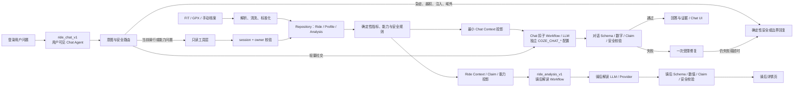

# AI 骑行伙伴 Agent 架构设计 v0.1

> 依据：PRD 6.5、7.2--7.10；`技术方案_AI骑行伙伴_v1.md`；`AI_AGENT_测评计划与记录.md`
> 更新日期：2026-09-05
> 状态：`Done`（2026-09-05 用户验收通过）。本设计定义 M3 的实现边界，不代表 `chat_enabled` 已开放。

## 1. 结论

AI 骑行伙伴是一个受控的骑行领域对话入口：它通过服务端只读工具获取用户自己的、已脱敏且可追溯的事实，通过规则和审核知识回答问题，并把语言表达交给受约束的 LLM。它不是通用聊天机器人，也不是骑后解读、训练计划或数据库访问的替代品。

当前运行时包含两条独立的 AI 链路：非对话的 `ride_analysis_v1` 骑后解读 Workflow，以及一个用户可见的 `ride_chat_v1` 对话 Agent。这里的“单 Agent”只指对话入口不拆分为多个自主协作 Agent；骑后解读不是对话 Agent，也不与对话共享会话或输出合同。两条链路共享身份边界、结构化事实、确定性规则和安全校验，但分别拥有独立的触发条件、输入输出合同、Feature Flag、降级和评测 Gate。拆分为“数据、教练、文案、审核”多个对话 Agent 会重复传递私有上下文，扩大权限、延迟和回滚面，而没有已验证的收益。

最小端到端价值：登录用户从一条已持久化的骑行记录出发，提出当前骑行问题，得到只基于其记录证据的回答；能力不足、越权、危险症状或工具失败时得到确定性、安全且不猜测的结果。

## 2. 与其他模块的关系

| 模块 | 对 Agent 提供什么 | Agent 可以做什么 | 明确边界 |
|---|---|---|---|
| 身份、会话与归属（M2 Foundation） | 服务端 session、资源 owner、删除传播 | 以 session 绑定访问范围 | 不接受模型或客户端指定的 `userId`；无权与不存在统一为 `NOT_FOUND` |
| 导入、Repository 与数据层 | 结构化 Ride、Profile、AnalysisRun；30 天保留和删除 | 读取最小字段、能力与质量状态 | 不直接查数据库，不读取原 FIT/GPX、精确坐标、完整时序或文件名 |
| 确定性指标与规则 | 原子能力、Claim、局限、历史可比性 | 引用现有 `claimId`，解释规则结果 | 不自行计算距离、功率、趋势、风险等级或用户能力总分 |
| 骑后 AI 解读 `ride_analysis_v1` | 共享确定性事实、Claim 和能力口径；骑后链路的已校验输出 | 与对话链路并行运行，各自完成本场景的解释和呈现 | 不作为聊天的隐式会话上下文；聊天不重复调用或改写骑后输出；聊天失败不得影响详情页 |
| 分享 | 已审核的低风险文案与展示事实 | 回答“这次能分享什么”或在未来生成受控表达 | 首期没有发布、发送、付费或任何写入工具 |
| 审核知识库 RAG | 带来源、版本、风险级别的骑行知识片段 | 在专项准入后回答通用概念问题 | M3 Demo 默认关闭；用户文本和检索片段都不能成为指令 |
| M4 训练与健康安全 | 未来由规则引擎输出的受限计划 | 仅解释已批准的规则输出 | 不诊断、不开处方、不决定强度/频次/恢复时长 |
| 评测与 Feature Flag | 固定集、硬门结果、`chat_enabled` | 在 Gate 通过后灰度提供对话 | Gate 未通过时服务端关闭，不因骑后 AI 通过自动开放 |

## 3. 系统边界与数据流



图中的两个 LLM 节点代表两条独立运行时链路；即使未来选择同一模型供应商，也不能因此视为同一个 Agent。骑后解读的 `AnalysisRun` 不会自动成为聊天上下文，聊天工具也不会触发或改写骑后解读。

`ride_chat_v1` 的扣子接入使用独立的 `COZE_CHAT_API_URL`、`COZE_CHAT_WORKFLOW_ID`、`COZE_CHAT_WORKFLOW_VERSION`、`COZE_CHAT_API_TOKEN` 与 `COZE_CHAT_MODEL_ID`。它的 Workflow 输入仅为 `chat_request`、`repair_instruction` 和 `previous_output`，输出节点为 `chat_output`（`ride-chat-output-v0.1` JSON）。这些配置、Prompt、运行记录和失败重试均不得复用骑后解读的 `COZE_*`、`COZE_INTERPRETATION_*` 或 `AnalysisRun`。

调用链的权限次序不可倒置：服务端先验证 session，再按 owner 加载资源，再生成最小工具结果，最后才允许模型看到数据。模型从不持有数据库凭据、OIDC token、原始文件或其它用户数据。

## 4. `ride_chat_v1` 工作流

`ride_chat_v1` 是唯一的用户可见对话 Agent。`ride_analysis_v1` 在骑行结束后由骑后解读入口独立触发；两者可以复用同一套确定性事实构造器，但不共享会话、模型输出、重试状态或降级结果。

1. 输入网关执行长度、频率和注入标记检查，并优先识别急性症状、危险骑行、实时道路、隐私和域外请求。
2. 确定性路由只允许：轻量社交、当前骑行、能力查询、域内但能力不足、或域外边界。历史比较、RAG、跨会话记忆和训练建议均不在 v0.1 路由集合。
3. 需要私有事实时，调用严格类型化的只读工具；轻量社交不调用工具；任何安全停止不进入普通 LLM 流程。
4. 运行时只组装当前问题、最多六轮白名单对话摘要和本轮工具结果。工具结果是数据，不是指令。
5. 模型返回内部 JSON；服务端依次检查 Schema、引用 Claim、数字、能力、路由一致性、隐私和安全。首轮失败只可进行一次删除违规内容或修正格式的受限修复。
6. 再次失败、超时、限流或工具错误时使用场景模板，不追加工具调用、不让迟到结果覆盖模板。

Demo 控制线：每轮最多三个不同工具，同一工具最多一次，单工具两秒，单工具结果最多 32 KB，模型八秒，整轮十二秒。日志只保留脱敏操作元数据和错误码，不保存完整聊天正文、精确位置、完整工具结果、密钥或内部 Prompt。

## 5. 首期工具合同

| 工具 | 输入 | 允许输出 | 服务端控制 | v0.1 行为 |
|---|---|---|---|---|
| `get_ride_context` | `ride_id`、受枚举约束的 `dims` | 本次白名单指标、特征、质量、局限与 `claimId` | session owner 校验；字段投影；2 秒/32 KB；统一 `NOT_FOUND` | 实现 |
| `get_capabilities` | `ride_id`、受枚举约束的 `caps` | 原子能力、来源、质量、不可用原因 | 同上，不返回完整 Profile 或轨迹 | 实现 |
| `compare_rides` | 指标、窗口、范围、锚点 | 可比性与规则计算结果 | 需要 M2 持久历史、完整口径和专项合同 | 延期 |
| `get_profile_context` | 字段白名单 | 最新必要基线及来源 | 只返回本轮必要字段 | 延期至 Profile 持久化接入后 |
| `search_knowledge` | 查询、风险范围 | 经审核知识片段与来源 | 独立检索评测、版本与过期检查 | 延期，默认关闭 |

工具对模型只暴露稳定错误码：`NOT_FOUND`、`CAPABILITY_UNAVAILABLE`、`TIMEOUT`、`TEMPORARY_UNAVAILABLE`。其中 `NOT_FOUND` 同时覆盖资源不存在和无权访问，防止资源枚举。

## 6. 输出、校验与降级

内部输出包含 `answer`、`evidence[]`、`limitations[]`、`route` 和 `fallbackCode`；面向用户的 `answer` 最多 600 个中文字符，证据最多 8 项、局限最多 3 项。涉及用户本次骑行的数字与结论必须绑定当前工具结果中的 `claimId`；找不到证据时删除该句，不允许猜测或重算。

| 级别 | 触发 | 用户可见行为 |
|---|---|---|
| D0 | 工具和全部校验通过 | 带证据、局限的完整回答 |
| D1 | 能力不足、不可比或缺字段 | 只回答可证明部分，说明具体缺口 |
| D2 | 首轮格式、引用或数字违规 | 一次受限修复后的精简回答 |
| D3 | 工具/模型超时、限流或再次校验失败 | 确定性模板，不要求重新上传 |
| D4 | 急症、危险、越权、注入或域外关键风险 | 固定安全停止或范围说明，不调用普通生成 |

## 7. 安全、隐私与删除

- 所有私有对象按服务端 session 归属验证；页面、API、工具和后台任务不得绕过 Repository 的 owner 条件。
- 原始 FIT/GPX、精确坐标、完整时序、文件名、模型密钥、OIDC token 和内部 Prompt 不进入聊天投影、RAG 或日志。
- 记录删除必须级联删除其 AnalysisRun、历史快照、分享/反馈引用、会话摘要和异步任务；账户删除覆盖该用户全部私有数据。删除后工具按 `NOT_FOUND` 处理。
- 生产启用仍依赖 ADR-022 的外部条件：`DATA_REGION`、OIDC 提供商、法务主体、备份轮换和跨境边界均须确认。开发用 session 只用于验证授权与删除链路，不能替代生产 OIDC。

## 8. 目录与责任建议

```text
src/
  auth/                 OIDC/session adapter；向业务提供 currentUserId
  persistence/          Repository 接口、PostgreSQL adapter、删除编排
  services/             import、delete、chat tool use-case 编排
  chat/                 路由、工具 schema、输出 schema、validator、fallback
  domain/               Ride/Profile/Claim/能力等纯函数
  ai/                   ride_analysis_v1 与 provider adapter
app/
  api/chat/             对话 BFF，只调用 services/chat
  chat/                 对话 UI 与确定性首页
```

当前实现应先引入 `persistence/` 和 session 适配边界，再新增 `chat/`。禁止由 `app/api/chat` 直接读取数据库或把模型输出原样返回。

## 9. M3 进入与放行条件

- M2 已通过：用户身份、持久记录、跨用户拒绝、记录/账户删除、最小事件和重启恢复。
- `CHAT-01` 至 `CHAT-10` 都具备可重复的自动化证据；至少覆盖正常提问、能力不足、跨用户、急症、注入、域外、工具/模型失败、输出校验、受限修复和脱敏观测。
- `AEVAL-M3-CHAT` 冻结工具成功定义、固定集和评分规则；硬门为事实、隐私、安全和授权零失败。
- 用户完成移动端预览并独立明确批准 `chat_enabled`。在此前，路由可用于内部预览，但 Feature Flag 必须关闭。

## 10. 架构决策与复审

| ID | 决策 | 复审条件 |
|---|---|---|
| CHAT-ADR-01 | 仅 `ride_chat_v1` 作为用户可见对话 Agent；`ride_analysis_v1` 保持独立 Workflow，不做多 Agent 自主协作 | 对话场景需要独立 Agent 或两个场景的边界、工具、评测发生实质变化，并有基准证明拆分收益 |
| CHAT-ADR-02 | 私有事实只经服务端只读工具进入模型 | 不复审原则；仅扩展类型化工具合同 |
| CHAT-ADR-03 | M3 v0.1 不启用 RAG、历史比较和跨会话记忆 | 对应 Repository、知识治理和专项评测已通过 |
| CHAT-ADR-04 | `chat_enabled` 独立于骑后 AI 功能 | M3 Gate 全部通过且用户明确签署开放决定 |
| CHAT-ADR-05 | Chat 默认候选使用快速模型；深度思考使用独立 `ride_chat_v1_reasoning` Workflow 做同固定集对照，不与默认版混跑 | 对照 Run 的事实/安全硬门均为零失败，且质量收益覆盖 P95 等待与成本增量 |
