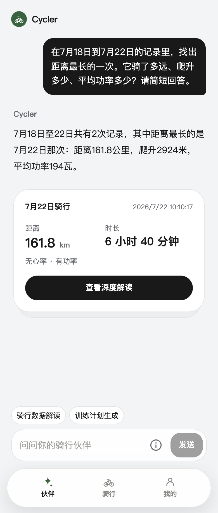
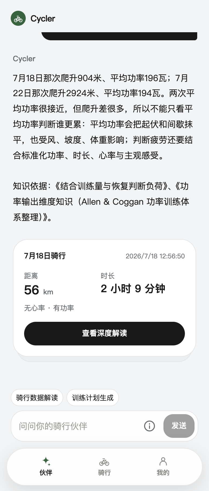
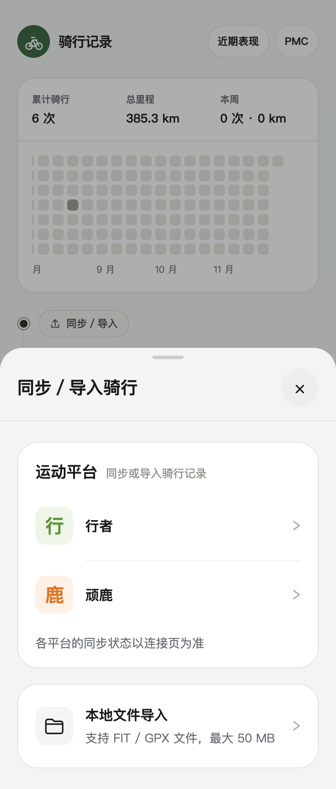
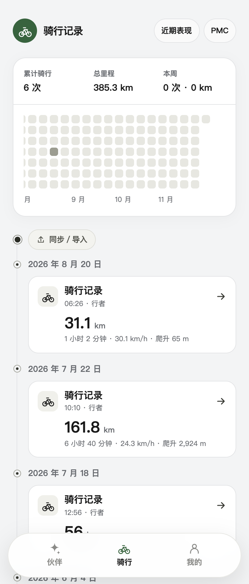
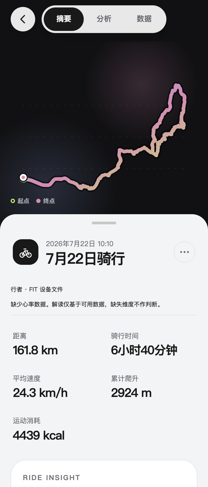
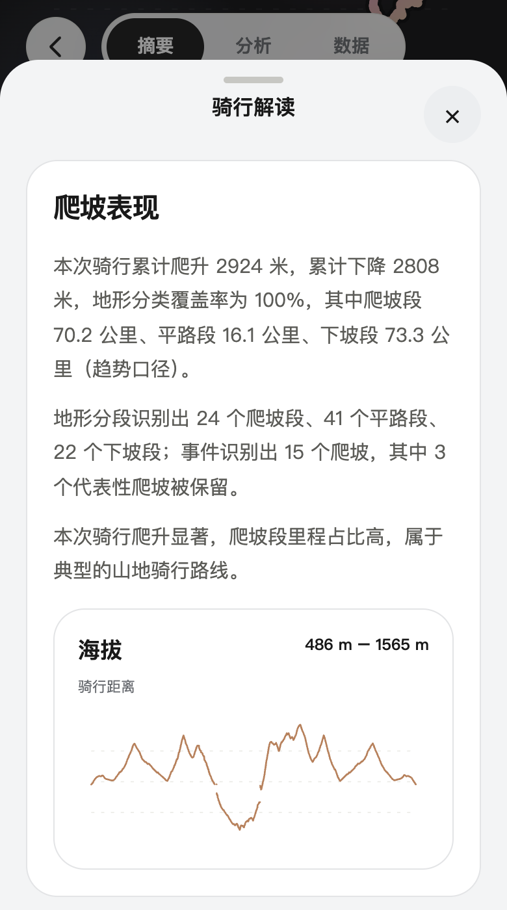
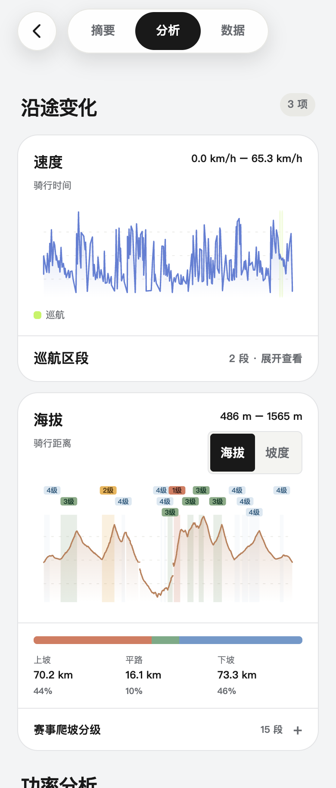
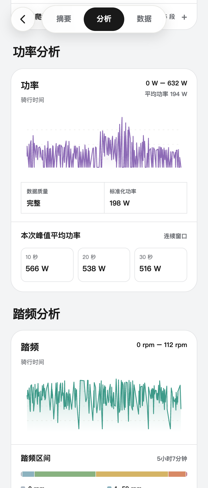
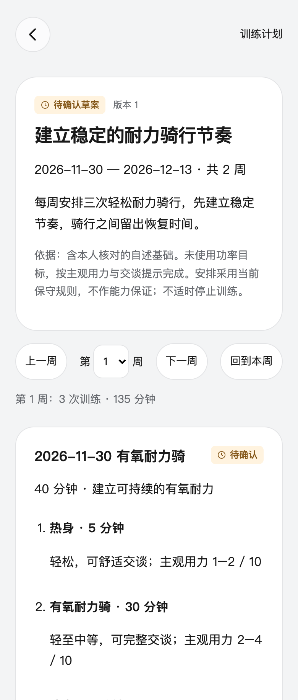

# AI Cycler · AI 骑行伙伴

AI Cycler 是面向骑友的骑行分析和训练助手。导入码表或骑行平台的记录后，可以在日历里回看骑行，通过图表和 AI 解读理解本次表现，也可以围绕实际骑行制定训练计划、记录执行情况。

## 当前功能

- **账号与个人资料** · 使用邮箱和密码注册、登录。骑行记录、个人资料、训练计划和平台连接归各自账号所有。
- **骑行导入与回顾** · 导入 FIT／GPX 文件，在日历和详情中查看记录。详情按文件可用数据展示路线、海拔、心率和功率等信息。
- **平台接入** · 顽鹿支持上传 OTM 导出的 ZIP 或一次选择多个 FIT，导入时跳过重复记录。配置平台凭据后可使用行者 OAuth 只读授权与手动同步。顽鹿在线同步限于配置指定的试点账号。
- **AI 解读与训练** · 基于骑行记录做骑后解读和对话问答，按目标和可用时间生成训练计划草案。确认计划后，可以把实际骑行关联到训练日并查看执行反馈。

## 界面速览

以下为移动端截图。骑行页面和 Agent 对话使用实际导入的行者记录，训练计划为示例草案。

### 用 Agent 检索骑行、对比表现

1. **按日期筛选并定位记录。** 问「7 月 18 日到 22 日哪次骑得最远」，Agent 从两条记录中找出 **161.8 km** 的长途骑行，列出爬升与平均功率，并给出可打开详情的记录卡片。
2. **沿用上下文继续追问。** 问「把这次和 7 月 18 日那次的爬升及平均功率并列」，Agent 将「这次」关联到刚找到的记录，对照两次骑行，并结合知识库解释为什么判断疲劳还要参考时长等信息。




### 导入与回顾骑行

打开「同步／导入骑行」，可选择行者、顽鹿或本地 FIT／GPX 文件。在骑行记录页，用热力图回顾骑行频率，查看累计里程，也可以按时间打开单次记录。




### 查看骑行摘要与 V2 解读

以 7 月 22 日的长途骑行为例，摘要显示路线、距离、骑行时长和累计爬升。打开「查看深度解读」，可阅读 V2 对同一条记录的分项说明，比如爬坡里程、地形构成和识别出的爬坡段。




### 直接查看数据分析

在骑行详情切换到「分析」标签，即可查看由记录直接计算的图表。上半部分展示速度、海拔和爬坡分级，下滑可查看功率、峰值平均功率和踏频。这个页面独立于 AI 解读。




### 查看训练计划草案

提供训练目标和每周可用时间后，可以生成计划草案，按周查看每次训练的时长和步骤，再确认启用。



## 本地运行

需要 Node.js 22.13 或以上版本，以及 pnpm。首次在项目根目录运行以下命令。

```bash
pnpm install --frozen-lockfile
cp .env.example .env.local
pnpm dev
```

打开 [http://127.0.0.1:3000](http://127.0.0.1:3000)，用邮箱和至少 12 个字符的密码注册，然后从「同步／导入骑行」上传 FIT 或 GPX 文件。默认配置可体验账号、文件导入和骑行详情，无需申请模型或平台凭据。

### 按需启用外部服务

- **骑后深度解读（V2）** · 在 `.env.local` 中填写 `SILICONFLOW_API_TOKEN`，设置 `AI_ANALYSIS_ENABLED=true`，然后在骑行详情点击「查看深度解读」。默认使用硅基流动的 `deepseek-ai/DeepSeek-V4-Flash`，可通过 `RIDE_MODEL_V2_MODEL_ID` 更换模型。[当前解读流程](doc_m7_main/AI_Cycler_项目架构.md#3-骑后解读)
- **模型对话与训练计划草案** · 设置 `CHAT_MODEL_ENABLED=true`，并填写 `SILICONFLOW_API_TOKEN`。
- **平台同步** · 按需设置 `XINGZHE_SYNC_ENABLED` 或 `ONELAP_SYNC_ENABLED` 及对应凭据。行者 OAuth 回调地址须与开放平台登记的地址一致。

环境变量以 [.env.example](.env.example) 为准。服务端数据默认写入 `.local-data/`，也可用 `LOCAL_DATA_DIR` 指定其他目录。将真实凭据保存在 `.env.local` 或服务端环境变量中。

## 开发与验证

项目使用 Next.js App Router、React 和 TypeScript。页面和 API 路由位于 [`app/`](app/)，骑行解析、指标计算、对话和训练逻辑位于 [`src/`](src/)，自动化测试位于 [`tests/`](tests/)。

```bash
pnpm verify   # TypeScript 类型检查与自动化测试
pnpm build    # 生产构建
```

## 项目文档

- [项目架构](doc_m7_main/AI_Cycler_项目架构.md) · 应用结构、代码入口与数据流
- [对话 Agent 整体设计](doc_m7_main/AI_Cycler_对话Agent整体结构设计.md) · 对话场景与 Agent 行为
- [账号与第三方骑行导入 PRD](doc_m7_main/v1.1.0-account-and-import/PRD.md) · 账号、顽鹿和行者的功能范围与验收
- [版本迭代规划](doc_m7_main/AI_Cycler_版本迭代规划.md) · 已完成事项与后续计划
- [测评基线](doc_m7_main/AI_Cycler_基线索引.md) · 历史基线版本、当时的模型配置与回归记录
