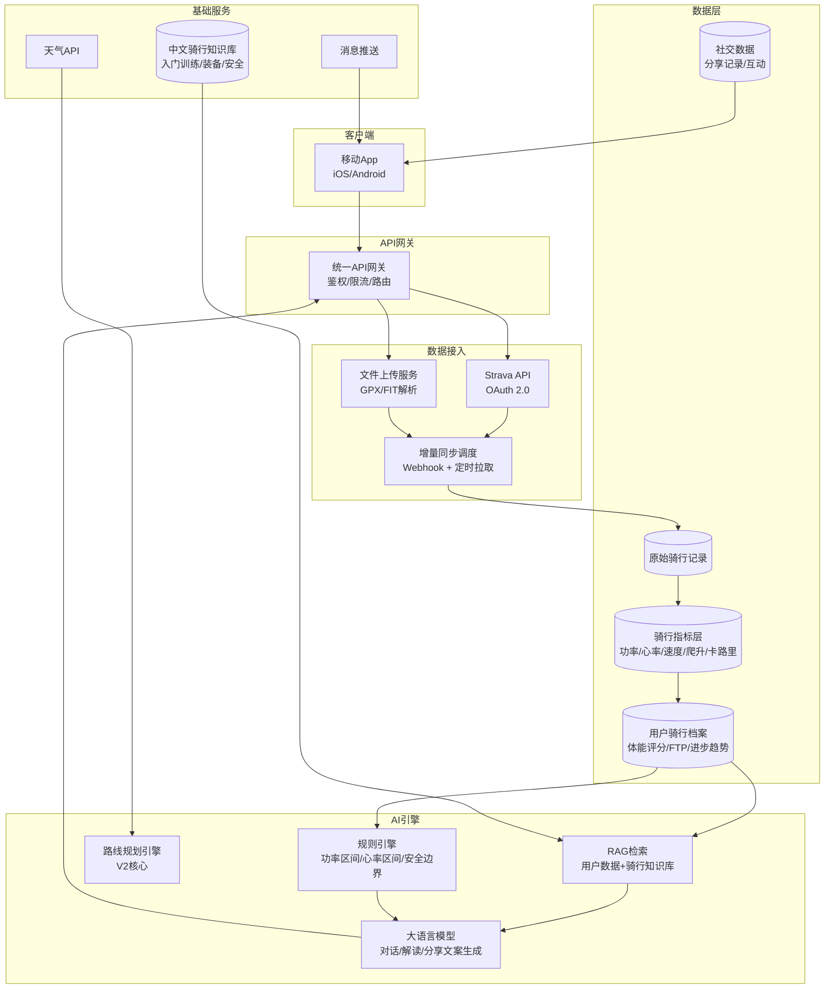

# 业余骑行AI助手 产品规划

> **产品代号**：AI Cycling Buddy
> **定位**：面向业余骑行爱好者的AI骑行伴侣
> **目标市场**：中国业余骑行爱好者
> **版本**：v1.0 / 2026-08-11

---

## 1 产品定位

### 1.1 定位陈述

当前骑行市场存在明显的"中间地带空白"：一端是行者、Strava等专业级记录工具，面向有竞技目标的骑行者；另一端是Keep等泛运动平台，骑行只是其数十种运动品类之一，缺乏骑行专项深度。**数千万业余骑行爱好者处于"有记录工具但无人帮我看数据"的状态**——他们每周骑2-4次，想提升但不知道方法，想分享但缺乏圈层认同。他们中有些人有功率计、有些人有心率带、有些人只有手机记录的轨迹——无论数据丰富程度如何，都需要有人帮他们翻译这些数字的含义。

业余骑行AI助手定位为**"AI骑行伴侣"**——不是冷冰冰的训练教练，而是懂骑行、能分析数据、会鼓励、能社交的智能伙伴。核心差异在于：**数据分层适配**（有功率用功率深解，无功率用心率/速度分析，都能获得有价值的解读）、强化社交属性（满足分享欲和圈层认同）、融入路线发现（让骑行不止于训练，更是探索）。不建记录系统——用户继续用行者/码表/Garmin记录，通过Strava OAuth或GPX/FIT文件导入数据，产品只做AI解读层。

| 维度 | 专业版（AI Cycling Coach） | 业余版（AI Cycling Buddy） |
|------|---------------------------|---------------------------|
| 目标用户 | 有明确赛事目标的中重度骑行者 | 业余骑行爱好者（功率计可选） |
| 核心场景 | 训练指导、赛事准备 | 数据解读、社交分享、路线发现 |
| 数据源 | Strava API + FIT/GPX | Strava API + GPX/FIT上传（同专业版） |
| AI角色 | 训练教练 | 骑行伙伴/数据翻译官 |
| 社交属性 | 弱 | 强（核心功能） |
| 训练计划 | 周期化功率训练 | 心率/功率分层训练的入门计划 |
| 路线推荐 | 无 | 核心差异化功能 |

### 1.2 为什么是现在

四个趋势交汇，创造了业余骑行AI助手的最佳入场窗口：

1. **骑行人口爆发**：全国骑行用户突破1.3亿，骑行已从小众运动演变为全民生活方式[$TRAE_REF](https://xinwen.bjd.com.cn/content/s6a1f5db4e4b03fa51a7f3a2d.html)。2025年全国骑行爱好者规模达600万人，同比增长18.3%[$TRAE_REF](https://www.docin.com/touch_new/preview_new.do?id=4979336889)。

2. **社交驱动取代训练驱动**：2026年数据显示，18-35岁城市用户中骑行社交互动频次首次超过健身打卡。小红书骑行话题浏览量超40亿次，Keep超六成用户骑行活动含组队、路线分享或线下聚会元素[$TRAE_REF](https://post.m.smzdm.com/p/a3mewv97/)。骑行已成为Z世代的"社交货币"。

3. **AI教练心智成熟**：Keep AI教练"卡卡"已为超130万用户生成个性化训练计划[$TRAE_REF](https://reportify.cn/news/1157678501030137856)，市场不需要再教育"AI能指导运动"这件事。

4. **骑行垂类AI仍空白**：行者不提供AI教练能力，Strava的AI功能面向英语用户且重心在专业训练，国内市场没有一款面向业余骑行爱好者的中文AI骑行分析产品。

---

## 2 市场机会

### 2.1 中国骑行市场全景

中国骑行运动行业正处于快速发展期，市场呈现"大众化+社交化+智能化"三重趋势：

| 指标 | 数据 | 来源 |
|------|------|------|
| 全国骑行用户 | 突破1.3亿 | 央视财经 2026.06 |
| 骑行爱好者规模 | 600万人（2025年） | 博研咨询 2026 |
| 骑行运动行业市场规模 | 4818亿元（2025年） | 博研咨询 2026 |
| 运动自行车市场 | 485.7亿元（2025年） | 中国自行车协会 |
| 注册骑行俱乐部 | 超1.8万家 | 博研咨询 2026 |
| 25-45岁骑行者占比 | 超60% | 博研咨询 2026 |
| Z世代骑行社交内容互动增长 | 同比+215% | 博研咨询 2026 |

### 2.2 业余骑行爱好者的细分画像

业余骑行爱好者并非铁板一块，可细分为三个子群体：

**A. 社交型骑行者（占比约45%）**

- 特征：周末骑行+拍照打卡+朋友圈/小红书分享，骑行是社交活动而非训练
- 车辆：入门公路车（3000-8000元）或折叠车
- 数据：用行者/黑鸟记录，但不看功率数据，只看里程和均速
- 痛点：不知道自己的水平在朋友圈处于什么位置，想要好看的骑行数据卡片分享
- 关键需求：数据可视化+社交分享+路线发现

**B. 健康型骑行者（占比约35%）**

- 特征：以锻炼身体为目的，每周固定骑行2-3次，有心率监测需求
- 车辆：入门公路车或健身骑行台
- 数据：关注心率区间和卡路里，想要知道"骑了有没有效果"
- 痛点：骑了很久但不知道体能是否提升，缺乏量化反馈
- 关键需求：体能趋势分析+心率区间解读+基础训练建议

**C. 成长型骑行者（占比约20%）**

- 特征：从休闲骑向严肃训练过渡，已购买心率带或功率计，开始关注FTP、踏频等概念
- 车辆：中端公路车（8000-20000元），可能已购入功率计
- 数据：有功率数据或心率数据，想了解FTP/训练负荷，想提升但不知道方法
- 痛点：有数据但无人解读，英文专业工具门槛太高
- 关键需求：FTP识别+功率数据分析+结构化训练计划+进阶路线推荐

### 2.3 市场空白验证

国内主流骑行应用中，行者和黑鸟的核心能力在"记录+社区+路书"，数据解读停留在图表展示层面。两者均不具备AI数据解读或AI训练指导能力。Keep虽然推出了AI教练"卡卡"，但骑行只是其运动品类之一，缺乏骑行专项的深度分析。

全球骑行AI教练产品（AI Endurance、FormBeat、Xert）全部面向英语市场，不支持中文，且均以功率计为核心数据源——但业余爱好者中也有拥有功率计的用户，他们的数据同样被浪费在记录工具里。这个空白的本质是：**现有产品要么太专业（英文+纯训练导向），要么太泛化（骑行只是附带的运动记录），缺少一个"数据分层适配（有功率深度分析、无功率也能解读）、满足社交分享需求、中文AI原生"的中间地带产品。**

---

## 3 竞品格局

### 3.1 直接竞品对比

| 产品 | 核心定位 | AI能力 | 社交能力 | 中文 | 数据分层适配 | 路线推荐 |
|------|----------|--------|----------|------|-------------|----------|
| **行者** | 骑行记录+社区+硬件 | 无AI教练 | ⭐⭐⭐⭐⭐ 14万+俱乐部 | ✅ | 功率/FTP展示但无解读 | 500万+路书 |
| **黑鸟单车** | 精准轨迹记录 | 无AI教练 | ⭐⭐⭐ 车队实时位置共享 | ✅ | 难度评分无深度分析 | 用户自制路书 |
| **Keep** | 泛运动AI教练 | ⭐⭐⭐⭐ "卡卡"，130万+用户 | ⭐⭐⭐ 运动社区 | ✅ | 通用评分，骑行不深 | 路线探索 |
| **Strava** | 全球运动社交 | ⭐⭐⭐ Athlete Intelligence | ⭐⭐⭐⭐⭐ 1.8亿用户 | ❌ | 需功率计+付费 | ⭐⭐⭐⭐ 热力图 |
| **Komoot** | 户外路线规划 | ⭐⭐ AI路线推荐 | ⭐⭐⭐ 社区景点推荐 | ❌ 中文版起步 | 路线规划为主 | ⭐⭐⭐⭐⭐ 路况感知 |

### 3.2 Keep AI教练深度分析

Keep是业余骑行AI助手最值得研究的竞品，因为它在"大众运动+AI教练"路线上走得最远，且用户画像高度重叠。

**Keep AI教练的核心能力**（基于Keep 9.1版本）：

- 基于自研Keepace.ai运动健康大模型，实现"感知-记忆-规划-执行"闭环
- 累计运动记录超140亿条，AI用户运动档案覆盖17类标签、700余项指标[$TRAE_REF](https://imgs-b2b.100ec.cn/detail--6657890.html)
- 支持骑行模式，可连接功率计和踏频器[$TRAE_REF](https://m.onlinedown.net/soft/10101065.htm)
- AI教练可生成个性化训练计划，语音陪跑调用超2100万次，AI功能次日留存率50%[$TRAE_REF](https://imgs-b2b.100ec.cn/detail--6657890.html)
- 饮食管理：拍照识别食物热量
- 社区+赛事：1000万+用户参与奖牌赛事

**Keep的局限性（也是业余骑行AI助手的机会）**：

1. **骑行深度不足**：骑行只是50+运动品类之一，AI数据分析维度浅，缺少功率估算、FTP、训练负荷等骑行专项指标
2. **用户画像泛化**：Keep月活2177万[$TRAE_REF](https://imgs-b2b.100ec.cn/detail--6657890.html)但用户目的分散（减脂、增肌、瑜伽等），骑行用户在其中是被稀释的
3. **社交非骑行专属**：Keep社区是泛运动社区，缺乏骑行圈层认同感
4. **路线规划弱**：路线探索停留在"附近路线"层面，缺乏骑行专项的路线难度评估和AI推荐

### 3.3 行者与黑鸟单车分析

行者和黑鸟在国内骑行记录市场占据主导，但均停留在"工具+社区"层面，未涉足AI数据分析：

| 维度 | 行者 | 黑鸟单车 |
|------|------|----------|
| 核心优势 | 3500万+用户，500万+路书，14万+俱乐部 | 精准轨迹记录，20h+离线续航 |
| 数据指标 | 功率、FTP估算、TSS等20+专业指标 | 难度评分+排名PK |
| AI能力 | 无AI数据解读，仅图表展示 | 无AI能力 |
| 社交特点 | 长图分享（含地图+数据+照片），快捷分享至微信 | 骑行记录分享至微信/微博/QQ |

行者的社交分享功能值得借鉴：支持运动长图分享（地图+数据+照片）、快捷分享至微信/朋友圈/QQ、网页链接分享。Pro会员还可展示热力图、3D地图、爬坡分析等进阶数据可视化[$TRAE_REF](https://hc.imxingzhe.com/hc/xing/articles/1733121258-)。

### 3.4 旅行路线规划AI应用

虽然不直接竞争，但AI旅行路线规划应用在"AI+路线"方向上的技术积累值得参考：

| 产品 | 核心功能 | 可借鉴点 |
|------|----------|----------|
| **Lovtrip** | AI 30秒生成旅行计划，AI图文路书生成 | 快速生成+可分享路书 |
| **圆周旅迹** | 链接智能解析（一键导入小红书攻略），AI行程规划 | 多源信息聚合+AI整合 |
| **Komoot** | Surface-aware routing，路况感知路线，离线地图 | 骑行专项路线推荐引擎 |

---

## 4 产品架构

### 4.1 功能模块全景

```
业余骑行AI助手功能全景
├── 数据接入层
│   ├── Strava OAuth直连（核心）
│   ├── GPX/FIT文件上传（行者/码表导出）
│   └── 数据解析与去重
├── 数据解读层（AI核心）
│   ├── 骑行数据自动解读（功率/心率分层）
│   ├── 体能水平评估（有功率深度建模/无功率心率估算）
│   ├── 骑后智能分析
│   └── 周/月度骑行报告
├── 社交分享层（差异化核心）
│   ├── AI生成骑行分享卡片
│   ├── 朋友圈/小红书一键分享
│   ├── 骑行圈排行榜·圈层PK（V2）
│   └── 骑行成就与勋章系统（V2）
├── 训练指导层
│   ├── 功率/心率分层训练计划
│   ├── AI骑行伙伴对话
│   └── 体能趋势追踪
└── 路线发现层（V2核心）
    ├── AI骑游路线推荐
    ├── 路书智能生成
    └── 沿途POI智能标注
```

### 4.2 系统架构



### 4.3 与专业版的架构差异

| 层次 | 专业版 | 业余版 |
|------|--------|--------|
| 数据源 | Strava API + FIT/GPX | Strava API + GPX/FIT上传（相同） |
| 核心指标 | FTP/CP/W'/CTL/ATL/TSB | 有功率：同专业版；无功率：心率/速度/体能评分 |
| 功率数据 | 核心指标 | 可选——有则深度建模，无则心率/速度分析 |
| 仪表设计 | PMC建模、功率曲线（全量） | 分层展示：有功率显示功率曲线+FTP；无功率显示心率区间+速度趋势 |
| LLM角色 | 训练教练 | 数据翻译官+骑行伙伴 |
| 特殊模块 | PMC建模、功率曲线 | 社交分享、路线推荐（成就/排行V2） |

架构层面的核心差异不在数据接入方式（两者一致），而在**数据指标层的分层处理**——业余版能根据用户实际拥有的数据维度（仅GPS轨迹 → +心率 → +功率），逐层升级分析深度。

---

## 5 AI能力设计

### 5.1 核心原则

**"AI做翻译官，不做教练"**——对于业余骑行爱好者，更需要的是"我的数据说明了什么"而非"下周该做5组4分钟105%FTP间歇"。AI的核心价值在于将枯燥的骑行数据翻译成用户能理解、能分享、能获得成就感的故事。

### 5.2 四项核心AI能力

**A. 骑行数据翻译官**

将原始骑行数据转化为自然语言解读，根据数据丰度自动调整分析深度：

- 有功率数据："今天NP 210W，IF 0.85，TSS 142——强度适中偏有氧耐力。前40km功率稳定在195W（Zone 2），第42km出现一次冲刺峰值520W。"
- 有心率无功率："均速26.3km/h，比上周快了3%。心率大部分在Zone 2-3燃脂有氧区间，第18-22km爬坡段心率控制稳定。"
- 仅有轨迹数据："今天你骑了35km，均速26.3km/h。这条路线你骑了5次，今天是第二快的成绩👍"

**B. 体能评分系统**

分层建模——根据用户数据维度自动匹配评估层级：

| 数据层级 | 可用指标 | 评估能力 |
|----------|----------|----------|
| 仅GPS轨迹 | 距离/速度/爬升/频次 | 骑行活跃度评分、速度趋势 |
| +心率数据 | +心率区间分布/心率漂移/心率恢复 | 有氧耐力评估、训练负荷估算 |
| +功率数据 | +FTP/CP/W'/TSS/IF/CTL/ATL/TSB | 完整体能建模（同专业版） |

无论用户处于哪个层级，系统都会给出当前数据维度下最有价值的评估，并在数据升级时自动解锁更深层的分析。

**C. AI分享助手**

自动生成可分享的骑行卡片：

- 根据骑行数据自动选择亮点（"今日最高速度52km/h🔥"）
- AI生成个性化分享文案（"秋日午后35km，心肺舒畅🍂"）
- 支持多种卡片模板：数据卡/路线卡/对比卡/风景卡（成就卡V2）
- 一键分享至微信/朋友圈/小红书

**D. 骑行路线智能推荐（V2）**

- 根据用户骑行偏好（距离/爬升/风景偏好）推荐路线
- 结合天气数据推荐最佳出发时间
- AI生成路书：起点→咖啡店→风景点→返程，含每个节点的距离和预估时间
- 社区热门路线排行

### 5.3 模型选型

| 用途 | 模型 | 选型理由 |
|------|------|----------|
| LLM对话 | DeepSeek-V3 | 中文能力强、成本低（¥0.002/1K tokens） |
| 骑后分析 | DeepSeek-V3 | 结构化输出+中文表达 |
| 分享文案生成 | DeepSeek-V3 | 创意文案+个性化风格 |
| Embedding | bge-m3 | 开源中文向量模型，支持中英混合 |
| 训练计划 | 规则引擎 + LLM润色 | 心率导向规则（确定性）+自然语言包装 |
| 路线推荐 | LLM + 地图API | 结合OSM/高德地图数据 |

### 5.4 中文骑行知识库

构建面向业余骑行爱好者的中文知识库，覆盖：

- 入门指导：如何选择第一辆公路车、基础骑行姿势、安全须知
- 训练基础：心率区间训练法、踏频的重要性、恢复与营养
- 路线百科：全国各地经典骑行路线介绍、难度评级
- 装备知识：头盔/骑行服/锁鞋选购指南、基础维修教程
- 赛事信息：国内业余赛事日历、参赛指南

---

## 6 MVP范围

### 6.1 MVP功能清单

MVP聚焦验证"业余骑行者是否愿意用AI解读自己的骑行数据并分享"，功能围绕四个核心闭环：

| 功能 | 说明 | 优先级 | 开发周期 |
|------|------|--------|----------|
| Strava OAuth授权接入 | 用户绑定Strava账号，自动拉取历史骑行+增量同步 | P0 | 1周 |
| GPX/FIT文件上传 | 支持行者/码表导出的GPX/FIT文件，解析为统一格式 | P0 | 1.5周 |
| 骑后AI智能分析 | 每次骑行导入后自动生成自然语言分析（数据分层：功率>心率>GPS轨迹） | P0 | 2周 |
| 体能评分与趋势 | 数据分层建模：有功率→FTP/CTL/TSB；有心率→有氧评估；仅GPS→活跃度评分 | P0 | 1.5周 |
| AI骑行伙伴对话 | 基于RAG+LLM的对话伙伴，分层回答训练/装备/路线问题 | P0 | 2周 |
| AI分享卡片生成 | 自动生成分享卡片（数据+路线+AI文案），一键分享微信/朋友圈 | P0 | 1.5周 |
| 入门训练计划 | 数据分层：有功率→功率区间训练；有心率→心率区间训练；仅GPS→RPE体感训练 | P1 | 1.5周 |

### 6.2 V2规划功能

| 功能 | 说明 | 优先级 |
|------|------|--------|
| 骑行成就系统 | 里程/爬升/连续骑行等成就勋章 | P1 |
| 圈层排行榜 | 好友周里程/爬升排行 | P1 |
| AI骑游路线推荐 | 根据用户偏好和历史数据推荐骑行路线 | P1 |
| 智能路书生成 | AI自动生成骑游路书（路线+补给点+风景点+耗时） | P1 |
| 赛事路线模拟 | 导入赛事GPX，AI分析难度和配速建议 | P2 |
| Garmin Connect接入 | 用户绑定Garmin账号，导入历史数据（需企业资质） | P2 |
| 俱乐部功能 | 创建/加入骑行俱乐部，俱乐部排行 | P2 |

### 6.3 MVP排除项

- 骑行记录功能——用户继续用行者/码表/Garmin记录，产品只做AI解读层
- 实时导航（V2与路线推荐一起做）
- 码表硬件对接
- 数字孪生训练预测（V2+）

---

## 7 商业模式

### 7.1 定价策略

参照Keep会员（月卡¥20-25，年卡¥148-248）和国内用户付费习惯，采用"免费增值+订阅"模式：

| 档位 | 价格 | 功能 |
|------|------|------|
| **免费版** | ¥0 | 骑行记录、基础数据分析、每周3次AI对话、基础分享卡片 |
| **Pro版** | ¥19/月 或 ¥168/年 | 无限AI对话、高级分析、AI定制分享卡片、训练计划、体能趋势、去广告 |
| **家庭版** | ¥29/月 或 ¥268/年 | Pro全部 + 家庭成员骑行排行、家庭骑行挑战 |

定价逻辑：Pro版定价约等于一杯奶茶的价格（月付），低于Keep会员月卡（¥20-25），降低决策门槛。年付折扣约26%（168 vs 228），鼓励留存。

### 7.2 收入预测（保守）

基于以下假设：首月5000注册用户（通过骑行社区内容营销获客），月增长率25%（社交裂变），免费转Pro转化率6%。

| 阶段 | 注册用户 | Pro用户 | 月收入（年付摊薄） |
|------|----------|---------|---------------------|
| 第1个月 | 5,000 | 300 | ¥4,200 |
| 第3个月 | 7,800 | 468 | ¥6,550 |
| 第6个月 | 15,200 | 912 | ¥12,770 |
| 第12个月 | 62,000 | 3,720 | ¥52,080 |

### 7.3 长期变现路径

- **路线推荐增值服务**：V2路线推荐模块可单独作为付费功能或Pro权益
- **装备推荐分佣**：AI在分析中识别装备需求（如"你的心率数据波动大，建议使用心率带"），引导至电商分佣
- **赛事报名合作**：与国内骑行赛事合作，AI分析+赛事推荐+一键报名
- **品牌合作**：骑行装备品牌赞助分享卡片模板/勋章/挑战赛

---

## 8 冷启动策略

### 8.1 目标用户获取

**核心种子用户**：小红书骑行博主（粉丝1k-5k），在骑行内容生态中处于"有影响力但尚未商业化"的腰部位置，有内容创作需求且对新产品接受度高。

**获客渠道**：

1. **小红书内容种草**：与骑行博主合作，用AI生成的"骑行数据报告"分享卡片作为内容素材。博主上传GPX或绑定Strava→AI自动生成分析报告和精美分享卡片→博主发布到小红书（自然带产品曝光）
2. **骑行俱乐部合作**：选择10个城市各3-5个活跃俱乐部，免费提供Pro会员，从B端渗透C端
3. **GPX上传引流**：在行者社区/骑行论坛发布"免费AI骑行分析"帖子，引导用户导出GPX上传获取AI分析报告
4. **朋友圈裂变**：分享卡片自带品牌水印和"上传你的骑行数据，生成专属分析报告"二维码，利用朋友圈社交网络传播

### 8.2 冷启动指标

| 指标 | 目标 | 说明 |
|------|------|------|
| 首月注册 | 5,000 | 种子用户+内容营销 |
| 数据接入率 | ≥70% | 注册后完成Strava绑定或GPX文件上传 |
| 分享率 | ≥40% | 至少生成并分享1次骑行卡片 |
| 7日留存 | ≥35% | 注册第7天仍活跃 |
| 30日留存 | ≥25% | 注册第30天仍活跃 |

---

## 9 关键风险

| 风险 | 影响 | 应对 |
|------|------|------|
| 行者强化AI能力 | 直接竞争，削弱差异化 | 建立社交分享壁垒（用户关系链+历史数据），保持产品体验领先 |
| Keep深耕骑行垂类 | 凭借用户基数快速覆盖 | 聚焦骑行圈层的社区氛围和专业深度，Keep难以在单一品类上All-in |
| 用户付费意愿不足 | 收入不达预期 | 先用免费版积累用户和口碑，通过社交裂变降低获客成本 |
| Strava API限流 | 增量同步受阻 | MVP阶段用户量<10时在Single Player Mode内验证，超限后提审扩容；同时GPX/FIT上传作为兜底 |

---

## 参考资料

本规划中的市场数据和竞品信息均来自公开来源，关键数据引用标注于正文中。主要参考来源包括：央视财经、博研咨询、中国自行车协会、什么值得买骑行App横评、Keep 2025年度业绩公告、行者和黑鸟单车官方帮助文档、小红书运动户外内容洞察报告等。
