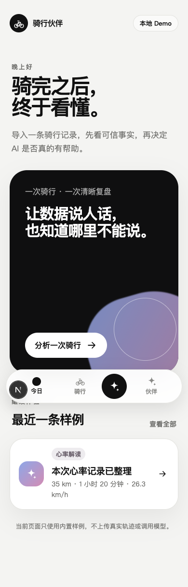
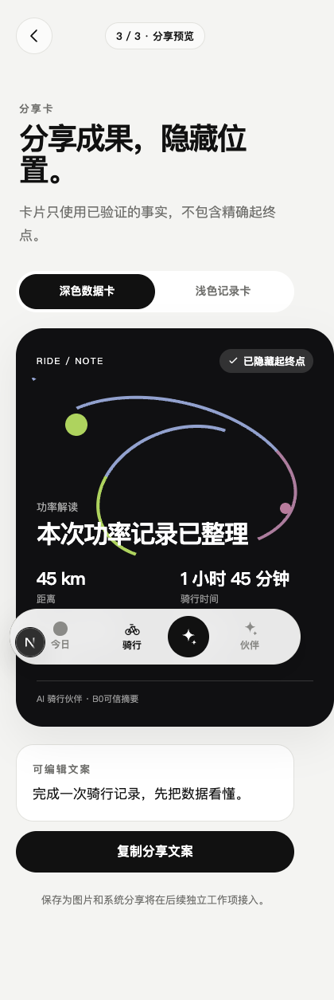

# ITEM-V004｜移动端优先可点击视觉壳预览

> 状态：`ACCEPTED`  
> 日期：2026-08-18  
> App：`visual-shell-v0.1`  
> 框架：Next.js 16.3.1 + React 19.2.8 + TypeScript 5.9.3  
> 数据：内置fixture + 已验收B0，不调用模型

## 1. 本项解决什么

将已验收的Schema、规则和B0摘要放进真实可点击页面，验证用户能否沿着“开始 → 选择记录 → 看懂事实与边界 → 查看证据 → 预览分享卡”的最短路径完成体验。

本项不验证真实文件上传、扣子或模型质量，避免同时混入数据接入、AI不确定性和视觉交互三类风险。

## 2. UED参考如何转化为界面规则

参考`UED参考/`中的五张Stoic iOS页面，提炼而非逐像素复制：

- 暖白背景、黑色高对比主卡和大面积留白；
- 粗体短标题与明显信息层级；
- 24–36px大圆角卡片、胶囊按钮、44px以上触控目标；
- 单屏只突出一个主要任务；
- 蓝紫渐变只用于“伙伴/解释”层，不覆盖事实卡；
- 先展示事实，再展示解释、证据和分享动作；
- 不使用参考产品的品牌、文案或插画资产。

## 3. 当前可点击路由

| 路由 | 作用 | 已实现状态 |
|---|---|---|
| `/` | 欢迎页与唯一主行动 | success |
| `/import` | L1/L2/L3样例选择、文件接入占位 | empty/success |
| `/import?state=loading` | 导入加载预览 | loading |
| `/import?state=error` | 可恢复错误预览 | error |
| `/rides/[id]` | “解读/数据”双Tab、B0摘要、分级数据、证据、反馈与分享入口 | full/basic/rejected |
| `/share/[id]` | 深色/浅色分享卡、隐私提示、复制文案 | success |

特殊样例：

- `gpx-no-timestamps`：基础模式，不显示时间和速度结论；
- `fit-truncated-file`：拒绝态，不显示冲突数字，也不能进入分享页。

## 4. 关键产品边界

- 页面明确标记“确定性摘要 · 未调用AI”，不把B0伪装成模型结果；
- 每张事实卡都能展开查看`evidenceId`和记录/计算来源；
- L1/L2/L3概要统一展示距离、骑行时间、平均速度、累计爬升；缺失或不可靠的项目保持空缺，不用`0`占位；
- “数据”Tab按现有Schema动态展示：L1基础数据，L2增加可靠心率，L3增加可靠功率；L2/L3在存在可靠记录时展示踏频；
- 内置fixture明确标记为“内置样例”，不再误标为真实“设备记录”；
- L1/L2/L3由规则决定，页面不能自行升级能力；
- 拒绝态不显示数字，分享按钮禁用；
- 分享卡显示“已隐藏起终点”，当前不包含原始轨迹或精确坐标；
- 真实FIT/GPX上传卡明确写为下一独立工作项，当前不读取用户文件；
- 页面无模型Token、API密钥、账号或数据库。

## 5. 工程与浏览器验证

### 自动验证

- `pnpm verify`：TypeScript通过；44/44测试通过、0失败；
- 视觉壳共7项纯视图模型测试；本轮新增4项，覆盖概要固定四项、分级详情、缺失不造数和样例来源标识；
- `pnpm build`：Next.js生产构建成功；识别`/`、`/import`、`/rides/[id]`、`/share/[id]`与404；
- 品牌SVG图标已由`app/icon.svg`提供；最终首页检查无404资源和JavaScript错误；
- 六个关键HTTP请求均返回200：主页、导入、L2详情、basic详情、rejected详情、L3分享。

### 浏览器走查

390×844主流程逐步执行并通过：

1. 首页进入导入页；
2. 选择L2样例进入详情；
3. 展开“为什么这样说”；
4. 进入分享页；
5. 切换浅色模板；
6. 首页与详情无横向溢出；
7. 当前可见链接、按钮和summary没有小于44px的触控目标。
8. 分享文案成功写入本地剪贴板，并显示“已复制”反馈。

桌面1280×900亦完成截图检查，内容保持单列聚焦，事实卡自适应为四列。

本轮在内置浏览器以移动端375px有效宽度复核“数据”Tab：

1. L1只显示基础数据；
2. L2显示基础数据、心率数据与踏频数据，内置样例平均踏频为84 rpm；
3. L3显示基础数据、心率数据、功率数据与踏频数据，内置样例平均踏频为87 rpm；
4. evidence ID可展开，切回“解读”后概要仍为统一四项；
5. 无时间戳样例只显示距离和爬升，没有`0 km/h`占位；
6. 损坏FIT的数据Tab不显示任何数字；
7. L3详情`scrollWidth = clientWidth = 375`，无横向溢出。

自动化最初使用`127.0.0.1`访问由`localhost`启动的开发服务，触发Next.js开发资源来源警告；改为与用户预览一致的`localhost`后，客户端水合、复制按钮与控制台复核通过。该警告未出现在生产构建中，也不通过扩大`allowedDevOrigins`绕过安全默认值。

## 6. 验收截图

### 首页



### L2详情页


### L3分享页



## 7. 如何亲自预览

开发服务器运行时访问：

```text
http://localhost:3000/
```

建议依次体验：

1. 首页点击“分析一次骑行”；
2. 分别打开L1、L2、L3，观察信息深度差异；
3. 在每个详情页切换“解读/数据”，检查分级数据与来源；
4. 打开“GPX无时间戳”和“FIT文件损坏”；
5. 在正常详情页展开证据并进入分享卡；
6. 将浏览器切换为390×844或直接用手机宽度查看。

## 8. 尚未实现

- 真实FIT/GPX上传API与进度；
- 原始轨迹简图、地图底图和坐标隐私裁剪算法；
- 心率/功率时序图、心率区间、卡路里、IF、TSS和FTP；这些指标尚无完整Schema或可靠计算前提；
- 保存图片、系统分享、反馈持久化和埋点；
- 扣子Workflow、B1/B2/B3模型结果和对话；
- 组件级视觉回归、Safari/真机浏览器与屏幕阅读器人工测试；
- 账号、数据库、部署和线上访问。

## 9. 用户验收结果

- 验收日期：2026-08-18；
- 验收人：用户；
- 验收结论：`ACCEPTED`；
- 最终反馈：统一四项概要、第一版数据Tab及L2/L3踏频补充均接受；NP名称保持“标准化功率”。
- 证据边界：本次验收确认视觉壳、固定样例主流程和信息结构，不代表真实上传、扣子模型、真机或真实用户价值已经验证。

后续真实上传、AI解读、轨迹图和分享导出仍必须作为独立工作项重新预览与验收。
