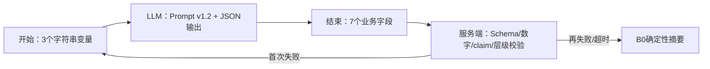

# `ride_analysis_v1` 扣子开发环境配置指南

> 工作项：`ITEM-V005`  
> Workflow基线：`ride_analysis_v1-dev.1`  
> Prompt：`prompts/cycling-buddy-system-prompt.md` v1.2  
> 状态：`SUPERSEDED / HISTORICAL_REFERENCE_ONLY`  
> 边界：仅保留为旧七字段链路的操作与失败学习证据。不要继续照此配置或发布；新版配置见[`ride_analysis_v2-配置指南.md`](ride_analysis_v2-配置指南.md)。

## 1. 为什么扣子只保留三个节点

首版的单一不确定性是“模型能否在可信事实内产生更有价值的表达”。数据解析、质量判定、层级边界、数字和claim校验都是确定性责任，由已有服务端代码统一执行。



这避免在扣子与代码中各维护一套校验规则。RAG、Function Calling、对话Agent和多Agent不在本项中。

## 2. 创建Workflow

1. 在扣子的私有开发空间创建Workflow，命名`ride_analysis_v1`。
2. 开始节点建立三个字符串输入：

| 变量 | 类型 | 必填 | 用途 |
|---|---|---:|---|
| `ride_snapshot` | String | 是 | 服务端生成的`RideContextSnapshot 1.0` JSON；使用短名以满足扣子20字符限制 |
| `repair_instruction` | String | 否，默认空 | 仅第二次调用时传入校验错误码 |
| `previous_output` | String | 否，默认空 | 仅作为待修复的不可信候选输出 |

3. 添加一个LLM节点：
   - 选择账号当时可用的稳定、快速、支持JSON输出的中文模型；不选深度思考档。
   - 打开模型设置：先选择`精确模式`作为预设，再把最大回复长度设为`700`、关闭`深度思考开关`；修改后界面会显示`自定义`，这是预期结果，需记录最终参数组合而不是模式标签。当前扣子界面不暴露temperature字段，记录为`NOT_CONFIGURED`，不要为了寻找该字段改变协议或增加节点。
   - 模型节点的整体执行超时可保持平台默认`180s`用于开发调试，重试次数选择`不重试`、异常处理选择`中断流程`；这不替代服务端的8秒默认超时、15秒硬上限和最多一次受限修复。
   - 将`prompts/cycling-buddy-system-prompt.md`中的text代码块完整粘贴到System Prompt。
   - 把三个开始变量映射到Prompt中的同名占位符。
   - 输出格式选择`JSON`；使用界面的“导入JSON”时，导入`coze/ride-analysis-output-example.json`。
   - **不要**把`coze/ride-analysis-output-schema.json`导入扣子的“导入JSON”界面。当前界面会把标准JSON Schema的`schema/id/type/properties`误当成业务输出字段；该文件只用于服务端强校验和人工核对约束。
4. 添加结束节点，选择`返回变量`，建立并映射以下七个输出：

| 结束节点变量 | 类型 | 映射来源 |
|---|---|---|
| `headline` | String | 大模型 → `headline` |
| `summary` | String | 大模型 → `summary` |
| `highlights` | Array&lt;Object&gt; | 大模型 → `highlights` |
| `nextAction` | Object | 大模型 → `nextAction` |
| `limitations` | Array&lt;String&gt; | 大模型 → `limitations` |
| `safetyLevel` | String | 大模型 → `safetyLevel` |
| `shareCopy` | Array&lt;String&gt; | 大模型 → `shareCopy` |

服务端同时兼容这七个根字段和历史`analysis_json`包装，但本Workflow采用七个根字段，避免在扣子中增加代码节点或把对象二次转成字符串。
5. 保存并在Workflow调试区运行一条内置L1样例；不要在扣子中自己输入或修改骑行数字。

## 3. 结构化输出Schema

以`coze/ride-analysis-output-schema.json`为服务端机器可读事实源。`coze/ride-analysis-output-example.json`只用于让扣子当前界面推断正确的输出字段和类型，不替代下列约束：

```json
{
  "type": "object",
  "additionalProperties": false,
  "required": ["headline", "summary", "highlights", "nextAction", "limitations", "safetyLevel", "shareCopy"],
  "properties": {
    "headline": { "type": "string", "maxLength": 20 },
    "summary": { "type": "string", "minLength": 1, "maxLength": 120 },
    "highlights": {
      "type": "array",
      "maxItems": 3,
      "items": {
        "type": "object",
        "additionalProperties": false,
        "required": ["text", "claimIds", "confidence"],
        "properties": {
          "text": { "type": "string" },
          "claimIds": { "type": "array", "minItems": 1, "items": { "type": "string" } },
          "confidence": { "type": "string", "enum": ["high", "medium", "low"] }
        }
      }
    },
    "nextAction": {
      "type": "object",
      "additionalProperties": false,
      "required": ["text", "basisClaimIds"],
      "properties": {
        "text": { "type": "string" },
        "basisClaimIds": { "type": "array", "items": { "type": "string" } }
      }
    },
    "limitations": { "type": "array", "minItems": 1, "items": { "type": "string" } },
    "safetyLevel": { "type": "string", "enum": ["normal", "caution", "stop"] },
    "shareCopy": {
      "type": "array",
      "minItems": 3,
      "maxItems": 3,
      "items": { "type": "string", "maxLength": 50 }
    }
  }
}
```

## 4. 发布与本地配置

1. 将Workflow发布到私有开发版，记录Workflow ID和确切模型名/ID。这不等于对外发布产品。
2. 在扣子API凭证页创建最小权限的开发Token。Token只放在本机`.env.local`，不粘贴到聊天、截图、前端或Git。
3. 复制`.env.example`为`.env.local`后填写：

```dotenv
AI_ANALYSIS_ENABLED=true
COZE_API_URL=https://api.coze.cn/v1/workflow/run
COZE_WORKFLOW_ID=你的Workflow_ID
COZE_API_TOKEN=你的开发Token
COZE_MODEL_ID=扣子中实际选择的模型名或ID
AI_ANALYSIS_TIMEOUT_MS=8000
AI_MAX_RESPONSE_BYTES=262144
```

如使用国际版扣子，将`COZE_API_URL`替换为当前控制台API文档给出的Workflow Run地址；不要根据猜测修改路径。

## 5. 开发冒烟测试

启动本地Demo后，调用：

```bash
curl -X POST http://localhost:3000/api/ride-analysis \
  -H 'Content-Type: application/json' \
  -d '{"rideId":"l1-built-in-sample"}'
```

首轮只使用内置L1/L2/L3样例，不上传真实文件。返回中`source=b2`表示模型输出通过校验；`source=b0`表示已降级，并应同时查看`fallbackCode`。不得因为页面能显示B0就误判为扣子已连通。

## 6. 完成后需回传的非敏感信息

- Workflow ID；
- 模型名或model ID；
- Workflow发布版本/时间；
- 调试是否在结束节点返回全部七个业务字段。

不要回传Token。
