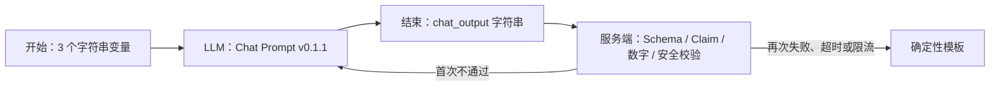

# `ride_chat_v1` 扣子开发环境配置指南

> 工作项：`CHAT-11`  
> Workflow：`ride_chat_v1`  
> 输入合同：`ride-chat-workflow-input-v0.1`  
> Prompt：[`prompts/ride-chat-workflow-v0.1.md`](../prompts/ride-chat-workflow-v0.1.md) `ride-chat-prompt-v0.1.1`（2026-09-08 人格对齐：自称“AI 骑行伙伴”的对话表达层；粘贴时以 v0.1.1 为准）  
> 输出合同：`ride-chat-output-v0.1`  
> 状态：`Review`。用于本地 Demo 联调；不代表 `chat_enabled` 已开放。

## 0. 模型版本策略

`ride_chat_v1` 的默认候选使用关闭深度思考的快速模型配置；另建 `ride_chat_v1_reasoning` 实验 Workflow 使用同一输入、Prompt、输出合同与服务端适配器，但可开启深度思考。不要在同一个已发布 Workflow 中直接切换二者并把结果混入同一测评 Run。

深度思考版不是更高权限的 Agent，也不能替代服务端 Schema、Claim、数字、安全或隐私校验。它必须以相同固定集独立比较事实硬门、一次修复率、P50/P95 延迟、调用次数和成本可观测性；只有在硬门均为零失败且收益足以覆盖等待和成本后，才可另行决定是否成为默认候选。

## 1. 边界

这是一条独立于骑后解读的对话链路。创建新的扣子 Workflow `ride_chat_v1`，不要复用 `ride_analysis_v1`、`ride_analysis_v2`、`ride_analysis_v3`、`COZE_*`、`COZE_INTERPRETATION_*`、骑后 Prompt 或 `AnalysisRun`。



扣子只负责受约束的语言表达。身份、归属校验、工具选择、数据裁剪、数字/Claim 校验、一次修复上限、超时、降级和观测均在服务端执行。安全、隐私、注入、训练计划与实时道路/天气请求在调用 Workflow 前已被服务端拦截。

## 2. 创建 Workflow

1. 在扣子的私有开发空间新建 Workflow，名称填 `ride_chat_v1`。如要测试深度思考，复制为独立的 `ride_chat_v1_reasoning`，不要覆盖默认版。
2. 在开始节点创建三个 `String` 变量：

| 变量 | 必填 | 默认值 | 用途 |
|---|---:|---|---|
| `chat_request` | 是 | 无 | 服务端生成的 JSON 字符串，包含路由、当前问题和可选的去标识化工具投影 |
| `repair_instruction` | 否 | 空字符串 | 仅第二次调用时提供的受限修复要求 |
| `previous_output` | 否 | 空字符串 | 仅第二次调用时提供的未校验候选输出 |

3. 添加一个 LLM 节点。
   - 默认版选择当前账号中稳定、快速、支持中文和 JSON 输出的非深度思考模型，并记录模型名或 ID。
   - 实验版可开启深度思考，并记录实际模型名或 ID、思考开关、思考强度与推理/回答长度。界面显示的设置不是运行证据；以真实 Run 的延迟和调用记录为准。
   - 重试设为“不重试”，异常处理设为“中断流程”。服务端最多允许两次调用，不能在扣子侧再加重试。
   - 将 [`prompts/ride-chat-workflow-v0.1.md`](../prompts/ride-chat-workflow-v0.1.md) 的 `text` 代码块完整粘贴为 System Prompt。
   - 将开始变量 `chat_request`、`repair_instruction`、`previous_output` 映射到 Prompt 中同名变量。
   - 将输出设置为 JSON 或 JSON 对象文本。不要让节点额外输出思考过程、Markdown 或解释。
4. 添加结束节点，返回唯一变量：

| 结束节点变量 | 类型 | 映射来源 |
|---|---|---|
| `chat_output` | String | LLM 节点完整 JSON 输出文本 |

`chat_output` 必须是一个 JSON 字符串，而不是拆分后的多个字段。其内容必须严格遵守下面的五字段对象；可用 [`coze/ride-chat-output-v0.1-example.json`](ride-chat-output-v0.1-example.json) 检查结构。

```json
{
  "schemaVersion": "ride-chat-output-v0.1",
  "route": "current_ride",
  "reply": "本次平均功率是 205 W。",
  "claimIds": ["claim:context:1"],
  "capabilityKeys": []
}
```

不要把 JSON Schema 文件导入为结束节点字段。Workflow 只需要返回一个 `chat_output` 字符串；详细 Schema、Claim、数字、路由和安全检查由服务端完成。

## 3. 调试输入与预期

只使用合成数据调试，不在扣子控制台粘贴真实 Token、完整用户数据、文件、轨迹或精确位置。一个当前骑行样例：

```text
chat_request = {"agent":"ride_chat_v1","agentVersion":"ride-chat-agent-v0.1","model":"your-model-id","route":"current_ride","text":"本次骑行平均功率是多少？","toolContext":{"tool":"get_ride_context","dimensions":["power"],"claims":[{"claimId":"claim:context:1","kind":"metric","key":"avgPowerW","value":205,"unit":"W","confidence":"high","displayValue":"205","displayUnit":"W"}],"limitations":[]}}
repair_instruction =
previous_output =
```

预期 `chat_output` 与示例结构相同，且只引用 `claim:context:1`。对 `capabilities` 路由，`claimIds` 必须为空，`capabilityKeys` 只能取当前 `toolContext.capabilities[].key`。对 `social` 路由，两个数组都必须为空，回复中不出现数字。

## 4. 发布与本地配置

1. 在扣子发布该 Workflow 的私有开发版本，记录 Workflow ID、发布版本、实际模型名或 ID，以及其为 `default_fast` 或 `reasoning_experiment`。两个版本使用不同 Workflow ID，避免发布版本覆盖和测评混淆。
2. 创建只用于此 Demo 的最小权限 API Token。Token 只能写入本机 `.env.local`，不能提交、截图、放入 Prompt 或发送到聊天记录。
3. 基于 `.env.example` 在 `.env.local` 填写：

```dotenv
CHAT_MODEL_ENABLED=true
CHAT_PROVIDER_KIND=coze_workflow
COZE_CHAT_API_URL=https://api.coze.cn/v1/workflow/run
COZE_CHAT_WORKFLOW_NAME=ride_chat_v1
COZE_CHAT_WORKFLOW_ID=你的_Workflow_ID
COZE_CHAT_WORKFLOW_VERSION=你的发布版本
COZE_CHAT_API_TOKEN=你的开发Token
COZE_CHAT_MODEL_ID=扣子中实际选择的模型名或ID
COZE_CHAT_TIMEOUT_MS=8000
COZE_CHAT_MAX_RESPONSE_BYTES=65536
```

如使用扣子国际版或其他地域端点，`COZE_CHAT_API_URL` 必须以该控制台当前 API 文档为准。不要凭路径猜测替换。服务端只允许 HTTPS（或本机调试地址），并将单次模型调用限制在 8 秒、最大响应 64 KB。

改完 `.env.local` 后重启本地开发服务。`CHAT_MODEL_ENABLED=true` 只允许本地 API 调到 Chat Workflow，不会自动打开 `chat_enabled`，也不会改变骑后 AI 解读。

## 5. 联调与验收

先运行不触网的固定集预检：

```bash
pnpm eval:chat:preflight
pnpm test
pnpm typecheck
```

通过后，使用 `/chat` 导入一条 Demo 骑行记录，分别提问“本次骑行平均功率是多少？”和“支持哪些能力？”。再在 `/demo-events` 核对事件只包含脱敏请求引用、路由、调用次数、耗时、修复次数和状态码，未显示对话正文、Prompt、Token、精确位置或 Provider 原文。

真实固定集调用会产生成本，并且需要新的 `AEVAL-M3-CHAT-<date>-<sequence>` Run ID。运行前单独冻结模型/Workflow 版本、调用次数和预算；运行后记录延迟、成本可观测状态、硬门结果和人工审阅。只有这些证据与用户明确批准均具备时，才评估是否开启 `chat_enabled`。

## 6. 需要回传的非敏感信息

- Workflow ID；
- Workflow 发布版本；
- 实际模型名或 ID；
- 调试时是否仅返回 `chat_output`，以及一条合成样例是否通过服务端校验。

不要回传 Token、真实用户文本、完整工具结果、Prompt 截图或扣子原始响应。
