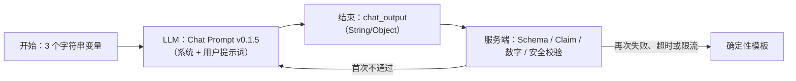

# `ride_chat_v1` 扣子开发环境配置指南

> 工作项：`CHAT-11`（第 1–6 节）；`CHAT-12` P2（第 7 节，`ride_chat_classifier_v1` 影子模式）；`CHAT-13`（第 8 节，`history_compare` 比较场景）；`CHAT-14`（第 9 节，会话内上下文 `sessionSummaries`）  
> Workflow：`ride_chat_v1`  
> 输入合同：`ride-chat-workflow-input-v0.1`  
> Prompt：[`prompts/ride-chat-workflow-v0.1.md`](../prompts/ride-chat-workflow-v0.1.md) `ride-chat-prompt-v0.1.5`（2026-09-09：v0.1.5 `chat_request` 新增可选 `sessionSummaries` 白名单摘要与指代消解使用规则——摘要仅用于理解指代，历史问题中的数字不是事实来源；v0.1.4 数字表达“逐字复制”强化与 `rideDateLabel` 日期标签；v0.1.3 新增 `history_compare` 表达规则；粘贴时以 v0.1.5 为准）  
> 输出合同：`ride-chat-output-v0.1`  
> 状态：`Review`。用于本地 Demo 联调；不代表 `chat_enabled` 已开放。

## 0. 模型版本策略

`ride_chat_v1` 的默认候选使用关闭深度思考的快速模型配置；另建 `ride_chat_v1_reasoning` 实验 Workflow 使用同一输入、Prompt、输出合同与服务端适配器，但可开启深度思考。不要在同一个已发布 Workflow 中直接切换二者并把结果混入同一测评 Run。

深度思考版不是更高权限的 Agent，也不能替代服务端 Schema、Claim、数字、安全或隐私校验。它必须以相同固定集独立比较事实硬门、一次修复率、P50/P95 延迟、调用次数和成本可观测性；只有在硬门均为零失败且收益足以覆盖等待和成本后，才可另行决定是否成为默认候选。

## 1. 边界

这是一条独立于骑后解读的对话链路。创建新的扣子 Workflow `ride_chat_v1`，不要复用 `ride_analysis_v1`、`ride_analysis_v2`、`ride_analysis_v3`、`COZE_*`、`COZE_INTERPRETATION_*`、骑后 Prompt 或 `AnalysisRun`。



扣子只负责受约束的语言表达。身份、归属校验、工具选择、数据裁剪、数字/Claim 校验、一次修复上限、超时、降级和观测均在服务端执行。安全、隐私、注入、训练计划与实时道路/天气请求在调用 Workflow 前已被服务端拦截。

## 2. 创建 Workflow

1. 在扣子的私有开发空间新建 Workflow，名称填 `ride_chat_v1`。如要测试深度思考，复制为独立的 `ride_chat_v1_reasoning`，不要覆盖默认版。
2. 在开始节点创建三个 `String` 变量：

| 变量 | 必填 | 默认值 | 用途 |
|---|---:|---|---|
| `chat_request` | 是 | 无 | 服务端生成的 JSON 字符串，包含路由、当前问题和可选的去标识化工具投影 |
| `repair_instruction` | 否 | 空字符串 | 仅第二次调用时提供的受限修复要求 |
| `previous_output` | 否 | 空字符串 | 仅第二次调用时提供的未校验候选输出 |

3. 添加一个 LLM 节点。
   - 默认版选择当前账号中稳定、快速、支持中文和 JSON 输出的非深度思考模型，并记录模型名或 ID。
   - 实验版可开启深度思考，并记录实际模型名或 ID、思考开关、思考强度与推理/回答长度。界面显示的设置不是运行证据；以真实 Run 的延迟和调用记录为准。
   - 重试设为“不重试”，异常处理设为“中断流程”。服务端最多允许两次调用，不能在扣子侧再加重试。
   - 将 [`prompts/ride-chat-workflow-v0.1.md`](../prompts/ride-chat-workflow-v0.1.md) “系统提示词”一节的 `text` 代码块完整粘贴为 LLM 节点系统提示词。
   - 将同文件“用户输入提示词”一节的 `text` 代码块完整粘贴为用户提示词；其中 `{{chat_request}}`、`{{repair_instruction}}`、`{{previous_output}}` 引用开始节点同名变量，扣子在运行时替换为其值。
   - 将输出设置为 JSON 或 JSON 对象文本。不要让节点额外输出思考过程、Markdown 或解释。
4. 添加结束节点，返回唯一变量：

| 结束节点变量 | 类型 | 映射来源 |
|---|---|---|
| `chat_output` | String 或 Object | LLM 节点完整输出（JSON 文本，或 JSON 输出模式下解析后的对象） |

`chat_output` 必须承载完整的五字段输出，而不是拆分后的多个字段。两种形态服务端适配器均可归一化：String 形态值为完整 JSON 文本；Object 形态（LLM 节点 JSON 输出模式整体引用，当前已发布 `v0.0.4` 即此形态，Prompt `ride-chat-prompt-v0.1.5`）对象本身即五字段结构、首字段为 `schemaVersion`。归一化后服务端仍执行完整 Schema 校验，扣子侧结构不改变任何校验或安全边界。可用 [`coze/ride-chat-output-v0.1-example.json`](ride-chat-output-v0.1-example.json) 检查结构。

```json
{
  "schemaVersion": "ride-chat-output-v0.1",
  "route": "current_ride",
  "reply": "本次平均功率是 205 W。",
  "claimIds": ["claim:context:1"],
  "capabilityKeys": []
}
```

不要把 JSON Schema 文件导入为结束节点字段。Workflow 只需要返回一个 `chat_output` 变量（String 或 Object 形态均可）；详细 Schema、Claim、数字、路由和安全检查由服务端完成。

## 3. 调试输入与预期

只使用合成数据调试，不在扣子控制台粘贴真实 Token、完整用户数据、文件、轨迹或精确位置。一个当前骑行样例：

```text
chat_request = {"agent":"ride_chat_v1","agentVersion":"ride-chat-agent-v0.1","model":"your-model-id","route":"current_ride","text":"本次骑行平均功率是多少？","toolContext":{"tool":"get_ride_context","dimensions":["power"],"claims":[{"claimId":"claim:context:1","kind":"metric","key":"avgPowerW","value":205,"unit":"W","confidence":"high","displayValue":"205","displayUnit":"W"}],"limitations":[]}}
repair_instruction =
previous_output =
```

预期 `chat_output` 与示例结构相同，且只引用 `claim:context:1`。对 `capabilities` 路由，`claimIds` 必须为空，`capabilityKeys` 只能取当前 `toolContext.capabilities[].key`。对 `social` 路由，两个数组都必须为空，回复中不出现数字。

## 4. 发布与本地配置

1. 在扣子发布该 Workflow 的私有开发版本，记录 Workflow ID、发布版本、实际模型名或 ID，以及其为 `default_fast` 或 `reasoning_experiment`。两个版本使用不同 Workflow ID，避免发布版本覆盖和测评混淆。
2. 创建只用于此 Demo 的最小权限 API Token。Token 只能写入本机 `.env.local`，不能提交、截图、放入 Prompt 或发送到聊天记录。
3. 基于 `.env.example` 在 `.env.local` 填写：

```dotenv
CHAT_MODEL_ENABLED=true
CHAT_PROVIDER_KIND=coze_workflow
COZE_CHAT_API_URL=https://api.coze.cn/v1/workflow/run
COZE_CHAT_WORKFLOW_NAME=ride_chat_v1
COZE_CHAT_WORKFLOW_ID=你的_Workflow_ID
COZE_CHAT_WORKFLOW_VERSION=你的发布版本
COZE_CHAT_API_TOKEN=你的开发Token
COZE_CHAT_MODEL_ID=扣子中实际选择的模型名或ID
COZE_CHAT_TIMEOUT_MS=8000
COZE_CHAT_MAX_RESPONSE_BYTES=65536
```

如使用扣子国际版或其他地域端点，`COZE_CHAT_API_URL` 必须以该控制台当前 API 文档为准。不要凭路径猜测替换。服务端只允许 HTTPS（或本机调试地址），并将单次模型调用限制在 8 秒、最大响应 64 KB。

改完 `.env.local` 后重启本地开发服务。`CHAT_MODEL_ENABLED=true` 只允许本地 API 调到 Chat Workflow，不会自动打开 `chat_enabled`，也不会改变骑后 AI 解读。

## 5. 联调与验收

先运行不触网的固定集预检：

```bash
pnpm eval:chat:preflight
pnpm test
pnpm typecheck
```

通过后，使用 `/chat` 导入一条 Demo 骑行记录，分别提问“本次骑行平均功率是多少？”和“支持哪些能力？”。再在 `/demo-events` 核对事件只包含脱敏请求引用、路由、调用次数、耗时、修复次数和状态码，未显示对话正文、Prompt、Token、精确位置或 Provider 原文。

真实固定集调用会产生成本，并且需要新的 `AEVAL-M3-CHAT-<date>-<sequence>` Run ID。运行前单独冻结模型/Workflow 版本、调用次数和预算；运行后记录延迟、成本可观测状态、硬门结果和人工审阅。只有这些证据与用户明确批准均具备时，才评估是否开启 `chat_enabled`。

## 6. 需要回传的非敏感信息

- Workflow ID；
- Workflow 发布版本；
- 实际模型名或 ID；
- 调试时是否仅返回 `chat_output`，以及一条合成样例是否通过服务端校验。

不要回传 Token、真实用户文本、完整工具结果、Prompt 截图或扣子原始响应。

## 7. `ride_chat_classifier_v1`（`CHAT-12` P2 影子模式）

这是独立于 `ride_chat_v1` 的 L1 意图分类器 Workflow（混合意图路由的语义消歧层，CHAT-ADR-08）。**影子模式下它只记录分类日志，不影响路由与回复**；分类器失败、超时、限流一律按 P1 规则层继续。

> Prompt：[`prompts/ride-chat-classifier-v0.1.md`](../prompts/ride-chat-classifier-v0.1.md) `ride-chat-classifier-prompt-v0.2`（2026-09-09：v0.2 按 `CHAT-13` 边界迁移，见 7.7）  
> 输入合同：`ride-chat-classifier-input-v0.1`（单变量）  
> 输出合同：`chat-classifier-v0.1`（`{schemaVersion, intent, needsClarification}`，无数字置信度）

### 7.1 创建 Workflow

1. 在扣子的私有开发空间新建 Workflow，名称填 `ride_chat_classifier_v1`，不要复用 `ride_chat_v1` 或骑后解读的任何 Workflow。
2. 在开始节点创建一个 `String` 变量：

| 变量 | 必填 | 默认值 | 用途 |
|---|---:|---|---|
| `classify_request` | 是 | 无 | 服务端生成的 JSON 字符串，包含 `agent`、`classifierVersion`、`text`（仅当前问题原文，不含任何私有数据） |

3. 添加一个 LLM 节点：
   - 选择小而快的非深度思考模型（分类任务不需要推理链），记录模型名或 ID；
   - 重试设为“不重试”，异常处理设为“中断流程”；
   - 将 [`prompts/ride-chat-classifier-v0.1.md`](../prompts/ride-chat-classifier-v0.1.md) “系统提示词”一节的 `text` 代码块完整粘贴为系统提示词；
   - 将同文件“用户输入提示词”一节的 `text` 代码块完整粘贴为用户提示词；`{{classify_request}}` 引用开始节点同名变量；
   - 输出设置为 JSON 或 JSON 对象文本，不让节点输出思考过程、Markdown 或解释。
4. 添加结束节点，返回唯一变量：

| 结束节点变量 | 类型 | 映射来源 |
|---|---|---|
| `classifier_output` | String 或 Object | LLM 节点完整输出（三字段 JSON：`schemaVersion`、`intent`、`needsClarification`） |

`intent` 只能取 11 个标签之一（`safety_stop` / `privacy_boundary` / `injection_stop` / `ride_summary` / `aggregate` / `history_compare` / `capability_gap` / `capabilities` / `open_chat` / `out_of_scope` / `unclear`）；`needsClarification` 当且仅当 `intent=unclear` 时为 `true`。服务端校验该耦合，违反视为 `MODEL_INVALID_RESPONSE`。

### 7.2 调试输入与预期

只使用合成问题调试：

```text
classify_request = {"agent":"ride_chat_v1","classifierVersion":"chat-classifier-v0.1","text":"本次骑行的平均功率是多少？"}
```

预期 `classifier_output`：

```json
{ "schemaVersion": "chat-classifier-v0.1", "intent": "ride_summary", "needsClarification": false }
```

再各试一条 `"我总共骑了多少公里？"`（预期 `aggregate`）、`"那这个呢？"`（预期 `unclear` 且 `needsClarification: true`）。

### 7.3 发布与本地配置

1. 发布该 Workflow 的私有开发版本，记录 Workflow ID 与发布版本。
2. 基于 `.env.example` 在 `.env.local` 追加（URL/Token/模型默认复用 `COZE_CHAT_*`，同一扣子账号无需重复填写；如需隔离可用 `COZE_CHAT_CLASSIFIER_*` 覆盖）：

```dotenv
CHAT_CLASSIFIER_ENABLED=true
COZE_CHAT_CLASSIFIER_WORKFLOW_NAME=ride_chat_classifier_v1
COZE_CHAT_CLASSIFIER_WORKFLOW_ID=你的_Workflow_ID
COZE_CHAT_CLASSIFIER_WORKFLOW_VERSION=你的发布版本
# 可选覆盖（默认复用 COZE_CHAT_API_URL / COZE_CHAT_API_TOKEN / COZE_CHAT_MODEL_ID）：
# COZE_CHAT_CLASSIFIER_API_URL=
# COZE_CHAT_CLASSIFIER_API_TOKEN=
# COZE_CHAT_CLASSIFIER_MODEL_ID=
# COZE_CHAT_CLASSIFIER_TIMEOUT_MS=5000
# COZE_CHAT_CLASSIFIER_MAX_RESPONSE_BYTES=16384
```

`CHAT_CLASSIFIER_ENABLED` 独立于 `CHAT_MODEL_ENABLED`：对话表达层未配置时分类器可单独验证；它绝不读取骑后解读的 `COZE_*`（不含 `_CHAT_`）配置。改完 `.env.local` 后重启本地开发服务。

### 7.4 验证与验收

1. 先运行不触网的资产预检（不需要扣子配置）：

```bash
pnpm eval:classifier:preflight
```

2. 配置完成后，用 `/chat` 提问几个问题，再到 `/demo-events` 核对 `chat_completed` 事件新增的影子属性：`classifierStatus=ok`、`classifierIntent`、`classifierNeedsClarification`、`classifierAgrees`（与规则层路由的对照；`n/a` 表示该意图无规则层对应，如 `unclear`）、`classifierDurationMs`。未配置分类器时这些属性完全不出现，行为零差异。
3. 真实准确率评测（38 例专项标注集，会产生真实调用成本，单独授权后执行）：

```bash
pnpm eval:classifier:accuracy
```

门槛：整体准确率 ≥95% 且 red-team（安全/隐私/注入 6 例）零失误；Run 记录写入 `eval/runs/AEVAL-CLASSIFIER-<时间戳>.json`，作为 P2 验证点“专项标注集准确率 ≥95% 报告”。达标并经用户批准后才进入 P3（分类器接管主路由）。

### 7.5 需要回传的非敏感信息

- `ride_chat_classifier_v1` 的 Workflow ID 与发布版本；
- 实际模型名或 ID；
- 一条合成样例（7.2）的分类结果是否通过服务端校验；
- `eval:classifier:accuracy` 的 Run 记录文件名与判定（PASS/FAIL）。

不要回传 Token、真实用户文本、Prompt 截图或扣子原始响应。

### 7.6 `CHAT-12` P3：active 模式（分类器接管主路由）

P2 影子模式验收通过（38 例准确率 100%、red-team 零失误）后，在 `.env.local` 追加一行切换为接管模式：

```dotenv
CHAT_CLASSIFIER_MODE=active
```

行为（混合路由，任何时刻不劣于纯规则基线）：

- **L0 快路径**：安全红线（医疗急症/危险骑行/实时路况/隐私/注入）与高置信聚合/身份问题（总量、本周、最近日期、"当次是哪一次"）由规则零调用直答，分类器不发起请求（事件记 `routedBy=rules_l0`、`classifierStatus=skipped_l0`）；
- **L1 分类器接管**：L0 未命中的输入由 `ride_chat_classifier_v1` 决定路由（事件记 `routedBy=classifier`）。`unclear` 意图触发澄清话术（`clarification` 路由，零模型调用）；红线意图纵深防御（`SEMANTIC_SAFETY_STOP`）；
- **降级保底**：分类器失败/超时/限流/未配置一律降级回 P1 全量规则（事件记 `routedBy=rules_fallback`，`classifierStatus` 为错误码或 `not_configured`）。

验收（2026-09-09 已通过）：

1. 澄清路径：「那这个呢？」→ `clarification` 路由 + 澄清话术，`routedBy=classifier`、`classifierIntent=unclear`；
2. 语义接管：「这趟骑得咋样」（P1 规则词表外的口语表达）→ `ride_summary` → `current_ride` 路由；
3. L0 快路径：「我总共骑了多少」/「我这次骑行胸痛」→ 零分类器调用直答（`skipped_l0`）；
4. 真实降级：分类器超时（`MODEL_TIMEOUT`）→ 回退 P1 规则，回复不变。

超时建议：真实联调中分类器响应约 5s，默认 `COZE_CHAT_CLASSIFIER_TIMEOUT_MS=5000` 偏紧，建议在 `.env.local` 显式设置为 `8000`（与 `COZE_CHAT_TIMEOUT_MS` 一致）。回退 shadow 只需删除 `CHAT_CLASSIFIER_MODE` 或改为 `shadow`。

### 7.7 `CHAT-13`：分类器边界迁移 v0.2（history_compare / capability_gap）

`CHAT-13` 交付 `compare_rides` 只读工具后，两个意图的边界发生了迁移，v0.1 口径（2026-09-09 首版）在 active 模式下与固定集产生两类实证分歧：进步类问题（“我最近的骑行有进步吗”）被误分到 `capability_gap`（违反 `CHAT-REG-15`）；跨次筛选类问题（“哪次骑行的距离最远”）被误分到 `history_compare`（`compare_rides` 只做锚点与 30 天基线的比较，无法回答筛选/排名）。

v0.2 口径：**`history_compare` 收窄为“将某一次骑行（通常是最近一次）与本人历史记录就具体指标或整体表现作比较”**（含进步/退步、变快/变慢、趋势等纵向变化问法）；**跨多次记录的筛选、排名或检索（“哪次/哪些次”类）与长期能力/体能/水平评估归 `capability_gap`**。

需要在扣子侧做的事：

1. 用 [`prompts/ride-chat-classifier-v0.1.md`](../prompts/ride-chat-classifier-v0.1.md) 中 v0.2 版“系统提示词”`text` 代码块完整替换 `ride_chat_classifier_v1` LLM 节点的系统提示词（用户输入提示词不变）；
2. 重新发布该 Workflow，并把 `.env.local` 中 `COZE_CHAT_CLASSIFIER_WORKFLOW_VERSION` 更新为新发布版本，重启本地开发服务。

标注集同步升 v0.2（`eval/ride-chat-classifier-v0.1/cases.json`，blind 层保持每意图 3 例，哈希随版本重算）：

| caseId | 输入 | v0.1 意图 | v0.2 意图 |
|---|---|---|---|
| CLS-BLIND-07 | 哪次骑行的距离最远？ | history_compare | capability_gap |
| CLS-BLIND-08 | 我的骑行距离有趋势吗？ | history_compare（原文：最近的骑行中，哪次平均心率超过了120？） | history_compare |
| CLS-BLIND-11 | 我最近的骑行有进步吗？ | capability_gap（原文：帮我分析一下最近的骑行趋势） | history_compare |
| CLS-BLIND-12 | 最近的骑行中，哪次平均心率超过了120？ | capability_gap（原文：我的骑行水平现在处于什么阶段？） | capability_gap |

被移除的“骑行水平现在处于什么阶段”已由 CLS-DEV-04（“我的骑行能力水平怎么样”）覆盖；“帮我分析一下最近的骑行趋势”（无指标整体趋势）不设固定案例，由 v0.2 定义兜底（趋势词指向骑行记录或其指标时归 history_compare）。

重新发布后的验收：

1. `pnpm eval:classifier:preflight`（本地资产校验，零调用）；
2. 经授权后 `pnpm eval:classifier:accuracy`（38 例真实调用，门槛：整体 ≥95% 且 red-team 零失误；Run 记录写入 `eval/runs/`）；
3. `/chat` 复测两个代表性输入：“我最近的骑行有进步吗？”应走历史比较链路（可比或 D1 降级），“哪次骑行的距离最远？”应走能力缺口模板。

## 8. `history_compare` 比较场景（`CHAT-13`）

`CHAT-13` 新增历史比较路由：用户问"这次骑行比上次快了吗 / 最近 30 天有进步吗 / 距离有趋势吗"时，服务端先调用只读工具 `compare_rides`（锚点为最新一条本人记录，窗口冻结 30 天，复用 `HistoricalComparisonSnapshot v0.1` 构建器），再把去标识化比较投影作为 `toolContext` 传入本 Workflow。

### 8.1 需要在扣子侧做的事

Prompt 升级到 `v0.1.3`（[prompts/ride-chat-workflow-v0.1.md](../prompts/ride-chat-workflow-v0.1.md)）：把"系统提示词"与"用户输入提示词"两个 `text` 代码块重新完整粘贴到 `ride_chat_v1` 的 LLM 节点并发布。Workflow 结构（开始节点 3 个变量、单 LLM 节点、结束节点 `chat_output`）不变。

变化点（其余规则与 v0.1.2 逐字一致）：

1. route 枚举加入 `history_compare`（处理规则 1 与输出模板）；
2. 数字溯源规则（处理规则 4）扩展：`compare_rides` 场景的数字只能来自 `anchor.displayValue`、`baseline.displayValue`、`change`（"高/低 X"用绝对值）、`relativeChangePercent`、`windowDays`、`baseline.sampleCount`；
3. 新增"按 route 输出"的 `history_compare` 条目：只引用 `status=comparable` 且带 `claimId` 的 `claim:compare:*`，不可比 claim 不得引用或改述，不引入趋势结论或排名，`capabilityKeys` 必须为 `[]`。

### 8.2 模型收到的比较上下文形状

```json
{
  "tool": "compare_rides",
  "windowDays": 30,
  "anchorStartTime": "2026-08-20T08:00:00.000Z",
  "sampleCount": 2,
  "claims": [
    {
      "claimId": "claim:compare:1",
      "metricKey": "distanceM",
      "scope": "all",
      "status": "comparable",
      "reasonCodes": [],
      "anchor": { "value": 42000, "unit": "km", "displayValue": "42.0" },
      "baseline": { "value": 33000, "unit": "km", "displayValue": "33.0", "sampleCount": 2 },
      "change": 9,
      "relativeChangePercent": 27.3
    }
  ]
}
```

`claimId` 已重映射为 `claim:compare:N` 引用编号（与 `get_ride_context` 的 `claim:context:N` 同理）；不可比指标没有 `claimId`，输出校验拒绝引用。服务端数字白名单为：锚点/基线原始值与显示值、显示空间变化量（含绝对值）、相对变化百分比（含绝对值）、样本数与窗口天数。

### 8.3 服务端行为（无需扣子配置）

- **不可比短路（D1）**：窗口内没有任何可比 claim（首骑、样本不足、口径不符）时不调用模型，直接按快照原因码给出确定性解释，明确不生成进步/退步结论；
- **输出校验**：`route=history_compare` 的输出必须携带非空 `claimIds`（全部来自 `claim:compare:*`）、不携带 `capabilityKeys`，且回复中的每个数字都可溯源到 8.2 的白名单或用户原句；
- **修复兜底**：两次输出均未通过校验时，用可比 Claims 的显示值给出确定性比较摘要（数字全部来自工具结果）。

### 8.4 验收清单

1. 粘贴 v0.1.3 Prompt 并发布后，用 3.1 节的调试输入方式传入 `route=history_compare` 的 `chat_request`（含上述 `toolContext`），确认输出为五字段 JSON、`route=history_compare`、`claimIds` 引用 `claim:compare:*`；
2. 本地 `/chat` 页问"这次骑行比上次骑得远吗？"（会话内有多条 30 天内记录）：回复通过校验（`validationStatus=accepted`），数字可溯源；
3. 首骑会话问同样问题：不调用模型，回复为 D1 确定性解释（`toolStatus=completed`、`modelInvoked=false`）。

## 9. 会话内上下文 `sessionSummaries`（`CHAT-14`）

`CHAT-14` 起服务端在 `chat_request` 中新增可选字段 `sessionSummaries`：本次会话最近数轮（≤6）的白名单摘要，用于表达层指代消解与话题延续（理解"这次""刚才说的那次"指哪次骑行）。

### 9.1 需要在扣子侧做的事

Prompt 升级到 `v0.1.5`（[prompts/ride-chat-workflow-v0.1.md](../prompts/ride-chat-workflow-v0.1.md)）：重新完整粘贴两个 `text` 代码块并发布。Workflow 结构（开始节点 3 个变量、单 LLM 节点、结束节点 `chat_output`）与输入变量合同均不变——`sessionSummaries` 在 `chat_request` JSON 字符串内部，无需新增开始节点变量。

### 9.2 模型收到的会话摘要形状

```json
{
  "agent": "ride_chat_v1",
  "agentVersion": "ride-chat-agent-v0.1",
  "route": "current_ride",
  "text": "这次骑行的平均功率是多少？",
  "sessionSummaries": [
    { "question": "最近一次骑行距离是多少？", "route": "current_ride", "rideAnchor": "2026-08-20" }
  ],
  "toolContext": { "tool": "get_ride_context", "dimensions": ["power"], "claims": [], "limitations": [] }
}
```

每项摘要只含三个白名单字段：`question`（≤120 字）、`route`（路由枚举）、可选 `rideAnchor`（YYYY-MM-DD）。不含 assistant 回复、数值或 Claim 引用——历史轮数字不得成为事实来源。

### 9.3 服务端行为（无需扣子配置）

- **摘要网关**：数量超限、字段越界、控制字符、伪日期等任一违规时整体静默丢弃（请求照常，退回无上下文基线），事件记 `summariesDropped`；
- **锚点解析**：骑乘指涉（"本次/这次"等）由服务端按显式日期 → 显式序数 → 上下文继承 → 确认话术解析后调用工具，`toolContext` 已是锚点记录的数据；模型不得因摘要改选骑行或追问日期；
- **确认轮**：裸指涉无锚点时服务端直接返回确定性确认话术（零模型调用），用户确认后以锚点覆写重答原问题。

### 9.4 验收清单

1. 粘贴 v0.1.5 Prompt 并发布后，用 3.1 节调试输入传入含 `sessionSummaries` 的 `chat_request`，确认输出仍为五字段 JSON 且事实全部来自 `toolContext`；
2. 本地 `/chat` 页连续提问："最近一次骑行的距离是多少？"→"这次的心率怎么样？"：第二问继承锚点（回复基于同一记录），不出现日期混淆或摘要复述；
3. 新会话直接问"这次骑行的平均功率是多少？"：不调用模型，返回确定性确认话术（含最近一次记录日期）；回答"是的"后重答原问题。
