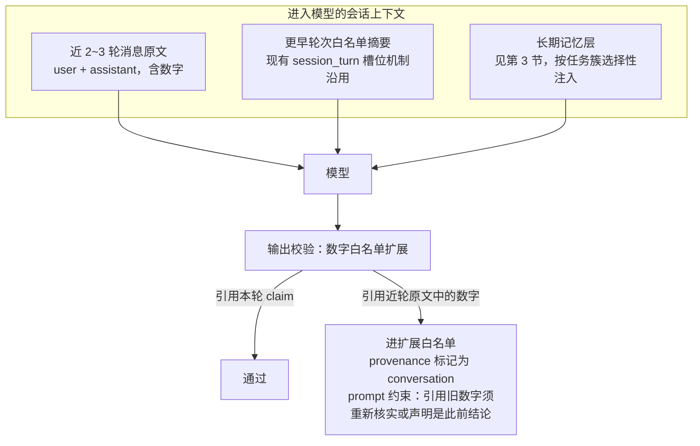
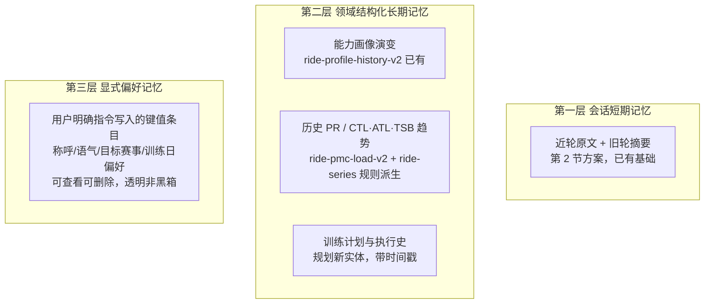

# 会话上下文与记忆机制 · 调研与决策建议

> 日期：2026-10-23｜关联：`2026-10-23_骑行伙伴自主Agent改造_需求分析.md` §4.1｜问题：① 会话摘要是否沿用现有实现，还是像同类 Agent 直接传当前会话消息？② 要不要接记忆功能？

## 0. 结论先行

| 问题 | 结论 |
| --- | --- |
| 会话上下文怎么传 | **升级为分层混合（hybrid）：近 2~3 轮传消息原文 + 更早轮次保留现有白名单摘要**。不是"沿用"，也不是"照抄主流换掉"——现有摘要机制 ≈ 主流做法里的 rolling summary，方向正确，缺的是"近期轮保持原文"这半边 |
| 要不要接记忆 | **接，但分三层，主体走领域结构化记忆（规则派生、带 provenance），不引入 Mem0/Letta/Zep 等外部记忆框架**。自由文本记忆仅限用户显式指令写入的偏好条目，透明可删 |

## 1. 同类 Agent 怎么处理会话上下文（调研结果）

| 产品 / 框架 | 短期上下文策略 | 长对话处理 | 备注 |
| --- | --- | --- | --- |
| ChatGPT / Claude 等对话产品 | 窗口内全量消息原文 | 超窗截断或提示开新会话 | 用户直觉"直接用消息"的来源 |
| Claude Code | 消息原文 | 窗口约 83.5% 触发 auto-compaction（摘要压缩），`/compact` 可指定保留项 | 压缩有损，社区经验：~75% 利用率是质量最优点 |
| Manus | 消息原文 | 保留最近 3 轮原文，超 128K token 触发摘要 | 明确原则：**Raw > Compacted > Summarized**（保真度递减，能用原文就不用摘要） |
| LangChain / LangGraph | 可配 | `ConversationSummaryBufferMemory` = 近轮原文 + 旧轮滚动摘要 | hybrid 是社区标配 |
| AWS Bedrock Agent 官方指南 | 四策略：full / windowed / summary / **hybrid（推荐）** | 近轮原文 + 旧轮摘要 | "每个 Agent 只给它需要的上下文" |
| Letta (MemGPT) | 原文 + agent 自管理记忆分页 | agent 自己调 memory 工具换页 | 长期记忆框架 |
| Mem0 / Zep(Graphiti) | 不涉（记忆层） | pipeline / 时序知识图谱 | 长期记忆框架，见 §3 |

**调研判读**：主流的完整形态是"**近期轮原文（维持指代消解与模型节奏）+ 旧轮压缩摘要（控 token 与噪声）**"，不是单纯全量原文。两项工程依据值得记录：

1. **保真度优先级**：摘要每压缩一层，多轮任务的成功率就掉一截（Manus/Claude Code 的共同经验）；最近 3 轮保持原文是为了模型的输出"节奏"。
2. **concat-and-retry 模式**（Microsoft/Salesforce）：多轮收集需求后拼一个干净 prompt 交给全新执行实例，能恢复多轮对话近 100% 的性能损失——对"对话收集约束 → 工具执行"分阶段的架构有直接参考价值（对应本项目：路由分类 → L2b 循环执行已是类似分阶段）。

## 2. 本项目现状与差距

### 2.1 现有实现（CHAT-14 P1）在行业坐标里的位置

| 设计点 | 现状 | 行业对照 |
| --- | --- | --- |
| 上下文形态 | ≤6 条白名单摘要槽位（question ≤120 字 + route + rideAnchor） | ≈ 领域特化的 rolling summary（**只做了 hybrid 的摘要半边**） |
| assistant 回复 | **不进上下文、不上服务端**（原文仅存 localStorage） | 主流均传 assistant 原文——这是本项目与主流最大的分叉 |
| 历史轮数字 | 摘要槽位无数字 → 历史数字不可能被引用 | 主流无此约束（本项目特有，见 2.2） |

### 2.2 不能照抄主流的原因（本项目两个特有约束）

1. **数字白名单输出校验**：输出校验只允许模型引用**本轮 claim 投影**中的数字。若历史 assistant 原文进上下文，模型复述"上一轮说的均速"就会被校验拒绝（或逼出错误降级）。现有摘要设计正是被这个约束逼出来的——**它不是落后，是适配**。
2. **隐私边界**：现有叙述是"对话原文只存用户本地、脱敏事件不落用户原文"。传近轮 assistant 原文上服务端 = 打破这条边界，属于**产品级隐私口径变更**，需用户显式决策，不能顺手改。

### 2.3 升级方案：分层混合（推荐）

配套改造点（三件，缺一不可）：

| # | 改造点 | 说明 |
| --- | --- | --- |
| 1 | 近 2~3 轮原文进上下文 | 上限按字节预算控制（沿用 `CHAT_SUMMARIES_MAX_BYTES` 的思路单列一档）；跨对话不传（沿用现有"仅当前活跃对话"口径） |
| 2 | **校验器白名单扩展** | 最近 N 轮 assistant 回复中出现过的数字并入本轮白名单，provenance 标记为 `conversation`；prompt 同步约束"引用往轮数字须重新调工具核实，或明确表述为'上一轮的结论'"——解决主流经验里的 **stale accumulation**（旧数字描述的世界已过时）问题 |
| 3 | 隐私口径决策 | assistant 原文随请求上服务端，需用户确认打破"原文不出本地"边界（或改为服务端不留存、仅转发模型，事件层仍脱敏） |

不升级的成本：多轮追问（"刚才那个均速，和上周比呢？"）、跨轮工具任务（先查 7 月、再查 8 月、再对比）的连贯性受限——这正是自主 Agent 改造后的高频交互形态，**建议随本次改造一并做，但作为独立切片排期**（它动了输出校验根基，须按制度开新评测 Run）。

## 3. 要不要接记忆：分三层接

| 层 | 形态 | 写入机制 | 为什么这样选 |
| --- | --- | --- | --- |
| 会话短期 | 原文+摘要 | 自动 | 第 2 节方案 |
| **领域结构化长期（主体）** | 带 provenance 的结构化事实（claim 风格） | **规则函数从骑行历史派生**，非 LLM 提取 | 骑行域的"记忆"大部分本就是确定性可算的：历史 PR、能力涨跌、负荷趋势、习惯骑行日。规则派生天然带 provenance、可进数字白名单、可校验——与项目 claim 文化完全一致 |
| 显式偏好 | 键值条目 | 用户显式指令（"记住我周六通常长距离"） | 只有这部分真正需要"记住对话内容"，用 ChatGPT memory 的显式形态但**透明可控**（回应行业对自动提取黑箱的批评） |

**为什么不引入 Mem0 / Letta / Zep**：

| 框架 | 核心机制 | 不采用的reasons |
| --- | --- | --- |
| Mem0 | pipeline 自动提取事实 + 向量检索 | 提取的事实无 provenance，进不了数字白名单校验体系；单用户场景下检索层是过度设计 |
| Letta (MemGPT) | agent 自管理记忆分页 | "记忆管理"与"任务推理"争抢模型容量（行业已观察到的退化）；与"确定性优先"文化冲突 |
| Zep (Graphiti) | 时序知识图谱（valid_at / invalid_at） | 思想最好（事实带生效期），但**这个思想用规则实现更便宜**：骑行事实的生效期（FTP 更新、能力变化）由规则从数据时间轴直接得出，不需要 LLM 建图 |

一个值得吸收的行业洞见（Zep 的核心贡献）：**长期事实必须带时间有效期**——"FTP 220"是"自 10-08 起"，不是永久真。领域结构化记忆的每条事实应带 `validFrom/validTo`，过期事实降级为历史趋势输入而非当前事实。

## 4. 对主报告的回填

- §4.1 输入（上下文）：会话上下文从"沿用现有摘要"改为"**分层混合：近 2~3 轮原文 + 旧轮白名单摘要 + 长期记忆按任务簇注入**"；新增隐私口径决策点。
- 新增任务簇依赖说明：训练监督的长期记忆 = 第二层结构化记忆，是其前置切片。
- 假设与待确认项新增：① assistant 原文上服务端的隐私口径是否接受；② 近轮原文轮数与字节预算；③ 记忆条目是否需要用户管理界面（建议 MVP 先不做，localStorage/服务端只读注入）。

## 附：本次调研信息源

- reinteractive《Why Does Your AI Agent Forget》——Manus 128K 摘要触发 / 近 3 轮原文保留 / concat-and-retry 模式
- AWS《Agent memory systems》——full / windowed / summary / hybrid 四策略与推荐
- tokenminning《Context hygiene》——rolling summarization 触发点（~80% 预算）与 episodic vs working memory 分离
- Klu《Agent memory architectures》——MemGPT/Letta、Mem0、Zep 论文级机制对比
- Mem0 博客（episodic memory）——记忆固化（episodic → semantic consolidation）与 Zep 时序图谱对比
- 腾讯云开发者社区《向量存储 vs 知识图谱》——三框架落地形态与成本
