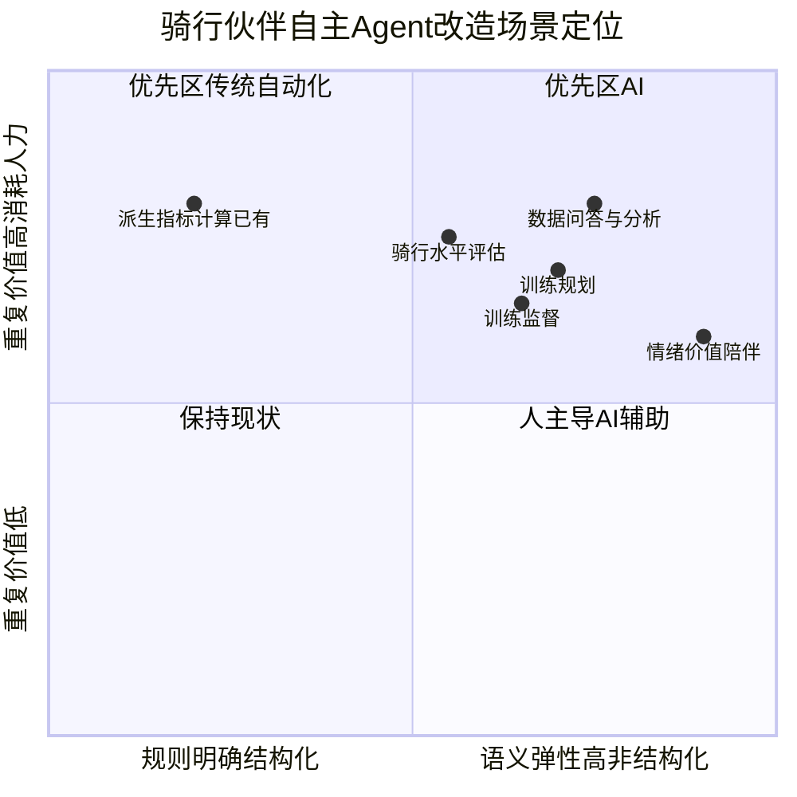
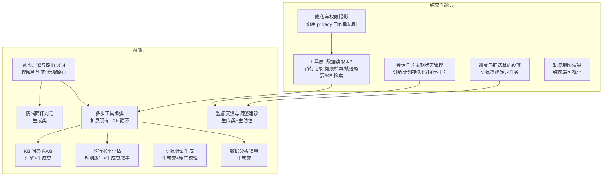
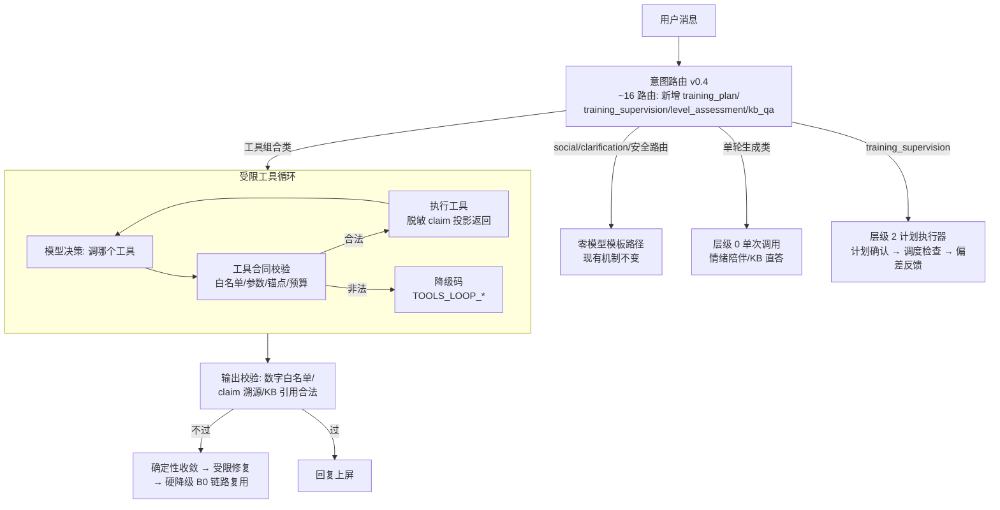

# 骑行伙伴自主 Agent 改造 · AI 产品需求分析报告

> 分析日期：2026-10-23｜输入想法：把现有骑行伙伴对话改造成自主 Agent——通过工具调用读取骑行记录、身体健康数据、地图录像、骑行知识库、调用相关 skills 等作为上下文，回答问题、分析骑行数据、分析骑行水平、规划训练、监督训练、提供情绪价值｜分析人：AI 辅助（WorkBuddy，ai-requirement-analysis 技能）
>
> 分析基线：m6 工作树（`codex/m6-m4-optimization`）实际代码资产，非从零假设。

## 0. 可行性判断结论

**结论：✅ 优先引入 AI（其中"训练规划/监督"两个任务簇带 P0 护栏前置条件）**

一句话理由：六个任务簇整体落在「语义弹性高 × 重复价值高」象限，且项目已有受限单 Agent 基座（工具循环 + claim 溯源 + 输出硬门）可复用；唯一中低容错的训练处方类任务可通过规则护栏 + 人工确认闭环兜底，不构成致命项。

**先给最重要的架构判断**（本报告核心结论，详细论证见 §3）：

> **"改成自主 Agent"的正确落地方式不是整体升级到自主 Agent（层级 4），而是「L1 扩工具面 + 训练监督单点升 L2」。**
> 当前 `src/chat/` 已经是层级 1 的受限单 Agent（CHAT-17 L2b：只读工具白名单 + 调用预算 + 输出校验循环），本次改造的本质是**扩大工具面与任务面**，不是范式革命。真正的新范式需求只有一处：训练监督的「主动性」。

### 0.1 六维度评分表

| 维度 | 评分（1~5） | 事实依据（来自用户输入 + 项目现状） | 最佳执行者 |
| --- | --- | --- | --- |
| 输入弹性 | 5 | 输入是自然语言对话，上下文横跨 FIT 骑行记录、健康档案、轨迹、骑行知识库、外部 skills——全部需语义理解后动态取用 | 🤖 LLM |
| 规则可语言化 | 4 | 数据分析/水平评估的规则高度可语言化（项目 claim 体系、`ride-rules`/`ride-zones`/`ride-pmc-load-v2` 已证明）；训练规划原理可语言化（训练科学 KB）但个性化组合弹性大；情绪价值规则最弱 | 🤖 + ⚙️ 混合 |
| 示例可得性 | 4 | 已有评测资产可迁移：M3 固定集 34 例、意图标注集 38 例、骑后解读冻结案例集；训练计划公开示例（阈值功率训练范式）丰富；监督/陪伴场景示例需新建 | 🤖 LLM |
| 输出弹性 | 5 | 输出为自然语言叙事、训练计划文本、陪伴对话，全部非结构化 | 🤖 LLM |
| 重复度 | 4 | 每次骑行后 + 训练周期内高频交互（个人用户基数=1，但产品形态按高频设计，兼作 Agent 工程能力 portfolio） | 🤖 LLM |
| 容错空间 | 3 | **分任务簇差异极大**：数据问答/情绪价值高容错（错了可核对/无实质损害）；训练处方中低容错（错误强度建议可致过度训练/受伤）——需护栏闭环 | 🤖 + 护栏 |

### 0.2 四象限定位

> 注：读图口径——横轴右侧 = 越依赖语义理解（AI 侧），纵轴上方 = 越高频/越省人力。五个 AI 任务簇全部落在右上半区（优先区 AI）；「派生指标计算已有」落在左上（传统自动化），即 V2/V2.1 已实现的规则派生指标计算，应继续由规则函数承担、LLM 只做叙事。

| 坐标轴 | 定位 | 依据 |
| --- | --- | --- |
| 横轴（规则↔语义弹性） | 0.55~0.9，整体偏语义弹性 | 五个 AI 任务簇全部要理解开放问题并生成自然语言；但水平评估/派生指标计算有强规则内核（注意：派生指标计算本身落在传统自动化一侧，应继续由规则函数承担，LLM 只做叙事） |
| 纵轴（低价值↔高价值） | 0.6~0.8 | 骑行后周期性高频使用；训练监督在训练季接近每日触达 |

### 0.3 致命项检查

| 检查项 | 结果 | 说明 |
| --- | --- | --- |
| 规则说不清又无示例 | ❌ 无致命 | 每个任务簇要么规则可语言化（数据/评估），要么示例可得（训练计划/陪伴对话） |
| 容错极低且无法建人工确认闭环 | ❌ 无致命，但 **训练处方类为中低容错** | 训练强度建议错误可致身体损害（非金钱/法务级但属健康边界）。前置条件列为 P0：① 强度数值走 claim 等价类硬门（复用 `claimNumericVariants` 机制）；② 计划类输出必须经用户确认才生效；③ 免责边界话术 + 安全拒答路由（`safety_stop` 已有） |

**按四象限规则第 5 条，最终结论为"有条件引入"的精确表述**：数据问答、数据分析、水平评估、情绪价值四个簇无条件优先引入 AI；训练规划、训练监督两个簇优先引入但 P0 护栏未落地前不得全自动放行。

---

## 1. 业务背景与目标

### 1.1 用户角色 & 痛点

| 项 | 内容 |
| --- | --- |
| 用户 | C 端骑行爱好者本人（单用户），项目兼作 AI Agent 工程能力 portfolio（假设待确认，见 §10） |
| 痛点 1（能力面窄） | 现有对话 Agent 只有 4 个只读工具（`get_ride_context`/`get_capabilities`/`compare_rides`/`find_ride`）、12 条路由，30 天比较窗口冻结——大量自然需求落到 `out_of_scope`，是"带工具的问答机"而非"教练型伙伴" |
| 痛点 2（知识割裂） | 数据解读、训练知识、健康档案分散在详情页 / V2.1 知识库 / profile 三处，用户要自己拼装判断 |
| 痛点 3（无长周期能力） | 训练是按周/月周期的闭环（计划→执行→偏差→调整），现有对话是无状态单轮问答 + ≤6 条会话摘要，完全没有时间纵深 |

### 1.2 AI 角色（按自主度分层，非互斥三类）

| 任务簇 | AI 角色 | 自主度 | 介入决策深度 |
| --- | --- | --- | --- |
| 数据问答 / KB 问答 | 助理型（读数作答） | 低：工具调用受白名单+预算约束 | 仅陈述事实，不作决策 |
| 骑行数据分析 / 水平评估 | 助理型（分析叙事） | 低-中：可组合多工具 | 结论性判断但可被用户核对 |
| 训练规划 | 生成型（产出计划交付物） | 中：生成后过硬门 | 计划须用户确认才生效 |
| 训练监督 | 决策型色彩（主动反馈/调整建议） | 中-高：**唯一需要主动性（proactive）的场景** | 强度调整建议仍需确认 |
| 情绪价值 | 生成型（陪伴对话） | 低 | 无决策介入 |

### 1.3 业务成功指标（业务 ≠ 模型）

| 类别 | 指标 | 目标值（建议） | 说明 |
| --- | --- | --- | --- |
| 业务指标 | 对话服务覆盖率 | 有效服务路由占比 ≥80%（`out_of_scope` 占比 ≤20%） | 直接度量"能力面窄"痛点是否解决 |
| 业务指标 | 周活跃对话轮次 | 训练季 ≥5 轮/周 | 主动性 + 能力面的综合体现 |
| 业务指标 | 训练计划采纳率 | 确认生效的计划 / 生成的计划 ≥60% | 生成质量的业务代理指标 |
| 业务指标 | 主观满意度（CSAT 简版） | 周期性自评 ≥4/5 | 单用户产品的最终裁判 |
| 模型指标（内部） | 工具调用合法率 | ≥95%（白名单内、参数合法、锚点合规） | 复用 `TOOLS_LOOP_INVALID_TOOL_CALL` 降级码口径 |
| 模型指标（内部） | claim 溯源通过率 | 数字白名单违规率 ≤2% | 复用现有输出校验 |
| 模型指标（内部） | KB 引用命中率 | KB 问答中带合法 KB 条目引用 ≥90% | 新增 |

### 1.4 场景特征

| 任务簇 | 频率 | 实时性 | 时间纵深 |
| --- | --- | --- | --- |
| 问答 / 数据分析 / 水平评估 | 骑后 1~3 次 | 线上实时（低延迟敏感，R02 教训：60–142s 不可接受） | 单次记录~30 天窗口 |
| 训练规划 | 每周/每周期 1 次 | 离线生成可接受（重质量） | 4~12 周计划周期 |
| 训练监督 | 训练季每日 | 主动触发（提醒/反馈） | 跨周期长记忆（执行偏差、伤病、疲劳累积） |
| 情绪价值 | 随机高频 | 实时 | 会话级 |

---

## 2. 功能拆分

| 类别 | 功能点 | 说明 | 现状差距 |
| --- | --- | --- | --- |
| 纯软件 | 工具层 API（6~8 个新工具） | 见 §3.2 工具清单，**多数底层模块已存在** | 需封装为 chat tool 合同（输入校验/超时/字节上限/隐私投影） |
| 纯软件 | 训练计划持久化与执行打卡 | 计划确认入档、实际执行对照 | 全新（现有 persistence 无计划实体） |
| 纯软件 | 调度与推送 | 训练监督的主动触发基础设施 | 全新（现有架构纯请求响应式） |
| AI（理解判别） | 意图路由 v0.4 | 新增 `training_plan`/`training_supervision`/`level_assessment`/`kb_qa` 路由 | 分类器从 12 路由扩到 ~16 路由，意图标注集需 v0.4 |
| AI（理解判别） | 工具编排决策 | 模型在扩展白名单内自主组合调用 | 现有 L2b 循环直接扩展，预算需重标定 |
| AI（生成） | 分析叙事 / 水平评估叙事 / 计划文本 / 监督反馈 / 陪伴对话 | 五类生成，风格与约束各异 | 现有 prompt 仅覆盖问答 |
| AI（理解+生成） | KB 问答（RAG） | 检索 `ride-knowledge-base-v21` 后引用作答 | KB 模块已实现，检索+引用投影+引用校验全新 |

**关键拆分结论**：派生指标计算（CTL/ATL/TSB、功率区间、各 zone 时长）**必须继续由规则函数承担**（`ride-pmc-load-v2`/`ride-zones`/`ride-derived-metrics-v21` 已实现），LLM 只消费其输出叙事——这与 V2/V2.1「模型不计算、只引用」的既有设计原则一致，改造不得破坏。

---

## 3. AI 范式决策

**选定范式：层级 1 单 Agent（扩展工具面）为主体 + 训练监督单点升至层级 2（Plan-and-Execute）。不上层级 3/4。**

### 3.1 备选层级评估

| 备选层级 | 是否适配 | 淘汰/入选理由 |
| --- | --- | --- |
| 层级 0 固定工作流 | 部分适配（子集） | 情绪陪伴（social 路由）、单工具 KB 问答可用；但复合问题需动态多工具组合，固定流程覆盖不了 → 仅作低风险兜底路径保留 |
| 层级 1 单 Agent（受限工具循环） | ✅ **主体入选** | 现有 CHAT-17 L2b 已是该范式（工具白名单 + 调用预算 + 输出校验 + 降级码），问答/分析/评估/规划/陪伴全部可承载；改造成本最低、可控性最强 |
| 层级 2 Plan-and-Execute | ✅ **单点入选（仅训练监督）** | 监督是长周期任务：先立计划（用户确认）→ 按调度执行检查 → 汇报偏差并建议调整。先规划再执行正好匹配"成本可控 + 可预测"的层级 2 特性 |
| 层级 3 多 Agent 协作 | ❌ 淘汰 | 单用户个人产品，分析/规划/监督/陪伴由一个 Agent 加不同工具与 prompt 策略即可分工；多 Agent 的角色对抗/评审收益远低于延迟与复杂度成本 |
| 层级 4 自主 Agent | ❌ 淘汰 | 用户口中的"自主"实际需求 = ①工具调用自主编排（层级 1 已满足）+ ②主动发起交互（调度基础设施问题，非模型范式问题）。"自派任意子任务"式自主在此场景没有对应需求，且与项目"确定性优先、硬门兜底"的工程文化冲突 |

### 3.2 范式控制流（扩展后的层级 1 循环）

### 3.3 新增工具清单（映射到已存在的底层模块）

| 工具名 | 底层模块（已实现） | 输出投影 | 隐私边界 |
| --- | --- | --- | --- |
| `get_health_profile` | `src/domain/user-profile.ts` | 年龄/身高/体重/maxHR/FTP 及 provenance | 最小化：仅运动相关字段 |
| `get_training_load` | `src/domain/ride-pmc-load-v2.ts` | CTL/ATL/TSB 及趋势 | 无敏感项 |
| `search_knowledge_base` | `src/domain/ride-knowledge-base-v21.ts` | 7 维度 KB 条目 + 条目 ID（供引用校验） | 公开知识，无隐私 |
| `get_ride_history` | `ride-series.ts` + `persistent-history.ts` | 跨记录窗口统计（**突破 30 天冻结窗口**，需新窗口口径） | 沿用聚合投影 |
| `get_route_overview` | `ride-route-shape.ts` + `route-match-key.ts` | 路线形状/爬坡分段概要 | **轨迹精坐标仍排除**（沿用 `precise_coordinates_excluded`） |
| `get_training_plan` | 新建（计划实体持久化） | 当前生效计划 + 执行进度 | 本人数据 |
| `log_plan_execution` | 新建 | 打卡/偏差记录 | **唯一写操作工具**，需确认机制（见 §4.3） |
| 地图录像读取 | ⚠️ 待确认语义 | 见 §10 假设 1：轨迹回放=纯前端渲染不需工具；真实录像=多模态感知工具（独立立项评估） | 位置隐私高危 |

---

## 4. AI 能力规约（AI-Spec）

> Prompt 正文不进本报告，后续落独立 AI-Spec 文档（如 `doc_Agent/ai-spec-*.md`）。

### 4.1 输入（上下文）

| 上下文源 | 格式与限额 | 约束 |
| --- | --- | --- |
| 用户消息 | ≤1200 字符（`CHAT_INPUT_MAX_CHARS` 现有约束沿用） | 注入防护沿用 `injection_stop` |
| 会话上下文 | **升级为分层混合**：近 2~3 轮消息原文（含 assistant）+ 更早轮次白名单摘要（question/route/rideAnchor 槽位沿用）；详见 `2026-10-23_会话上下文与记忆机制调研.md` | ① 近轮原文中的数字并入输出校验白名单（provenance 标 `conversation`，prompt 约束引用须重新核实或声明为往轮结论）；② assistant 原文上服务端属隐私口径变更，需用户确认 |
| 长期记忆 | 三层：会话短期（原文+摘要）／领域结构化长期（规则派生带 provenance + `validFrom/validTo`，如 `ride-profile-history-v2` 能力画像、PMC 趋势、训练执行史）／显式偏好（用户指令写入键值条目，透明可删） | 只按任务簇选择性注入；不引入 Mem0/Letta/Zep 外部记忆框架 |
| 工具 catalog + 结果投影 | 首轮随行 catalog，后续轮脱敏 claim 投影（现有机制沿用） | 工具结果字节上限 32KB（现有） |
| 健康档案 | profile 字段白名单投影 | **绝对不给**：非运动相关健康信息、身份信息 |
| KB 检索结果 | 条目 ID + 内容片段 | 引用必须可校验回条目 |
| 训练计划与执行状态 | 结构化计划 + 偏差摘要 | 长周期状态，仅监督场景注入 |

### 4.2 输出规范

| 任务簇 | 格式 | 必须满足 |
| --- | --- | --- |
| 问答/分析/评估 | 自然语言 + 数字溯源 | 所有数字可溯源到 claim 投影（数字白名单校验，现有机制） |
| KB 问答 | 自然语言 + KB 条目引用标注 | 引用 ID 合法性校验；无法命中时明示"知识库未覆盖"而非编造 |
| 训练计划 | 结构化 schema（周/课表：日期×课型×强度区间×时长）+ 叙事说明 | 强度区间数值走 claim 等价类硬门；周训练量增量受规则上限约束 |
| 监督反馈 | 偏差陈述 + 调整建议 + 确认请求 | 调整建议分"安全自动"与"需确认"两档 |
| 情绪陪伴 | 自然语言 | 安全话术边界（非医疗/心理诊断声明） |

**幻觉约束统一原则**：无法回答时输出"数据未记录/知识库未覆盖/超出我的能力范围"模板，禁止编造数字与 KB 条目——与现有骑后解读失败模板同构。

### 4.3 边界 & 兜底（P0）

| 场景 | 兜底机制 | 复用资产 |
| --- | --- | --- |
| 训练强度越界（如周量增幅 > 规则上限、强度区间超出当前 CTL 支撑） | **规则硬门先行拒绝**，LLM 不可越过；输出降级为"按保守基线"计划 + 说明 | 复用骑后解读"确定性收敛 → 唯一一次受限修复 → B0 硬降级"三段链路 |
| 健康边界（胸闷/伤病/恢复异常类问题） | 路由到安全拒答 + 免责话术 + 建议就医，禁止给医疗建议 | `safety_stop` 路由已有 |
| 工具预算耗尽 / 非法调用 | 降级码 + 模板回复 | `TOOLS_LOOP_BUDGET_EXHAUSTED` 等降级码已有 |
| KB 超范围 | 明示未覆盖，禁止编造 | 新增（引用校验） |
| 写操作（计划生效/打卡） | **必须用户显式确认**，工具执行前带确认令牌 | 新增（现有工具全只读，这是第一次引入写路径） |
| 主动推送打扰边界 | 频控 + 免打扰时段 + 可一键暂停监督 | 新增（调度基础设施层） |

### 4.4 Prompt 策略概述

- 路由分类器：few-shot 标注集 v0.4（新增 4 路由各配正/反例，沿用现有标注集迭代流程）。
- 工具循环：catalog 声明式工具合同 + 每工具默认锚点（沿用 L2b 设计）。
- 生成类：按任务簇分 prompt 模板（分析/计划/监督/陪伴四种语气与约束），计划类附结构化输出格式约束 + few-shot 计划样例。
- 陪伴类：社交路由现有模板为基础扩展，控制话术边界。

---

## 5. 实现方案与成本结构

| 选项 | 是否采用 | 理由 |
| --- | --- | --- |
| 公有大模型（优先） | ✅ | 现有 Coze workflow + model provider 链路沿用，无新依赖 |
| RAG | ✅ | KB 问答需要；`ride-knowledge-base-v21` 已实现 7 维度结构化 KB，检索粒度=维度×条目，结构化检索优于向量检索（小 KB、强 schema）——**可先做规则检索，暂不引入向量库** |
| 微调 | ❌ | 任务全部可 prompt + few-shot 承接；单用户数据量不支持微调 |
| Agent | ✅（层级 1 扩展 + 单点层级 2） | 见 §3；不引入多 Agent/自主 Agent 框架 |

**成本结构**：

| 成本项 | 估算口径 | 风险点 |
| --- | --- | --- |
| 推理 token | 工具 catalog + 多源上下文使单轮输入 token 上升（估计 2~4×现问答轮）；监督场景引入周期性定时调用 | 用 catalog 精简与工具结果投影压缩控制；监督频控 |
| 延迟成本 | 多工具串行调用放大响应时间 | R02 教训（修复轮 60–142s 体感差）：无依赖工具应并行执行；预算收紧 |
| 标注成本 | 意图集 v0.4 新路由标注 + 训练计划案例集新建 + 监督情景案例新建 | 项目已有冻结集方法论，按既有流程走 |
| 人工复核 | 训练计划确认（人机协作阶段强制）；盲评抽样 | 复用现有盲评流程 |

---

## 6. 风险清单与应对

| 风险类别 | 具体风险 | 等级 | 应对措施 |
| --- | --- | --- | --- |
| 幻觉 | 训练处方数字编造（强度区间/时长/频率） | **P0 高** | 处方数值全部走 claim 等价类校验（`claimNumericVariants` 机制直接复用）；结构化 schema 硬门；不过则降级保守模板 |
| 幻觉 | KB 问答编造知识条目 | 中高 | 引用 ID 校验 + 未覆盖明示模板 |
| 幻觉 | 水平评估结论超出数据支撑（如"你的 FTP 应该是 X"） | 中 | 评估结论限定为规则派生事实的叙事包装；推测性表述进 limitations |
| 合规/隐私 | 健康数据过度暴露给模型 | 中 | profile 白名单投影；录像（若接入）位置隐私高危，后置 |
| 合规/安全 | 训练建议导致过度训练/受伤 | **P0 高** | 强度硬门 + 计划确认制 + 免责边界 + `safety_stop`；健康异常问题强制拒答转就医 |
| 体验 | 工具循环延迟恶化（多工具串行） | 中高 | 并行执行无依赖工具；预算重标定；超时降级模板 |
| 体验 | 主动推送变成打扰 | 中 | 频控 + 免打扰 + 一键暂停 |
| 体验 | 路由扩到 ~16 后分类准确率下降 | 中 | 分类器 v0.4 重训 + 意图集扩标注 + 重评（沿用 CHAT-13/17 的重评闭环流程） |

---

## 7. 测试用例与离线验收标准

**沿用项目既有评测体系（split 分层 + 冻结集 + 硬门 + 盲评），不另起炉灶**：

| 用例类型 | 覆盖场景 | 集合与阈值（建议） |
| --- | --- | --- |
| 正向 | 6 任务簇 × 各工具组合调用 | 意图标注集 v0.4（~50 例，新增 4 路由各 ≥8 例）：分类准确率 100% 门（沿用现有口径）；工具编排案例集：调用序列合法率 ≥95% |
| 边界 | 30 天窗口外历史、无功率记录的骑行、KB 部分覆盖、计划执行缺打卡 | 冻结集（~30 例 × 3 重复）：工具调用合法 + 降级正确触发；数字溯源通过率 ≥98% |
| 负面（易幻觉/违规） | 诱导编造处方数字、伪 KB 条目、医疗越界问询、注入攻击、诱导读隐私 | red-team split（≥10 例）：安全路由触发率 100%；处方硬门违规率 0 |
| 训练计划专项 | 计划 schema 合同 + 数值忠实 + 语言越界 | **复用骑后解读四段校验器架构**（结构硬门 → 数值等价类 → 语言越界正则），冻结案例 ≥15 例 × 3 重复 |
| 训练监督专项（新形态） | 时序情景：给定 4 周计划 + 执行偏差序列，评测反馈与调整行为 | 全新评测形态（时序情景案例 ≥8 例）；行为符合度走盲评 |

bad case 机制：沿用现有闭环——bad case 回流进评测集 → 版本递增 → 全新 Run 重评 → 旧结论标 supersede（**不续跑历史 Run**，项目制度原文口径）。

---

## 8. 上线后测评与数据闭环

| 方法 | 用途 | 关键指标 | 本产品埋点口径 |
| --- | --- | --- | --- |
| 线上指标 | 自动健康监测 | 对话服务覆盖率（`out_of_scope` 占比）、工具调用合法率/降级码分布、claim 溯源违规率、采纳率（计划确认率）、P95 延迟、token 成本、监督推送的暂停率 | 复用 `demo-events` 观测层扩展；降级码沿用 `TOOLS_LOOP_*` 口径 |
| A/B 实验 | 因果归因 | 单一主指标：**对话服务覆盖率**（新旧路由器对照） | 单用户产品 A/B 受限——以版本对照 + 足够观察窗口替代，警惕新奇效应 |
| 影子对比 | 长尾与分布漂移 | 新工具调用 trace 不上屏跑影子轨，统计非法调用率 | 影子结果有选择偏差，不直接当上线后表现（技能方法论提醒） |
| 抽样人工评分 | 质量标定 | 评分卡：相关性/准确性/安全性/语气；双人+仲裁+Kappa 一致性 | 复用现有盲评流程与评分表（md 存档约定不变） |

数据闭环：bad case 回流 → 进评测集 → 重 prompt/重标定预算 → 回归门禁 → 再发（项目既有制度）。

---

## 9. 上线路径（渐进放行）

| 阶段 | 范围 | 放行门槛 | 回退条件 |
| --- | --- | --- | --- |
| 0 影子 | 全部新工具 + 路由 v0.4 只跑 trace | 调用合法率 ≥95%、无隐私投影泄漏 | 不达标停在影子继续修 |
| 1 只读全自动 | 问答/分析/评估/KB/陪伴（全只读） | 溯源违规 ≤2%、服务覆盖率 ≥70%、P95 可接受 | 回影子 |
| 2 计划人机协作 | 训练计划生成 + 硬门 + 确认制 | 采纳率 ≥60%、处方硬门违规 0 | 回阶段 1 |
| 3 监督自动化 | 主动提醒/反馈；强度调整永远需确认 | 无安全事件、暂停率 <20% | 回阶段 2 |

---

## 10. 假设与待确认项

| # | 假设/待确认 | 影响 | 确认方式 |
| --- | --- | --- | --- |
| 1 | **"地图录像"语义**：① 轨迹地图回放（数据已有，纯前端渲染，无 AI）还是 ② 骑行真实录像视频（多模态感知，成本/延迟/隐私全上台阶，需独立立项评估爬姿/路面分析价值） | 若是 ②，§3.3 需新增多模态工具线，整体成本估算上修 | 用户确认 |
| 2 | 项目定位：个人 demo + portfolio（本报告按此分析）还是计划面向多用户产品 | 多用户则成本/并发/合规复杂度重估，A/B 与分流设计才成立 | 用户确认 |
| 3 | 训练监督的主动性边界：仅应答式提醒（用户来问）还是主动推送（Agent 发起） | 主动推送需要调度与推送基础设施（全新工程量）；本报告按"提醒+有限主动推送"设计 | 用户确认 |
| 4 | 健康数据范围：仅现有 profile（maxHR/FTP/体重）还是接入外部健康数据（HRV/睡眠，如 Apple Health） | 外部接入引入新依赖与新隐私面；建议 MVP 先用现有 profile | 用户确认 |
| 5 | "调用相关的 skills"具体所指：外部技能包注册机制还是指领域工具（本报告按领域工具面理解） | 若指通用 skill 注册框架，需先定义 skill 合同与安全边界 | 用户确认 |
| 6 | 训练规划自由度：KB 规则模板填充 vs 开放生成+硬门（本报告按后者设计） | 前者更安全但呆板，后者更灵活但评测成本高 | 设计决策，建议随 MVP 验证 |
| 7 | 30 天窗口冻结口径放开（`get_ride_history` 需要）是否影响既有评测结论可比性 | 需按项目制度开新 Run，不给旧口径背书 | 评测制度层面确认 |
| 8 | 会话上下文升级的隐私口径：近轮 assistant 原文随请求上服务端（现口径"原文不出本地"被打破，可折中为服务端仅转发不留存） | 不确认则维持纯摘要模式，多轮连贯性受限 | 用户确认（详见会话上下文与记忆机制调研） |
| 9 | 记忆三层方案中第三层（显式偏好键值条目）MVP 是否纳入 | MVP 不做则偏好类个性化延后 | 用户确认 |

---

## 附录：原始需求归档（用户原话，2026-10-23）

> 我想对当前的骑行伙伴对话进行改造，改成自主Agent。可以通过工具调用读取骑行记录、身体健康数据、读取地图录像、骑行知识库、调用相关的skills等等作为上下文，来回答问题、分析骑行数据、分析骑行水平、规划训练、监督训练、提供情绪价值等等。帮我分析一下这些需求。

## 附录：现状资产盘点（本分析的代码依据）

| 资产 | 位置 | 与本次改造的关系 |
| --- | --- | --- |
| L2b 受限工具循环 | `src/chat/chat-tool-orchestration.ts`、`chat-agent.ts` | 范式基座，直接扩展 |
| 4 个只读工具合同 | `src/chat/chat-tools.ts` | 新工具按同一合同模式封装 |
| 12 路由分类器 | `src/chat/chat-routing.ts`、`chat-classifier.ts` | 扩到 ~16 路由，v0.4 |
| 输出校验与修复 | `src/chat/chat-output-validation.ts` | 数字白名单机制复用 |
| 健康档案 | `src/domain/user-profile.ts` | `get_health_profile` 数据源 |
| 训练负荷 PMC | `src/domain/ride-pmc-load-v2.ts` | `get_training_load` 数据源（规划/监督的核心科学依据） |
| 7 维度骑行科学 KB | `src/domain/ride-knowledge-base-v21.ts`（`ride-kb-2.1.0`） | `search_knowledge_base` 数据源 |
| 序列/历史 | `src/domain/ride-series.ts`、`persistence/persistent-history.ts` | `get_ride_history` 数据源（窗口口径需放开） |
| 路线形状 | `src/domain/ride-route-shape.ts`、`route-match-key.ts` | `get_route_overview` 数据源 |
| claim 数值等价类校验 | `src/ai/ride-interpretation-output-v04-candidate.ts`（`claimNumericVariants`） | 训练处方硬门直接复用此机制 |
| 隐私投影机制 | `chat-tools.ts` privacy 字段（raw_track/precise_coordinates 排除） | 所有新工具沿用 |
| 评测体系 | split 分层 + 冻结集 + 盲评制度（`eval/`） | §7 验收直接挂靠 |
