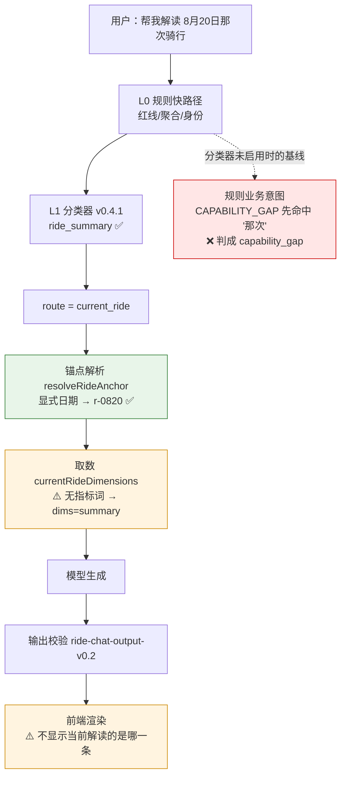

# 单次骑行解读「只能解读最近一次」缺陷分析

- 日期：2026-10-26
- 分支：`codex/m7-agent-autonomy`
- 触发：用户反馈「骑行解读只会解读最近一次的，应该支持用户选择任意一次骑行进行骑行数据解读」
- 性质：**路由合同缺维度**（不是正则漏词、不是模型问题）
- 复跑：`node scripts/inspect-chat-ride-selection.ts`（加 `--classifier` 可一并跑线上真实分类器）

---

## 一、结论先说

**「只能解读最近一次」不是一处 bug，而是三处结构性断点叠加的结果**：

| # | 断点 | 一句话 |
|---|---|---|
| **B1** | **路由合同没有「记录选择」这个维度** | `ChatRoute` 只承载 16 个意图，没有承载"哪一次骑行"的结构化槽位；记录选择退化成一整句自由文本，且只在 `current_ride` 一个分支被解析 |
| **B2** | **规则层词表把指涉吞掉** | `CAPABILITY_GAP` 的 `那次/那一次` 优先级高于 `CURRENT_RIDE`；`解读/分析/怎么样/表现` 不在 `CURRENT_RIDE` 词表里 → 指定记录的问法 **10/13** 落到"能力没开放""域外"模板 |
| **B3** | **缺省即最新，且不告知** | `autonomous_tools` 路由无指涉时 `default_latest` 静默取最新；`current_ride` 已有锚点时 `inherited` 静默沿用旧锚点；UI 上又不显示"当前解读对象是哪一条" → 用户看到的就是"它永远在解读最近一次" |

**关键反直觉事实（本次实测）**：锚点解析层**本身是支持绝对日期的**——

```
[current_ride] 帮我解读 8月20日那次骑行 → r-0820 src=explicit_date  ✅ 解析正确
```

也就是说，「8月20日」这类绝对日期**根本没能走到**锚点解析：它在路由层就被判成了 `capability_gap`（"这个能力当前还没开放"）。**能力是有的，路由没把话递过去。**



> 绿色 = 已具备但没被用上的能力；黄色 = 削弱"解读"质量；红色 = 直接判错。

---

## 二、复现证据

### 2.1 规则路由（`classifyChatInput`，未启用分类器的基线 / dev 兜底）

| 用户说法 | 实际路由 | 用户看到 |
|---|---|---|
| 骑行解读（**快捷问题原句**） | `out_of_scope` | "当前骑行伙伴只支持本次骑行和已开放能力范围内的问题" |
| 帮我解读 8月20日那次骑行 | `capability_gap` | "这个能力当前还没开放" |
| 帮我解读一下 7 月 18 日那次 | `capability_gap` | 同上 |
| 7月22日那次的平均功率是多少 | `capability_gap` | 同上（**问指标也一样被吞**） |
| 昨天那次骑行心率多少 | `capability_gap` | 同上 |
| 那次骑行我骑得如何 | `capability_gap` | 同上 |
| 8月20日的骑行数据怎么样 | `out_of_scope` | "只支持本次骑行…" |
| 8月20日骑得怎么样 | `out_of_scope` | 同上 |
| 解读一下我的第二次骑行 | `out_of_scope` | 同上 |
| 帮我分析一下上个月的骑行 | `out_of_scope` | 同上 |
| 帮我解读一下这次的骑行 | `current_ride` ✅ | 走锚点（无锚点则澄清） |
| 上次骑行怎么样 / 最近一次骑行怎么样 | `current_ride` ✅ | 锚定最新 |

> 13 条里只有 3 条（都含"这次/上次/最近一次"）走对了路，其余 10 条落到 `out_of_scope` / `capability_gap` 两个确定性模板。**「能选择任意一次」的入口在规则层几乎全被封死。**

### 2.2 锚点解析（`resolveRideAnchor`，假设已正确路由）

| 说法 | 解析结果 | 判断 |
|---|---|---|
| 帮我解读 8月20日那次骑行 | `r-0820` `explicit_date` | ✅ 能力存在 |
| 7月22日那次的平均功率是多少 | `r-0722` `explicit_date` | ✅ |
| 昨天那次骑行心率多少 | **CLARIFY** | ❌ 相对日期不支持 |
| 解读一下我的第二次骑行 | **CLARIFY** | ❌ 序数只认"上一次/最近一次/刚才" |
| 第二次骑行怎么样（会话已有锚点 7-22） | **`r-0722` `inherited`** | 🔴 **静默答错**：用户问"第二次"，系统答 7-22 并且不说明 |
| 第二次骑行怎么样（`autonomous_tools`，无锚点） | **`r-1005` `default_latest`** | 🔴 **静默取最新**——这正是"只会解读最近一次"的直接来源 |

### 2.3 线上真实路由（L1 分类器 v0.4.1 实测）

| 说法 | 分类 | 后果 |
|---|---|---|
| 骑行解读（快捷问题原句） | `unclear`（clarify=true） | → 澄清模板"不确定你指哪一次" |
| 帮我解读 8月20日那次骑行 | `ride_summary` ✅ | 到 `current_ride` → 日期能解析（**这条能work**） |
| 8月20日的骑行数据怎么样 | `ride_summary` ✅ | 同上 |
| 昨天那次骑行心率多少 | `ride_summary` ✅ | 路由对，锚点解析失败 → 澄清 |
| 解读一下我的第二次骑行 | `ride_summary` ✅ | 路由对，锚点不认识"第二次" → 澄清 |
| 帮我分析一下上个月的骑行 | **`aggregate`** ❌ | 被当成"聚合统计"，去答累计里程 |

> 结论：**分类器比规则层强得多（日期类问法能正确归入 `ride_summary`）**，但它也无法表达"我要选某一次"，落在 `current_ride` 之后的记录定位仍是自由文本解析。而快捷问题 `骑行解读` 是一个**纯裸标签**，分类器只能判 `unclear`。

### 2.4 评测覆盖：这类问题目前「没有尺子」

`eval/ride-chat-v0.7/cases.json`（M3 固定集 34 例）实测：

- 含**具体日期**（`X月X日`）的用例：**0 条**
- 含**序数**（`第二次`）的用例：**0 条**
- 唯一带日期的是 `CHAT-REG-18`「2026年8月20日骑行的平均功率是多少？」（`anchor_explicit_date`），且必须同时有"功率"这个指标词
- 锚点相关只有 `CHAT-REG-17`（本次→澄清）与 `CHAT-REG-18` 两条

→ 改完之后**没有任何回归门可以证明改好了**，必须补用例。

---

## 三、断点逐层定位（代码事实）

### B1 路由合同缺「记录选择」维度（根因）

- `src/chat/chat-routing.ts:7-33`：`ChatRoute` 16 个值全部是**意图**（social/current_ride/capability_gap/…），没有一个值或字段表达"哪一条记录"。
- `ChatRoutingDecision`（`:132-168`）只有 `route/risk/action/reasonCode/normalizedLength`，**没有 rideRef**。
- `app/api/chat/route.ts:90`：请求体键白名单 `["text","summaries"]` —— **客户端无法传"我选了哪一次"**。
- 因此"选择"只能靠自然语言，且被压缩在 `resolveRideAnchor` 一个函数里（`chat-ride-anchor.ts`）。
- 对照：**骑后解读（`/rides/[id]` → `RideAiAnalysis` → `InterpretationSheet`）本来就是任意单次的**——它由 URL 的 `rideId` 驱动。**同一个产品里，"解读"有两个入口，一个有明确记录标识（详情页），一个没有（对话页）**。这是结构不一致的源头。

### B2 规则层词表冲突（为什么"能力有却递不到"）

- `chat-routing.ts:204`：`CAPABILITY_GAP = /(那次|那一次|历史骑行|骑行历史|多次骑行|几次骑行)/`
- `chat-routing.ts:240`：`CURRENT_RIDE = /(这次|本次|当前|最近一次|上次|里程|距离|速度|心率|功率|踏频|爬升|海拔|耗时)/`
- 判定顺序 `:350-356`：`CAPABILITY_LEVEL_GAP → find_ride → CAPABILITY_GAP → HISTORY_COMPARE → CAPABILITIES → CURRENT_RIDE`
- 后果一：**任何含"那次"的句子都先被 `CAPABILITY_GAP` 吃掉**，包括"7月22日那次的平均功率是多少"——明明有指标词。
- 后果二：`CURRENT_RIDE` 是**指标词驱动**的；"解读/分析/怎么样/表现/评价"不在词表 → "8月20日骑得怎么样" → `OUT_OF_SCOPE`。
- 后果三（同类，非本缺陷但同机理）："帮我分析一下上个月的骑行" → `OUT_OF_SCOPE`，分类器 → `aggregate`。

### B3 缺省即最新 + 静默 + 不可见

- `chat-ride-anchor.ts:194`：`current_ride` 且无 DEIXIS → `inheritAnchor()`；**有锚点时沿用上一轮，不校验本轮语义是否指向它**。
- `chat-ride-anchor.ts:195`：兜底 `default_latest`——**不澄清**。
- `chat-tool-orchestration.ts:461-465`：L2b 循环 `startLoop` 同样走 `resolveRideAnchor`，无指涉时锚定最新，然后 `anchorRideId` 注入 `get_ride_context` 缺省值。
- 前端 `app/components/chat-home.tsx:136-151`：响应里的 `rideAnchor` 只写进摘要槽位（供下轮继承），**界面不渲染**"当前解读的是哪一条"。
- 三条叠加 = 用户的真实体验："它永远在解读最近一次，而且我没办法换。"

### B4 记录标识粒度：锚点存日期不存 rideId

- `chat-routing.ts:43-48`：摘要槽位只有 `rideAnchor?: string`（`YYYY-MM-DD`）。
- `chat-ride-anchor.ts:70-87`：`findRideRecordByDate` 在**同一天多条记录时取出发时间最晚的一条**。
- 后果：**同一天两次骑行（早通勤 + 晚训练）在对话里根本无法区分**——选上午那条，下一轮会被解析成晚上那条，且无任何提示。
- 这与"支持选择任意一次"直接冲突：**要"任意一次"，标识必须是 `rideId`，日期只是一个不唯一的键。**

### B5 「解读」的取数维度只有 summary

- `chat-tool-orchestration.ts:384-390`：`currentRideDimensions` 只在命中 `功率/心率/踏频/爬升` 时扩维，否则 `["summary"]`。
- `chat-tools.ts:390-396`：`summary` 只含 `distanceM / elapsedTimeS / movingTimeS / avgSpeedMps / maxSpeedMps`。
- 后果：**"帮我解读 8月20日那次骑行"即便路由与锚点都对了，下发给模型的也只有距离/时间/速度**——心率、功率、踏频、爬升全部不在上下文里。"解读"这个词在取数层等价于"看个摘要"。
- 对比 L2b 循环（`autonomous_tools`）由模型自己挑 `dims`——**同一诉求，走不同路由会得到不同质量的解读**。

### B6 双链路质量分裂

| 诉求 | 分类器标签 | 路由 | 执行 | 记录 | 维度 |
|---|---|---|---|---|---|
| 最近一次平均功率 | `ride_summary` | `current_ride` | 单工具 `get_ride_context` | 锚点 1 条 | 正则猜 |
| 距离最远那次心率 | `open_chat` | `autonomous_tools` | L2b 循环（≤5 次工具） | 可扩到检索结果 | 模型挑 |
| 帮我解读某次 | `ride_summary` | `current_ride` | 单工具 | 锚点 1 条 | **summary only** |

「解读」这种天然需要多工具（context + route_overview + training_load + KB）的诉求，被固定送进了**只允许一个工具、且维度由正则决定**的窄链路。

### B7 前端没有选择器，快捷问题是个裸标签

- `chat-home.tsx:164`：`quickQuestions = ["当前可以分析哪些数据？", "骑行解读", "水平评估", "训练计划"]`——`骑行解读` 没有任何记录指涉。
- 实测：分类器 `unclear` → 澄清模板；规则 `out_of_scope` → 域外模板。**这个按钮端到端不可用。**
- `chat-home.tsx:206-210`：页面摘要只有累计/总里程/本周三项 + `latestRideDateLabel`，**没有记录清单**，用户没有"选"的物理入口。
- `chat-home.tsx:147`：`buildChatSessionSummaries` 只带 `question/route/rideAnchor`，即便加了选择器也没有回传通道。

### B8 澄清回路不完备（想选也选不完）

- `chat-ride-anchor.ts:202-227`：纯确认语只接受「是的/最近一次/日期」；`CONFIRMATION_ROUTES` 里 `clarification` 可发起，但 `pending.route` 必须在 `RIDE_ANCHOR_TOOL_ROUTES = [current_ride, capabilities, history_compare, autonomous_tools]` 里——**`clarification` 不在其中** → 裸"骑行解读"澄清后，用户回"8月20日"也接不上。
- `chat-ride-anchor.ts:241,250`：确认落地用 `classifyChatInput`（**规则层**）重跑挂起问题，与线上分类器口径不一致 → 同句在两处判定可能不同。

---

## 四、为什么不能「补几行正则」了事

| 只改正则会怎样 | 说明 |
|---|---|
| 「那次」从 `CAPABILITY_GAP` 拿掉 | 会破坏 `CHAT-17` 对"回指/历史清单"的既有归因；且 `capability_gap` 的模板文案里明确把"跨记录检索"列为已开放能力，两者语义边界需要重新定义 |
| 给 `CURRENT_RIDE` 加"解读/分析" | "帮我分析一下上个月的骑行"会从 `aggregate` 变 `current_ride`，聚合口径被污染；且"分析"是泛动词（分析心率 / 分析趋势 / 分析路线） |
| 加"昨天/前天"正则 | 只解决相对日期，解决不了"第二次/上一次骑的那次/我选的那条"，而这些才是"选择任意一次"的高频表达 |
| 加"第二次"正则 | **序数口径未定义**：按时间正序第 2 次？倒序"上上次"？含不含室内骑行？不定义就是埋雷 |
| 让模型先列清单再问 | 多一轮往返 + 模型提问质量不稳定；且 `get_ride_history` 默认 90 天窗口，超出即"没有记录"（又是一个"数据明明在"的错觉） |

**本质**：需要通过路由合同的改动，让"哪一次"从**句子里的一种说法**变成**一个可传递的参数**。

---

## 五、三个方案

### 方案 A（最小改动 · 只在文本层加厚）

扩 `CURRENT_RIDE` 词表 + 修 `CAPABILITY_GAP` 边界 + 加相对日期/序数解析 + 「解读」默认全维度。
- 成本：约 1~1.5 天，不碰 API 合同与前端。
- 收益：绝对日期、相对日期、"上一次的上一次"能答对；"解读"维度补全。
- 不足：**仍无选择器**，用户依然得"说出日期"；同日多记录仍按日期二选一会错；用户依然看不见当前解读对象。

### 方案 B（推荐 · 给路由加 rideRef，复用既有 override 通道）

1. `/api/chat` 请求体加可选 `rideRef: { rideId } | { type: "latest" }`（白名单 + 字节预算同步改）。
2. `rideRef` 直接映射成**已有的** `RideAnchorOverride`（`chat-ride-anchor.ts:15`），从 `chat-tool-orchestration.ts:461` 与 `chat-agent.ts:1268` 的 `anchor` 入参进入——**这条通道已经存在且已在用（确认轮）**，不需要新链路。
3. 摘要槽位从 `rideAnchor: date` 升级为 `rideAnchor: {date, rideId}`（合同 `chat-routing-v0.2 → v0.3`），同日多记录可唯一定位；`rideAnchorDate` 仍用于展示。
4. 前端 `/chat` 加「选一次骑行」选择器（数据源已有：`repository.listRides`，`app/chat/page.tsx:9`），选中后携带 `rideRef`，并在消息气泡上方显示**当前解读对象**（日期 + 距离），可切换。
5. 快捷问题从裸标签 `骑行解读` 改为「解读最近一次」/「选一次骑行解读」，消除 `unclear`。
6. 规则层按 B2 修边界；「解读」意图在 `current_ride` 内用 `dims=全量`（或走 L2b 循环，见待拍板 D-3）。
7. 取消静默：任何 `default_latest` / `inherited` 的解析，回复正文必须显式带上「（10月5日那次）」。

- 成本：约 3~4 天（后端 1.5 + 前端 1 + 用例 0.5~1）。
- 收益：真正支持"选择任意一次"，且选择动作可记忆、可切换、可见。
- 风险：动到 `chat-routing` 摘要合同 → **必须全量回归 M3 + 边界集 + 编排集**（旧结论需标 `supersede`）。

### 方案 C（不推荐作主路径 · 加 `list_rides` 让模型反问）

新增 `list_rides` 工具，模型先列记录再追问。
- 问题：多一轮往返（p50 已 2~6s）、模型提问质量不可控、把"选择"变成对话谜题；`get_ride_history` 已能列清单但窗口受限。
- 可作为 B 的**兜底**：当用户说"随便挑一次"或指涉仍不明时，由模型列 3 条让用户选。

**推荐：B 为主，A 的词表/日期解析作为 B 的一部分一并做，C 作为 B 之后的增强。**

---

## 六、需要拍板的 4 件事

| 编号 | 问题 | 选项 | 建议 |
|---|---|---|---|
| **D-1** | 序数口径（"第二次""上上次"） | ①不做，只支持日期 + 选择器 ②按出发时间正序第 N 次（含室内）③倒序（最近=第 1 次） | ①＋②：**选择器优先**，序数只作为补充，且明确"按出发时间从早到晚计" |
| **D-2** | 摘要槽位是否升级为 `rideId` | ①只加不换（rideAnchor 保留日期）②换成 `{date, rideId}` ③不动 | ②——不改就修不了同日多记录 |
| **D-3** | 「解读」走哪条链路 | ①`current_ride` 单工具 + `dims=全量` ②迁到 L2b 循环（多工具） ③新路由 `ride_interpretation` | ①先落地（改动小、延迟低），②作为 C 阶段随生成层一起评估；**不建议新增 route**（意图维度与记录维度会形成 2×N 组合爆炸） |
| **D-4** | 评测怎么办 | ①补 M3 用例 ②新建"记录选择"专项集 ③升 M3 v0.8 + 生成层集 | ③：M3 现有 34 例**零覆盖**日期/序数，且 `kb_qa/level_assessment/companion` 也是 0 例——两件事合并成一次建集 |

---

## 七、回归与影响面清单（改动前必须知道）

| 面 | 会不会被动到 | 说明 |
|---|---|---|
| `CHAT-14` 锚点 4 级解析 | ✅ 动 | 加 rideRef（override 已在）、加相对日期/序数、取消静默 |
| 摘要合同 `chat-routing-v0.2` | ✅ 动 | `rideAnchor` → `{date, rideId}`，`sanitizeChatSummaries` 校验同步 |
| `TOOLS_ANCHOR_CLARIFY` 话术 | ✅ 动 | 需带上"可以直接选一次"的分支（而不是只提示日期） |
| `/api/chat` 入参白名单 | ✅ 动 | 加 `rideRef` + 字节预算 |
| 前端 `/chat` | ✅ 动 | 选择器 + 当前解读对象指示 + 快捷问题改写 |
| M3 固定集 / 边界集 / 编排集 | ✅ 必须重跑 | 锚点行为变了，`CHAT-REG-17/18` 结论需重验 |
| 骑后解读链路 `/rides/[id]` | ❌ 不动 | 已按 rideId 驱动，本来就支持任意单次 |
| `compare_rides` 30 天窗口 | ❌ 不动 | 与本缺陷无关，别顺手改口径 |
| 数字硬门 / 输出校验 | ⚠️ 间接 | `dims` 扩全后 Claims 变多，`claimIds` 上限 12 需复核 |

---

## 八、下一步（等你确认后开工）

1. 拍板 D-1~D-4（尤其 D-2 与 D-3，它们决定改动面大小）。
2. 若认同方案 B：我出 `开发规划/AGT-C` 系列的补丁工作项（编号建议 `AGT-C7 单次记录选择`），含改动清单、用例清单、回归命令。
3. 用例先行：先补 6~8 条"指定记录解读"用例（绝对日期 / 相对日期 / 序数 / 选择器 / 同日两条 / 跨窗口记录），再改代码——否则改完无法证明。

---

## 附：证据复跑

```bash
# 确定性部分（零网络零成本）：规则路由 + 锚点解析
node scripts/inspect-chat-ride-selection.ts

# 额外跑线上真实分类器（读 .env.local，约 13 次调用）
node scripts/inspect-chat-ride-selection.ts --classifier
```
