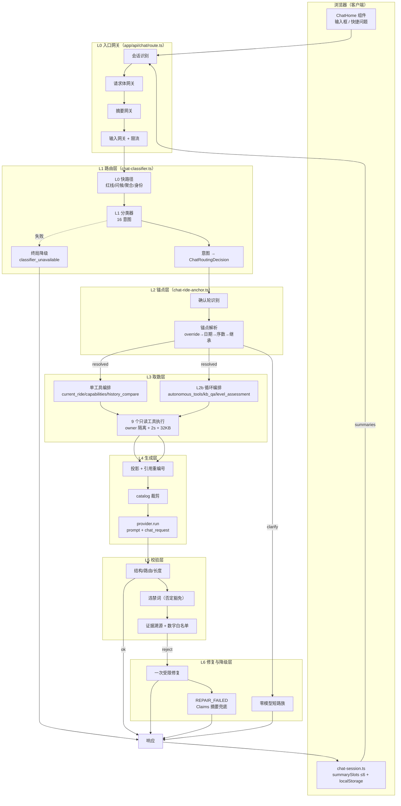

# 对话 Agent 分层节点 IO 说明书

- 日期：2026-10-27
- 版本基线：`chat-routing-v0.2` / `chat-tools-v0.2` / `ride-chat-output-v0.2` / `ride-chat-tool-call-v0.1` / `ride-chat-tool-catalog-v0.1` / `ride-chat-agent-v0.1`
- 覆盖范围：浏览器 → `POST /api/chat` → 路由 → 锚点 → 取数 → 生成 → 校验 → 修复/降级 → 响应 → 本地会话与可观测
- 用途：改任何一层前，先在这里找到「这个节点的输入是谁给的、输出交给谁、失败封在哪」

---

## 0. 全景



**一句话职责**：L0 保证「这句话能进来」；L1 决定「当什么意图处理」；L2 决定「看哪一条记录」；L3 决定「给模型什么事实」；L4 决定「怎么说」；L5 决定「说了算不算数」；L6 决定「说错/说不出时怎么办」；L7 决定「谁看见、留下了什么痕迹」。

---

## 1. 层与节点的职责边界

| 层 | 节点数 | 是否调模型 | 是否碰用户数据 | 失败封口 |
|---|---|---|---|---|
| L0 入口 | 4 | 否 | 否（仅 userId 与文本长度） | HTTP 4xx |
| L1 路由 | 3+1 | 是（仅分类器，`text` 一项） | 否 | 终局降级话术 |
| L2 锚点 | 2 | 否 | 是（读记录清单，只选不读内容） | 澄清话术（零模型） |
| L3 取数 | 3 | 否 | 是（owner 隔离） | 工具降级话术 |
| L4 生成 | 3 | 是 | 只见投影后的引用号 | provider 错误码 |
| L5 校验 | 3 | 否 | 否 | 错误码 → 触发 L6 |
| L6 修复/降级 | 3 族 | 是（仅修复轮 1 次） | 否 | 确定性话术 |
| L7 输出/观测 | 3 | 否 | 是（只写脱敏属性） | 静默 |

---

## 2. 逐节点 IO

### L0 入口网关 · `app/api/chat/route.ts`

#### N0.1 会话识别
| 项 | 内容 |
|---|---|
| 输入 | `Request`（含签名 cookie） |
| 输出 | `session: { userId }` 或 `null` |
| 契约 | 无 cookie / 签名失效 → `null` |
| 失败态 | `404 {error:"NOT_FOUND"}`（**不区分「未登录」与「无权限」**，避免探测） |
| 位置 | `route.ts:78-79` |

#### N0.2 请求体网关
| 项 | 内容 |
|---|---|
| 输入 | 原始 body 字节流 |
| 输出 | `body: { text, summaries? }` |
| 契约 | 字节上限 = `CHAT_INPUT_MAX_BYTES(4096) + CHAT_SUMMARIES_MAX_BYTES(3072) + 256`；JSON 可解析；**键白名单仅 `text` / `summaries`**（多一个键即拒） |
| 失败态 | `413 INPUT_TOO_LARGE` / `400 INVALID_INPUT` |
| 位置 | `route.ts:82-92` |

#### N0.3 摘要网关 `sanitizeChatSummaries`
| 项 | 内容 |
|---|---|
| 输入 | `summaries?: unknown` |
| 输出 | `{ summaries: ChatSessionSummary[], dropped: boolean }` |
| 元素形状 | `{ kind:"session_turn", question: string(≤120), route: ChatRoute(16 枚举), rideAnchor?: "YYYY-MM-DD"(真日历) }` |
| 契约 | 条数 ≤6；键只允许这 4 个；含控制字符即非法 |
| 失败态 | **任一元素违规 → 整体丢弃**（`summaries: []`, `dropped: true`），**请求照常**，退化为无上下文基线 |
| 位置 | `chat-routing.ts:87-120` |

#### N0.4 输入网关 + 限流 `routeChatInput`
| 项 | 内容 |
|---|---|
| 输入 | `(subject=userId, text)` |
| 输出 | `{ ok:true, text, decision }` 或 `{ ok:false, code, normalizedLength }` |
| 契约 | 非空、无控制字符、≤1200 字、≤4KB；限流 20 次 / 60s / 用户 |
| 失败态 | `400 INVALID_INPUT` / `413 INPUT_TOO_LARGE` / `429 RATE_LIMITED` |
| 备注 | 这里的 `decision` 是**规则层预估**（日志里记 `rule.route`），分类器启用时只用于兜底与遥测对照 |
| 位置 | `chat-routing.ts:359-398` |

#### N0.5 仓储视图
| 项 | 内容 |
|---|---|
| 输入 | `userId` |
| 输出 | `ApplicationRepository`（`listRides(userId)` 返回 `{record}[]`，**演示记录与本人记录合流**） |
| 契约 | 全部读写按 `ownerId` 隔离 |
| 位置 | `route.ts:107` |

---

### L1 路由层 · `chat-classifier.ts` / `chat-routing.ts`

#### N1.1 L0 快路径 `classifyChatInputL0`
| 项 | 内容 |
|---|---|
| 输入 | `text`（compact 后） |
| 输出 | `ChatRoutingDecision` 或 `undefined`（未命中） |
| 判定顺序 | 急症 → 用药 → 写操作 → 危险骑行 → 实时路况 → 隐私 → 注入 → 纯问候 → 身份/聚合 |
| 命中效果 | **不调用分类器**（`routedBy: "rules_l0"`），零模型零延迟 |
| 位置 | `chat-routing.ts:305-338` |

#### N1.2 L1 分类器 `SiliconFlowClassifierClient.classify`
| 项 | 内容 |
|---|---|
| 输入（模型侧） | `system: CHAT_CLASSIFIER_SYSTEM_PROMPT`（v0.4.1，4127 字）+ `user: <classify_request>{agent:"ride_chat_v1", classifierVersion:"chat-classifier-v0.2", text}</classify_request>` |
| 输入（函数侧） | `{ requestId, text }` |
| 输出 | `ChatClassifierResult = { schemaVersion:"chat-classifier-v0.2", intent: 16 枚举, needsClarification: boolean }` |
| 采样 | `temperature 0.3` / `enable_thinking false` / `json_object` / `max_tokens 256` |
| 预算 | 超时默认 12s（env 可调，上限 25s）；响应 ≤16KB |
| 失败态 | `MODEL_TIMEOUT` / `MODEL_RATE_LIMITED` / `MODEL_TEMPORARY_UNAVAILABLE` / `MODEL_INVALID_RESPONSE` |
| 位置 | `chat-classifier.ts:137-230` |

> 16 意图 → 路由的映射见 `intentToRoutingDecision`（`chat-classifier.ts:292-334`）。关键映射：`ride_summary→current_ride`、`open_chat→autonomous_tools`、`companion→social`、`unclear→clarification`。

#### N1.3 路由决定 `ChatRoutingDecision`
| 字段 | 取值 | 谁消费 |
|---|---|---|
| `schemaVersion` | `chat-routing-v0.2` | 日志 |
| `route` | 16 枚举（social / current_ride / capabilities / aggregate / capability_gap / out_of_scope / safety_stop / privacy_boundary / injection_stop / clarification / history_compare / autonomous_tools / training_plan / training_supervision / level_assessment / kb_qa） | L2/L3/L4/L5/L6 |
| `risk` | none / medical_emergency / dangerous_riding / real_time_road / privacy_request / prompt_injection / semantic_safety | 日志 |
| `allowModel` | `false` = 确定性节点集（safety/out_of_scope/aggregate/capability_gap/clarification/training_plan/training_supervision） | L6 |
| `action` | `deterministic_reply` / `tool_then_model` / `safety_stop` / `reject` | **L6 的第一道分叉** |
| `reasonCode` | 21 种（TEMPLATE 话术按它选文案） | L6 |
| `normalizedLength` | 压缩后字数 | 日志/测试 |

#### N1.4 分类器不可用 = 终局降级
| 项 | 内容 |
|---|---|
| 触发 | `routedBy === "classifier_unavailable"` |
| 输出 | `chatRoutingUnavailableResult(code)`：`route=out_of_scope`、`execution=template`、`modelInvoked=false`、reply="对话服务暂时不可用；我不会使用未经验证的结果回答。稍后再试…"、`fallbackCode=code` |
| 纪律 | **绝不回落到业务正则硬猜**（D-A2）——错误猜测比诚实失败更糟 |
| 位置 | `chat-agent.ts:330-347`、`route.ts:150-171` |

---

### L2 锚点层 · `chat-ride-anchor.ts`

> 这一层只做一件事：把「这次 / 8月20日 / 上次」变成**一条具体记录**。它不读记录内容，只比日期。

#### N2.1 确认轮识别 `detectAnchorConfirmation`
| 项 | 内容 |
|---|---|
| 输入 | `{ text, decision, summaries }` |
| 前置条件 | ① 最后一条摘要 `rideAnchor === undefined`（上轮挂起） ② 该轮 `route ∈ [current_ride, capabilities, history_compare, autonomous_tools]` ③ 本轮 `route ∈ [上述 + out_of_scope + clarification]` |
| 输出 | `{type:"latest", question, route}` / `{type:"date", question, route, date}` / `null` |
| 触发语 | `是的/对/嗯/好/ok`、`最近一次/上次/刚刚那次`、任意显式日期 |
| 位置 | `chat-ride-anchor.ts:202-228` |

#### N2.2 确认落地 `resolveAnchorConfirmation`
| 项 | 内容 |
|---|---|
| 输出 A | `{kind:"complete", text: 挂起的原问题, decision: classifyChatInput(原问题), anchor: {latest:true} \| {date}}` |
| 输出 B | `{kind:"reply", reply:"没有找到 X月X日 的骑行记录…"}`（`API` 层直接返回，零模型） |
| 注意 | A 分支用**规则层**重跑原问题（不是分类器）——这是同一句话在两处可能判不同的已知缺口 |
| 位置 | `chat-ride-anchor.ts:232-251` |

#### N2.3 锚点解析 `resolveRideAnchor`
| 项 | 内容 |
|---|---|
| 输入 | `{ text, route, summaries, entries: {record}[], override?, now? }` |
| 解析次序 | ① `override`（确认轮/选择器） → ② 显式日期（`2026年8月20日` / `8月20日` / `2026-08-20`）→ ③ 显式序数（`最近一次/上次/刚才`）→ ④ 上下文继承（摘要里最近一条 `rideAnchor`）→ ⑤ 路由相关兜底 |
| 路由分支 | `history_compare`：有指涉继承、序数取最新、否则默认最新；`capabilities`：有锚点沿用以保持一致，否则最新**不澄清**；`current_ride`/`autonomous_tools`：序数取最新，指涉/无指涉走继承（无锚点则澄清）或 `default_latest` |
| 输出 A | `{status:"resolved", record: RideRecord, date?: "YYYY-MM-DD", source: override\|explicit_date\|explicit_ordinal\|inherited\|default_latest}` |
| 输出 B | `{status:"clarify", reply: string}`（话术含"最近一次（X月X日）"） |
| 已知口径 | ① 同一天多条记录 → 取**出发时间最晚**的一条（日期不是唯一键）；② 无记录 → "还没有可供查看的骑行记录" |
| 位置 | `chat-ride-anchor.ts:123-196` |

---

### L3 取数层 · `chat-tool-orchestration.ts` / `chat-tools.ts`

#### N3.1 单工具编排 `createChatToolRunner.run`
| 项 | 内容 |
|---|---|
| 适用路由 | `current_ride` / `capabilities` / `history_compare` |
| 输入 | `{ text, decision, summaries, anchor? }` |
| 输出 | `{ context: ChatToolContext, trace: ChatToolTrace, resolvedAnchor? }` |
| `ChatToolContext` | `{ schemaVersion:"ride-chat-tool-context-v0.1", question, decision, sessionSummaries, toolResult }` |
| 维度决策 | `current_ride` → `currentRideDimensions(text)`（命中 功率/心率/踏频/爬升 才扩维，**否则 `["summary"]`**）；`capabilities` → `capabilityScope(text)`（缺省 8 类）；`history_compare` → `comparisonMetrics(text)`（缺省全量 6 指标） |
| 窗口 | `compare_rides` 固定 `windowDays=30` **不放大** |
| 预算 | 整体 `withinOrchestrationTimeout` 2s |
| 失败态 | 无记录 → `TOOLS_NO_CURRENT_RIDE`；澄清 → `TOOLS_ANCHOR_CLARIFY`（带话术）；超时 → `TOOLS_TIMEOUT`；其他 → `TOOLS_UNAVAILABLE` |
| 位置 | `chat-tool-orchestration.ts:524-590` |

#### N3.2 工具执行 `executeChatTool`
| 项 | 内容 |
|---|---|
| 输入 | `(repository, ownerId, ChatToolInvocation)` |
| 校验 | `parseChatToolInvocation`：**精确键集 + 枚举白名单 + 上限**（多一个键即 `INVALID_INPUT`） |
| 归属 | 带 `rideId` 的工具一律经 `ownedRide` → `repository.getRide(ownerId, rideId)`，取不到即 `NOT_FOUND`（**他人记录与不存在不可区分**） |
| 输出 | `ChatToolResult`（9 种之一），统一带 `schemaVersion:"chat-tools-v0.2"` 与隐私声明 `privacy: ["raw_track_excluded","precise_coordinates_excluded","source_filename_excluded"]` |
| 预算 | 单工具 2s；结果 ≤32KB（超限直接 `TEMPORARY_UNAVAILABLE`，不截断） |
| 失败态 | `INVALID_INPUT` / `NOT_FOUND` / `TIMEOUT` / `TEMPORARY_UNAVAILABLE` |
| 位置 | `chat-tools.ts:499-640, 1380-1486` |

**9 个工具的合同速查**（`chatToolSpecs`，`chat-tools.ts:823-1002`）

| 工具 | anchorMode | evidenceKind | 关键输入 | 缺省注入 |
|---|---|---|---|---|
| `get_ride_context` | required | claims | `rideId`, `dims[]`（summary/heart_rate/power/cadence/elevation） | `dims=["summary"]` |
| `get_capabilities` | required | claims | `rideId`, `caps[]`（18 个原子能力，可全传） | 8 类 |
| `compare_rides` | required | claims | `rideId`, `metrics[]`, `windowDays` | metrics 全量、`windowDays=30` |
| `find_ride` | required | claims | `rideId`, `metric`(单选), `mode`(max/min/threshold), `threshold`, `metrics[]`, `windowDays` | `windowDays=30`、`metrics=[metric]` |
| `get_health_profile` | none | claims | `fields[]`（weightKg/maxHeartRate/ftp） | 全量 |
| `get_training_load` | none | claims | `anchorDate`, `windowDays`(固定 42) | `anchorDate=today` |
| `search_knowledge_base` | none | **knowledge** | `dimensionIds[]`, `keywords[]`（**至少给一个**）, `maxEntries` | `maxEntries=3` |
| `get_ride_history` | optional（可 `null`） | claims | `rideId`, `windowDays`, `metrics[]` | `windowDays=90`、rows ≤20 |
| `get_route_overview` | required（必填） | claims | `rideId`, `segments` | `segments=3` |

#### N3.3 L2b 循环编排 `createChatToolLoopRunner`
| 项 | 内容 |
|---|---|
| 适用路由 | `autonomous_tools` / `kb_qa` / `level_assessment` |
| `startLoop` 输入 | `{ text, decision, summaries, anchor? }` |
| `startLoop` 输出 | `{ok:true, anchorRideId, resolvedAnchor}` 或 `{ok:false, code, reply?}` |
| 无记录特例 | 若该路由 catalog 内有 `anchorMode:"none"` 的全局工具 → 用**空锚点**启动（`anchorRideId=""`）；否则 `TOOLS_NO_CURRENT_RIDE` |
| `executeLoopCalls` 输入 | `{ calls: [{tool,input}], anchorRideId, allowedRideIds }` |
| 补全 `normalizeLoopCall` | 按 `anchorMode` 注入/校验 `rideId` → 场景默认值 → `windowDays` **越界钳制到上限** → `parseChatToolInvocation` 严格校验 |
| 执行策略 | **先全量校验再并行**（任一非法整轮不执行）；分片并发（片内 ≤4、片间串行）；receipts **按请求顺序落位** |
| 输出 | `ChatToolLoopCallReceipt[] = {tool,status:"completed",durationMs,result} \| {tool,status:"rejected",errorCode} \| {tool,status:"failed",errorCode}` |
| 位置 | `chat-tool-orchestration.ts:438-522` |

---

### L4 生成层 · `chat-agent.ts` + `siliconflow-chat-provider.ts`

#### N4.1 投影（把工具结果变成"模型能看的东西"）
| 项 | 内容 |
|---|---|
| 单工具 | `projectToolContextForProvider` → `{ context, claimReferences }`；引用号前缀 `claim:context:*` / `claim:compare:*` / `claim:find:*` |
| 多轮循环 | `projectLoopToolResults` → `{ toolResults: [{call:N, context}], claimReferences, knowledgeIds }`；引用号统一 `claim:loop:<call>:<n>` |
| 关键规则 | **模型只见引用号，不见内部 claimId / rideId / ownerId**；`claimReferences` 是校验侧的反查表 |
| 知识 | `search_knowledge_base` **不进** `claimReferences`，只走 `knowledgeIds` 通道（知识不能当数字证据） |
| 位置 | `chat-agent.ts:517-724` |

#### N4.2 catalog 裁剪 `buildChatToolCatalog`
| 项 | 内容 |
|---|---|
| 输出 | `{ schemaVersion:"ride-chat-tool-catalog-v0.1", anchorRideId, tools: [{tool, purpose, input}] }` |
| 裁剪表 | `autonomous_tools` = 9 全量；`kb_qa` = KB + context + health；`level_assessment` = 档案/负荷/历史/路线 + KB；其他路由**不下发**（空） |
| 用途 | `purpose` 写"用来做什么 + 不要用它做什么"，是选错工具的主要修法 |
| 实测体积 | 9 工具 ≈2404B |
| 位置 | `chat-tool-orchestration.ts:124-228` |

#### N4.3 `provider.run`
| 项 | 内容 |
|---|---|
| 输入 | `ChatProviderInvocation = { requestId, agentVersion, route, text, toolContext?, toolCatalog?, toolResults?, sessionSummaries?, repairInstruction?, previousOutput? }` |
| 请求体 | `{ model, messages:[system=CHAT_WORKFLOW_SYSTEM_PROMPT(5934字), user=三段 XML(chat_request / repair_instruction / previous_output)], temperature:0.3, enable_thinking:false, response_format:json_object, max_tokens:4096 }` |
| 输出 | `{ rawText: string }`（模型原始 JSON 文本，**未校验**） |
| 预算 | 单次默认 25s（env 上限 40s）；响应 ≤64KB；**Promise.race 双保险 + AbortController 辅助** |
| 观测 | `onTiming({ok, headersMs, bodyMs, totalMs, failurePhase, errorCode})` —— 用于区分"排队慢"还是"生成慢" |
| 失败态 | `MODEL_TIMEOUT`（含 `failurePhase`）/ `MODEL_RATE_LIMITED`(429) / `MODEL_TEMPORARY_UNAVAILABLE` / `MODEL_INVALID_RESPONSE` / `MODEL_NOT_CONFIGURED` |
| 位置 | `siliconflow-chat-provider.ts:72-201` |

#### N4.4 循环中间输出解析 `parseChatToolCallRequest`
| 项 | 内容 |
|---|---|
| 输入 | `rawText` |
| 输出 | `{ calls:[{tool,input}] }`（每次 1~4 项）或 `undefined`（=这是最终回答，不是工具请求） |
| 契约 | 恰好 2 键 `{schemaVersion:"ride-chat-tool-call-v0.1", calls}`；每个 call 恰好 2 键 |
| 位置 | `chat-tool-orchestration.ts:235-250` |

---

### L5 校验层 · `chat-output-validation.ts`

#### N5.1 结构与路由
| 检查 | 失败码 |
|---|---|
| JSON 可解析 | `OUTPUT_INVALID_JSON` |
| 版本 ∈ {v0.2(6键), v0.1(5键)} 且**键集精确** | `OUTPUT_SCHEMA_INVALID` |
| `route` 与 `decision.route` **完全相同** | `OUTPUT_ROUTE_MISMATCH` |
| `reply` 非空、≤600 字 / ≤2KB | `OUTPUT_TOO_LONG` |
| `claimIds` ≤12 且匹配 `claim:*`、不重复；`knowledgeIds` ≤6 且 `kb-*`；`capabilityKeys` ≤8 | `OUTPUT_SCHEMA_INVALID` |

#### N5.2 违禁词（否定语境豁免）
| 词族 | 失败码 | 豁免规则 |
|---|---|---|
| 诊断/处方/加量训练/实时路况/导航指引 | `OUTPUT_SAFETY_VIOLATION` | 命中位置**前 14 字**含否定/声明词（不能/不会/仅/只…）则放行 |
| 精确位置/坐标/住址/原始轨迹/`ride_id`/他人记录 | `OUTPUT_PRIVACY_VIOLATION` | 同上 |
| 系统提示词/api key/密钥/token/忽略指令 | `OUTPUT_INJECTION_VIOLATION` | 同上 |

> 豁免只覆盖"否定与声明短语"，不做整句豁免——已知局限，靠 Prompt + 离线判官兜。

#### N5.3 分路由证据校验
| route | 硬要求 | 失败码 |
|---|---|---|
| `social` | 三类证据全空 + 无数字 | `OUTPUT_CLAIM_INVALID` |
| `current_ride` | `toolResult.tool==="get_ride_context"`；`claimIds` **至少 1 个且在集合内**；`capabilityKeys` 空 | `OUTPUT_TOOL_CONTEXT_MISSING` / `OUTPUT_CLAIM_INVALID` |
| `capabilities` | `toolResult.tool==="get_capabilities"`；`capabilityKeys` 至少 1 个且全在集合内；`claimIds` 空 | `OUTPUT_CAPABILITY_INVALID` |
| `history_compare` | `compare_rides` 且**只能引用 comparable 的 claim** | `OUTPUT_CLAIM_INVALID` |
| `autonomous_tools` / `kb_qa` / `level_assessment` | ① 本轮必须有已完成结果（**零工具不能给事实**，除非命中"能力拒答"四条件豁免）② 引用必须落在 `toolClaimIds(本轮结果)` / `knowledgeIds` 内 ③ `claimIds` 与 `knowledgeIds` **至少一侧非空** ④ `capabilityKeys` 必须空 | `OUTPUT_TOOL_CONTEXT_MISSING` / `OUTPUT_CLAIM_INVALID` / `OUTPUT_KNOWLEDGE_INVALID` |

#### N5.4 数字白名单
| 项 | 内容 |
|---|---|
| 输入 | `reply` + 本轮所有工具的 `spec.numericFacts(result)` + `userText` |
| 判定 | 每个阿拉伯数字必须属于某事实的**等价类**（原值 / 舍入 / 单位换算 / 百分比）；用户原句里的数字同样合法 |
| 禁止 | 用两个数字算出第三个（距离÷时间推速度）、编造日期/次数/排名 |
| 失败码 | `OUTPUT_NUMERIC_UNSUPPORTED` |
| 产出 | `ChatOutputValidationPublic = { status, code?, referencedClaimCount, referencedCapabilityCount, referencedKnowledgeCount }` |

---

### L6 修复与降级层 · `chat-agent.ts`

#### N6.1 `runProviderWithRepair`（**唯一允许重试的地方**）
| 步骤 | 输入 | 输出 |
|---|---|---|
| 第 1 次生成 | 原 `invocation` | `rawText` |
| 校验 | `validateChatOutput` | ok → `execution:"validated"`, `repairAttempts:0` |
| 修复轮（≤1 次） | `invocation + { repairInstruction(code, route), previousOutput }` | ok → `execution:"repaired"`, `repairAttempts:1` |
| 修复仍失败 | —— | `fallbackCode:"REPAIR_FAILED"`，reply 用 **Claims 摘要兜底**（`claimsSummaryReply` / `comparisonSummaryReply`），数字全部取自 `displayValue` |
| 修复轮本身报错 | —— | `execution:"template"` + provider 错误码 |

#### N6.2 零模型短路族（在进模型**之前**就决定不给模型）
| 触发 | `fallbackCode` | reply 来源 |
|---|---|---|
| 关键节点：`resolveRideAnchor` 返回 clarify | `TOOLS_ANCHOR_CLARIFY` | 锚点话术（含最新日期） |
| `get_ride_context` 的 `claims` 为空 | `TOOLS_EMPTY_CLAIMS` | "当前骑行记录中没有包含你询问的这项指标数据…" |
| `compare_rides` 全部 `not_comparable` | 无（`execution:template`） | 按 `reasonCodes` 映射（**不交给模型解释**） |
| `find_ride` 无命中 / 全空 Claims | `TOOLS_LOOP_NO_MATCH` | 按 `reasonCodes`（ANCHOR_TIME_MISSING / METRIC_MISSING / THRESHOLD_NO_MATCH） |
| 循环内调用被拒（白名单/参数/越权） | `TOOLS_LOOP_INVALID_TOOL_CALL` | 固定话术 + 举例 |
| 循环预算耗尽（5 工具 / 6 provider / 90s） | `TOOLS_LOOP_BUDGET_EXHAUSTED` | 固定话术 + 举例 |
| 工具执行失败 | `TOOLS_TIMEOUT` / `TOOLS_UNAVAILABLE` / `TOOLS_NO_CURRENT_RIDE` | 固定话术 |
| 无 provider | `MODEL_NOT_CONFIGURED` | "对话模型尚未配置…" |

#### N6.3 模板族 `templateReply`
按 `reasonCode` 出话术，**独立文案 15 种**（红线 7 类、`WRITE_NOT_SUPPORTED`、`OUT_OF_SCOPE`、`CAPABILITY_GAP`、`TRAINING_PLAN`/`TRAINING_SUPERVISION`、`LEVEL_ASSESSMENT`/`KB_QA`、`CLARIFICATION_NEEDED`），其余 6 种（SOCIAL / CURRENT_RIDE / CAPABILITIES / AGGREGATE / HISTORY_COMPARE / AUTONOMOUS_TOOLS）落到 `default` 兜底句——它们正常情况下不会走到模板分支。

要点：`WRITE_NOT_SUPPORTED` 写拒绝三要素（为什么不能 / 正确入口 / 不承诺以后）；`CAPABILITY_GAP` 列 9 类已开放能力；`LEVEL_ASSESSMENT`/`KB_QA` 的文案只用于**降级路径**，不能写"正在规划中"（那是"没开放"的意思）。

---

### L7 输出与可观测

#### N7.1 响应体
```
{ ...ChatAgentPublicResult, text }
```
| 字段 | 说明 |
|---|---|
| `schemaVersion` | `ride-chat-agent-v0.1` |
| `decision` | 同上（**前端用它写摘要槽位**） |
| `execution` | `template` / `awaiting_tools` / `tool_context_pending_validation` / `validated` / `repaired` / `validation_rejected` |
| `modelInvoked` / `repairAttempts` | 是否调过模型、修过几轮 |
| `reply` | 用户最终看到的话 |
| `fallbackCode?` | 16 种降级码之一 |
| `rideAnchor?` | `YYYY-MM-DD`，前端存槽位供下轮继承 |
| `toolTrace?` / `loopTrace?` | 脱敏轨迹（步骤/耗时/状态/预算计数，**不含输入输出内容**） |
| `outputValidation?` | `{status, code, 三个引用计数}` |
| `text` | 回显压缩后的输入 |

**被剥离、不出网的字段**：`providerRawOutput`、`toolContext`（`publicChatAgentResult`）。

#### N7.2 事件（`demo_events`，仅脱敏属性）
| 事件 | 触发 | 关键属性 |
|---|---|---|
| `chat_requested` | 通过网关后 / 降级前 | `agentVersion, route, summariesCount, summariesDropped?, anchorConfirmation?, routedBy, classifierStatus/classifierIntent/classifierAgrees/classifierDurationMs, tokenStatus, costStatus` |
| `chat_completed` | 校验通过或有兜底回复 | 上述 + `execution, modelInvoked, modelCalls, modelDurationMs, toolCalls, toolDurationMs, repairAttempts, toolStatus, validationStatus, loopStatus/loopToolCalls/loopProviderCalls/loopSteps` |
| `chat_degraded` | `fallbackCode` 或 `validation_rejected` | 上述 + `fallbackCode, validationCode` |
| 纪律 | 事件失败**不得影响响应**（try/catch 吞掉） | —— |

#### N7.3 前端本地会话 · `chat-session.ts`
| 项 | 内容 |
|---|---|
| 请求 | `requestChatReply(text, summaries)` → `POST /api/chat`，`summaries.length ? {text,summaries} : {text}` |
| 写回 | `addReply` → `appendChatTurn`：每次提问追加一个槽位 `{kind:"session_turn", source, question:前120字, route, rideAnchor?}`，**只保留最后 6 条** |
| 存储 | `localStorage["ai-ride-chat-session-v0.1"]`，**不上服务端** |
| 失效 | 骑行快照指纹（7 字段：version/次数/总里程/本周次数/本周里程/最近日期/能力集）变化 → **自动开新对话** |
| 降级 | 请求失败 → 统一话术"对话服务暂时不可用；我不会使用未经验证的结果回答。"（**不在前端用正则猜答案**） |

---

## 3. 四条主干的 IO 串联

### 路径 A · 确定性模板（`execution: template`, `modelInvoked: false`）
```
text → L0(网关) → L1(L0快路径 或 分类器→out_of_scope/capability_gap/clarification/training_*)
     → L6 templateReply(reasonCode) → 响应
```

### 路径 B · 单工具 + 模型（`current_ride` / `capabilities` / `history_compare`）
```
text → L1 → L2 resolveRideAnchor ──clarify──→ L6（零模型话术）
                              └resolved→ L3 toolRunner.run
                                        → executeChatTool(owner隔离, 2s, 32KB)
                                        → L4 投影(claim:context:*) + provider.run
                                        → L5 校验 ──reject──→ L6 修复轮(1 次) → 仍拒 → Claims 摘要
                                                   └ok→ 响应(validated/repaired)
```
**短路点**：`TOOLS_EMPTY_CLAIMS`（claims 空）、不可比（history_compare）、锚点澄清。

### 路径 C · L2b 循环（`autonomous_tools` / `kb_qa` / `level_assessment`）
```
text → L1 → L2 startLoop(anchorRideId, resolvedAnchor)
          → loop[ 投影 → provider.run → parseChatToolCallRequest ]
                 ├ 工具请求 → executeLoopCalls(先全量校验 → 分片并发) → 回执 + 扩 allowedRideIds → 下一轮
                 └ 最终回答 → L5 校验 → 修复(1 次) → 仍拒 → loopSummaryReply
          预算：工具 ≤5 / 单轮 ≤4 / provider ≤6 / 墙钟 90s
```
**短路点**：`TOOLS_LOOP_INVALID_TOOL_CALL`、`TOOLS_LOOP_NO_MATCH`、`TOOLS_LOOP_BUDGET_EXHAUSTED`、`TOOLS_LOOP_FAILED`。

### 路径 D · 聚合直答（`aggregate`）
```
text → L1(L0 或分类器) → L3 不入（直接读 repository.listRides 结果由 API 传入 aggregateRecords）
     → chat-home.aggregateReply / aggregateOverviewReply / rideIdentityReply → 响应
```
**零模型、零工具**，数据与 /chat 页摘要同源。

### 特例 · 确认轮
```
上一轮：resolveRideAnchor → clarify（响应带 fallbackCode=TOOLS_ANCHOR_CLARIFY，摘要槽位 rideAnchor 空）
本轮：detectAnchorConfirmation(是/最近一次/日期) → resolveAnchorConfirmation
     → {kind:complete, text=挂起的原问题, decision=规则层重跑, anchor}
     → 从 L2 的 override 分支重新进入（不会再澄清）
```

---

## 4. 预算与上限总表（改任何一层前先对这张表）

| 维度 | 值 | 位置 |
|---|---|---|
| 输入长度 | ≤1200 字 / ≤4KB | `CHAT_INPUT_MAX_CHARS/BYTES` |
| 摘要 | ≤6 条 / 单条 question ≤120 字 / 总 ≤3KB | `chat-routing.ts:38-41` |
| 限流 | 20 次 / 60s / 用户 | `CHAT_RATE_LIMIT_*` |
| 分类器超时 | 默认 12s（上限 25s） | `chat-classifier.ts:118` |
| 分类器输出 | ≤16KB / max_tokens 256 | 同上 |
| 单工具超时 | 2s | `CHAT_TOOL_TIMEOUT_MS` |
| 工具结果 | ≤32KB（超限报错，不截断） | `CHAT_TOOL_MAX_RESULT_BYTES` |
| 单工具编排总超时 | 2s | `CHAT_TOOL_ORCHESTRATION_TIMEOUT_MS` |
| provider 单次 | 默认 25s（上限 40s） | `siliconflow-chat-provider.ts:58` |
| provider 响应 | ≤64KB | `CHAT_PROVIDER_MAX_RESPONSE_BYTES` |
| L2b 工具调用 | 累计 5 / 单轮 4（=并发） | `CHAT_TOOL_LOOP_MAX_TOOL_CALLS/CALLS_PER_ROUND` |
| L2b provider 调用 | ≤6 | `CHAT_TOOL_LOOP_MAX_PROVIDER_CALLS` |
| L2b 墙钟 | 90s | `CHAT_TOOL_LOOP_TIMEOUT_MS` |
| 输出正文 | ≤600 字 / ≤2KB | `CHAT_OUTPUT_MAX_REPLY_*` |
| 输出引用 | claimIds ≤12 / knowledgeIds ≤6 / capabilityKeys ≤8 | `CHAT_OUTPUT_MAX_*` |
| 修复 | 全链路 **≤1 次** | `repairAttempts: 0\|1` |

---

## 5. 引用编号体系（证据如何在模型与校验器之间对齐）

| 前缀 | 产生位置 | 形态 | 谁认 |
|---|---|---|---|
| `claim:context:<n>` | 单工具 `get_ride_context` / `get_health_profile` / `get_training_load` | 下标序 | 模型只写这个；校验用 `claimReferences` 反查真 `claimId` |
| `claim:compare:<n>` | 单工具 `compare_rides` | 下标序（**不可比 claim 无编号**） | 同上 |
| `claim:find:<n>` | 单工具 `find_ride` / `get_capabilities` | 展开序 | 同上 |
| `claim:loop:<call>:<n>` | L2b 循环第 N 次调用的第 M 个 Claim | 双层序 | 同上 |
| `kb-...` | `search_knowledge_base` | 领域知识 ID（**不重编号**） | 只进 `knowledgeIds` |

**红线**：模型不得在 `reply` 正文里内联引用号；`claimIds` 与 `knowledgeIds` 至少一侧非空（`social`/`capabilities` 除外）。

---

## 6. 谁有权看到什么（防越权的三层）

| 层 | 机制 | 效果 |
|---|---|---|
| 数据层 | `repository.getRide(ownerId, rideId)` / `listRides(ownerId)` | 他人记录 = `NOT_FOUND`，与不存在不可区分 |
| 编排层 | `allowedRideIds`（锚点 + 本轮结果返回的 rideId） | 模型自造 rideId → `RIDE_NOT_ALLOWED` → **整轮终止** |
| 输出层 | `PRIVACY_TERMS` 含 `ride_id` / `owner_id`；`publicChatAgentResult` 剥离 `toolContext` 与 `providerRawOutput` | 即使模型看到内部 ID，也出不了网 |

> 注意一个真实事实：`toolCatalog.anchorRideId` **会把当前锚点记录的内部 ID 下发给模型**（供缺省注入）。这是刻意的——它只在本次请求内有效，且 Prompt 明令不得复述、输出层会拦截。

---

## 7. 节点速查矩阵（一页看完）

| 层 | 节点 | 输入 | 输出 | 主要失败码 |
|---|---|---|---|---|
| L0 | N0.1 会话 | Request | `{userId}` | `NOT_FOUND`(404) |
| L0 | N0.2 体网关 | bytes | `{text,summaries}` | `INVALID_INPUT`/`INPUT_TOO_LARGE` |
| L0 | N0.3 摘要网关 | unknown | `{summaries,dropped}` | 整体丢弃（不报错） |
| L0 | N0.4 输入+限流 | text | `decision` | `INVALID_INPUT`/`RATE_LIMITED` |
| L1 | N1.1 L0 快路径 | text | `decision?` | — |
| L1 | N1.2 分类器 | text | `intent` | `MODEL_*` → 终局降级 |
| L1 | N1.3 路由决定 | intent | `ChatRoutingDecision` | — |
| L2 | N2.1 确认识别 | text+summaries | `pending?` | `null` |
| L2 | N2.2 确认落地 | pending | `complete`/`reply` | 日期无匹配 |
| L2 | N2.3 锚点解析 | text+route+entries | `resolved`/`clarify` | `TOOLS_ANCHOR_CLARIFY` |
| L3 | N3.1 单工具编排 | text+decision | `ChatToolContext` | `TOOLS_*` |
| L3 | N3.2 工具执行 | invocation | `ChatToolResult` | `INVALID_INPUT`/`NOT_FOUND`/`TIMEOUT` |
| L3 | N3.3 循环编排 | calls+allowedIds | `receipts[]` | `rejected`/`failed` |
| L4 | N4.1 投影 | toolResult | `context+refs` | — |
| L4 | N4.2 catalog | anchorRideId+route | `tools[]` | — |
| L4 | N4.3 provider | invocation | `rawText` | `MODEL_*` |
| L4 | N4.4 调用解析 | rawText | `calls?` | `undefined`=最终回答 |
| L5 | N5.1 结构 | rawText | `ChatOutput` | `OUTPUT_*`（6 种） |
| L5 | N5.2 违禁词 | reply | pass/reject | 3 种越界码 |
| L5 | N5.3 证据 | output+context | pass/reject | `CLAIM/KNOWLEDGE/TOOL_CONTEXT` |
| L5 | N5.4 数字 | reply+facts | pass/reject | `OUTPUT_NUMERIC_UNSUPPORTED` |
| L6 | N6.1 修复 | reject code | `repaired`/`REPAIR_FAILED` | `MODEL_*` |
| L6 | N6.2 短路 | 各前置条件 | 零模型话术 | 6 种 `TOOLS_LOOP_*`/`TOOLS_*` |
| L7 | N7.1 响应 | agentResult | 公开 JSON | — |
| L7 | N7.2 事件 | 属性表 | `demo_events` | 吞异常 |
| L7 | N7.3 本地会话 | 响应 | `summarySlots`+localStorage | 静默 |

---

## 8. 读这份说明书时值得记住的三个非对称

1. **路由与记录是两件事**：`route` 决定"用哪个模板/哪组工具"，`rideAnchor` 决定"看哪条记录"。二者由不同层解析、经不同字段传递（`decision.route` vs `rideAnchor`/`anchorRideId`），改一个不会自动改另一个。
2. **模型**永远只看到**投影**：引用号、日期标签、Claims 的 `value/displayValue`、以及 9 个工具的输入合同。它看不到 ownerId、看不到原始轨迹、看不到未投影的 claimId。
3. **"事实性解释"不由模型承担**：不可比、无命中、无指标、锚点不明、写操作——这五类全部是**零模型确定性话术**。原因是实测中模型在"没数据"时会朝"编造一个结论"的方向跑（`not_comparable` 被答成"完全一致"是最贵的一次）。
