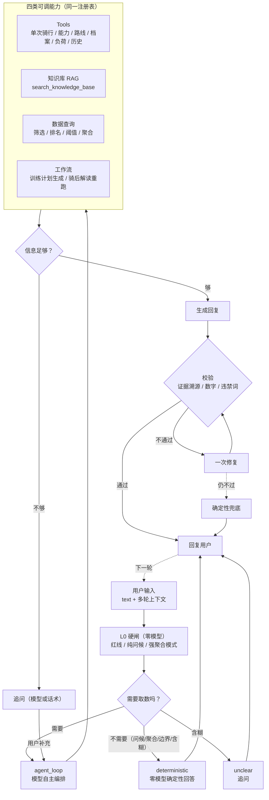
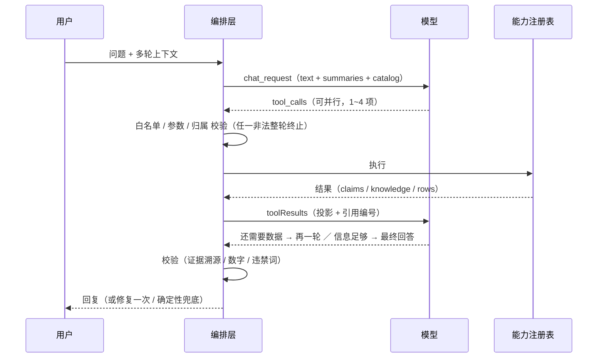

# 对话 Agent 去路由化重构方案

- 日期：2026-10-27
- 目标（用户口径）：**去掉多余冗余的路由，让大模型根据用户意图自己调用工具 / 工作流 / 知识库 / 数据查询获取上下文来回答**
- 性质：架构改造粗规划（不含代码）。落地前需拍板 §10 的 5 项
- 前置阅读：[分层节点 IO 说明书](./2026-10-27_对话Agent_分层节点IO说明书.md)（现状）、通用结构对照与四场景结构图（目标骨架，原文档已被移出项目目录，结论并入 [结构定案](../开发规划/2026-10-27_Agent结构设计与改造定案.md)）

---

## 一、结论

**16 条路由 → 3 条。** 不是"全部交给模型"，而是：

```
route ∈ { stop, deterministic, agent_loop }
```

- **`stop`**：红线，模型**永远看不到**（急症/危险骑行/隐私/注入）——延迟与可靠性都不允许问模型。
- **`deterministic`**：零模型确定性回答（问候、精确聚合、能力缺口、澄清、写拒绝）。
- **`agent_loop`**：**唯一取数路径**。模型自主决定调哪个工具 / 查知识库 / 做数据查询 / 触发工作流，循环到"信息足够"为止，再生成回复。

关键判断：**现在的 16 条里，真正不可下沉的只有 5 条（安全与边界），可下沉的是 11 条。** 其中 6 条本质是同一件事（`取数 → 回答`）被拆成了 6 个变体——这正是"冗余"的来源。

---

## 二、诊断：16 条路由的四种成分

| 成分 | 路由 | 为什么是这个成分 | 处置 |
|---|---|---|---|
| **① 安全与边界（5 条，不可下沉）** | `safety_stop` / `privacy_boundary` / `injection_stop` | 急症响应要**零延迟**、且模型判"我胸痛"不可靠（实测有把急症答成训练建议的风险） | **保留，合并为一个 `stop` + `risk` 子标签** |
| | `out_of_scope` / `capability_gap` | 防闲聊漂移、防模型承诺没做的能力 | **保留，并入 `deterministic`**（各成一个 reasonCode） |
| **② 确定性数据（2 条，不可下沉）** | `aggregate` | 总里程/次数必须精确，模型自己加总会错（已踩：模型把逐条 rows 加成 1001km，工具给的是 1050km） | **保留，并入 `deterministic`** |
| | `clarification` | "那这个呢"零信息，进模型只会幻觉 | **保留，并入 `deterministic`** |
| **③ 同一件事的 6 个变体（真冗余）** | `current_ride` | 单次指标 = 调一次 `get_ride_context` | **删，并入 `agent_loop`** |
| | `capabilities` | 数据可用性 = 调一次 `get_capabilities` | **删，并入 `agent_loop`** |
| | `history_compare` | 与历史比 = 调一次 `compare_rides` | **删，并入 `agent_loop`** |
| | `autonomous_tools` | 已经是循环 | **成为 `agent_loop` 主体** |
| | `kb_qa` | 知识问答 = 调一次 `search_knowledge_base` | **删，并入 `agent_loop`** |
| | `level_assessment` | 水平评估 = 调 4~5 个工具后总结 | **删，并入 `agent_loop`** |
| **④ 闲聊与占位（3 条）** | `social` | 纯问候零延迟直答有价值；其余闲聊可交给模型 | **问候留 L0 正则，其余并入 `agent_loop`** |
| | `training_plan` / `training_supervision` | 现在是占位模板，目标形态本来就是"调工具+生成+硬门" | **`deterministic` 占位保持不变，AGT-F 落地后并入 `agent_loop`** |

> 一句话：**"冗余"的不是路由数量，而是"用路由去表达'该调哪个工具'"这件事本身。** 路由该表达的是"这条请求能不能由系统自己确定性回答"，而不是"该调 get_ride_context 还是 compare_rides"。

---

## 三、目标架构



**与现状的四处结构性变化：**

| # | 变化 | 影响 |
|---|---|---|
| 1 | 路由从"执行分派器"退化为"**能否确定性回答**的三分类" | 判错的代价从"答错"降为"多一次模型调用" |
| 2 | 取数只有一条路径（`agent_loop`），不再按 route 决定调哪个工具 | 同一诉求不会因分类标签不同而走不同质量链路 |
| 3 | 工具选择交给模型，由 catalog 与分工表约束 | 需要重新校准 catalog 与 prompt（见 §7 代价） |
| 4 | 校验层成为**必经节点**（用户图上已有） | 与现状一致，继续保留并强化 |

### 一个必须先定的岔路：分类器留不留？

"要不要取数"这个判断，现在由 16 分类器给出。去路由化后有三条路：

| 方案 | 做法 | 延迟 | 风险 |
|---|---|---|---|
| **A 全删** | 只留 L0 红线正则，其余**全部**进 `agent_loop`（包括问候、域外、含糊） | **可能更快**：现在 = 分类器 1~4s + provider 4s；改后 = provider 4s（不调工具时一轮出答案） | 域外问题由模型兜（靠身份边界 + 输出去越界词），有漂移风险 |
| **B 降为二分类** | 分类器只判「域外 / 含糊」两个负向标签，其余一律进循环 | 仍多一次 1~4s | 域外拦截稳，但省不下延迟 |
| **C 降为三分类** | 「取数 / 不取数 / 含糊」 | 同上 | 最稳，但等于保留了一个迷你路由 |

**我倾向 A 起步、用边界集实测**：如果边界集 38 例里"域外/隐私/注入"仍能 100% 拦住（L0 正则已覆盖大部分），分类器就真的可以整个删掉——这是"去掉冗余"最彻底的一刀，而且**省掉的是每次请求 1~4 秒**，正好抵消循环多一轮的延迟。若实测域外漂移，再退回 B。

---

## 四、`agent_loop` 的内部结构



**四类能力的边界（对应你图里括号中的四项）**

| 类型 | 本质 | 现有成员 | 新增/调整 |
|---|---|---|---|
| **Tools** | 取"某一条/某几条记录"的事实 | `get_ride_context` `get_capabilities` `get_route_overview` `get_health_profile` `get_training_load` | 把 `rideId` 改成 **`rideRef`（date / ordinal / id）**，见 §5 |
| **知识库 RAG** | 取"道理" | `search_knowledge_base`（7 维度 + 别名表） | 补未覆盖零模型话术（AGT-C2） |
| **数据查询** | 取"跨记录的统计/筛选/排名" | `find_ride` `get_ride_history` `compare_rides` | 合并思路：一个参数化 `query_rides`（filter/sort/aggregate/window），减少模型"该用哪个"的选择成本 |
| **工作流** | 多步、有副作用或强规则的流程 | **目前没有这一类** | 新增 `generate_training_plan`（AGT-F）、`reanalyze_ride`（复用骑后解读 V2 链路） |

> "工作流"这一类是当前架构完全缺失的：训练计划其实不是一次工具调用，是"取数 → 生成 → 处方硬门 → 落库 → 确认"的流程。把它做成**模型可触发的 workflow**，比让模型自己在循环里拼 5 个工具更安全。

---

## 五、关键改动 1：把"锚点解析"下沉成工具参数

这是整个重构里**性价比最高**的一步，顺手解决"只解读最近一次"。

**现状**：`/api/chat` 不做记录选择，锚点由 `resolveRideAnchor` 用正则从文本里抠日期 → 存成 `"YYYY-MM-DD"` → 注入工具。限制：不认相对日期、不认序数、同一天多条会撞车、缺省静默取最新。

**改成**：
```jsonc
// 工具入参（模型填）
{ "tool": "get_ride_context", "input": { "rideRef": { "date": "2026-08-20" }, "dims": [...] } }
{ "tool": "get_ride_context", "input": { "rideRef": { "ordinal": -2 }, "dims": [...] } }   // 倒数第二次
{ "tool": "get_ride_context", "input": { "rideRef": { "rideId": "..." } } }
```
- 工具层负责 `rideRef → rideId` 解析：日期匹配、序数按出发时间排序、同日多条返回**候选列表**而非静默选一条。
- 解析不到 → 返回 `{ status:"ambiguous", candidates:[{rideId, rideDateLabel, distanceKm}] }` → **模型据此追问**（正好落进图里的"信息是否足够 → 追问"）。
- 缺省（模型没给 `rideRef`）→ 返回 `{ status:"need_reference" }`，**不再默认取最新**；需要"最近一次"时由模型显式传 `{"ordinal":-1}`。

**收益**：日期/序数/同日多记录/歧义追问一次性解决，且不再依赖正则。**代价**：模型可能填错日期（`2026-08-20` vs `8月20日`），需在 catalog 输入说明里给格式，并在工具层容错。

---

## 六、关键改动 2：catalog 从"按路由裁剪"改为"全量 + 分工表"

现状按 route 裁剪（9 / 5 / 3 / 空）。去路由后只剩"全量"一个选项。

| 项 | 现状 | 目标 | 代价 |
|---|---|---|---|
| 下发体积 | 9 工具 ≈2404B（仅循环路由） | 全量 9 + 未来工作流，≈2.6KB | 每次请求都带，token 略增；可接受 |
| 选错工具率 | 裁剪后可选空间小，实测非法调用率低 | 空间变大，**可能回升** | 用 `purpose`（用途+边界）+ 分工表补，但注意：**在 catalog 里写"不要用 X"会连带压制正确用法**（实测 ORCH-11 从 1/3 掉到 0/3） |
| 归因 | route 即归因维度 | 改为 `loopTrace.steps` + 首个工具 | 观测口径要重写 |

**可选优化（建议做）：投机预取。** 合并后所有数据类问题至少 2 轮模型调用（调工具 + 出答案），延迟会比现在的单工具路径多约一轮。缓解方式：编排层先用轻量规则预取一批"大概率要用"的结果（如单次指标 → 直接预取 `get_ride_context` 全维度），模型首轮就带数据，一轮出答案。失败也只是多几个没被引用的 claims（不进校验白名单）。

---

## 七、校验层：保留，且必须强化

你新加的"校验"节点与我们现状一致（`claimIds` 溯源 + 数字等价类 + 违禁词否证豁免）。去路由化后它更重要，因为**模型自由度变大**：

| 新增校验 | 触发条件 | 原因 |
|---|---|---|
| `OUTPUT_EVIDENCE_MISSING` | 事实性回答但零证据 | 循环里模型可能"不调工具直接答" |
| `OUTPUT_TOOL_CHOICE_SUSPECT`（离线） | 问单次指标却调了 `find_ride` | 选错工具在旧架构被 route 挡住，现在挡不住，只能事后量化 |
| `OUTPUT_ASSESSMENT_OVERREACH` | 评级/预测/处方 | 已在 AGT-C3 规划 |

---

## 八、迁移路径（5 步，每步可独立回滚）

| 步骤 | 做什么 | 验收 | 回滚 |
|---|---|---|---|
| **S0 打底** | 路由降级为**遥测标签**：行为不变，但执行分派改为读"新三分类"；建映射表 `旧 route → 新 route` | 同一批问题新旧两套标签并存，行为零差异 | 改回读旧 route |
| **S1 合并工具路由** | `current_ride` / `capabilities` / `history_compare` 并入 `agent_loop`；`rideRef` 下沉（§5）；catalog 全量 | **编排集 21 例 + 边界集 38 例原样跑**（两套都不按 route 断言）；M3 对应槽位只做答案不劣化比对 | 保留单工具执行器，按旧 route 分派 |
| **S2 合并知识/评估** | `kb_qa` / `level_assessment` 并入（本来就是循环，只需去 route 标签） | 边界集 KB 15 例、评估 8 例不退化 | 同上 |
| **S3 聚合下沉** | `aggregate` 做成确定性工具 `get_ride_summary`，由模型调用；保留"强聚合模式"L0 直答（"一共骑了多少"仍零模型） | 聚合类数字零差异（逐条比对） | 保留直答分支 |
| **S4 工作流接入** | `generate_training_plan` 作为 workflow 进注册表（前置：P6 + 业务交互 PRD + 处方硬门） | 处方硬门违规 = 0、采纳率 ≥60% | 退回占位模板 |

**顺序理由**：先做"打底 + 合并"（纯内聚，不动能力），再做"能力扩展"（工作流）。反过来会同时改两件事，失败无法归因。

---

## 九、代价与风险（必须先认）

| # | 代价 | 量级 | 缓解 |
|---|---|---|---|
| 1 | **延迟上升** | 数据类问题从 1 轮 provider（p50 生成约 4s）变 2 轮，约 +3~5s；问候/聚合路径若也进循环会从 0 变 4s+ | 问候/聚合留 L0；投机预取；保守用 90s 墙钟 |
| 2 | **成本上升** | 每次请求都带全量 catalog；数据类多一轮调用 | catalog 精简（`purpose` 控制在 60 字内） |
| 3 | **确定性风险** | 聚合、能力清单、能力缺口这三类现在**零模型精确**，交给模型会漂 | 三类全部留在 `deterministic`，或做成"必须调用的确定性工具" |
| 4 | **安全前置不能动** | 红线若进循环，急症响应延迟 4s+，且模型判断不可靠 | `stop` 永远在第 0 层 |
| 5 | **评测资产部分失效** | 三套集的断言口径不同（已逐套核对 `cases.json`）：**M3 34 例按 `expected.route` 断言 → 失效需重写**；**编排集 21 例按 `requiredTools / forbiddenTools / requiredEvidence` 断言 → 可直接复用**（只需把 `anchor` 字段适配成 `rideRef`）；**边界集 38 例按 `expected.behavior`（tool_executed / graceful_unavailable…）断言 → 可直接复用** | 把"重构回归"的主力放在编排集 + 边界集（它们本来就在测能力，不在测路由）；M3 改写成"能力断言"版；旧 Run 标 `supersede` |
| 6 | **归因变难** | 现在"哪个 route 失败"一目了然，之后要看 `loopTrace` | 事件里补 `firstTool` / `toolSequence` / `loopRounds` |
| 7 | **选错工具率回升** | 裁剪是过去压非法调用的手段之一 | 分工表 + 离线误选率统计（不阻塞上线） |

> 最大的一笔不是代码，是 **M3 那 34 例的断言口径**。但这笔账比想象的小：编排集（21 例，按工具集合断言）与边界集（38 例，按 behavior 断言）**本来就不测 route，重构后可以直接当回归基线用**——真正要重写的只有 M3，因为它是唯一按 `expected.route` 判分的集。

---

## 十、待拍板 5 项

| 编号 | 问题 | 选项 | 建议 |
|---|---|---|---|
| **D-R1** | 三分类是否够用？ | ①`stop / deterministic / agent_loop` ②保留 5~6 条（安全各自独立） | ①：安全内部用 `risk` 子标签区分，不必占 route 位 |
| **D-R2** | `aggregate` 留直答还是变工具 | ①留直答（零模型）②变工具由模型调 ③两者并存（命中强聚合词走直答） | ③：既保精确又保灵活 |
| **D-R3** | 数据查询要不要合并成 `query_rides` | ①保留 `find_ride`/`get_ride_history`/`compare_rides` 三个 ②合并为一个参数化工具 | ②：减少模型"选哪个工具"的决策成本，但改动大；可先①，S3 后再评估 |
| **D-R4** | 是否接受延迟 +3~5s | ①接受 ②做投机预取 ③给"快速模式"（单工具预取 + 跳过循环） | ②：预取成本低，效果直接 |
| **D-R5** | 评测集怎么建 | ①改造 M3 的 `expected.route` 断言 ②新建"能力集" ③用编排集 + 边界集作主回归，M3 只做答案比对 | ③：已核过字段——编排集按工具集合断言、边界集按 behavior 断言，**两套天然适配新架构**；M3 是唯一需要动断言的 |
| **D-R6** | 分类器留不留（§三岔路） | ①A 全删 ②B 二分类 ③C 三分类 | ①A 先试：省 1~4s 正好抵消循环多一轮；边界集实测域外拦不住再退 B |

---

## 十一、一句话总结

**要删的不是"路由"这个机制，而是"用路由表达工具选择"这个用法。** 删完之后剩下三类：系统能自己答的（含所有安全边界）、必须精确算的、以及"交给模型去取数"的唯一一条。你图里的骨架本身就是这个意思——只是"信息是否足够"要落成**两处**（取数前判指代、取数中判够不够），校验要从可选项变成必经节点。
