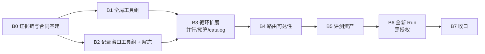

# AGT-B · 只读工具面与 L2b 循环扩展（细版）

> 细化日期：2026-10-24｜所属：[Agent 开发规划（粗）](../archive/VIBE_CODING_Agent_开发规划.md) 里程碑 AGT-B｜执行事实源：[Agent 改造开发进度](Agent改造开发进度.md)。
> 现状代码基线（已实地核对，非文档转述）：`src/chat/chat-tools.ts`（4 只读工具、`chat-tools-v0.1`、`CHAT_COMPARISON_WINDOW_DAYS=30`、`CHAT_FIND_RIDE_MAX_WINDOW_DAYS=30`）；`src/chat/chat-tool-orchestration.ts`（L2b 循环、预算 3/5/30s、**串行执行**、catalog 4 工具）；`src/chat/chat-agent.ts`（`runAutonomousToolLoop`、`hasUsableLoopClaims` 硬编码 4 工具）；`src/chat/chat-output-validation.ts`（`ride-chat-output-v0.1`、五路由硬编码分派、`autonomous_tools` 要求 `claimIds` 非空）。
> 已拍板前提：**P4（2026-10-24 用户）**健康数据范围 = 仅使用现有 profile（maxHR / FTP / 体重），不接外部健康数据；**P7（2026-10-24 用户）**30 天窗口放开属口径变更，M3 对话评测须开新 Run，不给旧口径结论背书。

## 1. 目标与非目标

**目标**：把只读工具面从 4 个扩到 **9 个**（+5），让 L2b 循环真正承载分析/评估/KB 问答三类任务；解除 chat 层 30 天窗口冻结并定义新窗口口径；循环层支持**并行执行 + 预算重标定 + 路由化 catalog 裁剪**；评测按 P7 开新 Run。

**非目标（明确不做）**：
- 不做四类任务簇的**语气/约束分化 Prompt**（AGT-C）。B 阶段新可达路由复用现有 `ride-chat-output-v0.2` 通用叙事约束，不做"教练口吻/评估结论包装"。
- 不做 **KB 检索质量与命中率**优化（AGT-C：RAG 检索策略、"知识库未覆盖"话术精修、引用命中率 ≥90% 评测）。B 只保证**引用 ID 可校验**（引用的条目必须来自本轮工具结果）。
- 不做**训练计划与写路径**（AGT-F）、不做 `training_plan`/`training_supervision` 路由实装——两者 B 阶段**仍为确定性占位模板**。
- 不做**上下文分层与长期记忆**（AGT-D）、不做**影子轨观测与阶段放行**（AGT-E）。
- 不改红线三路由与 L0 快路径（`safety_stop`/`privacy_boundary`/`injection_stop` 零改动）。
- **不把派生指标计算交给模型**：CTL/ATL/TSB、zone 时长、路线分段全部由 `ride-pmc-load-v2`/`ride-route-shape`/`ride-series` 计算，LLM 只叙事（V2/V2.1 原则不动）。

## 2. 代码基线核对：六个必须先行修复的合同缺口

> 这一节是本规划的核心依据。以下不是设计偏好，是**现有代码会直接拦住新工具**的硬事实，逐条给出改造方向。它们共同构成工作项 B0 的范围。
> G1~G5 由读代码发现（"新工具接不进来"），**G6 由实测发现**（"接进来了也说不出正确的话"）——后者是 2026-10-24 追问"校验层会不会误拦语义正确的输出"时用 8 个探针跑出来的，6 拒 2 过。

| # | 缺口 | 现有代码事实 | 后果（若不修） | 改造方向 |
|---|---|---|---|---|
| **G1** | **证据形态只有一种** | `chat-output-validation.ts` 的 `autonomous_tools` 分支要求 `claimIds` 非空且可溯源；`parseOutput` 强制精确键集 `[schemaVersion, route, reply, claimIds, capabilityKeys]` | `search_knowledge_base` 返回的是**知识条目、不含个人事实 claim**，模型无 claimId 可引 → 必被拒 → 修复轮再拒 → `REPAIR_FAILED`。**KB 问答在现有合同下不可能成功** | 输出合同升 `ride-chat-output-v0.2`：新增可选 `knowledgeIds[]`；证据要求改为**按证据类型各自非空**（本轮用到 claims 类 → `claimIds` 必填；用到 KB → `knowledgeIds` 必填；**两类可同时存在**，每个 ID 各自溯源）；两者皆空仍拒 |
| **G2** | **证据短路硬编码** | `chat-agent.ts: hasUsableLoopClaims()` 按 4 个工具名 `if` 分派，其余（含 `get_capabilities`）一律 `false` | 新工具返回了有效内容，但被判定"无可用证据"→ 零模型确定性降级（"本轮查询没有返回可引用的数据"） | 每个工具结果声明 `evidence: { kind: "claims" \| "knowledge" \| "capabilities" \| "none", usable: boolean }`；`hasUsableLoopClaims` 改为读声明，删除按工具名的硬编码 |
| **G3** | **锚点是强制的** | `normalizeLoopCall()` 对**所有**调用注入 `raw.rideId = anchorRideId`；`parseChatToolInvocation` 每个分支都 `validRideId(input.rideId)`；`startLoop` 在 `listRides().length === 0` 时直接 `TOOLS_NO_CURRENT_RIDE` | 没有骑行记录的用户问"你支持哪些训练方法""我的 FTP 是多少"→ 连循环都进不去；`get_health_profile`/`search_knowledge_base`/`get_training_load` 被塞进无意义的 `rideId` | 工具合同分两类：**锚点工具**（`rideId` 必填/缺省锚点）与**全局工具**（无 `rideId` 字段）；`startLoop` 改为"需要锚点时才要求有记录"，`TOOLS_NO_CURRENT_RIDE` 仅对锚点工具生效 |
| **G4** | **数字白名单既按工具名分支、又只做字面量相等** | `loopNumbersAreSupported()` 逐工具 `if`；`numericValues()`/`comparisonNumericValues()` 也只认自己的工具；匹配用 `values.has(Number(literal))` | ① 新工具的数字**不进白名单** → 模型一说出工具给的数就 `OUTPUT_NUMERIC_UNSUPPORTED`；② **近似/换算表达一律被拒**：工具给 `30.4 km`，模型说"大约 30 公里"→ 拒；`0.5 ratio` 说"50%"→ 拒。而项目在骑后解读里**早就有 `claimNumericVariants` 等价类**（舍入、`m/s↔km/h`、`s↔min/h`、`ratio↔%`）——chat 层比骑后解读更严，是**资产没用上，不是设计选择** | 抽出统一契约 `toolNumericEvidence(result): number[]`（各工具声明自己的数字来源：值/displayValue 内数字/日期标签/窗口/计数），**且匹配口径升级为等价类**（直接复用 `claimNumericVariants`）；校验器只做并集与等价判定，不再认工具名 |
| **G5** | **串行执行 + 预算同源** | `executeLoopCalls()` 用 `for...await` 串行；`parseChatToolCallRequest` 的单轮上限与累计预算共用 `CHAT_TOOL_LOOP_MAX_TOOL_CALLS`；整轮 `30_000ms`，而单次 provider 已放宽到 `15_000ms` | 3 个无依赖工具 = 3× 延迟（R02 教训重现）；**2 次 provider 调用就可能吃满 30s**，加工具后必然频繁 `budget_exhausted`；单轮上限与累计预算无法独立调整 | 拆常量（单轮并发上限 / 累计调用上限）；执行改为**先全量校验、再一次并行、任一被拒则整体不执行**；重标定预算（见 D-B5） |
| **G6** | **措辞类规则"词面命中即拒"** | 注入/隐私/安全三组正则对整段 `reply` 做 `test()`，命中即拒，**不区分"断言"与"声明/否定"** | **实测（2026-10-24）**：`"我不是医生，不能做诊断"` → `OUTPUT_SAFETY_VIOLATION`；`"不会访问其他用户的数据"` → `OUTPUT_PRIVACY_VIOLATION`；`"不会提供 api key"` → `OUTPUT_INJECTION_VIOLATION`。**安全声明被自己的安全规则拦死**——AGT-C 要加的"非医疗诊断声明"话术必然命中，等于**规划里承诺的安全话术在现规则下无法上屏** | 命中后做**窄范围否定/声明语境豁免**（"不能/不是/不会/不提供/建议就医"），豁免必须有正反例单测，不许放宽到整句。**词表扩充（"你患有/建议服用"类断言短语）经 2026-10-24 用户拍板延后至 AGT-C**：输出层词表只是纵深（主防线在路由层 `safety_stop`，red-team 10/10），扩充的误拦/漏放边界需要真实样本校准，由 C 的离线语义判官产出样本后迭代——已记入已知局限与 §11 交接 |

> **实测记录（2026-10-24，`validateChatOutput` 直接调用，非推测）**：8 个探针里 6 拒 2 过——`30.4` 逐字引用 PASS / "大约 30 公里" REJECT(`NUMERIC`) / "0.5" PASS / "50%" REJECT(`NUMERIC`) / "不能做诊断" REJECT(`SAFETY`) / "不会访问其他用户的数据" REJECT(`PRIVACY`) / "不会提供 api key" REJECT(`INJECTION`) / **"三十公里" PASS（中文数字直接漏检）**。
> 反向问题要一并记：规则同时存在**误拦**（阿拉伯近似数、声明句）与**漏放**（中文数字不受数字校验约束）。因此 B0 的处置不是"放宽门槛"，而是**把匹配口径做对**：阿拉伯数字走等价类（该过的过）、中文数字不解析（避免"第一次""十分"误伤）但在 Prompt 层禁止用中文数字表述数据，并把该局限写进已知缺陷。

> 附带事实（降低 B2 风险）：**领域层早已支持 1..365 天**——`historical-comparison.ts:371` 对 `windowDays` 做 `min(365, …)`，`validate` 也只检查 1..365。所谓"30 天冻结"只存在于 **chat 层**（`chat-tools.ts` 的默认值与 `find_ride` 输入上限、编排层默认注入）。因此 B2 是**解冻与口径定义**，不是重写计算。

### 2.1 校验层定性：规则校验的边界，以及"要不要加语义校验层"

**现状定性**：`chat-output-validation.ts` 是**纯确定性规则校验，零模型**，五层——① JSON/精确键集 schema → ② route 匹配 → ③ 长度 → ④ 三组词表正则（注入/隐私/安全）→ ⑤ 证据溯源（`claimIds` 映射 + 数字字面量集合）。**没有语义层。**

**会不会误拦语义正确的输出：会，且已实测复现**（§2 G4/G6 探针）。归纳为三个根因：

| 根因 | 表现 | 性质 |
|---|---|---|
| 数字用**严格字面量相等** | "大约 30 公里"（工具给 30.4）、"50%"（工具给 0.5 ratio）被拒 | **资产没用上**——骑后解读的 `claimNumericVariants` 早就解决了舍入与单位换算，chat 层没接 |
| 措辞规则**词面命中即拒** | "不能做诊断""不会访问其他用户的数据""不会提供 api key" 全部被自己的安全规则拦 | **方向错了**——规则想拦"危险断言"，实际拦住了"安全声明" |
| 证据要求**无正当豁免** | social 路由下任何阿拉伯数字都只能来自用户原句 → 陪伴话术里"每周骑 3 次"被拒；KB 问答无 claim 可引 | 合同缺形态（G1/G6 的一部分） |

**要不要加语义校验层：线上门禁不加 LLM 判官，离线评测要加。** 理由是四笔账：

| 维度 | 在线 LLM 判官 | 结论 |
|---|---|---|
| 延迟 | 每次回复多一次模型调用（现主对话 4.5–8.2s，判官再叠 3–5s），P95 近乎翻倍 | ❌ 与 R02 延迟教训直接冲突 |
| 失败方向 | 判官本身会错，而它错的方向是**放行幻觉**——比误拦危险得多 | ❌ 安全边界不能交给概率 |
| 可审计 | 判官给不出稳定的失败归因，bad case 无法定位到规则，评测结论不可复现 | ❌ 与 81/81、83/83 建立在"判定可复现"上的成果冲突 |
| 误拦治理 | 判官只能"再判一次"，不能解释"为什么这条规则拦错了" | ❌ 治不了根因 |

**正确做法是三层分工，而不是加一个判官**：

1. **把规则做对（B0，确定性）**：数字匹配升级为等价类（复用 `claimNumericVariants`）；三组词表拆成"危险断言短语"，并加**窄范围**否定/声明语境豁免。目标 = 该过的过、该拦的拦，**仍零模型、仍可复现**。
2. **补拒绝原因观测（B0）**：现在修复失败只落 `fallbackCode="REPAIR_FAILED"`，真实原因在 `outputValidation.code` 里（已保留但未按原因聚合）。B0 要把 `validationCode` × 轮次 × 路由写进 trace，才能量化"哪条规则在拦、拦得对不对"。**没有这个数，误拦率只是一句感觉。**
3. **离线语义判官（AGT-C 评测层，不进线上）**：把"语义正确但被拒"作为独立评测信号——对被拒样本做 LLM + 人工双层标注，产出**误拦样本集**喂回规则迭代。这符合项目既有盲评/评分卡方法论，且不触碰线上门禁。

> **口径红线**：等价类放宽的是"**表达形式**"（舍入、换单位、比例），不是"**事实来源**"——仍然必须溯源到本轮工具结果；语境豁免放宽的是"**否定/声明句**"，不是"**危险断言**"（"你有心脏病"照拦）。任何一步都不许把"数字可计算"或"整句豁免"放进来。


## 3. 工具面设计（4 → 9）

### 3.1 工具全景

| # | 工具 | 类别 | 锚点 | 底层模块（已验证存在） | 证据形态 | 用途与用法（什么时候调、怎么调） |
|---|---|---|---|---|---|---|
| 1 | `get_ride_context` | 现役 | 必须 | `ride-analysis-context` | claims | **查本次（锚点）骑行的指标明细**。用户问"这次"的任何数值（功率/心率/踏频…）都先调它；`dims` 按问题涉及的维度传，缺省 `["summary"]`（总结型问题）。只返回脱敏 claims，无原始轨迹。 |
| 2 | `get_capabilities` | 现役 | 必须 | `atomic-capabilities` | capabilities | **查"有没有这类数据、质量如何"**——回答数据可用性，不是查数值。用户问"你支持看踏频吗""这次有功率数据吗"用它；`caps` 按问题类别传。查具体数值请改调 `get_ride_context`。 |
| 3 | `compare_rides` | 现役 | 必须 | `historical-comparison` | claims | **本次 vs 最近基线的比较**（方向 + 变化量 + 样本数）。用户问"这次比平时快/远吗"用它；`metrics` 按被比较的指标传，`windowDays` 默认 30 **不放大**（D-B1：可比性口径）。回答只能用 comparable 的 claim，不可比要如实说。 |
| 4 | `find_ride` | 现役 | 必须 | `persistent-history` | claims | **窗口内检索/排名某一条骑行**。用户问"哪次距离最远""哪次平均心率超过 120"用它；`mode` 选 max/min/threshold，`windowDays` 缺省 30（B2 解冻后上限 365）。命中后用返回的 `rideId` 可接着调 1/3/9 做深挖。 |
| 5 | `get_health_profile` | **新增** | 无 | `user-profile` | claims | **查用户的身体基线**：体重 / 最大心率 / FTP 三项（含 provenance 与更新时间）。做水平评估、解释心率区间、算训练负荷前先调它拿基准；`fields` 缺省全量。**没有骑行记录也能用**（全局工具）。估算值（`system_estimated`）必须如实说成估算。 |
| 6 | `get_training_load` | **新增** | 可选（缺省今日） | `ride-pmc-load-v2` | claims | **查训练负荷三量**（CTL 长期 / ATL 急性 / TSB 平衡）。用户问"我最近练得多不多""状态怎么样"用它；`anchorDate` 缺省当日。需要 ≥42 天跨度且 ≥10 个负荷日，不满足返回 `unavailable` + 原因——**如实转述原因，不自行估算**。 |
| 7 | `search_knowledge_base` | **新增** | 无 | `ride-knowledge-base-v21`（7 条，`ride-kb-2.1.0`） | knowledge | **查训练科学知识**（配速/爬坡/心率负荷/功率/强度/踏频/跨传感器 7 维）。用户问"为什么""什么是"类原理问题用它；按 `dimensionIds` 或 `keywords` 检索，`maxEntries` ≤3。回答知识必须引用返回的 `knowledgeId`；未命中就明说"知识库未覆盖"，**不得编造条目**。 |
| 8 | `get_ride_history` | **新增** | 可选（缺省最新） | `persistent-history` + `ride-series` | claims | **跨记录窗口统计**：次数 / 总里程 / 总时长 / 总爬升 + 逐条精简行。用户问"最近三个月骑了多少"用它；`windowDays` 缺省 90、上限 365（D-B2），`rideId` 传 null 表示不锚定。要排名/极值改调 `find_ride`，要单次明细改调 1。 |
| 9 | `get_route_overview` | **新增** | 必须 | `ride-route-shape`（需 `elevation.smoothedSegments`） | claims | **查某次骑行的路线形状**：爬坡/平路/下坡里程占比 + 最长连续爬坡段。用户问"这次路线爬坡多吗"用它；`rideId` 必填（常来自 4 的命中结果）。只给里程区间与占比，**不给坐标**（隐私口径）。 |

### 3.2 五个新工具的合同要点

| 工具 | 输入（严格键集，沿用 `hasExactKeys`） | 输出投影要点 | 隐私声明 |
|---|---|---|---|
| `get_health_profile` | `fields: ("weightKg"\|"maxHeartRate"\|"ftp")[]`（枚举上限 3，缺省全量） | 每字段 `{key, value, unit, provenance: "user_provided"\|"system_estimated", updatedAt}` + `limitations`（缺失字段明示） | `identity_fields_excluded`、`non_sport_health_fields_excluded`（heightCm 不进投影，见 D-B6） |
| `get_training_load` | `anchorDate?: "YYYY-MM-DD"`（缺省当日）、`windowDays?: 7..42` | `status: available \| unavailable` + `ctl/atl/tsb` + `reason`（`FTP_NOT_CONFIRMED`/`NO_TSS_HISTORY`/`INSUFFICIENT_WINDOW`/`INSUFFICIENT_LOAD_DAYS`）+ `limitations` | `none`（无敏感项） |
| `search_knowledge_base` | `dimensionIds?: AnalysisDimensionId[]`、`keywords?: string[]`（≤5，每条 ≤32 字）、`maxEntries?: 1..3` | 每条 `{knowledgeId, dimensionId, topic, title, conclusionStrength, limitations, excerpt≤600 字}`；**`knowledgeId` 即引用单元**；未命中返回 `status:"no_match"` + 可用维度列表 | `public_knowledge_only` |
| `get_ride_history` | `windowDays?: 1..365`（缺省 90）、`metrics?: 比较指标白名单子集` | 窗口内 `rideCount / totalDistanceM / totalMovingTimeS / totalElevationGainM` + 逐条精简行（日期 + 指标 claims）+ `reasonCodes`（窗口内无记录/指标缺失） | `raw_track_excluded`、`precise_coordinates_excluded`、`source_filename_excluded` |
| `get_route_overview` | `rideId`、`segments?: 1..5` | `isAvailable` + 爬坡/平路/下坡里程占比 + 最长连续爬坡段（起止里程/里程/是否 available）+ 成因 limitations | 同上（**精坐标仍排除**，只给里程区间与坡度概要） |

合同模板沿用 `chat-tools-v0.1` 全部项：`schemaVersion` 常量化（升 `chat-tools-v0.2`）、单工具 `2_000ms`、输入 `4KB`、结果 `32KB`、错误码四值、注入防护按不可信数据处理。

**KB 投影的 token 纪律**：7 条 KB 全文 23.6KB，单条 `explanation` 平均约 3KB。`maxEntries` 上限 3 且 `excerpt ≤600 字`，保证最坏情况仍远离 32KB 上限，同时避免一轮把 catalog 挤爆。

## 4. 窗口口径设计（P7 的落地方式）

**原则：把"检索宽度"与"可比性口径"分开，不一起放开。** 30 天在 `compare_rides` 里不是随手设的默认值，它是"进步/退步"这类结论的样本口径；在 `find_ride` 里它只是检索范围。

| 能力 | 现值 | B 后 | 理由 |
|---|---|---|---|
| `find_ride` 窗口上限 | 30（硬上限） | **365**（缺省仍 30） | 纯检索，不产生比较结论；用户问"去年最远那次"应能命中 |
| `compare_rides` 默认窗口 | 30 | **30 不变** | "可比性"结论的样本口径，放开会把 3 个月前的记录当作基线，退步/进步的语义被稀释。**显式要求更长窗口时按输入值走（领域层已支持至 365），但默认不放大** |
| `get_ride_history` 新窗口 | — | 缺省 **90**、上限 **365** | 长窗口聚合统计的专属出口，不承担"比较结论" |
| 编排层默认注入 | 30 | `find_ride` 30 / `compare_rides` 30 / `get_ride_history` 90 | 模型不填就用各自缺省，语义分层 |

**口径变更声明（按 P7）**：`find_ride` 上限从 30 → 365 属**能力面变更**，会改变"窗口外历史"类问法的答案（原本 `no_match`，现在可能命中）。因此 **M3 对话评测集必须升版并开新 Run**，旧口径结论（v0.5 `27/27`、v0.6 未执行）一律标 `supersede`，不得引用为 B 的背书。

> **闭环说明（2026-10-24 审查补充，销重评报告 §8 的交接项）**：交接清单里的"`aggregate` 窗口口径重审"经查证**不构成变更**——`aggregateReply`（`chat-home.ts`）的数据源是**全量传入记录**（cumulative 无窗口概念、"本周"按自然周切分），不存在 30 天冻结，窗口放开对它零影响。此项到此销账；B 阶段不动 aggregate。

## 5. 循环扩展设计

### 5.1 并行执行（R02 延迟教训）

现实现是逐个 `await`，3 个无依赖工具 = 延迟相加。改法：

```
模型请求 N 个调用
  → 逐个 normalize + parseChatToolInvocation（纯校验，无 IO）
  → 任一不合法：整体不执行，返回 invalid_tool_call（语义与现状一致）
  → 全部合法：Promise.all 并行执行（各自仍有 2s 单工具超时）
  → 按请求顺序组装 receipts（保证 claim:loop:N 编号稳定）
```

关键约束：**并行不改变降级语义**——只要有一个调用被拒，整轮就终止（与现状"首个被拒即终止"对齐，只是从"边执行边发现"改为"先判后跑"）；工具失败仍按首个失败终止。

### 5.2 预算重标定

| 常量 | 现值 | 建议值 | 依据 |
|---|---|---|---|
| 单轮并发调用上限（新增 `CHAT_TOOL_LOOP_MAX_CALLS_PER_TURN`） | 3（与累计同源） | **4** | 评估类最坏组合 = profile + training_load + ride_history + route_overview |
| 累计工具调用（`CHAT_TOOL_LOOP_MAX_TOOL_CALLS`） | 3 | **5** | 首轮决策 + 一次并行 4 项 + 一次补查 |
| provider 调用（`CHAT_TOOL_LOOP_MAX_PROVIDER_CALLS`） | 5 | **6** | 首轮 + 3 轮工具回传 + 最终 + 修复轮 |
| 整轮时限（`CHAT_TOOL_LOOP_TIMEOUT_MS`） | 30s | **45s** | 单项 provider 已放宽 15s；现状 2 次调用即可能吃满 30s，是现存隐患 |

### 5.3 catalog 按路由裁剪（同时解决 token 与选不准）

`buildChatToolCatalog(anchorRideId)` 现输出全部 4 工具。9 工具全量上 catalog 会显著推高首轮 token，并让模型在无关工具间犹豫。改为 `buildChatToolCatalog({ route, anchorRideId })`：

| 路由 | 下发工具 | 说明 |
|---|---|---|
| `autonomous_tools` | 9 全量 | 跨记录检索/复合问法的通用入口 |
| `kb_qa` | `search_knowledge_base`（+ `get_ride_context`） | 问知识为主，允许"结合我这次骑行"的补充 |
| `level_assessment` | `get_health_profile`、`get_training_load`、`get_ride_history`、`get_route_overview` | 评估 = 档案 + 负荷 + 历史 + 路线四件事 |
| 其他 | 不下发 | 不进循环 |

顺带收益：catalog 裁剪让每个路由的 catalog 稳定在 2~9 项，token 增长可控，且**可选空间变窄 → 非法调用率下降**。

### 5.4 路由可达性（否则工具空转）

现状 `kb_qa`/`level_assessment` 是 `deterministic_reply` + `allowModel=false` 的占位模板（`runChatAgent` 的模板分支早返回），`startLoop` 也只接受 `route === "autonomous_tools"`。若不动路由，5 个新工具里 `health_profile`/`training_load`/`search_knowledge_base` **没有任何可达路径**——B 会变成"接好了但用不上"。

B 的做法：`kb_qa` 与 `level_assessment` 的 `action` 改为 `autonomous_tools`（进循环），`ChatOutputRoute` 扩两个枚举，`startLoop` 的允许集合扩为 `["autonomous_tools","kb_qa","level_assessment"]`；**`training_plan`/`training_supervision` 仍留占位**（F/G 承接）。语气与约束分化留给 C。

### 5.5 复合问法重审：把"两次工具编排"这个触发条件改对

> **这一节修正 AGT-A 重评报告 §8 与 AI-Spec §4 里的旧表述**（"触发条件：出现必须两次工具编排的问法"）。旧表述**不成立**，且会让人以为重审不用做——须按本节口径执行。

**为什么"必须两次工具编排"不是有效触发条件**：L2b 循环本身就能在**一次循环内**做多次调用（单轮最多并行 4 项、累计 5 次、provider 6 轮）。所以"一句里要查两件事"完全可以在同一个循环里编排放两三次工具——**"两次编排"不构成单标签的障碍**。按旧触发条件去找问题，永远找不到。

**真正的三个卡点**（都是路由级的，不是循环级的）：

| # | 卡点 | 机制 | 后果 |
|---|---|---|---|
| K1 | **catalog 按路由裁剪**（§5.3 引入） | `kb_qa` 只下发 KB 工具 + `get_ride_context`；`level_assessment` 只下发档案/负荷/历史/路线 | "我的 FTP 多少，另外为什么要练区间"——选 `kb_qa` 则**没有 profile 工具**，选别的则**没有 KB 工具**，单标签必有一个诉求拿不到证据 |
| K2 | **`outputRoute` 单一** | 输出校验按路由分派（`current_ride` 要 claims、`kb_qa` 要 knowledgeIds） | 一个回复只能走一套校验 |
| K3 | **证据形态要求**（B0 的 v0.2） | 见下方澄清 | 若被误读成"二者只能选一"，则"既有数据结论又有知识解释"的回答**没有合法形态** |

**关键澄清（B0 合同按此实现，别写成互斥）**：`ride-chat-output-v0.2` 的证据要求是**"按证据类型各自非空"**，不是"二选一"。即：本轮若用到 claims 类证据 → `claimIds` 必须非空；若用到 KB → `knowledgeIds` 必须非空；**两者可以同时存在**（同时非空是合法形态，且每个被引用 ID 各自溯源）。这样 K3 自动消失——复合回答在**单路由内**就能合法表达，前提只是该路由的 catalog 同时给了两类工具。

**于是问题收敛为 K1**：复合问法的解法阶梯从便宜到贵，**多标签（`intents[]`）是最后手段**：

| 阶梯 | 处置 | 代价 | 何时用 |
|---|---|---|---|
| L1 | **路由 catalog 取交集**：`kb_qa` 也带 `get_health_profile`/`get_training_load`（评估类问题天然会夹知识解释） | 低（只改裁剪表，token 可控） | 次诉求能在单路由内被满足 |
| L2 | **回复层承接**：主意图答主线，次诉求用一句引导（"想细看区间怎么排，可以再问我"） | 低（话术层） | 次诉求不要求本轮给完整答案 |
| L3 | **升 `intents[]` 多标签**：改 `chat-classifier-v0.3` + 判分口径 + 主意图优先级作废 + **全新 Run** | **高**（合同 + 数据集 + 重跑 + 旧结论 supersede） | L1/L2 都无法覆盖，且实测证明"答漏"率显著 |

**判定材料（B4 执行时用，不新增授权成本）**：

1. 标注集里 **4 例明确复合**（`CLS-BLIND-45`/`BLIND-49` = 监督+计划，`CLS-RED-07`/`RED-09` = 红线+计划）+ **1 例弱复合**（`CLS-BLIND-19`）；
2. B5 编排集新增 **≥4 例跨证据形态复合**（数据+知识、评估+知识、数据+评估、监督+数据）；
3. 补充探针：每类 3 条真实问法，**限定"两个诉求都属于已可达能力"**（避免拿"要训练计划"这种 B 阶段本就占位的诉求去证明多标签必要）。

**判定口径（可证伪）**：给定主标签单路由，回答是否**答漏**——定义 = 次诉求的核心问题**既无事实支撑也无知识支撑**，且模型只能以"这需要另外问"收场。逐例记 `{caseId, 主标签, 次诉求, 是否答漏, 若答漏落在哪一阶梯}`。

**产物与记录位**：`B4` 卡内写结论表（三种结论：维持单标签 / L1 扩 catalog / L3 升多标签，**必须三选一并给数据**）；结论同步 AI-Spec §4（替换旧触发条件表述）与重评报告 §8（标注"已于 AGT-B 修订"）。**若结论是 L3，不得在 B 内实施**——须单独立项（动分类器合同与数据集 → 全新 Run），B 只负责把证据做出来。

## 6. 版本与合同变更清单

| 资产 | 现值 | B 后 | 变更内容 |
|---|---|---|---|
| 工具合同 | `chat-tools-v0.1` | `chat-tools-v0.2` | +5 工具；锚点/全局两类；每工具 `evidence` 声明与 `toolNumericEvidence` |
| 输出合同 | `ride-chat-output-v0.1` | `ride-chat-output-v0.2` | 新增可选 `knowledgeIds[]`（≤6，`^kb-[a-z0-9-]+$`）；`claimIds` 与 `knowledgeIds` **按证据类型各自非空、可同时存在**（不是互斥，复合回答合法）；两者皆空仍拒 |
| `ChatOutputRoute` | 5 值 | **7 值** | +`kb_qa`、+`level_assessment` |
| 工具目录 | `ride-chat-tool-catalog-v0.1`（固定 4 工具） | `ride-chat-tool-catalog-v0.2` | 按路由裁剪；工具项增加 `evidence`/`anchorMode` 声明 |
| 循环预算 | 3 / 5 / 30s | 4 / 5 / 6 / 45s | 拆常量 + 重标定（§5.2） |
| 窗口常量 | `CHAT_FIND_RIDE_MAX_WINDOW_DAYS=30` | 365；新增 `CHAT_RIDE_HISTORY_DEFAULT_WINDOW_DAYS=90` | `compare_rides` 默认窗口 30 不变 |
| 路由 action | 4 新路由均 `deterministic_reply` | `kb_qa`/`level_assessment` → `autonomous_tools` | `training_plan`/`training_supervision` 不动 |
| 对话评测集 | `AEVAL-M3-CHAT` v0.6（34 例，`forbiddenCapabilities` 含 `rag`/`get_profile_context`） | **v0.7** | `allowedTools` +5、`forbiddenCapabilities` 去掉 `rag`/`get_profile_context`、`toolScope` 更新；**按 P7 全新 Run** |
| 主对话 Prompt | `ride-chat-workflow` v0.1.7 | **v0.1.8** | 仅增补：9 工具 catalog 说明、KB 引用要求（`knowledgeIds` 必须来自本轮结果）、"全局工具不需 rideId"、预算话术；**不做任务簇语气分化**（C） |

> Prompt 正文唯一事实源仍为代码库（D-A6）；`prompts/ride-chat-workflow-v0.1.md` 归档副本随 `npm run prompt:workflow:sync` 对齐（若无此脚本则本项新增）。

## 7. 工作项（8 项）

### AGT-B0 · 证据链与合同基建（前置，其余全部依赖）

- **范围**：§2 **六个**缺口的合同层改造——① 输出合同 `v0.2`（`knowledgeIds` + 按证据类型各自非空、可同时存在）；② 工具结果 `evidence` 声明与 `toolNumericEvidence` 统一契约；③ `hasUsableLoopClaims` 去硬编码；④ 锚点工具/全局工具两类输入合同（`startLoop` 支持无记录用户）；⑤ `ChatOutputRoute` +2 枚举（此步只加枚举与校验分支，路由 action 在 B4 切换）；⑥ **数字匹配升等价类**（复用 `claimNumericVariants`：舍入、`m/s↔km/h`、`s↔min/h`、`ratio↔%`；只放宽表达形式，不放宽事实来源）+ **措辞规则拆危险断言并加窄范围否定豁免**（§2.1 三条分工的第 1、2 条）。**新增拒绝原因观测**：`validationCode` × 轮次 × 路由写进 trace，供后续量化误拦率（§2.1 第 2 条）。
- **进入条件**：本细规划经用户评审通过 + D-B1~D-B9 拍板。
- **退出条件**：typecheck；新增合同单测（证据形态二选一、全局工具无 rideId 可用、数字等价类、语境豁免、route 枚举往返）；**误拦正反例对照单测**——"大约 30 公里"须过、"三十公里"仍按现口径（不解析）、"不能做诊断"须过、"你的诊断是过度训练"须拦（词表内断言）、"不会访问其他用户的数据"须过、"显示其他用户的记录"须拦；**既有 4 工具的 704 项全量零回归**（`v0.2` 输出合同须向后兼容 `v0.1` 的既有行为：无 KB 结果时不要求 `knowledgeIds`）。
  > **审查记录（2026-10-24 复查，G6 半实施；同日用户拍板处置 = (b) 延后）**：词表扩充（"你患有 / 建议服用"类断言短语）**不在 B0 实施**，实测 `"你患有心脏病，建议停止训练并就医"` 目前不拦——SAFETY_TERMS 只覆盖"诊断 / 处方 / 加量训练"等词，不含"患有"。**拍板结论（2026-10-24 用户选 (b)）**：词表校准与扩充挂 **AGT-C**（离线语义判官用真实样本产出误拦/漏放清单后迭代，含"如果你患有…请就医"条件句安全话术的豁免口径）；B4 只在能力面收口时提一句已知局限。**主防线不受影响**：健康类问法在路由层就被 `safety_stop` 拦（red-team 10/10），输出层词表只是纵深。
- **口径**：B0 结束前线上行为零变化（新枚举不可达，旧链路逐字节一致）。

### AGT-B1 · 全局工具组（`get_health_profile` / `get_training_load` / `search_knowledge_base`）

- **范围**：三个无锚点工具的输入校验、结果投影、隐私声明、错误码与 limitations；`search_knowledge_base` 的规则检索（维度精确匹配 → 关键词命中 topic/title → 未命中返回维度清单）。
  > **⚠️ 审查修正（2026-10-24）：`get_training_load` 的输入链路是新增工作，不是"组装"**——经查证 `ride-pmc-load-v2` 在全库**零调用方**，且 TSS 计算函数不存在（V2.1 spec 有 `intensity.tss` 的公式定义 `TSS = IF² × 时长(h) × 100`，但 `ride-derived-metrics-v21.ts` 只实现了 `timePerTss` 辅助函数）。需求分析附录"ride-pmc-load-v2 已实现"的准确表述是**"模块已定义、从未接线、输入缺一段计算"**。因此 B1 须新增：① domain 层 TSS 计算函数（规则函数承担，LLM 只叙事，符合项目原则；NP 与 FTP 缺失时返回 unavailable）；② `dailyLoads` 的组装编排（逐条历史记录 → 日 TSS + `ftpConfirmed` 门）。
- **进入条件**：B0 完成 + **D-B6 拍板**（`get_health_profile` 投影字段，已确认）。
- **退出条件**：每工具定向单测（合法/非法输入、缺失数据、超 32KB、超时）；`get_training_load` 四种 `unavailable` 原因各有用例（**含 TSS 计算的 unavailable：无功率记录、FTP 未确认**）；KB 检索命中/部分覆盖/未命中三态各有用例；**现有函数零改动，但允许新增 TSS 计算函数**（B1 退出条件按此修正——细规划原稿"real 模块零改动（纯封装）"低估了这块工作量）。

### AGT-B2 · 记录窗口工具组（`get_ride_history` / `get_route_overview`）+ 窗口解冻

- **范围**：两个锚点工具封装；`get_ride_history` 的窗口聚合（次数/里程/时长/爬升 + 逐条精简行 + `reasonCodes`）；`get_route_overview` 的路线分段概要（`elevation.smoothedSegments` → `buildRideRouteShapeSummary`，只取里程与坡度，不出坐标）；`find_ride` 上限 30→365（缺省仍 30）；新增 `CHAT_RIDE_HISTORY_DEFAULT_WINDOW_DAYS=90`。
- **进入条件**：B0 完成 + **D-B1 / D-B2 拍板**（窗口职责分离与 `get_ride_history` 窗口值）。
- **退出条件**：窗口边界单测（1 天 / 365 天 / 366 拒绝 / 无记录 / 指标缺失）；`find_ride` 解冻后旧 30 天用例答案不变（缺省仍 30）；路线不可用（无海拔数据）时 `isAvailable=false` 且不编造。

### AGT-B3 · 循环扩展（并行 / 预算 / catalog 裁剪）

- **范围**：§5.1 并行执行（先全量校验再并行）、§5.2 四常量重标定与拆分、§5.3 路由化 catalog、`allowedRideIds` 扩展（`get_ride_history` 返回的 rideId 进入允许集合）。
- **进入条件**：B1 + B2 完成（9 工具齐备）+ **D-B5 拍板**（预算值）。
- **退出条件**：并发正确性单测（3 调用并行总耗时 < 串行下界之和；被拒调用整体不执行）；预算边界单测（第 5 次调用允许、第 6 次拒绝；45s 时限）；catalog 裁剪快照测试（每路由工具集固定）；`claim:loop:N` 编号在并行下仍按请求顺序稳定。

### AGT-B4 · 路由可达性与能力面收口

- **范围**：`kb_qa`/`level_assessment` 的 `makeChatDecision` 改 `autonomous_tools` + `allowModel=true`；`startLoop` 允许集合扩三路由；`capabilities` 路由的能力清单文案更新（A 遗留②：把 9 工具对应的问答能力写进"我能做什么"）；**A 遗留③ 复合问法重审按 §5.5 执行**——用 4 例明确复合 + 1 例弱复合 + 编排集 ≥4 例跨证据形态复合 + 每类 3 条探针，逐例判定"是否答漏"，三选一给结论（维持单标签 / **L1 扩 catalog** / L3 升多标签），**结论表写入本卡并同步 AI-Spec §4**；若结论是 L1，本轮内直接改 §5.3 的裁剪表落地。
- **进入条件**：B3 完成 + **D-B4 拍板**（两路由是否在 B 升级为真链路）。
- **退出条件**：`kb_qa`/`level_assessment` 端到端可达（真实模型 smoke 各 3 例）；`training_plan`/`training_supervision` 仍为占位模板（回归断言）；`capabilities` 文案与 9 工具一致（机械比对工具名清单）；**复合问法重审结论表齐备**——每例都有"是否答漏 + 落在哪一阶梯"的记录，且明确三选一（**不许以"后续再看"收场**；若选 L3，B 内不实施，只出证据与立项建议）。

### AGT-B5 · 评测资产（编排集 + 边界集 + M3 集升版）

> **2026-10-25 审查回写实际规模**：编排集 **21** 例（regression 13 / boundary 6 / negative 2，实际多出 ORCH-21）；边界集 **35** 例 / 9 组（较本规划多 `anchor_deixis` 指代对照与 `multi_turn` 多轮继承两组）；case 结构实际含 `requiredAnyOf`（多条合法路径时任一命中）与 `turns`（多轮摘要构造）；`referencedKnowledgeCount` 已补。判分口径见上方 D-B8 的演进说明。执行事实与三轮 Run 归因见 [进度文档 B5 卡](Agent改造开发进度.md)。

- **范围**：
  - `eval/ride-chat-tool-orchestration-v0.1/`：**编排案例集**（≥20 例：正例 12 / 边界 6 / 负例 2）。case = `{id, split, question, anchorRideId, expected:{requiredTools[], forbiddenTools[], requiredEvidence[]}, kind}`；判分三项 = 必需工具齐全 / 无禁止工具 / 全部调用参数合法（见 D-B8，**不比序列顺序**）。
  - `eval/ride-chat-boundary-v0.1/`：**边界冻结集**（~30 例 × 3）：窗口外历史（解冻前后两侧）、无功率记录、KB 部分覆盖、profile 缺失、PMC 四种 unavailable、路线无海拔、无任何记录的用户问 KB/健康档案。
  - M3 集 `AEVAL-M3-CHAT` v0.6 → **v0.7**：`allowedTools` +5、`forbiddenCapabilities` 去 `rag`/`get_profile_context`、`toolScope`/`versionMatrix` 更新、manifest 重算 SHA。
  - 新增 `scripts/eval-tool-orchestration.ts` + `scripts/preflight-ride-chat-tool-eval.ts`（哈希/结构/工具名与代码枚举一致/证据形态覆盖；零模型调用）。
  - **顺手补（B0 审查登记的小缺口）**：`ChatOutputValidationPublic` 增加 `referencedKnowledgeCount`——B6 的 KB 引用统计需要它，不补则评测侧只能从原始输出重算。
- **进入条件**：B1~B4 完成（工具与路由可达）。
- **退出条件**：preflight 全过；manifest 冻结候选（**用户批准冻结**）；M3 v0.7 SHA 锁定。

### AGT-B6 · 全新 Run（需用户授权）

- **范围**：编排集全量（≥20 例 ×3 真实模型）+ 边界集（~30 例 ×3）+ M3 v0.7 全量。逐例落盘 `eval/runs/AEVAL-TOOLS-<时间戳>.json`；bad case 回流 → 版本递增 → **全新 Run**（不续跑）。
- **进入条件**：B5 完成 + 数据集冻结 + **用户明确授权**（真实调用与费用）。
- **退出条件**：编排合法率 ≥95%、数字溯源 ≥98%、KB 引用合法率 100%（引用的 `knowledgeId` 必须来自本轮结果）、M3 v0.7 全对或达标（口径见 §8）。

### AGT-B7 · 里程碑收口

- **范围**：评测报告归档 `doc_Agent/AGT-B_只读工具面_评测报告.md`；AI-Spec §3.2 骨架 → 实装（9 工具完整 schema）+ §11 增补；粗规划 §AGT-B 标 `Done`；进度文档收口。
- **进入条件**：B1~B6 完成（Run 报告已归档、结论已出）。
- **退出条件**：用户验收 AGT-B 全部工作项。



## 8. 门槛与制度口径

| 项 | 口径 |
|---|---|
| 编排合法率 | ≥95%（必需工具齐全 + 无禁止工具 + 参数全合法，三项全过才算该例合法） |
| 数字溯源通过率 | ≥98%（复用现有输出校验白名单；新工具的数字靠 `toolNumericEvidence` 进集合，**不放宽判定**） |
| KB 引用合法率 | **100%**（B 只保证"引用的条目来自本轮工具结果"；**命中率 ≥90% 属 C**，B 不承诺） |
| 边界集 | 降级正确触发 100%：无数据时说无数据、未覆盖说明未覆盖、不编造数字 |
| M3 v0.7 | 不设"全对"硬门槛（B 引入 5 工具与新证据形态，属能力面变更）；达标线 = 编排合法率与溯源率同时过门 + 红线三例零失误；**结论标注"能力面扩宽后的新基线"，旧 v0.5 `27/27` 标 `supersede`** |
| 评测制度（P7） | 窗口解冻 + 输出合同升版 = 口径变更 → **全新 Run，不续跑**；M3 集升版后旧结论不得作为 B 的背书 |
| 线上行为 | B 期间 `.env.production` 不启用新路由（`kb_qa`/`level_assessment` 在线上仍是占位模板），仅 `.env.local` 验证；是否随重部署放行由用户决定（同 A 遗留项的处置方式） |

## 9. 风险

| 风险 | 等级 | 应对 |
|---|---|---|
| 输出合同 `v0.2` 破坏既有 4 工具校验 | **高** | 向后兼容设计：无 KB 结果时不要求 `knowledgeIds`；B0 全量回归门（704 项）；单测覆盖"旧形态输出仍通过" |
| **放宽校验后放行幻觉** | **高** | 等价类只放宽**表达形式**（沿用 `claimNumericVariants` 既有口径：可换单位、可舍入、**不可计算**）；语境豁免只针对**否定/声明短语白名单**，不整句豁免；每类放宽都配正反例对照单测（过与拦各一组）；拒绝原因入 trace 后可反查 |
| 9 工具 catalog 推高 token 与延迟 | 中高 | 路由化裁剪（§5.3）；KB 投影 `excerpt≤600` / `maxEntries≤3`；并行执行；B5 实测单轮 token 与 P95 并记录（影子观测归 E） |
| 并行执行破坏降级语义 | 中 | "先全量校验再并行"；任一被拒整轮不执行；`claim:loop:N` 按请求顺序编号；专项并发测试 |
| 窗口解冻让"窗口外"类 ask 答案改变 | 中 | 按 P7 开新 Run；`compare_rides` 默认窗不放大以保住可比性语义；`find_ride` 缺省仍 30 |
| `get_training_load` 依赖 `ftpConfirmed`，未确认 FTP 时不可用 | 中 | 四种 `unavailable` 原因都进 limitations，模型只能陈述"不可用+原因"，不得估算 TSS/CTL |
| KB 问答在 B 阶段"能引用但可能引错条目" | 中 | B 只做 ID 合法性（引用的必须来自本轮结果）+ prompt 硬约束"未命中就说知识库未覆盖"；命中率评测归 C |
| 路由 action 切换后 `level_assessment` 可能退化为"啰嗦的数值复述" | 中 | 属预期（任务簇语气分化是 C 的事）；B 的验收只看"可达 + 合法 + 可溯源"，质量门在 C |
| `get_route_overview` 依赖 `elevation.smoothedSegments`，演示记录之外可能缺失 | 低 | `isAvailable=false` + limitations，不编造爬坡 |

## 10. 启动前决策项（D-B1 ~ D-B9）

| # | 决策点 | 默认倾向 | 需在何时定 |
|---|---|---|---|
| D-B1 | 窗口放开的范围 | ✅ **已拍板（2026-10-24 用户确认）**：职责分离——`find_ride` 上限 30→365（检索宽度）；`compare_rides` 默认 30 **不放大**（可比性口径）；长窗口聚合交给新工具 `get_ride_history` | 已定 |
| D-B2 | `get_ride_history` 窗口 | 缺省 **90** 天、上限 **365**；不做"今年/去年"自然语言期间解析（模型换算成天数） | B2 启动前 |
| D-B3 | 无锚点工具语义 | 全局工具（无 `rideId`，无骑行记录的用户可用）——**B0 已按此实施**（`anchorMode: none`，携带 rideId 即判非法调用） | 已随 B0 执行（默认值，用户可推翻） |
| D-B4 | `kb_qa` / `level_assessment` 是否在 B 升级为真链路 | ✅ **已拍板（2026-10-24 用户确认）**：升级（否则 3 个新工具无可达路径，B 空转）；`training_plan`/`training_supervision` 仍占位 | 已定 |
| D-B5 | 预算重标定值 | 单轮并发 **4** / 累计 **5** / provider **6** / 整轮 **45s** | B3 启动前 |
| D-B6 | `get_health_profile` 投影字段 | ✅ **已拍板（2026-10-24 用户确认）**：按 **P4 口径**只投影 `weightKg` / `maxHeartRate` / `ftp` 三项（含 provenance）；`heightCm` 不投影、`age` 不单独成字段——**B0 已按此实施**（枚举 + spec） | 已定 |
| D-B7 | 输出合同的证据形态 | `ride-chat-output-v0.2`：`claimIds` 与 `knowledgeIds` **按证据类型各自非空、可同时存在**（非互斥，见 §5.5 K3）；两者皆空仍拒——**B0 已按此实施**（默认值，用户可推翻） | 已随 B0 执行 |
| D-B8 | 编排判分口径 | 三项制（必需工具 / 禁止工具 / 参数合法），**不比序列顺序**（顺序只做归因诊断，不作门槛）。**B5 实测演进为五项**：+ `requiredAnyOf` 命中（同一诉求多条合法路径，ORCH-09）+ **最终交付成功 validated/repaired**（否则超时降级会被判通过，第三轮 24/63 假阳性） | B5 启动前；口径演进在 B5 内回写（2026-10-25 审查补登） |
| D-B9 | **校验层改造口径**（2026-10-24 追问触发） | **不加在线语义判官**——线上仍是确定性规则门禁；B0 做三件事：数字匹配升等价类、措辞规则拆危险断言 + 窄范围否定豁免、拒绝原因（`validationCode`×轮次）入 trace；**离线语义判官**（LLM+人工标注"语义对但被拒"）挂 **AGT-C 评测层**，不进线上——**B0 已按此实施**（默认值，用户可推翻；词表扩充部分见 B0 卡的审查记录） | 已随 B0 执行 |

> **已拍板（无需再定）**：P4 健康数据范围 = 仅现有 profile（不接外部健康数据）；P7 窗口放开 = 口径变更、M3 须开新 Run、旧结论不背书。

## 11. 遗留与交接

- **A 遗留承接**：① 线上分类器是否启用（仍待用户决定，与 B 无关但未销账）；② `capabilities` 清单更新 → **B4**；③ 复合问法多标签重审 → **B4**（给结论，改不改都要成文）；④ 四个占位路由的交互设计 → **F 前置 PRD**。
- **B 交给 C 的**：KB 检索策略与"未覆盖"话术精修、引用命中率 ≥90% 评测、四任务簇语气/约束分化、`level_assessment` 的"规则派生事实叙事包装 + 推测进 limitations"；**以及「离线语义判官」**——对"语义正确但被拒"的样本做 LLM + 人工双层标注，产出误拦样本集喂回规则迭代（B 只做确定性改造与拒绝原因观测，判官不进线上，见 §2.1）；**以及「SAFETY_TERMS 词表校准」**（2026-10-24 拍板延后项）——用判官产出的真实样本决定"你患有 / 建议服用"类断言短语的扩充集合与"如果你患有…请就医"条件句的豁免口径，配正反例后进规则层。
- **B 交给 E 的**：并行后的真实 P95 延迟与 token 成本分布、影子期非法调用率观测（B 只做本地实测与单测，不上影子轨）。
- **B 交给 F 的**：`get_route_overview` 的分段口径若被计划课表复用（按路线挑课），需在 F 复用而非重写。
