# Agent 结构设计与改造定案（2026-11-02 执行流程修订）

> **当前执行口径（2026-11-02）**：共用架构先行，再按 UX 五场景执行“明确场景 → 输入输出合同 → Agent 能力与界面 → 端到端验收”。下文三平面与 SD 技术方向保留；原四批次排期、专项建集及 Run 前置门槛由 §4 与[当前开发规划](VIBE_CODING_Agent_开发规划_v2.md)取代。历史分析、指标及待拍板记录仅供追溯，不能覆盖本次用户指令。

> **现役架构（2026-11-20）**：正常聊天由 executionRoute 三值分派，需要模型的获准请求使用同一工具循环。前置分类器只守请求边界，正式主链使用统一工具协议，旧业务标签保留供历史资产读取。现役提示词与分类合同见 [AI-Spec](../AI-Spec_对话Agent能力规约_v2.md)，实施状态见[开发进度](Agent改造开发进度.md)。

- 日期：2026-10-27
- 定位：**把 10-23 需求分析、AGT 路线图、以及 10-27 三轮讨论（去路由化 / 六场景满足度 / 交互可行性）收敛成一份统一的结构设计**。拍板后作为后续所有里程碑的结构依据
- 输入：[需求分析 v1（已归档）](../archive/2026-10-23_骑行伙伴自主Agent改造_需求分析.md)｜[粗规划 v1（已归档）](../archive/VIBE_CODING_Agent_开发规划.md)｜[开发进度](Agent改造开发进度.md)｜[去路由化方案](../agent改造分析文件/2026-10-27_对话Agent_去路由化重构方案.md)｜[六场景满足度评估](../agent改造分析文件/2026-10-27_Agent结构与路由_六场景满足度评估.md)｜[五场景交互可行性](../agent改造分析文件/2026-10-27_五场景交互可行性评估.md)（本定案产出后，需求分析/AI-Spec/粗规划已按本定案升级 v2，见 [需求分析 v2](../2026-10-27_骑行伙伴Agent改造_需求分析_v2.md)、[AI-Spec v2](../AI-Spec_对话Agent能力规约_v2.md)、[粗规划 v2](VIBE_CODING_Agent_开发规划_v2.md)）
- 与既有锁定的关系：**范式主线不变**（层级 1 扩工具面 + 训练监督单点 L2；不上 L3/L4；派生指标计算仍由规则函数承担）。变的是**路由形态与交互形态**——这是演进，不是推翻

---

## 0. 一页结论

**目标结构 = 三个平面 + 三层校验。**

```mermaid
flowchart TD
    IN["用户输入<br/>text + summaries + choice"]

    subgraph CP["控制平面（确定性，零模型）"]
        L0["L0 硬闸：红线 / 纯问候 / 强聚合 / 写拒绝"]
        DET["deterministic 直答"]
    end

    subgraph IP["认知平面（唯一取数路径）"]
        LOOP["agent_loop：模型自主编排"]
        subgraph REG["能力注册表（四类）"]
            T["Tools<br/>记录/档案/负荷/路线"]
            KB["知识库 RAG"]
            Q["数据查询<br/>筛选/排名/聚合"]
            WF["工作流<br/>计划生成/骑后解读"]
        end
        RR["rideRef 参数<br/>date/ordinal/rideId<br/>解析不了→给候选"]
    end

    subgraph XP["交互平面（新增）"]
        CH["choice 状态<br/>跨轮记住用户选了什么"]
        AR["artifact 产出<br/>记录列表/计划等结构化物"]
        CF["confirm 确认<br/>写操作令牌"]
    end

    VAL["校验三层<br/>文本证据 / artifact schema / 领域硬门"]
    OUT["回复用户<br/>reply + choices + artifact + actions"]

    IN --> L0
    L0 -->|能确定性回答| DET --> OUT
    L0 -->|需要取数| LOOP
    LOOP <--> REG
    LOOP <--> RR
    LOOP --> VAL --> OUT
    CH --> LOOP
    AR --> OUT
    CF --> OUT
    OUT -.->|"下一轮（choice 继承）"| IN
```

**五条设计原则**（每条都对应一轮已验证的教训）：

| # | 原则 | 依据 |
|---|---|---|
| 1 | **意图与动作分离**：route 只回答"这句话是不是系统自己能答"，action 回答"要让用户做什么" | 六场景评估 G-1：现在 4 个 action 全在描述"怎么回答" |
| 2 | **取数只有一条路径**：所有数据类问题走同一个模型循环，删掉"用路由表达工具选择" | 同一诉求因分类标签不同而走不同质量链路（数据分析四子路径） |
| 3 | **确定性不下沉**：红线、精确聚合、写拒绝永远在模型之前 | 急症要零延迟；模型加总踩过 1050km→1001km |
| 4 | **产物与文本分离**：结构化物走 artifact 通道，不塞 600 字 reply | 计划/列表装不进文本，塞进去也无法校验 |
| 5 | **校验分层**：文本看证据，artifact 看 schema，处方看规则硬门 | 数字白名单能保证"有出处"，保证不了"处方合理" |

**当前改造路线**：共用架构底座（ARCH-01～05）→ UX 场景一 → 二 → 三 → 四 → 五；领域能力随场景补齐。旧 H/R/C/D/F/G 作为能力来源，不再独立串行阻塞场景。

---

## 1. 输入收敛：各文档往这份定案里贡献了什么

| 来源 | 贡献 | 在定案中的位置 |
|---|---|---|
| 需求分析（10-23） | 范式锁定、六任务簇、业务指标（覆盖率≥80%、采纳率≥60%）、P0 护栏 | §0 原则 3/5、§5 验收 |
| VIBE 粗规划 | AGT A~G 里程碑、渐进放行四阶段、评测制度（新 Run 不续跑） | §4 路线图映射 |
| 开发进度 | A/B 已 Done、C 细规划待评审、无 In Progress | §4 排期起点 |
| 去路由化方案 | 16→3、分类器岔路（D-R6）、rideRef 下沉、迁移 S0~S4 | SD-1/2/4 |
| 六场景满足度 | G-1~G-5 缺口、MSC-1..5、规划盲区（AGT-H） | SD-3/5/6、§4 批次 1 |
| 五场景交互 | choices 通道、深度分析入口复用 InterpretationSheet、计划域缺口 | SD-5/6、§3 交互平面 |

---

## 2. 目标结构详解

### 2.1 控制平面（保留现状，零改动成本）

回答"这句话要不要过模型"。产出三类结果：

| 路由（3 值） | 触发 | 承载 | 备注 |
|---|---|---|---|
| `stop` | 红线（急症/用药/危险骑行/实时路况/隐私/注入），带 `risk` 子标签 | 固定话术 | **永不进模型** |
| `deterministic` | 纯问候、完整精确聚合问题、明确未授权记录写入或域外边界 | 零模型直答 | **精确性保护**：聚合数字服务端算 |
| `agent_loop` | 其余业务自然语言，包括目标、资料、知识、分析和需要上下文的含糊表达 | AI 理解、调用能力或追问 | 统一业务执行路径 |

> 旧 16 标签继续兼容和提供上下文提示，不再选择业务执行器；含糊、能力缺口及未开放计划请求也交循环理解，未实现工具不注册，AI 只能如实说明限制。聚合只有完整高置信快捷问题走 deterministic；复合问题通过循环调用规则计算工具。映射见 §6.1；实际合同见 AI-Spec §16。

### 2.2 认知平面：统一 agent_loop

一个循环承载全部取数任务，内部四个部件：

**① 能力注册表（四类，对应你图里的括号）**

| 类 | 成员 | 交互形态 |
|---|---|---|
| **Tools** | `get_ride_context` / `get_capabilities` / `get_route_overview` / `get_health_profile` / `get_training_load` | 一次调用返回 claims 投影 |
| **知识库 RAG** | `search_knowledge_base`（7 维度 + 别名表） | 返回带 `knowledgeId` 的条目 |
| **数据查询** | `find_ride` / `get_ride_history` / `compare_rides`（评估合并为参数化 `query_rides`，后置） | 筛选/排名/聚合，含聚合 claim |
| **工作流** | 计划信息卡触发独立草案生成，聊天可用 `propose_training_plan` 修改现有草案。骑后深度解读复用 V2 工作流 | 工作流按各自合同校验，计划草案返回版本引用 |

**② 记录选择（rideRef）——从「系统猜你指哪次」改成「你说哪次就是哪次」**

先看现状的三个体验问题：

- 你说"分析一下**那次**骑行"，系统猜不出你指哪一次，就**默认当"最近一次"回答，而且不告诉你它选了哪条**——你以为它在分析你问的那次，其实可能是另一条；
- 你说"**倒数第二次**"，系统不认识这种说法，照样回最近一次；
- 同一天骑了两次，系统永远只答"出发较晚"的那次，另一次你问不到。

改造后的规则只有三条：

| 你怎么说 | 系统怎么做 |
|---|---|
| "分析 8月20日那次" / "上次" | 按你指的那次作答，**回复里写明是哪次**（如"8月20日这次"） |
| 说法含糊（"那次"），或同一天有多条 | **不猜**——直接列出你最近的几次骑行（日期、距离、有哪些数据），让你点一下选 |
| 你点选了其中一条 | 分析那条，**绝不混淆**；后续继续问这条也不用重新选 |

一句话：**用户指哪条就分析哪条；指不清就给选项让用户点；绝不偷偷替用户选"最近一次"。**

> 开发口径（保留给实现参考）：工具入参 `rideRef {date | ordinal | rideId}`；解析不到返回候选列表（`candidates`）供模型追问；未指明时返回"需指定对象"（`need_reference`），不再默认取最新——要最近一次就显式传 `{"ordinal":-1}`。

**③ 循环预算**（沿用 B5 定标）：工具累计 ≤5 / 单轮 ≤4 / provider ≤6 / 墙钟 90s。

**④ 分类器与提示词**：L0 保留确定性边界与快捷查询，已配置的语义分类器区分安全、隐私、注入、明确域外与放行。指代、澄清和业务工具选择归统一 Agent；记录继承与查询范围依据明确点选、作用域、用户原话与工具参数。正式主 Prompt 只使用 `autonomous_tools` 协议，旧 Prompt 由历史适配路径显式选择。计划首份草案有专用 Prompt，经计划服务校验和保存。

聊天在同一窗口呈现多个本地会话段。当前段的摘要和选择供本轮上下文使用，历史分页及来源消息定位属于界面状态。

绑定会话在平台页手动触发顽鹿试验同步，服务端核对归属、拉取骑行并复用文件导入服务。[同步技术方案](Cycler_第三方骑行自动同步技术方案.md)

### 2.3 交互平面（全新，批次 1 交付）

| 部件 | 内容 | 撑住的场景 |
|---|---|---|
| **action 扩 7 值** | 现有 4 + `select`（给选项）+ `produce_artifact`（产出结构化物）+ `confirm_write`（写确认） | ①②③④ |
| **choice 状态** | 摘要槽位 v0.3 加 `choice {kind, id}`；`rideAnchor` 退化为纯展示；**点选必须传 `rideId`** | ①③ |
| **artifact 通道** | 输出合同 v0.3 加 `artifact {kind:"ride_list"‖"plan"‖"goal_options", payload}`，与 reply 并行、不占 600 字额度 | ①②③④ |
| **actions 指令** | 响应携带可执行动作（如 `deepAnalysis {rideId, dateLabel}`），前端渲染成按钮 → 打开 `InterpretationSheet` 抽屉（复用骑后解读链路） | ①② |

### 2.4 校验三层

| 层 | 校什么 | 复用/新增 |
|---|---|---|
| 文本证据 | claimIds/knowledgeIds 溯源、数字等价类、违禁词否证豁免 | 现有，零改动 |
| artifact schema | 结构化物的形状与枚举 | 新增（计划/列表合同） |
| 领域硬门 | 处方强度不越 maxHR/FTP、周负荷增幅上限、每周≥1 恢复日、伤病禁忌 | AGT-F（复用骑后四段校验器方法论） |

---

## 3. 结构定案清单（SD-1 ~ SD-12）

| # | 定案 | 现状 → 目标 | 依据 | 影响面 |
|---|---|---|---|---|
| SD-1 | 路由 16 → 3 | `stop / deterministic / agent_loop` | 去路由化方案 §二 | `chat-routing.ts`、事件遥测 |
| SD-2 | 分类器边界 | 保留安全、隐私、注入和明确域外判断，已配置但失败时显式降级 | 业务理解交给有上下文的 Agent | `chat-classifier.ts` |
| SD-3 | action 4 → 7 | + `select` / `produce_artifact` / `confirm_write` | G-1 | `chat-routing.ts`、`chat-agent.ts` |
| SD-4 | rideRef 下沉 | 锚点正则 → 工具参数 + ambiguous 候选 | 顺手解决"只解读最近一次" | `chat-ride-anchor.ts`、`chat-tools.ts` |
| SD-5 | 摘要槽位 v0.3 | + `choice {kind, id}`；rideAnchor 只作展示 | G-2 | `chat-session.ts`、`chat-routing.ts` |
| SD-6 | 输出合同 v0.3 | + `artifact` 通道；reply 600 字不变 | G-3 | `chat-output-validation.ts`、前端 |
| SD-7 | 能力注册表四类 | Tools / KB / 数据查询 / 工作流 | 你图里的四类括号 | `chat-tool-orchestration.ts` |
| SD-8 | catalog 全量下发 | 删"按路由裁剪"，改全量 + 分工表 | 去路由化后无 route 可裁 | B 里程碑的裁剪机制退役 |
| SD-9 | 校验三层 | 文本 / schema / 硬门 | G-4 | 现有校验器 + 新增两层 |
| SD-10 | 写路径 + 确认令牌 | 计划生效必须显式确认，落库留痕 | G-5、P0 护栏 | AGT-F |
| SD-11 | deterministic 保留清单 | 安全／权限边界、纯问候、精确快捷查询；业务含糊交 AI | "确定性不下沉" | 不以业务关键词接管语义理解 |
| SD-12 | 评测断言迁移 | 按"能力 + 事实"断言，不按 route | 编排集/边界集天然适配（已核对字段），M3 需重写 | `eval/` |

---

## 4. 当前实施路线与架构边界

自然语言的上下文理解、能力选择与调用属于第一阶段共用机制；目标等领域工具随场景接入。不得在场景开发时增加模型前的目标、资料或引导关键词短路。旧“含糊／能力缺口”标签只作提示，不直接生成骑行澄清或固定业务答案；明确安全、权限、精确快捷查询等确定性边界保留。当前技术合同见 [AI-Spec §16](../AI-Spec_对话Agent能力规约_v2.md#16-共用执行边界补差与-scn-01-能力合同)。

共用架构范围与出口以[开发规划 §2](VIBE_CODING_Agent_开发规划_v2.md)为准：合同与兼容、统一执行主链、能力注册与上下文、三层校验及写入扩展、现有真实能力集成收口。

先完成这些机制，再按 UX 五个场景逐个补业务 schema、工具／工作流和界面；计划实体、真实生成与处方规则随场景四，今日训练和评估随场景五。未实现的业务能力不暴露为可执行工具。确定性写拒绝仅覆盖未授权或未实现的写操作，不能永久拦截后续已确认的合法计划启用。

分类器按 SD-2 守边界；精确聚合保持规则计算，复合问题可通过统一循环调用聚合工具。能力注册统一，日期范围、记录权限和引用身份在工具层校验。

架构验收检查既有数据／知识能力、候选与点选、跨轮上下文、结构校验、确定性边界和失败恢复，并记录兼容／回退。单节点、任务级测评与专项建集暂缓；工程检查继续。无真实模型证据时明确缺口，不能用替身或历史 Run 代替。

原批次的样本数、命中率、采纳率和影子放行安排保留为历史参考／后续正式放行事项，不作为当前架构和场景开发的前置门槛。

## 5. 与既有决策/口径的关系

### 5.1 修订（需明确记档的口径变更）

| 既有口径 | 修订为 | 处理 |
|---|---|---|
| AGT-A 验收口径"12 路由 11 意图全部保留、无删除" | 16→3（SD-1） | **不是否定 A**——A 交付的意图体系、标注集、重评闭环全部保留为资产；变的是"意图不再作为执行分派器"。按评测制度开新 Run，A/B 结论标 `supersede` |
| B 的"catalog 按路由裁剪" | 全量 + 分工表（SD-8） | 裁剪机制退役，ORCH 系列按能力断言继续有效 |
| 锚点存日期（CHAT-14） | rideRef 存 `rideId`（SD-4/5） | 同日多记录修复；摘要合同升 v0.3 |
| C1 按路由分段 | 按新三分类段组装 | C 细规划微调一项，其余不变 |
| M3 判分口径 | 按"能力 + 事实"断言 | M3 升 v0.8 时一并改（D-R5） |

### 5.2 不变项（定案明确背书）

- 范式：层级 1 扩工具面 + 训练监督单点 L2；不上 L3/L4。
- 派生指标计算由规则函数承担，模型只引用（"模型不计算"）。
- 全部 P 系列已拍板决策（P1/P2/P4/P5/P7 等）继续有效；P6/P8/P9 到点再拍。
- 已有测评资产保留；本轮专项测评暂缓。以后决定开展测评时，继续使用新 Run、版本留档与 bad case 回流。
- 校验三层中的"文本证据层"原样保留。

---

## 6. 附：路由收敛映射表与决策清单

### 6.1 16 → 3 映射（逐条）

| 旧 route | 新归属 | 形态 |
|---|---|---|
| safety_stop / privacy_boundary / injection_stop | `stop`（risk 子标签） | 固定话术 |
| out_of_scope / capability_gap | 明确域外边界 `deterministic`；域内能力诉求 `agent_loop` | 依实际目录说明能力，不由缺口标签固定分派 |
| social | `deterministic`（问候）/ `agent_loop`（闲聊陪伴） | L0 正则分流 |
| aggregate | `deterministic`（强聚合词）/ `agent_loop`（复合，模型调聚合工具） | 双轨 |
| clarification | `agent_loop` | AI 结合上下文澄清；需要记录时由工具返回候选 |
| current_ride / capabilities / history_compare / autonomous_tools / kb_qa / level_assessment | `agent_loop` | 模型自主编排 |
| training_plan / training_supervision | 当前进入 `agent_loop` 如实说明未开放；领域落地后接实际工具与确认 | 场景四／五补业务能力 |

### 6.2 历史决策清单（按当前流程承接）

2026-10-27 启动 H0 已承接 D-S1/D-S4；本次用户指令更新执行顺序，无需重新确认该方向。D-S2 的分类器策略与 D-S3 聚合实现纳入 ARCH-02，具体方案和证据随开发记录；后文“现在拍／阻塞批次”是原始清单，不再构成当前阻塞。

**现在拍（阻塞批次 1/2 启动）**：

| # | 决策 | 建议 |
|---|---|---|
| D-S1 | 认可本定案的方向（16→3 + 三平面 + 批次顺序） | 认可即启动 AGT-H 细规划 |
| D-S2 | 分类器处置：全删 / 降二分类 | 先全删，边界集实测拦截率后定 |
| D-S3 | aggregate 双轨（强聚合直答 + 复合走工具） | 双轨 |
| D-S4 | AGT-H 插入位置：C 之前独立里程碑 | 认可（否则 C1 返工） |

**到点拍（不阻塞启动）**：D-S5 延迟预算与投机预取（批次 2 前）；D-S6 数据查询是否合并 `query_rides`（批次 3 后）；D-S7 记录列表密度与训练目标枚举（AGT-H 细规划时）；P6/P8/P9 按原计划节点。

---

## 7. 风险集中表（最终版）

| 风险 | 等级 | 消化位置 |
|---|---|---|
| 数据类延迟 +3~5s | 中 | 分类器删除省 1~4s 对冲；必要时投机预取（D-S5） |
| catalog 全量后选错工具率回升 | 中 | 分工表 + `purpose`；离线误选率统计（不阻塞） |
| 域外/闲聊漂移（分类器删除后） | 中 | 边界集 38 例实测；拦不住退二分类（D-S2） |
| 处方安全 | **P0** | SD-9 硬门 + SD-10 确认令牌 + 阶段 2 放行门，三层冗余 |
| M3 断言重写工作量 | 低 | 编排集+边界集天然适配（已核对），M3 是唯一要动的 |
| C 细规划部分返工 | 低 | 只挪 C1，其余照做 |

---

## 8. 一句话

**这次定案不是换范式，而是把"问答机"升级为"教练型伙伴"该有的三个平面：控制平面守住确定性，认知平面统一取数，交互平面让用户能选、能看、能确认。** 你 10-23 锁定的方向一直没变——今天补上的是结构里缺的那三分之一。
