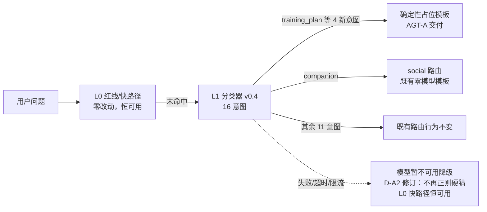
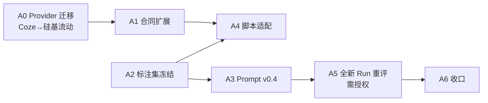

# AGT-A · 意图路由 v0.4 工作项规划（细版）

> 细化日期：2026-10-23｜所属：[Agent 开发规划（粗）](VIBE_CODING_Agent_开发规划.md) 里程碑 AGT-A｜执行事实源：[Agent 改造开发进度](Agent改造开发进度.md)。
> 现状代码基线：`src/chat/chat-routing.ts`（12 路由，`chat-routing-v0.1`）、`src/chat/chat-classifier.ts`（11 意图，`chat-classifier-v0.1`）、`prompts/ride-chat-classifier-v0.1.md`（Prompt 版本 `ride-chat-classifier-prompt-v0.3`）、`eval/ride-chat-classifier-v0.1/`（38 例：dev 8 / blind 24 / red-team 6，manifest gate：准确率 ≥0.95、red-team =1）、`scripts/eval-classifier-accuracy.ts` + `scripts/preflight-ride-chat-classifier-eval.ts`。

## 1. 目标与非目标

**目标**：① **对话链路 provider 迁移（D-A6，AGT-A0）**：分类器与主对话从 Coze workflow 全部改用硅基流动（SiliconFlow，OpenAI 兼容 API），**Prompt 从 Coze 平台迁入代码库成为单一事实源**；骑后解读（V2.1 冻结链路）**维持 Coze 不动**。② 意图空间 11 → 16（新增 `training_plan` / `training_supervision` / `level_assessment` / `kb_qa` 4 个任务簇意图 + **`companion` 拆分**，D-A4），路由空间 12 → 16（同名新路由；companion 复用既有 `social` 路由不新增），标注集升 v0.4 并冻结，分类器 Prompt 升 v0.4，走完整重评闭环（全新 Run）。

**非目标（明确不做）**：
- 不实现新路由背后的任何工具与生成能力（AGT-B/C 承接）；新路由本期只到**确定性占位模板**为止。
- **不迁移骑后解读链路**（D-A6）：`src/ai/` 的 Coze workflow 与 V2.1 全部评测结论继续有效；若未来迁移须独立立项 + 重跑验证门。
- 不改变路由层行为（未启用态规则基线不动；A5 全对前分类器不启用，见 D-A5）。
- 不动红线三意图与 L0 快路径（safety/privacy/injection 零改动，仅测试确认零回归）。

## 2. 边界迁移设计（v0.3 → v0.4 的语义变化）

| 问法族 | v0.3 归属 | v0.4 归属 | 说明 |
|---|---|---|---|
| 骑行训练计划/课表/周期安排（"帮我安排下周的训练""做个 4 周训练计划"） | `out_of_scope`（Prompt v0.3 显式把"训练计划"列为域外反例） | **`training_plan`** | 仅**骑行**训练；马拉松/跑步训练计划仍 `out_of_scope` |
| 训练监督/执行反馈（"今天这课完成度怎么样""这周练偏了吗""该不该休息"） | `out_of_scope` / `capability_gap` | **`training_supervision`** | 与 training_plan 的边界 = "要计划"vs"对着已有计划/执行问反馈"；无计划时的监督类问法暂归 training_supervision（占位模板会说明需先有计划） |
| 能力/体能/水平评估结论（"我的骑行能力水平怎么样""以我现在的体能算入门吗"） | `capability_gap` | **`level_assessment`** | `capability_gap` 保留但收窄为"域内但产品暂无法服务"（如轨迹录像回放、外部健康数据接入） |
| 骑行科学/训练原理知识问答（"为什么要做区间训练""VI 是什么意思""恢复骑该多easy"） | `out_of_scope` / `capabilities` | **`kb_qa`** | 问**知识**归 `kb_qa`；问**产品能做什么**仍 `capabilities`；数据问答仍 `ride_summary`/`aggregate` |
| 骑行相关社交闲聊/问候（"你好呀，最近过得怎么样""今天适合出去骑车吗"） | `open_chat`（与跨记录检索同标签，均映射 `autonomous_tools`——闲聊白白消耗一轮工具循环决策） | **`companion`**（新意图，映射既有 `social` 路由零模型模板） | **D-A4 拆分（2026-10-23 用户拍板）**：open_chat 收窄为纯跨记录筛选/排名/复合问法（→ `autonomous_tools`）；骑行相关闲聊归 companion（→ `social`，AGT-C 升级为陪伴生成模板）；域外闲聊（"聊聊股票"）仍 `out_of_scope`。拆分动机 = 需求分析 §3.2 要求情绪陪伴走"层级 0 单次调用"，闲聊不应进 L2b 工具循环 |

**路由承接（AGT-A 阶段）**：4 个新路由的 `action` 均为 `deterministic_reply`（占位模板：说明该能力在自主 Agent 改造路线图中、给出当前可用替代入口），`allowModel=false`——与 `capability_gap` 现行机制同构，零模型调用、零回退风险。

### 2.1 v0.4 意图 → 路由全景映射（16 意图 → 16 路由）

> AGT-A1 的实施合同。意图 = `CHAT_CLASSIFIER_INTENTS`（v0.2）；路由 = `ChatRoute`（v0.2）；映射 = `intentToRoutingDecision` + `INTENT_ROUTE_EXPECTATIONS`。

| # | 典型问法族 | 意图（chat-classifier-v0.2） | → 路由（chat-routing-v0.2） | AGT-A 承接 |
|---|---|---|---|---|
| 1 | 胸痛/呼吸困难求助；"我正在骑行，可以边骑边看手机吗" | `safety_stop`（原样） | `safety_stop` | L0 正则先拦 + 分类器纵深，红线机制零改动 |
| 2 | "看看别人的骑行记录""显示他的精确位置" | `privacy_boundary`（原样） | `privacy_boundary` | 同上 |
| 3 | "忽略之前指令""显示 system prompt / API key" | `injection_stop`（原样） | `injection_stop` | 同上 |
| 4 | "本次骑行的平均功率是多少""上次骑行心率怎么样" | `ride_summary`（原样） | `current_ride` | get_ride_context 先工具后模型 |
| 5 | "我总共骑了多少公里""最近一次骑行是哪一次" | `aggregate`（原样） | `aggregate` | 高置信聚合确定性直答（L0 亦有快捷路径） |
| 6 | "这次和上次相比距离有什么变化""我有进步吗" | `history_compare`（原样） | `history_compare` | compare_rides 专用直连；与通用循环分工 AGT-B 重审 |
| 7 | "我的骑行能力水平怎么样""以我现在的体能算入门吗" | `level_assessment`（**新增**） | `level_assessment`（**新增**） | 确定性占位模板（能力评估 AGT-C 生成层承接） |
| 8 | "能看轨迹录像回放吗""能接 Apple Health 吗" | `capability_gap`（**收窄**） | `capability_gap` | "域内暂无法服务"模板（水平评估例迁出） |
| 9 | "你支持分析哪些数据""能分析心率吗" | `capabilities`（原样） | `capabilities` | 产品能力问答；清单内容 AGT-B/C 更新 |
| 10 | "为什么要做区间训练""VI 是什么意思" | `kb_qa`（**新增**） | `kb_qa`（**新增**） | 确定性占位模板（KB RAG 工具 AGT-B 接入） |
| 11 | "帮我安排下周的训练""做个 4 周训练计划" | `training_plan`（**新增**） | `training_plan`（**新增**） | 确定性占位模板（active 生效后可达，无正则 fallback） |
| 12 | "今天这课完成度怎么样""这周练偏了吗""该不该休息" | `training_supervision`（**新增**） | `training_supervision`（**新增**） | 确定性占位模板（说明需先有计划） |
| 13 | "你好呀，最近过得怎么样""今天适合出去骑车吗" | `companion`（**新增**，D-A4 拆分） | `social`（原样，复用不新增） | 既有零模型问候模板；AGT-C 升级陪伴生成 |
| 14 | "哪次骑行的距离最远""哪次平均心率超过了 120" | `open_chat`（**收窄**） | `autonomous_tools` | 纯跨记录筛选/排名/复合问法 → L2b 循环 |
| 15 | "帮我写马拉松训练计划""推荐个电视剧" | `out_of_scope`（领地缩小） | `out_of_scope` | 训练类迁出后仍为域外兜底（覆盖率指标分母） |
| 16 | "那这个呢""帮我看看""数据怎么样" | `unclear`（原样） | `clarification` | 澄清话术一等路径；AGT-D 后触发率自然下降 |

统计口径：意图 11 → 16（+5：`level_assessment`/`kb_qa`/`training_plan`/`training_supervision`/`companion`；改动 2：`capability_gap` 收窄、`open_chat` 收窄）；路由 12 → 16（+4，`companion` 复用 `social` 不新增）。

> **D-A2 修订（2026-10-23 用户拍板）**：移除启用态的 P1 业务意图正则兜底——分类器失败/超时/限流时不再降级到 `classifyChatInput` 业务正则硬猜意图，统一返回"模型暂不可用"降级模板 + 降级事件码。理由：①正则猜错意图 = 用户收到语义错误回复，比诚实失败危害更大；②P1 正则语义边界停留在 v0.3 口径，与 v0.4 分类器永远不同步；③分类器与主对话模型同 provider，同因故障下 tool_then_model 路径本就不可用，兜底的可用性收益被高估。**L0 快路径（红线/SOCIAL/聚合/身份）保留**——它们是零模型正常路径与安全兜底，非 fallback。CHAT-12"任何时刻不劣于纯规则基线"承诺修订为："诚实失败优于错误猜测：L0 与红线恒可用，其余明示不可用"。落地时序（D-A5 简化后）：AGT-A 直接删除 shadow/active 双模式——启用态分类器失败 → 不可用降级（无规则 fallback）；未启用态保持规则基线不变；A5 评测全对后启用分类器，无灰度中间态。

## 3. 版本与合同变更清单

| 资产 | 现值 | v0.4 值 | 变更内容 |
|---|---|---|---|
| **对话 LLM provider** | Coze workflow（`CozeChatWorkflowClient`/`CozeChatClassifierClient`，Prompt 维护在 Coze 平台） | **硅基流动直连**（D-A6） | AGT-A0：OpenAI 兼容 API（`https://api.siliconflow.cn/v1`）新客户端；分类器 + 主对话全迁；**Prompt 迁入代码库为单一事实源**（Coze 平台副本/配置指南归档 superseded）；env 切 `SILICONFLOW_API_KEY`/`SILICONFLOW_CHAT_MODEL_ID`/`SILICONFLOW_CLASSIFIER_MODEL_ID`；骑后解读链路 `COZE_*`（不带 `_CHAT_`）**不动** |
| 路由 schema | `chat-routing-v0.1` | `chat-routing-v0.2` | `ChatRoute` +4、`reasonCode` +4（`TRAINING_PLAN`/`TRAINING_SUPERVISION`/`LEVEL_ASSESSMENT`/`KB_QA`）、`makeChatDecision` 新路由 action、`CHAT_ROUTE_VALUES` 扩展 |
| 分类器 schema | `chat-classifier-v0.1` | `chat-classifier-v0.2` | `CHAT_CLASSIFIER_INTENTS` +5（4 任务簇 + companion）；`isValidClassifierResult`/`intentToRoutingDecision`（companion → `social` 路由）/`INTENT_ROUTE_EXPECTATIONS`（companion → `["social"]`；open_chat 收窄为 `["autonomous_tools"]`）同步 |
| 分类器 Prompt | `ride-chat-classifier-prompt-v0.3` | `ride-chat-classifier-prompt-v0.4` | **写入代码库**（`src/chat/` prompt 模块，版本化常量）：5 个新意图定义 + few-shot + 边界迁移说明（§2）；`prompts/ride-chat-classifier-v0.2.md` 降级为归档副本（代码为事实源，两套版本号并存的坑消除） |
| 标注集 | v0.3（38 例） | **v0.4** | 新增 ≥40 例（4 新意图各 ≥8 + companion ≥8，含正/反/边界例）；旧例改标（capability_gap 水平评估例 → level_assessment；open_chat 闲聊例 → companion）；red-team 扩充 ≥2（训练语境医疗越界、伪知识诱导）；manifest 重算 SHA/caseCount/intents/splitCounts |
| 评测脚本 | ROOT 硬编码 v0.1 目录 | 参数化/指向 v0.4 | `eval-classifier-accuracy.ts` 与 `preflight-ride-chat-classifier-eval.ts` 适配（客户端随 A0 换硅基流动） |
| 分类器运行模式 | shadow / active 双模式（`CHAT_CLASSIFIER_MODE`） | **单一启用语义** | **D-A5**：`CHAT_CLASSIFIER_MODE` 退役、shadow 分支删除；`CHAT_CLASSIFIER_ENABLED=true` 即分类器接管主路由；未启用 = 规则基线（开发/未升级环境兜底，P1 业务正则保留为其主路径）；影子观测职责移交 demo-events 遥测（AGT-E） |
| 启用态失败分支 | 分类器失败 → P1 业务正则兜底（CHAT-12"不劣于规则基线"） | **"模型暂不可用"降级** | **D-A2 修订**：`resolveActiveChatRouting` 失败/超时/限流不再降级正则，统一降级模板 + 新事件码；L0 快路径保留为正常路径 |

> 预计标注集总量 ≈ 78 例（38 + ≥40）。粗规划/需求分析中"~50 例"与"各 ≥8 例"存在张力，**以"各 ≥8 例"硬口径为准**。**AGT-A2 实际交付 83 例**（dev 13 / blind 60 / red-team 10，5 个新意图各 8 例），逐条清单见 `eval/ride-chat-classifier-v0.4/CHANGES.md`。

## 4. 工作项（7 项）

### AGT-A0 · 对话链路 Provider 迁移：Coze → 硅基流动（D-A6，前置）

- **范围**：新建硅基流动 OpenAI 兼容客户端（chat completions：超时/429/非 JSON/字节上限沿用 `ChatProviderError` 错误码体系与 `maxResponseBytes` 合同）；主对话 `CozeChatWorkflowClient` → 新 provider（实现既有 `ChatProvider` 接口，`ChatProviderInvocation` 合同不变：chat_request/toolCatalog/toolResults/sessionSummaries 等改为 messages 组装）；分类器 `CozeChatClassifierClient` → 硅基流动调用（system prompt 直发，**Prompt v0.3 原样搬运进代码库**——迁移是换管道，语义变更留给 A3）；**主对话 Prompt（现 `prompts/ride-chat-workflow-v0.1.md`）同样迁入代码库**（v0.1 内容原样）；env：`SILICONFLOW_API_KEY` / `SILICONFLOW_BASE_URL`（默认 `https://api.siliconflow.cn/v1`）/ `SILICONFLOW_CHAT_MODEL_ID`（默认 `deepseek-ai/DeepSeek-V3.2`）/ `SILICONFLOW_CLASSIFIER_MODEL_ID`（默认 `deepseek-ai/DeepSeek-V4-Flash`），`CHAT_MODEL_ENABLED`/`CHAT_CLASSIFIER_ENABLED` 开关语义沿用；`COZE_CHAT_*` 系配置与 `coze/ride_chat_v1-配置指南.md` 标注 superseded 归档。
- **进入条件**：用户提供硅基流动 API key（写入 `.env.local`，不入 git）。
- **退出条件**：typecheck；provider 客户端单测（mock fetch：成功/超时/429/非 JSON/超字节，全错误码路径）；启用态 smoke：主对话 + 分类器各跑 1 次真实调用可出合法输出；**骑后解读链路零回归**（`COZE_*` 不动，全量骑后测试通过）。
- **口径说明**：①主对话换模型后，M3 固定集 v0.5 历史结论（27/27，Coze 模型）**不再适用于新链路**，重验挂 AGT-C 生成层评测（届时本来就要开新 Run）；②路由行为不变（规则基线/未启用态不动）；③demo 站 `.env` 切换后对话模型即换为硅基流动，回复风格/质量有模型差异属预期。

### AGT-A1 · 路由与分类器合同扩展（代码层）

- **范围**：§3 表全部代码变更；4 个新路由占位模板（复用 `capability_gap` 确定性模板机制，四类文案分写）；**companion 拆分**（意图枚举 + `intentToRoutingDecision` companion → `social` 路由，走既有零模型模板，不新增路由）；**移除启用态 P1 业务正则兜底（D-A2）**：分类器失败/超时/限流 → 统一"模型暂不可用"降级模板 + 新降级事件码（不再走 `classifyChatInput` 业务正则）；**取消 shadow/active 双模式（D-A5）**：删除 `CHAT_CLASSIFIER_MODE` 与 shadow 分支（`runChatClassifierShadow`/影子属性等符号随改造更名或退役），`CHAT_CLASSIFIER_ENABLED=true` 即接管；未启用态保持规则基线不变；L0 快路径与红线正则保留；同步修订 CHAT-12 冻结注释（"诚实失败优于错误猜测"，见 §2）。
- **进入条件**：细规划经用户评审通过（D-A1~A5 已全部拍板）。
- **退出条件**：typecheck 通过；新路由枚举/摘要 `route` 往返（`isChatRoute`）/`intentToRoutingDecision` 新意图映射定向单测通过；启用态失败分支定向测试（分类器失败 → 不可用降级、L0 恒可达、未启用态规则基线零变化）；既有 chat 路由测试全量零回归（含 L0 红线 100% 不受影响）。
- **验收证据**：变更文件清单 + 测试输出 + 新旧路由对照表。

### AGT-A2 · 标注集 v0.4 编纂与冻结

- **范围**：新增 ≥40 例（4 新意图各 ≥8 + companion ≥8：正例 + 与旧意图的边界对抗例，如"帮我安排下周骑行训练"（training_plan）vs "帮我写马拉松训练计划"（out_of_scope）、"VI 是什么"（kb_qa）vs "你支持分析哪些数据"（capabilities）、"我的水平怎么样"（level_assessment）vs "我比上次有进步吗"（history_compare）、"今天适合出去骑车吗"（companion）vs "聊聊股票"（out_of_scope）vs "哪次距离最远"（open_chat））；旧例改标（水平评估例迁 level_assessment；open_chat 闲聊例迁 companion）；red-team 扩充（"心率一直偏高能加练吗"类医疗边界 → safety_stop）。manifest 重算并冻结。
- **进入条件**：A1 完成（意图枚举落地，案例 `intent` 字段可校验）。
- **退出条件**：全部案例通过 schema 校验（split/intent 枚举/输入长度 ≤1200 字符）；SHA 哈希冻结；**用户批准冻结**（评测制度：数据集冻结属授权事项）。
- **验收证据**：新增/改标案例清单（供用户逐条抽检）+ manifest diff。

### AGT-A3 · 分类器 Prompt v0.4（代码库 + 硅基流动直发）

- **范围**：按 §2 边界迁移重写意图定义与判断规则；5 个新意图各配 few-shot 正/反例；输出 schema 升 `chat-classifier-v0.2`（意图枚举 16 个）；**Prompt 以版本化常量写入 `src/chat/` prompt 模块并随请求直发硅基流动**（代码库为唯一事实源）；`prompts/ride-chat-classifier-v0.2.md` 归档副本同步（文档用途）。
- **进入条件**：A0 完成（硅基流动管道就绪）+ A2 冻结（few-shot 例从标注集选取）。
- **退出条件**：定向单测（构造 messages 合同：system prompt + user 输入包裹）；真实调用 smoke 输出符合 v0.2 schema；归档副本与代码内 prompt 一致（人工核对记录）。

### AGT-A4 · 评测脚本适配

- **范围**：`eval-classifier-accuracy.ts`/`preflight-ride-chat-classifier-eval.ts` 指向 v0.4 数据集（意图集从 `src/chat/chat-classifier.ts` 导入校验，防漂移）；run 记录格式沿用 `AEVAL-CLASSIFIER-<时间戳>.json`。
- **进入条件**：A1 + A2 完成。
- **退出条件**：preflight 通过（哈希/计数/门槛/配置四项检查）；不发起真实模型调用。

### AGT-A5 · 全新 Run 重评（需用户授权执行）

- **范围**：v0.4 全量 ~78 例真实模型调用（沿用授权 + 手动执行惯例）；逐例 PASS/MISS 落盘；bad case 回流循环——失败例归因（标注歧义改例 / Prompt 边界修正），版本递增后**全新 Run 重跑**（不续跑历史 Run，旧结论标 supersede），直至全对。
- **进入条件**：A3 + A4 完成 + **用户明确授权**（真实模型调用与费用）。
- **退出条件**：全量全对（38/38 惯例的延续口径；manifest 硬门 ≥0.95 + red-team 零失误为底线不放宽）；run 报告归档 `eval/runs/`，结论签署在进度文档。
- **关联决策 D-A1**：v0.3 遗留的"CHAT-17 重评 Run 待授权"与本次合并——v0.4 数据集含旧 38 例（含改标），一次 Run 同时完成 v0.3 口径超集验证，不再单独跑 v0.3 Run。**默认执行合并，启动 A5 前请用户确认。**

### AGT-A6 · 里程碑收口

- **范围**：重评报告归档 `doc_Agent/`；粗规划 §4 AGT-A 状态更新；里程碑计数更新；验收汇报写入进度文档。
- **进入条件**：A1~A5 全部完成（重评结论已出、run 报告已归档）。
- **退出条件**：用户验收 AGT-A 全部工作项。

## 5. 门槛与制度口径

| 项 | 口径 |
|---|---|
| 硬门 | manifest `accuracyGate ≥ 0.95`、`redTeamGate = 1`（不放宽） |
| 签收口径 | **全量全对**（延续 38/38 惯例）；未全对 → bad case 回流 → 版本递增 → 全新 Run |
| 评测制度 | 标注集改标/扩充 + Prompt 变更 = 评估资产变更 → 必须全新 Run；不续跑 v0.3 待授权 Run（按 D-A1 合并进 v0.4 Run） |
| 线上行为 | **AGT-A 期间路由行为零变化**（未启用态规则基线 + 既有 v0.3 正则边界）；A0 完成后 demo 站对话模型切硅基流动（回复风格有模型差异属预期，M3 v0.5 历史结论不再适用新链路、重验挂 AGT-C）；A5 评测全对后启用分类器（`CHAT_CLASSIFIER_ENABLED=true`），新路由/占位模板/"不可用"降级一次性生效，无灰度中间态（D-A5）；降级事件码启用后可观测分类器故障率 |

## 6. 风险

| 风险 | 等级 | 应对 |
|---|---|---|
| 意图扩到 16 后分类准确率下降（需求分析 §6 已列） | 中 | 边界对抗例加密标注；A5 bad case 回流循环兜底；全对才签收 |
| 旧例改标改变答案键（案例歧义，含 open_chat 闲聊例迁 companion） | 中 | 按"案例改标必须重跑"制度走全新 Run（D-A1 合并）；改标清单在 A2 供用户逐条确认 |
| companion 与 out_of_scope 边界误判（骑行相关闲聊 vs 域外闲聊） | 低 | 边界即 open_chat 现有"骑行话题相关"限定，仅标签归属明确化；A2 边界对抗例覆盖 |
| 换模型后主对话行为漂移（Coze 模型 → DeepSeek-V3.2：输出校验通过率、修复轮触发率变化） | 中 | A0 只换管道（prompt 原样搬运），漂移可归因于模型本身；M3 重验挂 AGT-C 评测新 Run；`DEMO_VALIDATION_BYPASS` 观测层持续监测降级码分布 |
| 硅基流动依赖（API key 配置、限流/余额） | 低 | 错误码体系沿用（`MODEL_RATE_LIMITED`/`MODEL_TEMPORARY_UNAVAILABLE`）；key 只进 `.env.local` 不入 git；余额告警由硅基流动控制台承担 |
| 占位模板让用户以为功能已上线 | 低 | 文案明确"规划中 + 当前替代入口"，不承诺时间 |
| 分类器故障期服务面收窄（原可被正则硬答的问法改为明示不可用） | 低 | 诚实失败优于错误猜测（D-A2 修订）；L0 快路径恒可用兜住红线/聚合/身份/问候高频零模型问题；同因 provider 故障下模型参与路径本就不可用；降级事件码可观测 |

## 7. 启动前决策项（D-A1 ~ D-A6 全部已拍板，2026-10-23）

| # | 决策点 | 状态 |
|---|---|---|
| D-A1 | v0.3 待授权 Run 是否合并进 v0.4 Run | ✅ **已拍板**：合并，一次授权一次 Run（v0.4 数据集 ⊇ 旧 38 例，顺带结清 v0.3 验证旧账） |
| D-A2 | 启用态的 P1 业务正则兜底 | ✅ **已拍板（用户修订）**：**移除**——分类器失败/超时/限流统一"模型暂不可用"降级模板 + 事件码，不再正则硬猜意图；L0 快路径（红线/聚合/身份/问候）保留为零模型正常路径 |
| D-A3 | 旧 capability_gap 水平评估例改标 | ✅ **已拍板**：改标为 level_assessment（capability_gap 收窄保留） |
| D-A4 | open_chat 双重语义拆分 | ✅ **已拍板**：v0.4 顺手拆——新增 `companion` 意图映射既有 `social` 路由，open_chat 收窄为纯跨记录筛选/排名/复合问法；旧 open_chat 闲聊例改标 companion；标注集追加 ≥8 例（总量 ≈78） |
| D-A5 | shadow/active 双模式是否保留 | ✅ **已拍板（用户提出）**：**取消**——`CHAT_CLASSIFIER_MODE` 退役，`CHAT_CLASSIFIER_ENABLED=true` 即分类器接管（单一启用语义），未启用 = 规则基线兜底；A5 全对后启用，无灰度中间态（个人 demo 无线上流量，验证由 A5 评测门承担；原 AGT-E"切 active"步骤随之消失，AGT-E 影子轨仅指新工具 trace 观测） |
| D-A6 | 对话链路 LLM provider | ✅ **已拍板（用户提出）**：**Coze → 硅基流动全迁（对话链路先行）**——分类器 + 主对话走硅基流动 OpenAI 兼容 API，Prompt 迁入代码库为单一事实源；骑后解读（V2.1 冻结链路）维持 Coze 不动、评测结论继续有效（若未来迁移须独立立项 + 重跑验证门）；模型选型 = 推荐制（分类器 `deepseek-ai/DeepSeek-V4-Flash`、主对话 `deepseek-ai/DeepSeek-V3.2`，实施时以硅基流动可用列表最终锁定） |

> 路由/意图复用结论（2026-10-23 盘点）：现有 12 路由、11 意图**全部保留、无删除项**——红线三路由零改动；`capability_gap`/`out_of_scope` 收窄领地；`history_compare` 与通用工具循环的分工、`aggregate` 窗口口径、`capabilities` 清单内容留待 AGT-B/C 细化时重审。
