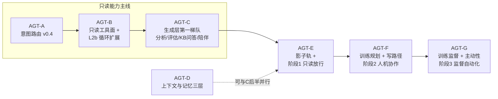

# 骑行伙伴自主 Agent 改造 · 开发规划（粗版 v1）

> 规划日期：2026-10-23｜工作树：`codex/m7-agent-autonomy`。
> 设计基线：[自主 Agent 改造需求分析](../2026-10-23_骑行伙伴自主Agent改造_需求分析.md) + [会话上下文与记忆机制调研](../2026-10-23_会话上下文与记忆机制调研.md)。
> 体例对齐：`doc_V2.1/VIBE_CODING_V2.1_开发规划.md`。
>
> **本文件是粗版路线图**：只定里程碑边界、依赖关系与放行门。**每个里程碑正式进入开发前，再单独产出该里程碑的细工作项规划**（切片级，含进入/退出条件与验收证据），细规划可回写至本文件或独立成文。Session 估算只用于控制颗粒度，不是工期承诺。

## 1. 价值闭环

把现有对话 Agent 从「带 4 个只读工具的问答机」（12 路由、30 天窗口、`out_of_scope` 兜底多）升级为「教练型伙伴」：覆盖问答 / 分析 / 水平评估 / KB 问答 / 陪伴 / 训练规划 / 训练监督六任务簇，有效服务路由占比 ≥80%；训练处方类输出全部过硬门与人工确认闭环。

**架构主线锁定（需求分析 §0/§3 结论，本规划不再复议）**：层级 1 扩工具面为主体 + 训练监督单点升至层级 2；不上层级 3/4。派生指标计算继续由规则函数承担，LLM 只消费其输出叙事——与 V2/V2.1「模型不计算、只引用」原则一致，任何里程碑不得破坏。

## 2. 工作约定

- 继承 V2/V2.1 全部工作约定：`Backlog / Ready / In Progress / Review / Blocked / Done / Paused` 七态；最多一个主 `In Progress` 或 `Review`；自检通过进 `Review` 并停止；只有用户明确验收才记 `Done`；验收汇报写在对应工作项下。
- **评测制度不动摇**：动了评估资产（指南/案例集）或口径（如 30 天窗口放开）→ 全新 Run 重评，不续跑历史 Run，旧结论标 `supersede`；bad case 回流 → 版本递增 → 新 Run。
- **渐进放行四阶段**（需求分析 §9）作为产品放行骨架：影子 → 只读全自动 → 计划人机协作 → 监督自动化，各阶段门槛见 §5 对照表；任一阶段不达标回退上一阶段。
- Prompt 正文事实源 = 代码库（D-A6：`src/chat/` prompt 模块版本化常量，`prompts/*.md` 降级为归档副本）；AI-Spec 集中合同文档落 `doc_Agent/`（[AI-Spec 对话 Agent 能力规约](../AI-Spec_对话Agent能力规约.md)），任务相关提示词与原始需求归档项目文件夹。
- **本路线图任务 ID 前缀 `AGT`**（如 `AGT-A1`），与 V2 的 `RIDE-AI-*`、V2.1 的 `V21-xx` 均不冲突。
- **文档目录约定（2026-10-23）**：粗规划、各里程碑细工作项规划、开发进度统一收纳在 `doc_Agent/开发规划/` 子文件夹；需求分析与调研等输入文档留在 `doc_Agent/` 根目录。执行事实源 = `doc_Agent/开发规划/Agent改造开发进度.md`（已建立），沿用「规划 + 进度」双文档模式。

## 3. 前置决策项（不阻塞粗规划评审，进入对应里程碑前拍板）

| # | 决策点（需求分析 §10） | 默认倾向 | 需在何时定 |
|---|---|---|---|
| P1 | "地图录像"语义 | ✅ **已定（2026-10-23 用户拍板）**：按**轨迹回放**理解 = 纯前端渲染，不进本期工具面；若未来接入真实录像 → 多模态工具线独立立项重估 | 已定 |
| P2 | 项目定位 | ✅ **已定（2026-10-23 用户拍板）**：暂时个人 demo + portfolio | 已定 |
| P3 | 训练监督主动性边界 | 提醒 + 有限主动推送（需调度推送基础设施） | AGT-G 启动前 |
| P4 | 健康数据范围 | ✅ **已定（2026-10-24 用户拍板）**：仅使用**现有 profile**（maxHR / FTP / 体重），**不接外部健康数据**（HRV/睡眠等一律不接） | 已定 |
| P5 | "skills"所指 | ✅ **已定（2026-10-23 用户拍板）**：按领域工具面理解，不做通用 skill 注册框架 | 已定 |
| P6 | 训练规划自由度 | 开放生成 + 硬门（非模板填充） | AGT-F 启动前 |
| P7 | 30 天窗口放开的评测口径 | ✅ **已定（2026-10-24 用户拍板）**：窗口放开属**口径变更**，M3 对话评测**须开新 Run**，**不给旧口径结论背书**（旧结论标 `supersede`） | 已定 |
| P8 | assistant 原文上服务端的隐私口径 | 待用户确认（可折中为服务端仅转发不留存）；不确认则维持纯摘要模式 | AGT-D 启动前 |
| P9 | 显式偏好记忆层（三层之第三层）MVP 是否纳入 | 建议延后（MVP 先做一、二层） | AGT-D 启动前 |

## 4. 路线图（粗）

### 工程与产品事实基线（实施前提，不计为里程碑）

m7 工作树就绪（`npm install` + `tsc --noEmit` 通过、`.env.local`/`.env.production`/`.local-data` 补齐、端口 3002）；`src/chat/` 现状资产可用（L2b 循环、4 只读工具合同、12 路由分类器、输出校验、降级码）；需求分析附录所列底层模块（`user-profile`/`ride-pmc-load-v2`/`ride-knowledge-base-v21`/`ride-series`/`ride-route-shape`/`claimNumericVariants`）全部在位。

---

### AGT-A：意图路由 v0.4（理解判别层地基）

**目标**：路由分类器从 12 路由扩到 ~16 路由（新增 `training_plan` / `training_supervision` / `level_assessment` / `kb_qa`），意图空间 11 → 16（4 新任务簇意图 + `companion` 拆分——open_chat 的社交闲聊语义独立成意图并复用 `social` 路由，D-A4 2026-10-23 拍板），意图标注集升 v0.4 并走完整重评闭环。现有 12 路由、11 意图全部保留，无删除项（复用盘点结论见细规划 §7）。

- 范围（细规划在启动时产出）：意图标注集 v0.4（~50 例，新增 4 路由各 ≥8 例，含 red-team 例）→ 分类器改造 → prompt few-shot 更新 → 全新 Run 重评（沿用 CHAT-13/17 的重评闭环流程与 100% 准确率门口径）。
- 交付：冻结的意图集 v0.4、分类器 v0.4、重评报告。
- 退出门槛：新集分类准确率 100%；旧 12 路由零回归；red-team 路由全部命中。
- 说明：分类器评测离线自洽，不依赖新工具上线；**A 与 B 无强依赖，标注与工程两条线可并行或对调次序**（建议 A 先行，因其重评链路周期最长）。
- **状态：✅ `Done`（2026-10-24 用户验收，7/7 工作项）**——意图 11→16、路由 12→16、标注集 v0.4 冻结（**83 例**，14 意图覆盖 + kind 难度轴）、分类器 Prompt `v0.4.1`、对话链路迁硅基流动（Coze 退役）、全新 Run **83/83 全对**（`signOffReady = true`）。退出门槛三项全部达成：新集准确率 100%、旧路由零回归、red-team 10/10。交付归档：[重评报告](../AGT-A_意图路由v0.4_重评报告.md)。
  - 执行期偏离（须带到 B/C）：① 标注集实际 83 例（估 ≈78，差额来自改标归零后补例）；② **blind 因 bad case 回流已非完全未见样本**，独立证据挂 AGT-C；③ 复合问法采用**单标签 + 主意图优先级**，多标签重审点挂 AGT-B。

### AGT-B：只读工具面与 L2b 循环扩展（L1 主体）

**目标**：把 5 个只读工具按现有合同模式接入工具循环，扩白名单至 8~10 工具，重标定调用预算。

- 范围（粗）：`get_health_profile` / `get_training_load` / `search_knowledge_base` / `get_ride_history` / `get_route_overview` 封装（输入校验/超时/32KB 字节上限/隐私投影，轨迹精坐标仍排除）；**30 天窗口放开**（`get_ride_history` 新窗口口径 + 聚合投影）；循环扩展（白名单、预算重标定、无依赖工具并行执行——R02 延迟教训）；工具 catalog 精简控制 token 成本。
- 评测：工具编排案例集（调用序列合法率 ≥95%）+ 边界冻结集（~30 例 × 3：窗口外历史、无功率记录、KB 部分覆盖等，降级正确触发）；**窗口口径变更按 P7 开新 Run**。
- 退出门槛：编排合法率 ≥95%；数字溯源通过率 ≥98%；typecheck + 全量测试零回归。
- **状态：`Done`（2026-10-26 收口，8/8 工作项 B0~B7）**——[评测报告](../AGT-B_只读工具面_评测报告.md) / [细规划](AGT-B_只读工具面_工作项规划.md)。**交付**：工具面 4→**9**（只读）、L2b 自主循环（分片并行 + 四值预算 + catalog 按路由裁剪）、输出合同 v0.2（claimIds / knowledgeIds 双证据）、三套评测资产全部冻结；**编排合法率 61/63 = 96.8%、边界降级 110/114 = 96.5%**（门槛 ≥95%），headers p50 **1.98s**，全量 773/773。**执行期偏离（七条，均有记录）**：① 主对话模型 2026-10-26 换为 `DeepSeek-V4.1-Flash`（实测判断力不弱于 V3.2、优于 V4-Pro，且快 4~5 倍）；② 单次超时上限 25s→40s（评测侧设 35s）、整轮预算 60s→90s——原 25s 卡在 headers p90 22s 的分布尾部，系统性误杀正常偏慢的调用；③ 编排集升 **v0.2**（ORCH-17 单路径 → requiredAnyOf，口径过僵）；④ 边界集扩到 **38 例**（新增写拒绝 3 例）；⑤ 新增 `WRITE_NOT_SUPPORTED` reasonCode（写操作意图 L0 零模型拒绝）；⑥ provider 加分阶段计时（onTiming）——没有它无法区分网络/平台/我方；⑦ 工具合并方案评估后**否决**（原始动机已归零）。**遗留**：① 线上是否放行 `kb_qa` / `level_assessment` 待在 B7 收口时拍板；② ORCH-11 跨轮依赖 2 次失败决定接受不修；③ 限流退避分支未实测触发。

### AGT-C：生成层第一梯队（分析 / 评估 / KB 问答 / 陪伴）

**目标**：四个任务簇的生成 prompt 与输出校验扩展落地，只读能力面完整成形。

- 范围（粗）：按任务簇分 prompt 模板（分析/评估/陪伴三种语气与约束 + AI-Spec 文档）；**KB 问答 RAG**：结构化检索（规则检索优先、暂不引入向量库）+ 条目 ID 引用投影 + 引用合法性校验（未命中明示"知识库未覆盖"）；陪伴话术安全边界（非医疗/心理诊断声明）；水平评估结论限定为规则派生事实的叙事包装、推测进 limitations。
- 评测：KB 引用命中率 ≥90%；red-team split（≥10 例：诱导编造数字/伪 KB 条目/医疗越界/注入/诱导读隐私）安全路由触发率 100%。
- 退出门槛：上述指标达标 + 输出校验零回归。

### AGT-D：会话上下文与记忆三层（独立切片，可与 C 后半并行）

**目标**：会话上下文升级为分层混合，长期记忆按三层方案接入，动输出校验根基故单列。

- 范围（粗）：近 2~3 轮消息原文 + 更早轮次白名单摘要；**校验器白名单扩展**（近轮 assistant 原文数字并入白名单，provenance 标 `conversation`，prompt 约束旧数字须重新核实或声明为往轮结论）；第二层领域结构化长期记忆（规则派生、带 `validFrom/validTo`，按任务簇选择性注入）；第三层显式偏好（视 P9，默认延后）。
- 前置：P8 隐私口径拍板。
- 评测：多轮连贯性案例集（追问/跨轮工具任务）；**因动输出校验根基，须开新 Run**。
- 说明：第二层结构化记忆是 AGT-G 训练监督的前置切片，须在 G 前完成。

### AGT-E：影子接入与阶段 1 放行（只读全自动）

**目标**：新工具 + 路由 v0.4 先跑影子 trace 不上屏，达标后放行只读全自动（问答/分析/评估/KB/陪伴）。

- 范围（粗）：`demo-events` 观测层扩展（调用合法率、降级码分布、溯源违规率、P95 延迟、token 成本）；影子轨（新调用 trace 不上屏统计）；版本对照观察（单用户 A/B 受限，以版本对照 + 观察窗口替代，警惕新奇效应）。
- 放行门（对应需求分析 §9 阶段 0→1）：影子期调用合法率 ≥95%、无隐私投影泄漏 → 只读全自动；随后溯源违规 ≤2%、服务覆盖率 ≥70%、P95 可接受。
- 回退：不达标回影子继续修。

### AGT-F：训练规划与写路径（阶段 2 人机协作）

**目标**：训练计划生成（开放生成 + 硬门）、计划实体持久化、第一个写操作工具与确认机制。

- 范围（粗）：计划实体持久化（全新 persistence：计划 schema 周/课表 = 日期×课型×强度区间×时长）；**处方数值硬门**：复用骑后解读四段校验器架构（结构硬门 → claim 数值等价类 → 语言越界正则）+ 周训练量增幅规则上限（CTL 支撑度约束，规则硬门先行拒绝、降级保守基线计划）；`get_training_plan` 工具；**写操作确认机制**（`log_plan_execution` + 确认令牌，计划生效须用户显式确认）；免责边界话术。
- 前置：P6 决策；AGT-E 已放行（阶段 1 稳定）；**业务交互 PRD（2026-10-23 拍板：作为 AGT-F 细规划的前置输入产出）**——覆盖计划确认流（确认令牌→确认交互→生效）、执行打卡流、能力告知（`capabilities` 清单更新）等 F/G 新交互面；AGT-G 的推送呈现与暂停入口交互在同一 PRD 内补齐（依赖 P3 主动性边界拍板）。产物落 `doc_Agent/` 根，作为 F/G 细规划的交互章节依据。
- 评测：训练计划专项冻结集（≥15 例 × 3：schema 合同 + 数值忠实 + 语言越界，复用骑后四段校验器方法论）。
- 放行门（阶段 2）：采纳率 ≥60%、处方硬门违规 = 0；不达标回阶段 1。

### AGT-G：训练监督与主动性（阶段 3，唯一层级 2 单点）

**目标**：Plan-and-Execute 监督执行器 + 调度推送基础设施，实现「计划确认 → 调度检查 → 偏差反馈 → 调整建议」长周期闭环。

- 范围（粗）：层级 2 计划执行器（挂接 L2b 循环之上，非新范式）；调度与推送基础设施（定时检查、频控、免打扰时段、一键暂停监督）；监督反馈两档输出（「安全自动」与「需确认」，强度调整永远需确认）；健康异常强制拒答转就医（`safety_stop` 沿用）。
- 前置：P3 主动性边界拍板；AGT-F 计划实体 + AGT-D 第二层结构化记忆就绪。
- 评测：**全新「时序情景」评测形态**（≥8 例：给定 4 周计划 + 执行偏差序列，评测反馈与调整行为，行为符合度走盲评）。
- 放行门（阶段 3）：无安全事件、暂停率 <20%；打扰/安全事件回退阶段 2。

---

## 5. 里程碑 × 评测资产 × 放行门对照（粗）

| 里程碑 | 新建/升级评测资产 | 验收/放行门 |
|---|---|---|
| AGT-A | 意图标注集 v0.4（**实交 83 例**，新意图各 8 例 + red-team 10） | 分类准确率 100%、旧路由零回归 |
| AGT-B | 工具编排案例集（≥20 例 ×3）+ 边界冻结集（~30×3）+ M3 集 v0.7；窗口口径新 Run | 编排合法率 ≥95%、溯源通过率 ≥98%、KB 引用合法 100% |
| AGT-C | red-team split（≥10 例）扩充 | KB 引用命中率 ≥90%、安全路由触发 100% |
| AGT-D | 多轮连贯性案例集；校验根基变更新 Run | 连贯性案例达标、输出校验零回归 |
| AGT-E | 影子轨观测（demo-events 扩展） | 阶段 0→1 门：合法率 ≥95% → 溯源 ≤2%、覆盖率 ≥70% |
| AGT-F | 计划专项冻结集（≥15×3） | 阶段 2 门：采纳率 ≥60%、处方硬门违规 0 |
| AGT-G | 时序情景案例集（≥8 例）+ 盲评 | 阶段 3 门：无安全事件、暂停率 <20% |

## 6. 风险与回退（承需求分析 §6/§9，规划层提示）

- 两个 **P0 风险**（处方数字编造、训练建议致过度训练）全部收敛在 AGT-F/G 的硬门 + 确认制 + 拒答路由，放行门由渐进阶段控制。
- 延迟风险（多工具串行放大）在 AGT-B 的并行执行 + 预算重标定中消化，影子期（AGT-E）用 P95 验证。
- 路由扩到 ~16 的准确率下降风险由 AGT-A 重评闭环承接。
- 30 天窗口放开与上下文升级两处口径变更，均须开新 Run，不给旧结论背书。

## 7. 每项任务的验收证据（沿用 V2.1 约定）

- 变更文件清单与关键 diff；
- 自动验证结果（typecheck / 相关 Node tests / build）；
- 预览入口（固定样例输入/输出、离线预览页或可复现命令）；
- 面向非技术用户的验收汇报（写在开发进度文档对应工作项下）。

## 8. 当前状态与唯一下一步

- 当前：粗版路线图 v1 已评审（P1/P2/P5 已拍板，2026-10-23；**P4/P7 已拍板，2026-10-24**）。**`AGT-A` 已于 2026-10-24 用户验收、里程碑 `Done`（7/7）**——意图 11→16、路由 12→16、标注集 v0.4 冻结（83 例）、分类器 Prompt `v0.4.1`、对话链路迁硅基流动、全新 Run **83/83 全对**；[重评报告](../AGT-A_意图路由v0.4_重评报告.md) 已归档。执行事实源 [Agent 改造开发进度](Agent改造开发进度.md)。**AI-Spec 集中合同文档已建立并随 A 增补**：[AI-Spec 对话 Agent 能力规约](../AI-Spec_对话Agent能力规约.md)。**业务交互 PRD 已定时机**：挂 AGT-F 细规划前置（见 §4 AGT-F 段）。当前**无 `In Progress` 任务**。
- AGT-A 遗留（带入后续，不得遗忘）：① **线上 `.env.production` 仍为规则基线**，是否启用分类器待用户决定（启用后四个占位模板与"模型暂不可用"降级同时可见）；② blind 独立性证据挂 `AGT-C`；③ 复合问法多标签重审 → **已明确落到 `AGT-B4`**（须给结论）；④ 四个占位路由（`training_plan`/`training_supervision`/`level_assessment`/`kb_qa`）的交互设计挂 `AGT-F` 前置。
- 唯一下一步：**用户验收 `AGT-B0`（证据链与合同基建）**，通过后启动 `AGT-B1`（全局工具组）。B0 已于 2026-10-24 实施完成（`Review`）：六个合同缺口全部落地——输出合同 v0.2、`chatToolSpecs` 证据声明、锚点两类、数字等价类、措辞语境豁免、拒绝原因 trace，主对话 Prompt 升 v0.1.8；验证 tsc 0 error + 全量 **723/723**。D-B1/B4/B6 已由用户确认，D-B3/B7/B9 按默认执行（内部合同项，不影响产品可见行为）。
