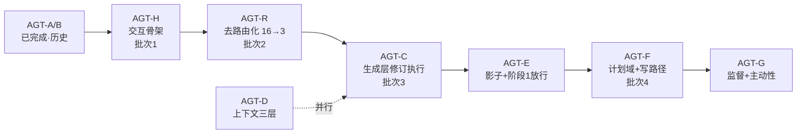

# 骑行伙伴自主 Agent 改造 · 开发规划（粗版 v2）

- 日期：2026-10-27｜取代：[粗规划 v1（已归档）](../archive/VIBE_CODING_Agent_开发规划.md)
- 依据：[Agent 结构设计与改造定案 v1.0](2026-10-27_Agent结构设计与改造定案.md)｜[需求分析 v2](../2026-10-27_骑行伙伴Agent改造_需求分析_v2.md)｜[AI-Spec v2](../AI-Spec_对话Agent能力规约_v2.md)
- 执行事实源：[Agent 改造开发进度](Agent改造开发进度.md)（沿用，本文不记执行状态）

---

## 1. 价值闭环

把对话伙伴从「问一句、答一段话」升级为「教练型伙伴」：**能选（任意一次骑行）、能交付（列表/计划）、能确认（写操作）**，覆盖六任务簇与六条核心旅程（需求分析 v2 §1）；有效服务占比 ≥80%；处方类输出全部过硬门与人工确认。

**架构主线锁定（v2 修订表述，不再复议）**：三平面结构（控制/认知/交互）+ 层级 1 扩工具面 + 训练监督单点 L2。派生指标计算仍由规则函数承担——任何里程碑不得破坏。

## 2. 工作约定（全部继承 v1）

七态任务管理；最多一个 `In Progress`/`Review`；自检通过进 `Review`；用户验收才 `Done`；验收汇报写在进度文档对应工作项下；评测制度（新 Run 不续跑、supersede、bad case 回流）不动摇；Prompt 事实源 = 代码库；任务 ID 前缀 `AGT`；渐进放行四阶段骨架不变。

## 3. 路线图（v2 重排）

**排序三条理由**（定案 §4）：先加后删（H 纯增量风险最小，让场景①②先可用）；rideRef 必须在 H 做（交互点选与锚点下沉的公共件）；C1 模块化必须在 R 之后（否则按 16 路由做完再改等于做两遍）。

## 4. 里程碑定义

### AGT-A：意图路由 v0.4 + Provider 迁移（已完成 · 历史）

2026-10-24 用户验收（7/7）。交付：意图 11→16、路由 12→16、标注集 v0.4 冻结 83 例、83/83 全对。**退出门槛：已达成（历史验收）**。v2 定位：意图体系作为资产继承，16 路由执行分派随 AGT-R 退役（"无删除"口径由定案修订，结论标 `supersede`，非否定）。

### AGT-B：只读工具面与 L2b 循环扩展（已完成 · 历史）

2026-10-26 用户验收（8/8）。交付：工具面 4→9、循环四值预算、输出合同 v0.2；编排 96.8% / 边界 96.5%。**退出门槛：已达成（历史验收）**。v2 定位：工具面与循环基座继承；catalog 按路由裁剪机制随 AGT-R 退役为"全量 + 分工表"。

### AGT-H：交互骨架（批次 1，**下一里程碑**）

**目标**：把"让用户选、给用户看、引导深入"三类交互落地——场景①②端到端可用。
**范围**：动作 7 值；摘要槽位 v0.3（choice）；输出合同 v0.3（choices/artifact/quickActions）；rideRef 工具参数（先 `get_ride_context`/`get_route_overview`）；候选列表与追问；前端点选与"当前分析对象"指示；深度分析入口（复用 `InterpretationSheet`）；轻问轻答引导文案。**细规划**：[AGT-H_交互骨架_工作项规划.md](AGT-H_交互骨架_工作项规划.md)。
**退出门槛**：场景①②端到端演示通过；编排集+边界集零回归；旧前端兼容（新字段忽略不报错）。

### AGT-R：去路由化（批次 2）

**目标**：16 路由 → 3（stop/deterministic/agent_loop），取数路径统一。
**范围**：S0 打底（route 降为遥测标签，行为零差异）→ 合并 6+2 条路由进循环 → catalog 全量 + 分工表（SD-8）→ 分类器处置（D-S2：先删，边界集实测拦不住退二分类）。
**退出门槛**：编排集 21 例 + 边界集 38 例原样跑不退化（两套不按 route 断言，天然适配）；M3 对应例答案不劣化；域外拦截率 100%。**回滚**：保留旧执行器与旧 route 分派，开关切回。

### AGT-C：生成层修订执行（批次 3）

**目标**：四任务簇生成质量。**相对 v1 细规划的唯一修改**：C1（Prompt 模块化）改为在**新三分类**上组装 base + 段，且排在 AGT-R 之后执行；C0/C2/C3/C4/C5/C6 照 v1 细规划执行（它们不依赖路由数）。
**退出门槛**：沿用 C 细规划门槛（KB 命中 ≥90%、评估越界 0、危机转介 100%、p50 ≤2.5s）。

### AGT-D：会话上下文与记忆三层

目标与范围沿用 v1（前置 P8，与 AGT-C 并行）。**退出门槛**：多轮连贯性案例集达标 + 输出校验零回归（动校验根基须开新 Run）。

### AGT-E：影子接入与阶段 1 放行

目标与范围沿用 v1。**退出门槛**：影子期调用合法率 ≥95% → 只读放行（溯源 ≤2%、覆盖率 ≥70%）。

### AGT-F：训练规划与写路径（批次 4）

目标与范围沿用 v1（前置 P6 + 业务交互 PRD，**含 SD-9 硬门与 SD-10 确认令牌**）。**退出门槛**：阶段 2 放行门——采纳率 ≥60%、处方硬门违规 = 0。

### AGT-G：训练监督与主动性

目标与范围沿用 v1（前置 P3）。**退出门槛**：阶段 3 放行门——无安全事件、暂停率 <20%。

## 5. 里程碑 × 评测资产 × 放行门

| 里程碑 | 评测资产 | 门槛 |
|---|---|---|
| AGT-H | 交互用例集 v0.1（点选/候选/同日多条/跨轮 choice ≥12 例）+ 编排/边界集回归 | 场景①②演示通过；两套零回归 |
| AGT-R | 编排集 + 边界集为主回归；M3 v0.8（能力断言重写） | 两套不退化；域外拦截 100% |
| AGT-C | 生成层集 v0.1 + M3 v0.8（D-C 口径） | 沿用 C 细规划 |
| AGT-D / E / F / G | 沿用 v1 §5 对照表 | 沿用 |

## 6. 前置决策项

| # | 决策 | 状态 |
|---|---|---|
| P1/P2/P4/P5/P7 | 已拍板（继承） | ✅ |
| D-S1~D-S4 | 定案方向 / 分类器 / 聚合双轨 / AGT-H 插入位置 | **待拍板（启动 AGT-H 前）** |
| D-S5 延迟与预取 / D-S6 query_rides 合并 | 到点拍（R 前 / C 后） | 待 |
| D-H1~D-H3 | 列表密度 / 训练目标枚举 / 深度分析入口形态 | AGT-H 细规划时拍 |
| P3 / P6 / P8 / P9 | 沿用 v1 节点 | 待 |

## 7. 风险与回退

处方安全（P0）：硬门 + 确认 + 拒答三层冗余，放行门控制。延迟：分类器删除省 1~4s 对冲循环多一轮；必要时投机预取（D-S5）。catalog 全量后误选率回升：分工表 + 离线统计（不阻塞）。域外漂移：边界集实测，退二分类。各批次回滚口径见 §4 各段。

## 8. 当前状态与下一步

AGT-A/B `Done`；定案 v1.0 与三份分析文档已产出；**唯一下一步：拍板 D-S1~D-S4 → 启动 AGT-H0**（细规划见 [AGT-H_交互骨架_工作项规划.md](AGT-H_交互骨架_工作项规划.md)）。
