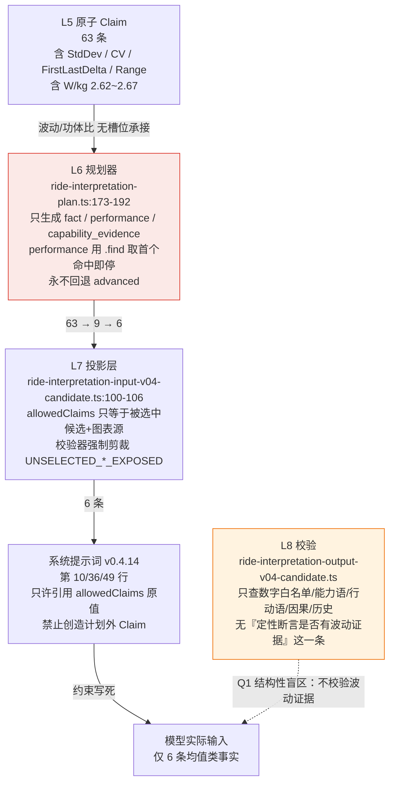

# 盲评 NO-GO 事实性根因分析

> 关联：`T002-V04` 盲评结果（`eval/human-review/T002-V04-blind-review-result-v0.1.md`）
> 状态：**分析定稿，代码零改动**（本分析产出于实施前，未对任何源码做修改）
> 日期：2026-10-02

---

## 1. 结论一句话

**盲评 NO-GO 的第一驱动因子是「事实忠实」（30% 权重）过低，而非「洞察不足」。** 且数据能进一步收敛到一个结构性断点：**丰富的事实（方差/过程/功体比）在 L5 被正确算出，却因 L6 规划器没有候选槽位承接、L7 投影层契约性裁剪，最终进不了模型输入——模型既看不到、系统提示词又禁止它引用，于是只能用均值类 Claim 硬编「稳定/连贯/平稳」等无据定性结论。**

---

## 2. 盲评数据：事实性确实是主因

`T002-V04`（9 案例 × 候选/B0 配对）评分账：

| 维度 | 权重 | 候选 | B0 | 配对差 | 判定 |
|---|---:|---:|---:|---:|---|
| **事实忠实** | 30% | 2.83 | **5.00** | **−2.17** | ❌ 致命 |
| 洞察价值 | 25% | 2.39 | 1.00 | +1.39 | ✅ |
| 行动性 | 20% | 2.94 | 1.50 | +1.44 | ✅ |
| 不确定性 | 10% | 2.22 | 3.44 | −1.22 | ❌ |
| **加权综合** | — | **2.75** | **2.94** | **−0.19** | ❌ < 4.2 |

**三条关键读数：**

1. **候选 2.75 < B0 2.94** —— 加了 AI 之后整体质量反而低于不加 AI 的事实罗列。这不是「分数偏低」，是「倒挂」。
2. 事实忠实掉 2.17 分 → 按 30% 权重**直接损失 0.65 加权分**，把洞察赚来的 +1.39 几乎全部吃掉。NO-GO 没有第二个候选驱动因子。
3. 8/9 候选案例被至少一位评审标记硬门问题，**B0 零标记** —— 这是「越界」，不是「偏低」。

---

## 3. 失效收敛成四类，且高度集中

| 类 | 失效表现 | 涉及案例 | 占案例数 |
|---|---|---|---|
| **Q1** | 无波动/过程证据却断言「稳定/连贯/平稳」 | F04、F05、F07、F08、F09 | **5/9（主因）** |
| Q2 | 证据卡外的能力结论（"配速保持能力"） | F01、F02、F05 | 3/9 |
| Q3 | 引用不存在的规划类信息（"符合本次骑行规划"） | F01 | 1/9 |
| Q4 | 异常数据（0km/0.5km/h）未声明限制、按正常叙事 | F03 | 1/9 |

**一条反直觉但关键的规律：**

- 洞察差 **+2.00** 的三个案例（F02/F06/F09）**全是降级或受限场景**。
- 数据齐全的四个场景洞察差只有 +1.00，且**全部命中 Q1**。

即：模型在受限场景靠**正确降级**产生洞察（安全可控）；在数据齐全场景靠**编造定性结论**产生洞察。唯一零硬门标记的 F06 恰好证明——**输入受约束时输出质量可达标**。这指向「补证据 + 上确定性边界」，而非「推翻架构」。

---

## 4. 机制根因：一条断在 L6 的证据链

**四层拆解：**

1. **L5 算出来了。** `src/domain/ride-features.ts` 为速度/功率/踏频/心率各产出 `StdDev`、`CoefficientOfVariation`、`FirstLastDelta`，海拔产出 `Range`。本次 FIT 共 63 条原子 claim，**波动类事实全在里面**。

2. **L6 没有槽位承接（真正的断点）。** `ride-interpretation-plan.ts:173-192`：每个维度只生成 `fact / performance / capability_evidence` 三类；`performance` 用 `.find` **取首个命中就停、永不回退 advanced**。`power_output` 的 performance 命中 `powerSeriesMeanW`（均值）后结束，`powerStdDevW` 再正确也进不来。唯一以波动为主体的是 `pacing_stability`，但它优先级 50、default 模式排第 4，**进不了焦点**。

3. **投影层强制剪裁（不是 bug，是契约）。** `ride-interpretation-input-v04-candidate.ts:100-106` 规定 `allowedClaims` 只等于「被选中候选 + 图表引用到的源 claim」；`:158/:164` 用 `UNSELECTED_CANDIDATE_CLAIM_EXPOSED` / `UNSELECTED_SOURCE_CLAIM_EXPOSED` **反过来强制**这个剪裁。63 → 9 → 6 是被校验器写死的行为。

4. **提示词只能管形式，管不了实质。** v0.4.14 第 41–43 行要求「用表现词必须含 performance/relation claim，且均值类不足以支撑稳定性判断时不要硬写」。但模型只要挂上一个 performance claim（其 source 是均值）就**满足了字面要求**——「稳定」照写。L8 只校验数字白名单、长期能力语、行动语、因果、历史引用，**没有「这个定性断言有没有波动证据」这一条**。Q1 因此是结构性盲区，与项目在 FIX-013~017 总结的教训（「模式修补无效时上确定性边界」）一致。

- Q2 = 同一根源：`capability_evidence` 的 source 就是 performance（均值），模型有「能力」的合法 Claim 可挂。
- Q3 = L8 只查数字、不查「引用了不存在的语义类别」。
- Q4 = L5 对退化记录没有「有效性降级」claim。

---

## 5. 定性判断：这是「实现窄于设计」，不是「产品取舍」

设计文档 `骑后解读规则重构设计.md`：

- 第 146 行：*「默认只解读重点、避免指标罗列」* —— 看起来像刻意取舍。
- 但第 155/157 行明确要求：`power_output` 承载「**本次输出水平和稳定性、峰值窗口**」；`pacing_stability` 承载「**速度/功率/心率波动**」。

**结论：设计里「稳定性」本来就该有证据支撑，实现却把证据留在了 L5。这是实现窄于设计，不是要不要改定位的问题，而是要不要把已定的设计补齐。** 这个区别决定了它属于「按设计补齐」，而非「重新定义产品定位」。

---

## 6. 修复靶点（按可撬动分数排序，均未实施）

| 优先级 | 靶点 | 涉及 | 修法要点 |
|---|---|---|---|
| P0 | **Q1** | 5/9 案例、30% 权重维度 | **成对动手**：① 证据侧把波动 Claim 投影进 `allowedClaims`；② 规则侧在 L8 加「无波动证据则禁用稳定类措辞」的确定性边界。只做①模型可能仍不用，只做②会出现「有波动数据却不敢说」，缺一不可。 |
| P1 | **Q2** | 3/9 | 收紧 `capability_evidence` 语义边界：能力断言必须能落到「单次/区段范围」；L8 增加「能力名词需 capability_evidence + 范围」。 |
| P2 | **Q4** | 1/9 | 输入侧增加记录有效性降级 claim（0km/极低速 → 显式降级叙事）。 |
| P3 | **Q3** | 1/9 | L8 禁止引用不存在的语义类别（规划/路线安排）。 |

---

## 7. 动手前的代价与前置确认

- 任何投影改动都会改变 `ride-interpretation-plan` 行为，**FORMAL-08 的 81 槽结论将不再对应新代码**，必须另立新 Run ID（不可续跑、不可改写历史）。
- 盲评需按新冻结计划重开（全新 Run，不续跑 `AEVAL-RUN-20260907-876`）。
- Coze 侧 Prompt 需重新发布，`.env.local` 版本号要同步。
- 设计文档第 432–446 行已冻结实施顺序，此项属于**新任务**，需先确认。

**待拍板的两件事：**

1. **修复范围**：只做 Q1（最小切口，撬动 30% 权重维度的 5/9 案例），还是四类一起做？
2. **产品定位**：设计文档要求 `power_output` 承载功体比/区间/峰值——这次是「按设计补齐（训练向证据）」，还是「只在现有均值框架里加波动证据（保守）」？这直接决定 L6 候选要开几个槽位。
