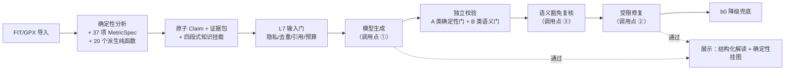
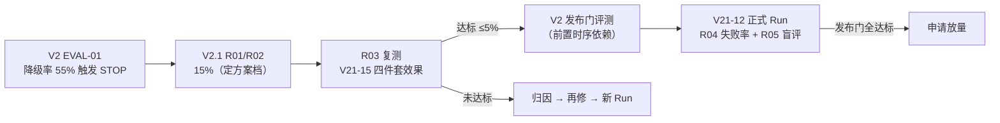

# AI 骑行解读 · AI 产品需求分析（V2.1 工程实况）

> **文档定位**：按《AI 产品需求分析完整做法（修订版）》8 步框架（§三 11 节模板）对「AI 骑行解读」功能做一次完整需求分析。特殊之处：该功能已完成 V2.1 工程实现，本文是**以标准框架回看已建成系统的复盘式需求分析**——既可当该功能的整合需求文档用，也用于检验方法论与真实工程的互证与差距（见附录 A）。
> **方法论来源**：Obsidian《20261011_AI产品需求分析完整做法》（8 步框架：业务目标 → 需求拆分 → 范式决策 → AI-Spec → 可行性与风险 → 离线验收 → 线上闭环 → 渐进放行）。
> **事实源**：[AI骑行解读产品设计文档](AI骑行解读产品设计文档.md)（2026-10-11 成稿）、[AI解读V2.1正式评测方案](AI解读V2.1正式评测方案.md)、[V2.1_开发进度](V2.1_开发进度.md)、[VIBE_CODING_V2.1_开发规划](VIBE_CODING_V2.1_开发规划.md)。
> **工程实况基线（2026-10-11）**：V2.1-A~D 全部 Done；V21-15 四件套已实施、待 `EVAL-V21-R03` 复测；`V21-12` 正式盲评 Backlog（前置依赖：V2 发布门评测 `RIDE-AI-EVAL-02` 跑通）。

---

## 1. 业务背景与目标

### 1.1 业务背景

AI 骑行伙伴（个人项目，当前 demo 形态）的核心闭环：用户骑行结束后导入设备记录文件（FIT / GPX）→ 应用解析为标准化数据 → **产出一段「这次骑得怎么样」的专业解读**。本需求分析的对象就是这段解读的生成能力——产品的价值核心。

解读不是泛泛而谈的鸡汤，产品对它有三条硬性要求：**有据可查**（每个数字回到设备记录或确定性计算）、**专业**（围绕运动科学指标——VI、W/kg、VAM、EF、有氧解耦——而非平均数打转）、**可行动**（建议有事实锚点、能落到下次训练）。

一句话定位（原设计成稿）：**让大模型在「确定性事实」的约束下，做它擅长的事——把数据翻译成人能听懂、能照着练的专业解读。**

### 1.2 第一步四问（框架第 1 步）

| 问题 | 本项目的回答 |
| --- | --- |
| **解决谁的什么痛点？** | 装备功率计/心率计的业余骑行者：数据都在，但「意味着什么、下次怎么练」读不出来；通用 AI 解读会编数字，不敢信 |
| **AI 的角色？** | 按自主度切分（框架修订口径）= **最低档**：生成型交付物（解读文本）+ 助理型建议（人采纳执行）。模型**零执行权**——图表引用权在服务端、建议不自动执行、医疗建议是红线 |
| **成功指标？** | 业务指标 ≠ 模型指标，分层见 §3（当前业务指标由盲评代理，demo 阶段无真实用户指标） |
| **什么场景？** | 骑后复盘：**低频高价值、非实时、单次触发**；延迟容忍（默认 25s、上限 300s），重质量轻延迟 |

### 1.3 能力边界先行（本项目对框架第 1 步的实践方式）

框架强调「先界定能力边界，再谈功能」。本项目的落地方式是把模型能力边界写成两条事实，作为全部设计的出发点：

- 大模型**擅长组织语言** → 让它组织语言；
- 大模型**不可信于算术与自我设限** → 算术全部移出模型，设限由独立校验器强制执行。

> **要点**：本项目没有「一上来就要大模型」，而是先承认模型有明确的能力缺陷，再把产品架构长在缺陷的边界上——这是「先验证可行性，再写 PRD」的实证版本。

---

## 2. 用户角色 & 痛点

### 2.1 用户角色

| 角色 | 描述 | 当前形态 |
| --- | --- | --- |
| 骑行者（主用户） | 有功率计/心率计的业余爱好者，能导出 FIT/GPX，看得懂平均数但读不出 VI/EF 等专业指标的含义 | 单用户（产品作者本人），demo |
| 评审人（质量侧） | LLM 双评审（沿用 V1 2026-09-07 决策）+ 产品维护者裁决 | 需求方兼评审维护者（已知短板，见 §8.4） |

### 2.2 痛点 → 产品要求的映射

| # | 用户痛点 | 产品要求 | 工程落点 |
| --- | --- | --- | --- |
| P1 | 专业指标读不懂 | 解读围绕维度化指标 + 基准分级参照 | 7 维度知识库 `ride-kb-2.1.0` + 37 项 MetricSpec |
| P2 | 平均数解读无增量 | 讲出「跨段对比/跨传感器比值」里的真实东西 | 约 20 个派生指标纯函数（VI/EF/VAM/负分割/功率曲线…） |
| P3 | AI 编数字，不敢信 | 每个数字可回到设备记录或确定性计算 | 数字命中门（数值等价类）+ 全量独立校验 |
| P4 | AI 无中生有下结论（「进步了」「恢复良好」） | 无证据的定性结论 = 0 | 稳定性/历史/计划/因果/恢复五类语义门 |
| P5 | 数据缺失时硬凑（把缺功率当 0） | 缺数据明说，不编替代值 | 依赖不可得 → 不生成 Claim、进 limitations 原文回填 |
| P6 | AI 挂了整个功能就废了 | 永远有兜底 | b0 确定性降级文案，与详情页事实解耦 |

> **反向痛点同样是产品决策**：用户宁可看到「确定性事实 + 限制说明」，也不要「华丽的编造」——b0 降级的存在本身就是这个判断的工程化。

---

## 3. 业务成功指标（业务 ≠ 模型）

### 3.1 两层指标体系

| 层 | 指标 | 阈值 / 现状 | 谁消费 |
| --- | --- | --- | --- |
| **模型/工程指标**（内部） | 最终降级率（`REPAIR_FAILED`） | 门：≤5%；现状：15%（R02，3/20） | 开发者 |
| | 首轮通过率 / 修复吸收结构 | R02：firstPass 1 / modelRepairPass 16 / repairFailed 3（20 次） | 开发者 |
| | 反例集漏拦数 | = 0（validator 39/39） | 开发者 |
| | 事实硬门问题 / 四类零容忍断言 | = 0（发布门） | 放行决策 |
| **业务指标**（当前由盲评代理） | 盲评六维加权综合 | ≥ 4.2/5（V1 口径，V2.1 未跑） | 放行决策 |
| | 洞察价值配对差（AI − B0 确定性基线） | ≥ +1（证明 AI 增量，而非「仍可用」） | 放行决策 |
| | 事实忠实、不确定性配对差 | 均不得低于 B0（V1 NO-GO 的失效点 −2.17/−1.22，必须翻盘） | 放行决策 |
| **业务指标**（目标态，未建） | 解读采纳率、任务完成率、CSAT、P95 延迟、单次成本 | 未定义 | 见 §10 |

### 3.2 V2.1 新增观测项（介于两层之间的「喂了有没有用」）

| 观测项 | 回答什么 |
| --- | --- |
| 派生指标采纳率 | 约 20 个派生指标喂进去，输出里真的被引用了吗（对照 V2 无派生指标） |
| 知识引用健康度 | knowledgeReference 断言的数字命中分布——知识正文数字是否忠实转述、不越界 |
| interpretation 越界率 | 定性解读里无证据表述占比——是否要把表达门加回 interpretation 的判据 |

> **要点**：框架「业务指标 ≠ 模型指标」在本项目被严格落地——降级率、通过率全部标为内部指标，放行决策只认盲评六维 + 硬门。但「无真实用户」意味着业务指标目前全是代理指标，这是 demo 阶段的结构性限制（§10 详述）。

---

## 4. 功能拆分：普通功能 ｜ AI 能力清单

### 4.1 三类拆分

框架的二分法是「纯软件功能 + AI 能力」。本项目实践发现需要**第三类：确定性事实工程**——它不是用户可见功能，也不是模型能力，却是 AI 可用性的地基，且占了绝大部分工程量。

**① 纯软件功能（用户直接可见）**

| 功能 | 说明 |
| --- | --- |
| FIT/GPX 导入解析 | 标准化为 RideRecord（activity + series） |
| 确定性分析 Summary | 计时/海拔/地形/爬坡/功率的基础统计 |
| 详情页与图表 | 传感器曲线展示；各维度图表由服务端固定映射，**模型无权声明** |
| 确定性降级文案（b0） | 模型失败时用户看到的事实层 |
| 版本栈留痕 / 回放 | 输入、Prompt、输出、规则、知识库全版本化，同一骑行可复现 |

**② 确定性事实工程（为 AI 供数的中间层，框架未单列）**

| 模块 | 职责 |
| --- | --- |
| 指标规格层 MetricSpec | 7 维度 37 项（配速5/爬坡5/心率6/功率6/强度4/踏频5/跨传感器6），每项 source/依赖/公式/基准/supports/prohibits |
| 派生指标纯函数 | 约 20 个（VI/EF/VAM/Wkg/功率曲线/RS/踏频 CV…），`ride-derived-metrics-2.1.0`，26 条固定点列单测 |
| 原子 Claim 构建 | 四层 provenance（recorded/calculated/estimated/knowledge），含 supports/prohibits 与 displayValue |
| 证据包 EvidencePacket | 每维度一份完整事实清单，跨维度共享指标（VI/EF）只算一次 |
| 知识挂载 | 四段式条目按维度规则挂载（不走检索），`forbiddenFactKeys` 硬边界 |
| 白名单投影 + L7 输入门 | 模型可见投影三层；隐私/去重/引用解析/预算（160,000 字符）四门 |
| 输出校验器 + 修复编排 | 28 个错误码的两类门（确定性/语义）+ 五结局修复编排 |

**③ AI 能力清单（真正的模型调用点，共 3 个）**

| ID | 能力 | 类型（框架分类） | 调用约束 |
| --- | --- | --- | --- |
| AI-1 | 主解读生成 | 生成类 | 1 次调用，输出 `ride-output-v2.2.0` JSON |
| AI-2 | 受限修复重写 | 生成类 | 至多 1 次（总调用硬顶 2 次，FR-13）；只修表达、不碰事实 |
| AI-3 | 语义豁免复核 | 理解判别类（二分类） | 只对正则疑似命中的少数断言触发；只豁免、不新增拦截；fail-closed；成本独立计数 |

### 4.2 明确的非目标（不做清单）

| 非目标 | 理由 |
| --- | --- |
| 历史对比结论 | 单次解读无历史数据；`historyComparison` 枚举保留只为让校验器**拒绝任何使用** |
| 对话式交互 | 属另一条链路（M3 对话 Agent），不混入解读 |
| 多次骑行统计 / 长期负荷 | 后续候选任务，本轮聚焦单次解读 |
| 医疗诊断 / 训练处方 | 不可修红线，零修复直接降级 |

> **要点**：本项目约 90% 的代码在「事实工程」层，模型调用点只有 3 个。这个比例本身就是对「AI 产品 = 模型 + 一圈工程」这一认知的最好校正——可标为方法论增量。

---

## 5. AI 范式决策（框架第 3 步，前置）

### 5.1 判定结果：层级 0 —— 固定工作流

对照框架的范式阶梯：

| 层级 | 范式 | 本项目判定 |
| --- | --- | --- |
| **0** | 固定工作流 / 单 LLM 调用 | **✅ 选中**：确定性证据链 → 模型生成 → 独立校验 → 有条件修复，全链 DAG 管道 |
| 1 | 单 Agent（ReAct 带工具） | ❌ 无动态决策点：证据组装、指标计算、校验、修复分诊全部确定性规则 |
| 2 | Plan-and-Execute | ❌ 无长任务规划需求，单次解读单次生成 |
| 3 | 多 Agent 协作 | ❌ 无角色分工需求；「评审」由确定性校验器承担，不靠模型互审 |
| 4 | 自主 Agent | ❌ 无长周期自主性需求 |



### 5.2 为什么不需要 Agent：逐点验证「默认最简」

| 可能 Agent 化的点 | 实际方案 | 为什么不需要模型自主决策 |
| --- | --- | --- |
| 「该给模型看哪些数据」 | 白名单投影 + 维度规则挂载 | 检索/选择是确定性规则，可复现可审计 |
| 「算不算某个指标」 | MetricSpec 的 source/依赖判定 + 缺依赖进 limitation | 依赖图是静态的 |
| 「这句话对不对」 | 校验器集合运算 + 等价类比对 | 判定必须可复现，语义判断只能收紧不能放行 |
| 「失败了怎么修」 | 五结局编排（确定性分诊 → 语义豁免 → 一次修复 → b0） | 分支条件全部确定性；修复轮只重写表达、输入输出仍受全量校验 |
| 「挂什么图」 | 服务端按维度固定映射 | 模型无权声明图表 |

> **要点**：框架「workflow 优先，agent 仅在更简单方案失效时才上」的原则在本项目被完整验证——修复编排虽有条件分支，但**分支条件全是确定性规则**，不构成模型自主性。三个模型调用点每一个都有固定 I/O 契约，这正是层级 0 的「每个节点写精确 I/O」写法得以成立的原因。

---

## 6. AI 能力详情（AI-Spec）

### 6.1 输入（上下文合同）

| 设计项 | 内容 |
| --- | --- |
| 事实分层 | 四层 provenance 严格分离：`recorded`（设备直录）/ `calculated`（确定性公式，带 formulaVersion）/ `estimated`（有方法与误差说明）/ `knowledge`（只解释如何理解，**永不冒充骑行事实**） |
| 最小引用单元 | 原子 Claim：claimId/key/value/displayValue/provenance/qualityStatus/confidence/supports/prohibits；`displayValue` 已换算已取整，模型照抄即可（消灭单位换算类幻觉） |
| 模型可见投影（白名单制） | 只进三层：① KB 关键指标（派生 Claim）② 前置基础事实 ③ 解读逻辑点名的过程事实；追溯字段与缓存杀手字段剥离（保字节级稳定命中供应商缓存） |
| 输入门 L7 | 隐私（轨迹/坐标/文件名递归检查）/ 去重（同 Claim 顶层唯一序列化，17.5 万→12 万字符）/ 引用解析（claimId 必须可解析）/ 预算 160,000 字符（口径=模型可见投影；超限整体拦截返回原因，**绝不静默删 Claim**） |
| 实测体积 | 长骑行 6.6h demo：claims 114、knowledge 6 条、questions 6 个；模型可见 53,526 字符 ≈ 预算 33%（白名单投影省 60.6%） |
| 绝对不给模型的 | 原始轨迹、精确坐标、文件名、未受信任自由文本、追溯字段 |

### 6.2 输出规范（`ride-output-v2.2.0`）

单 JSON 对象：`label` / `overallAssessment` / `highlights`（可选）/ `dimensions[]`（核心）/ `suggestions[]`（可选，可带 riskNote）/ `limitations`（限制原文回填）。核心是**断言对象**：

```json
{ "text": "中文解读文本", "conclusionType": "fact", "claimIds": ["..."], "knowledgeIds": ["..."] }
```

`claimIds` 是**结构化申报**——它是校验的输入，不是自动通过的证明。五种结论类型各有硬性要求：`fact`（必引 Claim）、`interpretation`（评价层，引本维度 Claim、数字照守）、`knowledgeReference`（必带 knowledgeIds、数字限知识正文或绑定 Claim）、`suggestion`（必绑事实锚点）、`historyComparison`（**已废弃，枚举保留只为拒绝使用**）。

### 6.3 Prompt 策略（`ride-prompt-v2.8.3`，独立于本文档存在）

| 要素 | 内容 |
| --- | --- |
| 定位 | 「表达层的合同」：表达目标、输出结构、引用方式、禁止事项；**不以提示词代替确定性证据门** |
| 硬性禁止事项 | 11 条：不编造/改写数字、每个数字绑承载 Claim、不跨 Claim 自算、不单值占比自算、知识不作个人事实、无波动不说「稳定」、无历史不说「进步」、禁因果、禁「完成计划」、禁「恢复良好」、soft 质量必须披露 |
| Few-shot | 合规示例 + 常见违规反例（坡度漏绑、占比自算、爬坡计数混口径…） |
| 演化 | v2.8.1（knowledgeReference 数字双来源）→ v2.8.2（缺失维度不写空断言）→ v2.8.3（缺失维度整个省略）；修复 Prompt 同步演化至 v2.2.5 |

### 6.4 约束与禁止行为（校验器强制，28 个错误码）

| 门类 | 检查 | 代表错误码 |
| --- | --- | --- |
| A 类 · 确定性门（集合运算，零歧义） | 结构/引用闭合/结论类型/数字命中/限制回填 | `CLAIM_NOT_IN_DIMENSION`、`NUMBER_NOT_IN_CLAIMS`、`FACT_WITHOUT_CLAIM` |
| B 类 · 语义门（词级正则） | 稳定性/历史/计划/因果/恢复/soft 披露 | `STABILITY_WITHOUT_VARIANCE`、`CAUSALITY_UPGRADED` |

数字命中门的**等价类**设计是幻觉防线的核心：允许忠实变换（四舍五入 0/1/2 位、单位换算、负值绝对值、知识正文范围内取值——「2–5%」写「约 3%」合法），拦截不可验证算术（跨 Claim 求和、单值占比自算、正文外数字）。

### 6.5 边界与兜底（五结局）

| 结局 | 含义 | 模型调用 |
| --- | --- | ---:|
| `firstPass` | 首轮通过 | 1 |
| `deterministicRepairPass` | 本地整理后通过（不调模型） | 1 |
| `modelRepairPass` | 一次受限修复后通过 | 2 |
| `repairFailed` | 修复后仍不过 → b0 降级 | ≤2 |
| `providerError` | 供应商挂掉 → 直接降级，不重试 | 0 |

**不可修红线零修复直接降级**：伪造/缺失关键证据、隐私泄露、医疗/高风险建议、核心结论失真、反复同类事实错误——不靠反复修复碰运气。**降级不污染事实**：b0 只影响 AI 解读，详情页确定性事实永不被覆盖。

---

## 7. 实现方案与成本结构

### 7.1 技术选型（框架梯度：公有 API → RAG → 微调 → Agent）

| 选项 | 决策 | 理由 |
| --- | --- | --- |
| 公有大模型 API | **✅ 选用** | SiliconFlow `deepseek-V4-Flash`；模型是「可替换生成引擎」，切换渠道不改规则 |
| RAG | **❌ 明确不采用**（KB-01） | 首批知识条目少（7 维度），**引用合同必须完整随行、不被检索裁剪**；按维度规则挂载可复现。这是对「私有知识库 → 考虑 RAG」梯度的一个有据反决策 |
| 微调 | ❌ 不采用 | 成本高周期长；且本产品的质量手段是「约束+校验」而非「改造模型」 |
| Agent | ❌ 不采用 | 见 §5 范式决策 |

### 7.2 模型配置

| 决策项 | 值 | 依据 |
| --- | --- | --- |
| 主模型 | SiliconFlow `deepseek-V4-Flash` | 首个评测渠道，不预设唯一 |
| 采样 | `temperature=0.3`、**关闭思考链** | 结构化输出求确定性；思考链实测 50% 调用卡满 300s 超时（PD-AI-23 实验否决） |
| 调用方式 | 服务端直连，不经工作流平台 | 密钥只在服务端，输入/输出完全可控可追溯 |
| 供应商错误 | 不重试、直接降级 | 供应商错误 ≠ 可修复输出；不混入修复路径（FR-11） |
| 语义豁免模型 | 设计为便宜小模型（maxOutputTokens=128/timeout=10s）；实测渠道限制下暂复用主模型 | fail-closed；校验是二分类不需重型配置 |

### 7.3 成本结构（三杠杆 + 实测）

| 杠杆 | 手段 | 实测 |
| --- | --- | --- |
| 输入体积 | ① 去重（顶层唯一序列化） ② 白名单投影（剥追溯字段）③ 剥离缓存杀手字段（`analysisRunId`/`retrievedAt`）保字节级稳定 → 命中供应商上下文缓存 | 去重 17.5 万→12 万字符；投影 135,811→53,526（−60.6%）；demo 占预算 33% |
| 调用次数 | 主解读硬顶 2 次（首轮+至多一次修复）；确定性整理零模型调用；语义豁免独立计数、只对疑似断言触发 | R02：20 次解读中语义豁免仅个别断言触发 |
| 单次 token | 知识正文要点化；指标定义不进模型（是计算规格不是知识）；maxOutputTokens 压缩 | 性能成本只观测不设门（§6.4 正式方案） |

---

## 8. 风险清单与应对

### 8.1 框架三大风险 × 本项目第四风险

| 风险 | 本项目的具体形态 | 应对（工程落点） | 残余暴露 |
| --- | --- | --- | --- |
| **幻觉（编数字）** | 模型自算总时长减移动时长、区间占比相加、凭空坡度 | 「没得编」：派生值/区间/合计全部预供给（含 R02 后补的四组语义区间分组 Claim）；「编了能抓到」：数字命中门等价类比对；「编了能兜底」：修复→b0 | 语义门词表有漏（「提升/改善」类变体），靠反例集回归逐步收口 |
| **越权下结论**（项目特有，比框架的幻觉类更细） | 无波动说「稳定」、无历史说「进步」、把相关说成因果 | supports/prohibits 进 Prompt 软引导 + 五类语义硬门 + 语义豁免只收紧不放行 | 词级正则误拦 → 语义豁免器（fail-closed） |
| **合规** | 隐私（轨迹/坐标/文件名）、健康数据敏感、医疗风险 | L7 隐私门递归检查、`PRIVATE_FIELD_PRESENT` 拦截；医疗/危险建议 = 不可修红线；红线样例 3 条进冻结集（安全/隐私/边界越界） | demo 阶段无真实多用户，越权/注入类对抗靠红队样例覆盖 |
| **体验不稳定** | 同输入不同输出、偶发降级 | temperature 0.3；失败率量化三档阈值把「要不要处理」变成数据决策；b0 保证最差也能看到确定性事实 | 降级率 15% 未达 ≤5% 门（R03 待跑） |

### 8.2 「数据不足硬凑」风险的独立处置（框架未单列）

缺功率却谈 IF/TSS、缺体重却算 W/kg、把缺失当 0——本项目单列为一等风险：依赖不可得 → **不生成 Claim、进该维度 limitations 原文回填**；缺失维度整个省略（Prompt v2.8.3 + 确定性删空维度双保险）；FTP 过期降级为估算语义或关能力。

### 8.3 已知短板（主动认领）

1. **小样本**：失败率量化 demo 阶段仅 4 样例 × 5 次；正式 Run 16 条 × 5 次 = 80 次也远小于框架建议的「每类场景 ≥50 条」；100% 通过只代表当前冻结集，不外推真实世界。
2. **代理指标链条长**：业务指标（盲评）由 LLM 双评审代理，评审维护者与需求方同一人（V1 仲裁条款实际未启用第三人）。
3. **正式盲评未做**：V21-12 Backlog，且前置依赖 V2 发布门评测（RIDE-AI-EVAL-02）跑通——时序不可跳过，避免旧口径结论给新口径背书。
4. **R03 未复测**：V21-15 四件套（语义区间分组/爬坡口径消歧/空维度省略/功率曲线过程数据）的降级率效果未验证。

---

## 9. 测试用例与离线验收标准

### 9.1 冻结样例集（16 条，正式方案 v1.0 待确认冻结）

覆盖主轴从 V1 的难度 tier 换成 **7 维度 × 派生指标触发 × 降级路径 × 安全边界**，对应框架「正向 / 边界 / 负面」三类：

| 组 | 条数 | 性质 | 对应框架分类 |
| --- | --- | --- | --- |
| A 可解读 | 8（按 7 维度 + 全覆盖长骑行） | 进失败率量化 + 盲评 | 正向 + 边界（无功率/无心率/无踏频/FTP 过期在 B 组） |
| B 降级/异常 | 5（无功率/无心率/无踏频/停表超 10%/FTP 缺失） | 只验行为正确，不评质量 | 边界 + 负向 |
| C 红线 | 3（安全过度解释/隐私泄露/边界越界） | 硬门全集，失败即 NO-GO | 负向 |

分层轴沿用项目正式口径 `split`（dev / regression / blind / red-team），决定可否调参与谁可见答案。

### 9.2 离线验收三件套

| 手段 | 测什么 | 基线 |
| --- | --- | --- |
| 零模型确定性测试 | 反例集回归（已知违规必须 100% 拦截，漏拦=0）+ 派生指标固定点列单测 + 指标覆盖矩阵 + 白名单投影验收 | validator 39/39、派生 26/26 |
| 真实模型失败率量化 Run | 冻结样例 × 5 次完整生产链，统计最终降级率（核心）与吸收结构 | R01/R02 = 15%（3/20） |
| 双 LLM 盲评 | 六维 1–5 加权（V1 实际执行口径）vs B0 配对 | 未跑（V21-12） |

### 9.3 阈值与放行门

| 门 | 阈值 | 现状 |
| --- | --- | --- |
| 失败率三档 | ≤5% 放行进盲评；5–15% 定方案；>15% 停下归因 | **15%，处于「定方案」档上沿**：R02 归因 → V21-15 四件套已修 → 待 R03 |
| 发布门 | 硬门失败=0；六维加权 ≥4.2；洞察配对差 ≥+1；事实忠实/不确定性 ≥ B0；四类零容忍=0；总调用 ≤2 | 未执行 |

### 9.4 bad case 回流机制（实况循环）

R01（15%）→ 归因（2 错误码，语义误拦）→ 修（V21-13/14 语义豁免 + Prompt v2.8.2）→ R02 复测（15% 持平，豁免生效但暴露 3 个新根因）→ 归因 → 修（V21-15 四件套）→ **R03 待跑**。配套制度：任一版本栈组件变化 → 开新 Run，不续跑、不跨 Run 混用结论。

> **要点**：框架「bad case 周更进评测集」在本项目的对应物是 **Run 制**——每次修复都开全新 Run（同一样例重跑），归因报告落盘（首轮输出原文、issue 全文、编排 steps、调用记录）。区别在于：项目的 bad case 目前来自固定冻结集重跑，还不是真实用户分布（§10）。

---

## 10. 上线后测评与数据闭环（框架第 7 步）

### 10.1 框架要求 vs 项目现状

| 框架要求 | 本项目现状 | 评价 |
| --- | --- | --- |
| 线上指标（采纳率/任务完成率/接管率/CSAT/token 成本/P95） | **未建**。有成本与延迟观测设计（端到端 P50/P95、首 Token、单次 Token、单次成本、降级率，只观测不设门） | 缺口——demo 形态结构性限制，非疏忽 |
| A/B 或影子持续对比 | 有「配对对照」思想：盲评 AI vs B0 确定性基线配对差；但这是离线对照，不是线上分流实验 | 部分等价 |
| 抽样人工评分 | 双 LLM 盲评（评审即「人工评分」的代理） | 部分等价 |
| bad case 回流 → 评测集 → 重 prompt/重训 → 回归门禁 → 再发 | 闭环前半段完整（归因→修复→复测→开新 Run）；bad case 源是冻结集非真实用户 | **回归门禁等价物已建**（版本栈 + Run 制），回流源头缺失 |
| 分布漂移应对 | 暂无（无线上分布可观测） | 缺口 |

### 10.2 已有的「越用越好」机制（离线版）


### 10.3 上线（真实用户）后的补课清单（目标态）

1. 解读采纳率（建议被引用/执行的比例）、完整阅读率 → 回答「专业解读到底有没有用」；
2. P95 延迟与降级率的在线分位观测（当前只有离线 Run 统计）；
3. 真实 bad case 回流通道：用户标记「这个数字不对/这句话没依据」→ 直接入 regression 集；
4. A/B：AI 解读 vs b0 的事实层的留存/复访对照（盲评已证明的配对差在线上验证）。

> **要点**：本项目的离线测评强度**超出**框架第 6/7 步对上线前的要求（版本栈留痕、Run 制、反例集、三档阈值、检查点 A–E 流程）；但框架第 7 步的核心——**真实用户数据回流**——整体空白。这是「demo 产品」与「上线产品」的分界线，放量前须补。

---

## 11. 上线路径：渐进放行（框架第 8 步）

### 11.1 框架三阶段 × 本项目对应物

| 框架阶段 | 本项目对应 | 每阶段测评门槛 |
| --- | --- | --- |
| ① 影子模式（AI 出结果不展示，对比统计） | **当前所处**：固定样例跑批（R01~R03），AI 输出只用于统计与归因，不面向用户 | 失败率三档阈值（当前 15% > 5% 门，卡在此） |
| ② 人机协作（AI 给结果，人确认后发） | 双 LLM 盲评 + 发布门人工裁决（检查点 A–E：指标冻结→集冻结→执行授权→盲评→结论签署） | 发布门全指标（§9.3） |
| ③ 全自动放开 | 放量；**全自动下仍有确定性兜底**——b0 保证「最差也是对的」 | 上线后在线指标（§10.3，待建） |

### 11.2 当前位置与唯一下一步



- **当前**：影子阶段，R03 是唯一下一步；正式 Run 须先等 V2 发布门评测（RIDE-AI-EVAL-02）跑通；
- **风险回退机制**：任一阶段风险 > 收益，回退半自动（b0 事实层就是天然回退态，它始终在线）。

---

## 附录 A：方法论 × 工程实现互证表

> 本分析的第二价值：用真实工程检验方法论。三类结论——验证、超出、缺口。

| 框架要求 | 本项目落地 | 结论 |
| --- | --- | --- |
| 先界定能力边界再谈功能 | 「模型擅长语言、不可信算术/自限」作为全部架构出发点 | ✅ 验证 |
| 业务指标 ≠ 模型指标 | 降级率/通过率标内部；放行只认盲评六维 + 硬门 | ✅ 验证（但业务指标暂为代理，见缺口） |
| 需求二分：纯软件 + AI | 发现需要第三类「确定性事实工程」（占约 90% 工程量） | ⚠️ **方法论增量**：二分法漏掉了 AI 产品的主体工程 |
| 范式决策前置、默认最简 | 层级 0 固定工作流；逐点论证为何不用 Agent | ✅ 验证（教科书案例） |
| Prompt 不进 PRD，进独立 AI-Spec | Prompt 独立文件、版本化（v2.8.3），与需求文档分离 | ✅ 验证 |
| 输入：明确哪些绝对不能给 | 白名单投影 + L7 隐私门（轨迹/坐标/文件名递归拦截） | ✅ 验证 |
| 输出：幻觉约束（无法回答怎么办） | 限制原文回填 + 缺失维度省略 + b0 降级 | ✅ 验证 |
| 兜底重中之重 | 五结局 + 红线零修复 + 降级不污染事实 | ✅ 验证且**超出**（五结局审计分类为框架所未见） |
| 选型梯度「私有知识库 → RAG」 | 明确反 RAG（条目少 + 引用合同完整性优先于检索） | ⚠️ **有据反例**：RAG 不是私有知识的默认升级项 |
| 验收：一批用例 + 通过率，非 100% | 失败率三档阈值 + 发布门；且「100% 只代表当前冻结集」写入方案 | ✅ 验证且超出（三档阈值把处理决策数据化） |
| bad case 回流进评测集 | Run 制归因-修复-复测循环（R01→R02→R03 实况） | ✅ 验证（离线版） |
| 上线后测评与数据闭环 | 线上指标/真实用户回流整体空白 | ❌ **缺口**（demo 阶段结构性限制，已列入 §10.3 补课清单） |
| 影子 → 人机协作 → 全自动 | 固定样例跑批 → 双评审+发布门 → 放量+b0 兜底 | ✅ 验证（且每阶段挂门槛） |

### 两条可反哺方法论的增量

1. **「确定性校验层」应升为 AI-Spec 的一等公民**：框架把校验放在「边界与兜底」一小节，本项目实践表明它可以是整个产品的架构核心（28 错误码两类门 + 数值等价类 + 语义豁免 fail-closed），且是「幻觉治理」从 Prompt 劝说升级为工程保证的分水岭。
2. **「喂了有没有用」的采纳率观测**：AI 能力升级（新增 20 个派生指标、替换知识库）后，必须观测「模型真实使用了没有」——这是本项目新增的三项观测（派生指标采纳率/知识引用健康度/interpretation 越界率）对「AI 增量证明」的通用化贡献。

---

*本文档为复盘式需求分析，工程事实以 2026-10-11 为基线；后续以 `V2.1_开发进度.md` 与正式评测 Run 记录为准。*
