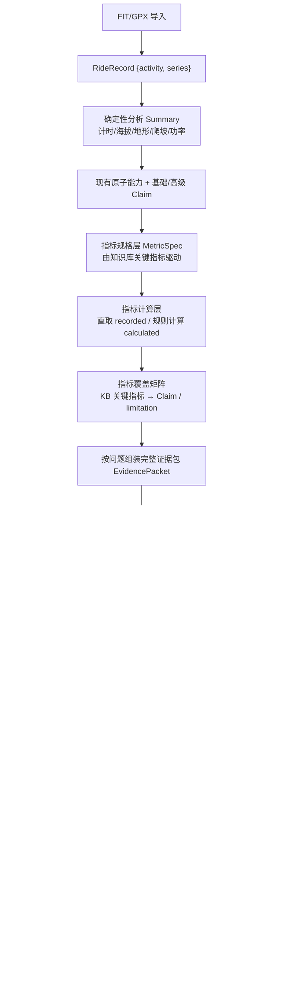
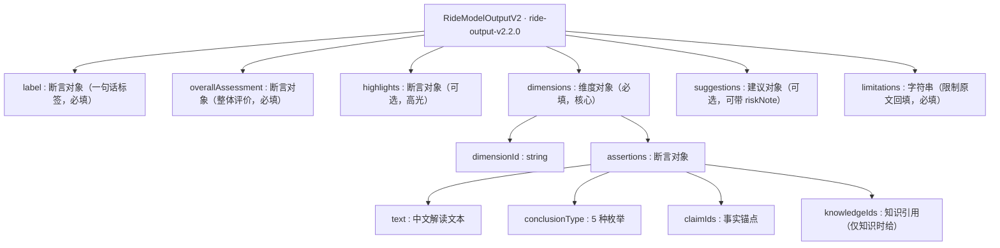

# AI 骑行解读 V2.1 优化设计文档

> 视角：产品经理 + 技术方案  
> 定位：在 V2 证据体系与上下文重构的基础上，做一轮「指标规范化 + 运动科学知识库升级」的优化。V2 已把"证据可信、隐私、成本、输出校验、降级"五条主线跑通，V2.1 只动两件事——**模型输入的指标口径** 与 **知识库**，其余设计原则原样继承。  
> 基线：V2 重构设计文档（`doc_V2/AI骑行解读V2重构设计文档.md`）、技术方案（`doc_V2/技术方案_AI骑行伙伴_V2.md`）、业务规则与 PRD。  
> 新增输入：`cycling_science_knowledge_base.md`（7 维度骑行运动科学知识库，本文档简称"新知识库"）。  
> 状态：设计基线已定稿，待评审确认后进入开发规划执行。

---

## 1. 背景与优化目标

### 1.1 为什么做这轮优化

V2 已经解决了"模型会编"的根因——用证据化 + 独立校验把"能说什么"管住了。但还剩下一个 V2 有意没深挖的问题：**模型看到的指标，是被"详情页有哪些字段"牵着走的，而不是被"解读维度需要哪些运动科学指标"牵着走的。**

具体表现为三个缺口：

| 缺口           | 表现                                             | 后果                                                          |
| ------------ | ---------------------------------------------- | ----------------------------------------------------------- |
| 指标口径跟着详情页走   | 输入以"详情页字段全覆盖"为准绳（`FR-01`/覆盖矩阵），详情页没有的派生指标就不进输入 | 模型拿不到 VI、EF、VAM、有氧解耦这些**真正有解读价值的指标**，只能绕着平均功率、平均心率这些"平均数"打转 |
| 知识库太薄、与维度错位  | 旧知识库 8 条 / 5 主题，且是"指标定义"视角，不是"维度解读"视角          | 每个维度能挂到的知识少且不聚焦，模型缺少"这个指标该怎么分级、什么信号算好/算坏"的参照系               |
| 心率/功率区间基准不统一 | KB 用 LTHR 心率 5 区，代码用 maxHR 心率 5 区              | 同一段心率，两套分区口径，解读可能自相矛盾                                       |

新知识库恰好对症：它**按 7 个解读维度**组织，每个维度给出「关键指标 + 计算方法 + 基准分级 + 解读逻辑（✅/⚠️）+ 运动科学依据」。这正是 V2 缺的那块"维度化指标 + 分级参照系"。

### 1.2 优化目标（一句话）

**让模型输入的指标清单由运动科学知识库的关键指标决定（能直取就直取、不能直取就规则化算出来），并让每个维度的解读都有知识库的基准分级与解读逻辑做参照系，从而提升解读的"专业度"与"口径一致性"。**

### 1.3 三条优化要求与落点映射

| 用户要求                                  | 设计落点                         |
| ------------------------------------- | ---------------------------- |
| ① 输入数据修改：不强制 = 详情页；以知识库关键指标为准，直取或规则计算 | §4「指标规格层 + 指标计算层」、§6「输入口径切换」 |
| ② 知识库直接更换为新版，按新版重新设计知识库使用             | §5「知识库结构化方案」、§7「知识挂载层重设计」    |
| ③ 其他设计原则不变                            | §9「不变的设计原则」（逐条对照确认）          |

---

## 2. 现状盘点（V2 工程实现 vs 新知识库）

### 2.1 V2 当前链路的指标家底

V2 已经把"从导入数据到原子 Claim"跑通，当前已能产出如下指标（均在 `src/domain/ride-capability-claims-v2.ts` 等确定性规则模块中计算）：

- **基础记录指标**（直取，provenance=recorded）：距离、累计爬升/下降、活动能耗、总时长/移动时长、平均/最大速度、平均/最大心率、平均/最大功率、平均/最大踏频、设备 NP。
- **计时与地形**：停歇次数与时长、巡航段（时长/均速/变异系数）、地形分段里程（爬坡/平路/下坡，趋势与局部两种口径）、地形覆盖比。
- **爬坡**：代表性爬坡段（级别/距离/净爬升/坡度 + 段内心率/功率）、爬坡计数披露。
- **心率**：最大心率基线（用户/估算）、心率 5 区分布（**maxHR 基准**）、心率阶段变化（stageComparison，即"心率漂移"的雏形）。
- **功率**：平均功率、连续窗 NP、平均/标准化 W/kg、功率 7 区分布（FTP 基准）、10/20/30 秒连续峰值、IF、TSS。
- **踏频**：踏频区间分布。
- **跨传感器**：固定窗口关系聚合 + 跨传感器对齐能力状态。

### 2.2 新知识库 7 维度关键指标全景 & 与现状的差距

新知识库的 7 个维度与 V2 现有 `analysisDimensionIds` 的前 7 个**一一对应**（`pacingExecution / climbPerformance / heartRateLoad / powerOutput / intensityAndTrainingLoad / cadenceStrategy / crossSensorCoordination`），这是本轮优化能"精准对位"的前提。差距统计：

| 维度     | 知识库关键指标数 | 已具备 | 新增/扩展 | 主要缺口                                         |
| ------ | -------- | --: | ----: | -------------------------------------------- |
| 配速执行   | 5        |   0 |     5 | VI、前后半功率差、停歇占比、爬升/下降功率比、负分割                  |
| 爬坡表现   | 5        |   0 |     5 | 爬坡 W/kg、VAM、坡度-功率匹配、爬坡功率衰减、有效爬升高度            |
| 心率负荷   | 5        |   2 |     3 | EF、心率恢复、区间基准对齐（LTHR）                         |
| 功率输出   | 6        |   4 |     2 | 功率曲线扩展（5s/1min/5min/20min/1h）、VI             |
| 强度与负荷  | 4        |   2 |     2 | 相对强度 RS、每 TSS 耗时                             |
| 踏频策略   | 5        |   2 |     3 | 踏频变异系数、功率-踏频关系、传感器对齐校验                       |
| 跨传感器配合 | 6        |   1 |     5 | 有氧解耦 Pw:Hr、EF、踏频-功率同步、速度-功率比、心率-踏频关系、坡度-功率匹配 |

> 共享指标（只算一次、多维度引用）：**VI**（配速 + 功率输出"有效功率比"）、**EF**（心率负荷 + 跨传感器）。合计需新增派生指标约 **20 个**。

结论：V2 的指标层集中在"记录值 + 功率/心率分布"，而知识库的指标层强调"**跨段对比、跨传感器比值、做功效率、爬坡专用指标**"——这正是解读质量的增量来源。

---

## 3. 核心架构调整（一图总览）



相较 V2 的变化集中在**中间三块**（E/F/G 新增，I 重设计），上下游（证据包、L7 门、Prompt、输出校验、修复降级）的契约不变，只做**指标清单与知识内容的适配**。

---

## 4. 指标规格层与指标计算层（要求①落点）

### 4.1 指标规格层（MetricSpec）

新知识库每张"关键指标"表，转成一条结构化 `MetricSpec`，作为"该指标怎么来、能支撑什么、不能支撑什么"的**唯一权威定义**：

```ts
interface MetricSpec {
  metricId: string;              // 如 "pacing.variabilityIndex"
  dimensionId: AnalysisDimensionId;
  name: string;                  // 中文名
  definition: string;            // 定义（照知识库）
  source: "direct" | "computed"; // 直取 / 规则计算
  // direct：从 activity.metrics 或 series 直接读
  // computed：给出依赖与公式
  dependencies?: string[];       // 依赖的底层指标/能力
  formula?: string;              // 计算口径（版本化，可复现）
  unit: string;
  displayUnit?: string;
  benchmark?: Benchmark;         // 基准分级（照知识库分级表）
  supports: string[];            // 能支撑的结论方向
  prohibits: string[];           // 禁止的结论方向
}
```

关键约束（继承 V2 证据化原则）：

- **缺失不填 0**：依赖不可得时该指标**不生成 Claim**，而是进该维度 `limitations`。
- **直取与计算分离**：`source=direct` 的 Claim `provenance=recorded`，`source=computed` 的 `provenance=calculated` 且带 `formulaVersion`，二者不混称。
- **支持/禁止结论显式声明**：每条 MetricSpec 声明 `supports/prohibits`，与输出校验器的射程对齐（如 TSS 禁止支撑"恢复良好/伤病风险"）。

### 4.2 指标计算层（Derived Metrics）

把 20 个新增派生指标收敛到一个**纯函数模块** `src/domain/ride-derived-metrics-v21.ts`（纯函数、确定性、版本化、可单测），按维度分簇：

| 分簇   | 派生指标       | 计算口径（照知识库）                         |
| ---- | ---------- | ---------------------------------- |
| 配速   | VI 变速系数    | NP / 平均功率                          |
| 配速   | 前半/后半功率差   | (后半NP − 前半NP) / 前半NP × 100%        |
| 配速   | 停歇时间占比     | 停歇时间 / 总时间 × 100%                  |
| 配速   | 爬升/下降功率比   | 爬坡段均功 / 下坡段均功                      |
| 配速   | 负分割        | 后半 vs 前半，±2%/2–5%/>5% 分级           |
| 爬坡   | 爬坡 W/kg    | 爬坡段均功 / 体重                         |
| 爬坡   | VAM        | 爬升高度 / 时间 × 3600                   |
| 爬坡   | 坡度-功率匹配度   | 不同坡度段 W/kg 一致性（变异系数）               |
| 爬坡   | 爬坡功率衰减率    | 长爬坡后半 vs 前半 W/kg 下降                |
| 爬坡   | 有效爬升高度     | 扣除假爬升的净爬升                          |
| 心率   | 效率因子 EF    | NP / 平均心率                          |
| 心率   | 心率恢复       | 骑行结束后 1–2 分钟心率降幅（受限，见 §4.3）        |
| 功率   | 功率曲线扩展     | 5s / 1min / 5min / 20min / 1h 最大输出 |
| 强度   | 相对强度 RS    | 秒数 × NP × IF / (FTP × 3600) × 100  |
| 强度   | 每 TSS 耗时   | 总时长 / TSS                          |
| 踏频   | 踏频变异系数     | 踏频标准差 / 平均踏频                       |
| 踏频   | 功率-踏频关系    | 不同功率档下踏频选择                         |
| 跨传感器 | 有氧解耦 Pw:Hr | (前半 NP/HR − 后半 NP/HR) / 前半 × 100%  |
| 跨传感器 | 速度-功率比 V/P | 速度 / 功率                            |
| 跨传感器 | 心率-踏频关系    | 同功率下不同踏频的心率                        |
| 跨传感器 | 坡度-功率匹配    | 坡度与功率变化的时间对齐                       |

**实现顺序原则**：先做"纯函数 + 单测"，再接到 Claim 构建，最后挂进能力/证据包。共享指标（VI、EF）只在模块内算一次，由配速/功率/心率/跨传感器各维度按 MetricSpec 引用。

### 4.3 一个需要显式决策的边界：心率恢复

知识库把"心率恢复"列为心率负荷关键指标，但其定义是"骑行结束后 1–2 分钟心率下降幅度"，依赖**骑行结束后的持续记录**，而单次 FIT/GPX 通常止于停表时刻，多数导入数据**天然没有这段数据**。

处置口径（沿用 V2"缺失进 limitation"原则，不新开开关）：

- 若导入数据在停表后仍有心率记录 → 规则计算 `heartRate.recovery`（provenance=calculated，标注采集窗口）。
- 否则 → **不生成该 Claim**，在该维度 `limitations` 记 `heartRate.recovery:no_post_ride_data`，模型不得编造恢复幅度。

---

## 5. 知识库结构化方案（要求②落点）

### 5.1 旧知识库 → 新知识库的替换

|       | 旧（batch1）                           | 新                                          |
| ----- | ----------------------------------- | ------------------------------------------ |
| 文件    | `ride-knowledge-base-batch1-v2.ts`  | `ride-knowledge-base-v21.ts`（新增，替换 batch1） |
| 版本    | `ride-kb-batch1-1.0.0`              | `ride-kb-2.1.0`                            |
| 结构    | 8 条平铺 / 5 主题                        | 7 维度 × 四段式                                 |
| 组织视角  | 指标定义（TSS/FTP/功率区间/PMC/恢复/心率漂移/过度训练） | 维度解读（每个维度一条完整知识条目）                         |
| 与维度映射 | 靠 `applicableDimensions` 打散         | 天然 1:1（7 维度各一条）                            |

旧 batch1 的 8 条内容**不丢**：其中 TSS/FTP/功率区间/心率漂移/恢复/过度训练的"定义与出处"已并入新知识库对应维度（新知识库 §4 功率区间、§5 TSS/IF、§3 心率漂移、§7 有氧解耦等），且新知识库在这些点上更完整。替换后以新知识库为唯一知识来源，不再回引 batch1。

### 5.2 四段式知识条目（重设计知识库使用方式）

新知识库每个维度是一条知识条目，但内部是**四段式**，四段的"用途"不同：

| 段        | 内容                                                  | 在链路中的角色                                             |
| -------- | --------------------------------------------------- | --------------------------------------------------- |
| ① 指标定义   | 关键指标 + 计算方法                                         | 驱动 `MetricSpec`（§4.1），**不进模型当"知识"**，是计算规格           |
| ② 基准分级   | 基准范围与分级表（如 VI 分级、FTP W/kg 分级、TSS 分级、Pw:Hr 分级、EF 分级） | 作为知识 `explanation` 的**可引用正文**，模型只能照转述、不能改数字         |
| ③ 解读逻辑   | ✅ 良好信号 / ⚠️ 问题信号                                    | 结构化接入 `supports/prohibits` 与**软引导**（模型判断方向的参照，不是硬门） |
| ④ 运动科学依据 | 每维度背后的科学依据                                          | 知识 `explanation` 的主干，随行可引用                          |

### 5.3 解读逻辑的结构化（本轮的知识库使用方式升级）

旧知识库只给"解释正文"，模型"看着办"。新知识库的"解读逻辑"段（✅/⚠️ 信号）可以**结构化**，产出两类下游资产：

- **硬门部分**（可确定性校验的）：转成 MetricSpec 的 `supports/prohibits`，由输出校验器按射程拦截（延续 V2"宁可误拦、不可漏拦"）。例如"爬坡功率衰减 >15%"这类**需要计算的判断，一律由指标计算层预算出数值 Claim**，模型只照抄、不自算——与 V2 对"跨 Claim 自算"的禁令完全一致。
- **软引导部分**（需语义判断的）：作为 Prompt 的维度级"解读线索提示"，只引导表达方向，**不**降级成放行依据（延续 V2"语义判断只能收紧、不能放行"原则）。

一句话：**知识库从"纯参考文本"升级为"指标规格 + 分级参照 + 解读线索"三类结构化资产**，但仍保持"知识 ≠ 事实"的硬边界（知识永远不生成、不替代骑行事实）。

---

## 6. 输入口径切换：KB 关键指标覆盖矩阵（要求①落点）

### 6.1 从"详情页一致性"到"指标一致性"

V2 的输入口径准绳是 `FR-01`（详情页每个事实必须到模型）+ 字段覆盖矩阵（`ride-analysis-coverage-v2.ts`）。V2.1 把它**降级为"详情页事实可追溯性索引"**（详情页字段仍可追踪到 Claim/limitation，用于回放与审计，不回退），同时**新增一个"指标覆盖矩阵"作为新的输入口径准绳**：

```text
知识库关键指标 (MetricSpec)
  -> 直取 / 规则计算
  -> 原子 Claim（recorded / calculated）
  -> 或 明确 limitation（缺失/质量不足/无数据）
  -> 维度 EvidencePacket
```

两条矩阵的关系：

| 矩阵              | 角色       | 变化                                                |
| --------------- | -------- | ------------------------------------------------- |
| 字段覆盖矩阵（V2）      | 详情页事实可追溯 | **降级为审计索引**，不再决定"模型必须看到什么"                        |
| 指标覆盖矩阵（V2.1 新增） | 模型输入口径准绳 | **新增为输入准绳**：KB 关键指标必须"要么有 Claim、要么有明确 limitation" |

### 6.2 两层分离：证据包层保留完整 Claim，模型投影层白名单制

- **证据包 / L7 门的机制不变**：仍是"完整证据包 + 去重 + 隐私门 + 引用解析 + 预算门"，指标覆盖矩阵只改变"投影给模型的指标清单"，不改变"怎么校验喂进去的东西"。
- **证据包层保留完整 Claim**：`EvidencePacket` 里的全部合格 Claim 保留（用于审计、回放、展示高光挑选、未来"多次骑行统计"场景复用），**不因投影而物理删除**。
- **模型投影层改白名单制**：`projectModelVisibleRideInputV2` 只序列化 §6.3 三层（KB 关键指标 + 前置基础事实 + 解读逻辑点名的过程事实）；**三层之外的 V2 既有 Claim 一律不进模型投影**（如 `activityEnergyKcal`、逐条巡航段明细等）。
- **详情页可追溯性不回退**：字段覆盖矩阵降级为审计索引后，详情页字段仍在代码层可追溯到 Claim/limitation，这**不依赖该 Claim 是否进模型**。


> 白名单不是拍脑袋删：它由 `MetricSpec.dependencies`（派生指标的前置事实）+ 解读逻辑结构化信号字段（点名的过程事实）确定性推导，可复现、可审计。相较 V2 的"详情页必须全发"，这是**输入瘦身的自然延伸**（V2 已做追溯字段瘦身，S2-07）。

### 6.3 精确边界：指标覆盖矩阵是"必须覆盖的下限"，不是"内容的上限"

明确一条核心语义——**"准绳"约束的是"必须覆盖什么"，不是"只允许什么"**。进模型投影的事实分三层：

| 层             | 内容                                      | 是否必须进模型                       |
| ------------- | --------------------------------------- | ----------------------------- |
| ① KB 关键指标     | 直取或规则算出的 Claim（VI/EF/VAM/爬坡Wkg/IF/TSS…） | **必须**（指标覆盖矩阵的准绳）             |
| ② 派生指标的前置事实   | 距离/时间/功率/心率/踏频/海拔/坡度/体重/FTP 等基础值        | **必须**（派生指标的输入；也是模型引用数字的绑定对象） |
| ③ 解读逻辑点名的过程事实 | 停歇次数与单次时长、爬坡踏频、心率区间分布、功率曲线各时长、前后段对比     | **必须**（KB 的 ✅/⚠️ 信号直接引用）      |

**确定性 Summary 仍需保留**，且是第①层派生指标的上游依赖（VI、爬坡 W/kg、VAM、功率曲线、区间分布都以 Summary + series 为输入），同时详情页仍靠 Summary 提供确定性事实（延续 V2"AI 与详情页解耦、降级不污染事实"）。

**三层之外直接不进模型投影**：与 KB 指标无关的 V2 既有 Claim（如 `activityEnergyKcal`、逐条巡航段明细等），在模型投影层**直接删除**（白名单制），但证据包层仍保留（审计/回放/展示/未来"多次骑行统计"场景复用）。删除由指标覆盖矩阵 + `MetricSpec.dependencies` + 解读逻辑信号字段确定性判定，**不拍脑袋、可复现**。

结论：Summary 不减，证据包层的完整 Claim 不减；减的只是"模型投影"——从"详情页字段必须全发"换成"KB 关键指标白名单"这一条新准绳。

---

## 7. 知识挂载层重设计

沿用 V2 的 `attachRideKnowledgeEvidenceV2` 机制（知识只挂到已有合格包的维度、不打开不可用维度、缺知识不伪造出处），只改"挂什么"：

- 每个维度挂**一条四段式知识条目**（`knowledgeId = kb-v21-<dimensionId>`）。
- `explanation` = 四段中的「② 基准分级 + ④ 运动科学依据」合并（模型可引用正文，数字白名单 = 该维度知识条目正文）。
- `conditions` = 适用条件（照知识库各维度的"适用条件/测试条件"，如 Pw:Hr 需"90 分钟以上 Z2 稳态"）。
- `limitations` = 知识库该维度的局限（如"EF 受环境温度影响"）。
- `forbiddenFactKeys` = 该维度知识不得冒充的骑行事实键（沿用 V2 合同）。
- 新增 `interpretationSignals`（结构化解读逻辑）供 Prompt 与校验器消费（§5.3）。

**体积控制**：7 条四段式知识全文挂在顶层 `knowledge` 清单会明显增大输入。对策（延续 V2"体积在证据生成层解决"）：

- 指标定义段（①）**不进模型**——它是计算规格，模型不需要看公式。
- 基准分级（②）与解读逻辑（③）按维度**只挂该维度能用到的最小必要段**，科学依据（④）做"要点化"（保留结论句与出处，不整段原文）。
- 知识仍顶层唯一序列化一次，问题包只引 `knowledgeIds`（S2-06 去重机制不变）。

---

## 8. 数据质量前置检查

新知识库附录给出 5 条"AI 前置检查"，与 V2 已有的质量门对照：

| 知识库前置检查                    | V2 现有对应                                   | V2.1 动作                                        |
| -------------------------- | ----------------------------------------- | ---------------------------------------------- |
| 功率数据完整性（缺失 <5%、无 >2 分钟死区）  | 功率质量门（coverage/最长缺口/软质量）                  | 沿用，不重复造                                        |
| 心率信号连续性（无 >250/<30 bpm 异常） | 心率连续性质量                                   | 沿用                                             |
| 踏频同步性（延迟 <1 秒）             | 跨传感器对齐                                    | 沿用                                             |
| 坡度合理性（-15% ~ +20%）         | 海拔/地形质量门                                  | 沿用                                             |
| FTP 基准有效性（3–4 个月内测试）       | `verifiedFtp`（user_confirmed + updatedAt） | **增强**：FTP 有效期校验纳入 TSS/IF 能力依赖（过期则降级为估算语义或关能力） |

结论：数据质量前置检查 V2 基本已覆盖，V2.1 只补"FTP 有效期"这一条，不重复建设。

---

## 9. 不变的设计原则（要求③落点，逐条对照）

| V2 原则                                | V2.1 是否保持                                                     |
| ------------------------------------ | ------------------------------------------------------------- |
| ① 先确认事实，再组织解释                        | ✅ 不变，指标计算层仍"缺失进 limitation、不填 0"                              |
| ② 证据完整与展示重点分离                        | ✅ 不变，证据包层保留完整 Claim；模型投影白名单属输入侧瘦身（S2-07 投影的延伸），不违反"展示挑高光不删证据" |
| ③ 能力可用性与内容生成分离                       | ✅ 不变，新增指标依赖不可得只关对应指标，不关维度                                     |
| ④ 宁可误拦、不可漏拦                          | ✅ 不变，新增指标的 supports/prohibits 对齐校验器射程                         |
| ⑤ 降级不污染事实                            | ✅ 不变，指标计算失败只影响 AI 解读，不动详情页                                    |
| ⑥ 全程可追溯、可回放                          | ✅ 不变，MetricSpec/formulaVersion/知识库版本全版本化                      |
| 证据化（provenance/quality/displayValue） | ✅ 不变，新增指标沿用同一 Claim 合同                                        |
| 输出校验（数字命中/稳定/历史/恢复/因果门）              | ✅ 不变，只做"新指标数字门 + 分级白名单"适配                                     |
| 隐私四旗标 + 禁止字段键                        | ✅ 不变                                                          |
| 成本（去重/瘦身/缓存命中/一次修复）                  | ✅ 不变，知识正文要点化 + 指标定义不进模型                                       |
| 降级五结局（v2 / b0×4）                     | ✅ 不变                                                          |
| 灰度开关、版本化 Prompt                      | ✅ 不变                                                          |

---

## 10. 模型输出结构与输出校验门（V2.1 增量）

### 10.1 模型输出结构（输出契约）

模型只输出**一个 JSON 对象**（`RideModelOutputV2`，schema 版本 `ride-output-v2.2.0`，权威定义在 `src/ai/ride-output-schema-v2.ts`）。本结构 V2 已定、V2.1 原样继承（仅 schema 版本随 Prompt 递增），是理解"输出校验门到底在验什么"的前提。



**顶层字段**：

| 字段                  | 类型       | 必填 | 约束                                                          |
| ------------------- | -------- | -- | ----------------------------------------------------------- |
| `schemaVersion`     | string   | 是  | 固定 `ride-output-v2.2.0`                                     |
| `label`             | 断言对象     | 是  | 一句话标签，须引至少一条高置信、非限制类本次骑行 Claim                              |
| `overallAssessment` | 断言对象     | 是  | 整体评价，`conclusionType` 固定 `fact`                             |
| `highlights`        | 断言对象[]   | 否  | 高光；证据不足省略整个字段，不硬凑                                           |
| `dimensions`        | 维度对象[]   | 是  | 核心；每项 = `dimensionId` + `assertions[]`，只解释本维度问题包内的 Claim/知识 |
| `suggestions`       | 建议对象[]   | 否  | 建议；每条须绑至少一条 Claim 作事实锚点，可附 `riskNote`                       |
| `limitations`       | string[] | 是  | 只能原文照抄输入中出现过的限制，不得改写或编造                                     |

**断言对象**（`label` / `overallAssessment` / `highlights[]` / `dimensions[].assertions[]` / `suggestions[]` 同构）：

```json
{ "text": "中文解读文本", "conclusionType": "fact", "claimIds": ["..."], "knowledgeIds": ["..."] }
```

| 字段               | 说明                                                                                          |
| ---------------- | ------------------------------------------------------------------------------------------- |
| `text`           | 中文解读文本                                                                                      |
| `conclusionType` | 5 种枚举：`fact` / `historyComparison` / `knowledgeReference` / `suggestion` / `interpretation` |
| `claimIds`       | 事实锚点——**必须在当前维度的 claimIds 清单内**（跨维度引用即 `CLAIM_NOT_IN_DIMENSION`）                            |
| `knowledgeIds`   | 仅 `knowledgeReference` 时提供                                                                  |

**`conclusionType` 5 种枚举**：

| 枚举                   | 含义                 | 硬性要求                                                      |
| -------------------- | ------------------ | --------------------------------------------------------- |
| `fact`               | 陈述事实               | 必须引 Claim；文本每个数字须在 claimIds 有来源，否则 `NUMBER_NOT_IN_CLAIMS` |
| `interpretation`     | "骑得怎么样、意味着什么"的定性解读 | 须引至少一条本维度 Claim（claimIds 非空），数字仍须来自所引 Claim               |
| `knowledgeReference` | 转述知识（口径/方法）        | 必须带 `knowledgeIds`，不得当个人骑行事实、不得写本次事实数字                    |
| `suggestion`         | 给建议                | 须绑事实锚点 Claim，可带 `riskNote`                                |
| `historyComparison`  | 历史对比               | **已废弃**：单次解读无历史数据，枚举保留只为让校验器拒绝任何使用它的输出                    |

**与校验门的关系**：`ride-output-validator-v2.ts` 逐条遍历上述结构做检查——`NUMBER_NOT_IN_CLAIMS` = 某断言 text 里的数字在 claimIds 找不到来源；`CLAIM_NOT_IN_DIMENSION` = 断言引用的 claimId 不在其维度 claimIds 清单内；`FACT_WITHOUT_CLAIM` = `fact` 断言却空 claimIds。根因分析文档里每个 issue 的归属，都以本结构为准。

### 10.2 输出校验门对照（V2.1 增量）

**核心结论：V2.1 的校验器增量很小，绝大多数被 V2 已有通用门天然覆盖，无需新写校验逻辑。** demo 阶段只做"最小适配"，精细反例与枚举回归留到 demo 后重启。

| 校验门                  | V2 现有机制                                                                                                                                               | V2.1 增量                                                           | demo 内是否必须                 |
| -------------------- | ----------------------------------------------------------------------------------------------------------------------------------------------------- | ----------------------------------------------------------------- | -------------------------- |
| 数字命中门（通用）            | 文本每个数字必须匹配所引 Claim 的 value/displayValue                                                                                                               | **零新增**：派生指标按标准 Claim 合同产出即自动覆盖                                   | 是（V21-03 已产出标准 Claim，无新代码） |
| 知识转述数字白名单            | 知识转述数字 = 所引知识的出处/条件/解释正文                                                                                                                              | **一处修复（demo 内已做）**：四段式「基准分级 + 科学依据」正文纳入白名单；另补**范围数字语义**（见下）       | 是（V21-08 挂载时带上 + 范围语义修复）   |
| 稳定/历史/恢复/因果/计划门      | 通用禁则                                                                                                                                                  | **零新增**：新指标沿用既有 supports/prohibits                                | 是（继承）                      |
| prohibit 声明（非"枚举注册"） | prohibit 是自由字符串，随 Claim 接线进证据包 `packet.prohibits` → 模型输入 `question.prohibits`，作 **Prompt 软引导**；运行时校验器（`ride-output-validator-v2.ts`）**不消费** prohibits | 派生指标接线时已声明 prohibits（V21-07 `buildDerivedMetricClaimsV21`），无需额外动作 | 已完成（V21-07）                |
| 反例集扩充                | 6 类已知违规                                                                                                                                               | 增 VI/EF/VAM 派生数字自算反例（V21-10 已补）                                   | demo 后（V21-10 已做）          |

**demo 内最小适配**（并入 V21-03 / V21-08，不单独占切片）：

1. 新增派生指标按标准 Claim 合同产出（`value/unit/displayValue/displayUnit/supports/prohibits`）；
2. 派生指标 prohibits 随接线声明（V21-07 完成；prohibit 无校验器枚举，无需注册）；
3. 四段式知识正文纳入数字白名单。

### 10.3 知识转述数字白名单的「范围数字」修复（2026-10-08 实测暴露）

新知识库正文塞满运动科学**基准分级范围**（"VI 1.05–1.15"、"负分割 2–5%"、"EF 1.5–2.0"、"VAM 800–1200"、"心率 Z2 81–89%" 等，约 50 处）。V2 数字门对知识正文的匹配只做**精确相等**，`extractNumbers` 会把范围拆成两个边界点，于是模型**忠实转述范围中间值/概括值**（"约 3%"、"约 0.8"、"约 1000"）就被误判为编造 → `NUMBER_NOT_IN_CLAIMS` → 修复轮同样命中不了 → `REPAIR_FAILED`。

修复（`ride-output-validator-v2.ts`）：新增 `extractNumberRanges`，把知识正文里的 `A–B` 范围解析为 `[min, max]`，知识侧数字匹配在精确相等之外，追加"数字落在所引知识正文范围内"这一合法情形。范围是正文自己写的一部分，引用范围内取值**不是编造**，不改变"正文外的数字仍拦截"的底线。

- 保留：知识正文之外的数字（如正文只写"2–5%"却写"7%"）仍被拦截（新增反例测试覆盖）。
- 单边阈值（"<0.60"、">1.25"）的边界值已能被精确提取命中，模型照抄边界即可通过；对其"概括取值"的精细处理留待 demo 后观察是否需要。

**demo 后重启**（原 V21-10，已收口）：反例集扩充（VI/EF 自算反例 + 派生数字正例已补，见 V21-10）、基准分级引用门精细拦截（已由数字门 + 范围语义 + 跨 Claim 自算禁则覆盖）、LTHR Z1–Z5 区间代号白名单（已由 `structuralNumberPattern` 的 `Z[1-7]` 剥离覆盖）。

**原 V2 校验器不关**：它对新指标是零适配的通用兜底，也是 demo 质量底线；若需观察模型原始输出，用现有引擎开关加一个"关闭校验"的调试开关即可，不必移除校验器。

---

## 11. 心率区间基准对齐（口径一致性专项）

新知识库 §3.3 明确心率区间基于 **LTHR**（乳酸阈值心率，Z1–Z5 = <81% / 81–89% / 90–94% / 95–105% / >106%），而 V2 现有 `buildHeartRateZoneDistribution` 用 **maxHR 基准**。这是唯一一处"同一概念两套口径"的硬冲突，必须在本轮对齐：

- **优先 LTHR**：Profile 提供乳酸阈值心率（用户填写，`user_provided`）时，心率区间按 LTHR 5 区（Z1–Z5）计算。当前 `UserProfile` 无 LTHR 字段——`V21-02` 的 MetricSpec 冻结时需同步决策：新增 Profile 字段（改动面大，涉及用户资料设置 UI），或首轮默认全部走 maxHR 降级口径（改动面小，等真实 LTHR 数据接入后再开）。
- **降级 maxHR**：无 LTHR 时沿用 maxHR 5 区，但 Claim 的 `provenance`/`formulaVersion` 标注基线口径，且知识条目 `conditions` 注明"本区间分级基于 LTHR，当前按 maxHR 近似"，避免模型把两套口径混用。
- 功率区间（FTP 基准 7 区）与新知识库 §4.3 完全一致，**无需改动**。

---

## 12. 评测与验收

沿用 V2 的评测闭环（样例集冻结 + 反例集 + 双人盲评 + 自动指标 + 发布门），本轮新增两类验收项：

- **指标覆盖验收**：每条知识库关键指标要么在输入中有对应 Claim，要么有明确 limitation（用固定样例逐维度核对，产出"指标覆盖矩阵"）。
- **指标数值正确性验收**：新增派生指标用固定点列（构造已知序列）验证数值正确（VI/EF/VAM/split 差/负分割/Pw:Hr 解耦等单测），防止"算错还要给模型"。
- **发布门不变**：事实硬门 = 0、四类零容忍断言 = 0、事实忠实度 ≥ 确定性基线、允许修复时总调用 ≤2 次。

---

## 13. 风险与回退

| 风险                        | 控制                                | 回退边界                          |
| ------------------------- | --------------------------------- | ----------------------------- |
| 新增 20 个派生指标增大输入体积         | 知识正文要点化、指标定义不进模型、模型投影白名单制         | 触发 L7 预算门按既有降级，不做静默裁剪         |
| 派生指标算法误算（VI/EF/VAM 等）     | 纯函数 + 固定点列单测 + formulaVersion 版本化 | 关闭对应指标并进 limitation，不降级成无证据结论 |
| 心率区间基准切换引起既有解读变化          | LTHR 优先、maxHR 降级，provenance 标注口径  | 关闭 LTHR 基线，回退 maxHR 基准        |
| 知识正文增大导致 Prompt 缓存命中下降    | 剥离缓存杀手字段、知识顶层唯一序列化                | 复用 S2-07 瘦身投影，不影响缓存           |
| FTP 有效期校验过严导致 TSS/IF 频繁关闭 | 只在"明显过期"时降级，边界给提示                 | 关闭有效期校验，退回"仅 user_confirmed"  |
| 替换 batch1 丢失既有知识结论        | 新知识库已覆盖 batch1 主题且更完整，替换前做主题覆盖核对  | 保留 batch1 文件为只读归档（不删），必要时回引   |

---

## 14. 架构决策记录（ADR-V2.1）

| ID          | 决策                                                                      | 复审条件                    |
| ----------- | ----------------------------------------------------------------------- | ----------------------- |
| ADR-V2.1-01 | 输入口径准绳由"详情页字段一致性"切换为"知识库关键指标一致性"；字段覆盖矩阵降级为审计索引，不回退                      | 用户要求恢复"详情页必须全发"时        |
| ADR-V2.1-02 | 新增 MetricSpec 层与派生指标纯函数模块 `ride-derived-metrics-v21.ts`，共享指标（VI/EF）只算一次 | 指标计算需要跨服务/持久化复用且出现测量证据时 |
| ADR-V2.1-03 | 知识库替换为 7 维度四段式（指标定义/基准分级/解读逻辑/科学依据）；指标定义不进模型，基准分级+科学依据要点化进模型            | 知识库内容治理/版权要求变化时         |
| ADR-V2.1-04 | 解读逻辑段结构化：可计算判断预算出数值 Claim，可语义判断的仅作 Prompt 软引导，不降级为放行依据                  | 输出校验器射程重新设计时            |
| ADR-V2.1-05 | 心率区间基准对齐：LTHR 优先、maxHR 降级，provenance 标注口径                               | Profile 增加新的心率基线来源时     |
| ADR-V2.1-06 | FTP 有效期纳入 TSS/IF 能力依赖（明显过期降级）                                           | 用户确认 FTP 复测周期口径变化时      |
| ADR-V2.1-07 | 心率恢复指标：有停表后数据则算，无则进 limitation，不新开开关                                    | 引入"骑行后持续监测"数据源时         |
| ADR-V2.1-08 | 模型投影层改白名单制：只发"KB 关键指标 + 前置基础事实 + 解读逻辑点名的过程事实"三层；证据包层保留完整 Claim，不物理删除    | 长骑行样例实测白名单过瘦导致维度证据不足时   |

---

## 15. 落地分期（关联开发规划）

| 里程碑            | 内容                        | 关联切片                |
| -------------- | ------------------------- | ------------------- |
| A 知识库与指标规格     | 新知识库结构化 + MetricSpec 目录冻结 | `V21-01` / `V21-02` |
| B 指标计算层        | 20 个派生指标纯函数 + 单测          | `V21-03` ~ `V21-06` |
| C 输入口径与知识挂载    | 指标覆盖矩阵上线 + 四段式知识挂载        | `V21-07` / `V21-08` |
| D Prompt 与校验适配 | Prompt + 输出校验器适配          | `V21-09` / `V21-10` |
| E 评测闭环         | 样例集冻结 + 硬门回归 + 盲评         | `V21-11`            |

> 详细任务粒度、进入/退出条件、验证证据见《VIBE_CODING V2.1 开发规划》；执行事实源见《V2.1 开发进度》。

---

*本文档是 V2.1 优化的设计总纲；指标级计算口径以新知识库 `cycling_science_knowledge_base.md` 为准，规则级细节在实现切片中逐项冻结版本。*
