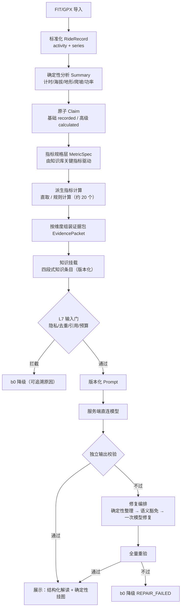
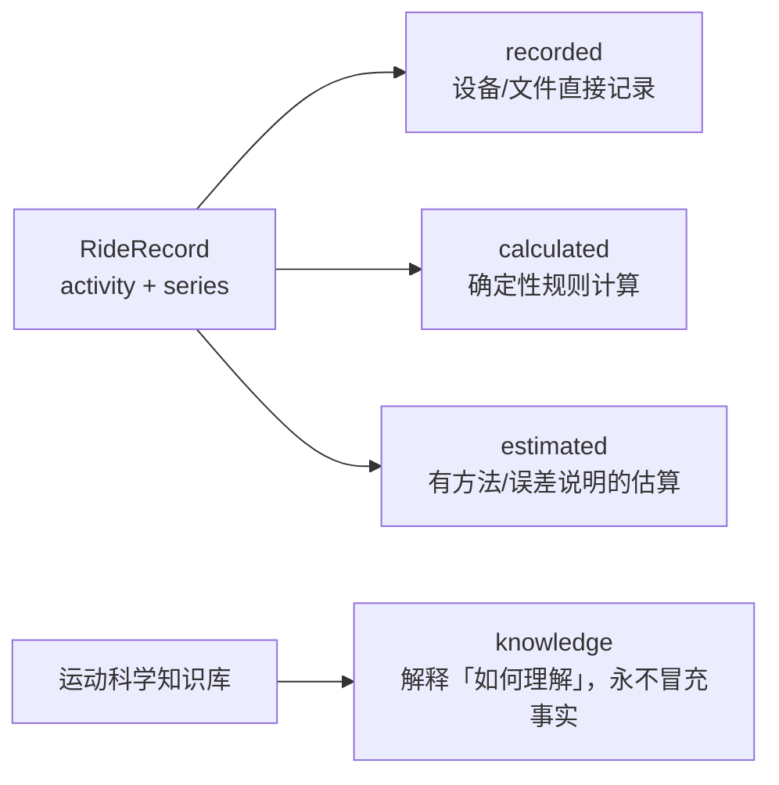
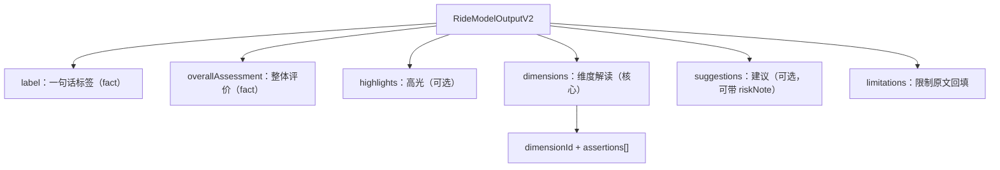
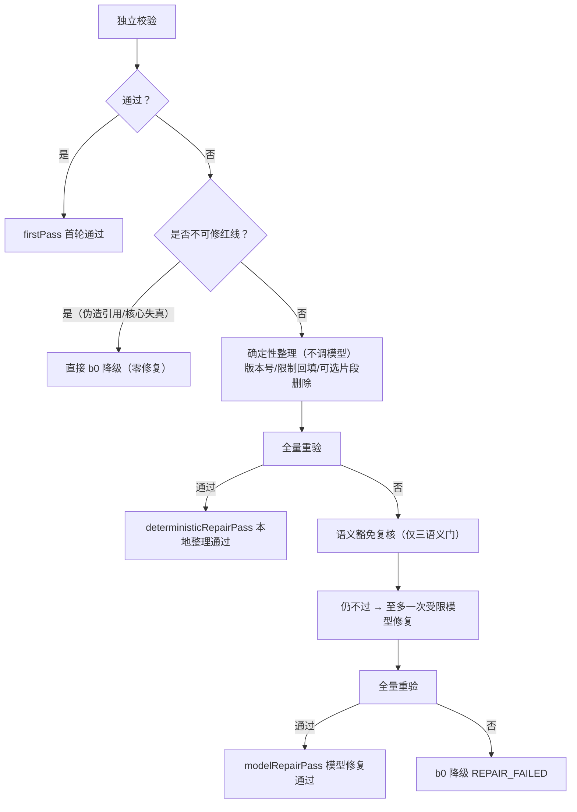

# AI 骑行解读产品设计文档

> 文档定位：从 0 设计「AI 骑行解读」这一功能的完整产品设计，以当前工程实现为准。  
> 视角：产品经理（业务规则 + 产品决策 + 质量与风险控制），不展开代码细节。  
> 原则：本文档是设计的「成稿」，不是重构记录——只回答「这个功能是什么、为什么这样设计、怎么保证它不出错」，不叙述版本演进过程。  
> 关联事实源：`src/ai/`（解读编排/校验/修复/模型调用）、`src/domain/`（证据/指标/知识库/输入投影）、`doc_V2.1/`（优化设计与测评方案）。

---

## 1. 背景与目标

### 1.1 产品是什么

用户骑行结束后，把设备记录的文件（FIT / GPX）导入应用，产品需要给用户一段「这次骑得怎么样」的 AI 解读。这段解读不是泛泛而谈的鸡汤，而是：

- **有据可查**：每一句话、每一个数字都能回到设备的记录或系统的确定性计算；
- **专业**：围绕运动科学认可的指标（变速指数 VI、功体比 W/kg、爬升速度 VAM、效率因子 EF、有氧解耦 Pw:Hr 等）组织洞察，而不是围着「平均功率、平均心率」这类平均数打转；
- **可行动**：给出能落到下一次训练的、有事实锚点的建议。

一句话定位：**让大模型在「确定性事实」的约束下，做它擅长的事——把数据翻译成人能听懂、能照着练的专业解读。**

### 1.2 要解决的核心问题：三个「翻车」风险

直接拿大模型解读骑行数据，有三类典型风险，是整个设计的出发点：

| 风险          | 典型表现                                              | 若不治理的后果               |
| ----------- | ------------------------------------------------- | --------------------- |
| **幻觉（编数字）** | 模型自己「算」出总时长减移动时长、把多个区间占比相加、凭空写一个坡度                | 用户信了一个不存在的数字，产品失去信任   |
| **越权下结论**   | 没有波动证据却说「输出稳定」；没有历史却说「进步了」；没有恢复证据却说「恢复良好」；把相关说成因果 | 把「数据能证明的」和「模型脑补的」混为一谈 |
| **数据不足硬凑**  | 缺功率却谈 IF/TSS、缺体重却算 W/kg、把缺失当 0、把通用知识伪装成个人结论       | 用户以为产品看到了自己没有的数据      |

这三类风险的共同根因是：**大模型擅长「组织语言」，但不可信于「算术」和「自我设限」。** 因此整个设计的核心思想是——

> **能确定性做的，绝不交给模型；交给模型的语言，必须能逐条被机器核对。**

### 1.3 产品目标（可验收）

1. **事实零污染**：用户看到的每个数字都能在设备记录或确定性规则里找到出处，模型算术错误 = 0；
2. **表达有边界**：无证据的「稳定/进步/恢复/完成计划/因果」结论 = 0；
3. **专业有增量**：解读围绕运动科学知识库的维度化指标与基准分级组织，讲出数据里真实的东西；
4. **永远有兜底**：模型出不来合格解读时，用户仍能看到确定性的事实降级文案，绝不看到半成品。

---

## 2. 核心设计原则

这八条原则是贯穿输入、输出、检验、降级所有环节的「宪法」，每一条都能在工程里找到落点。

| # | 原则                | 一句话含义                                | 关键落点                                                            |
| - | ----------------- | ------------------------------------ | --------------------------------------------------------------- |
| ① | **证据化**           | 先确认事实，再组织解释；「知识」永远不等于「本次骑行事实」        | Claim 的 provenance（recorded/calculated/estimated/knowledge）四层分离 |
| ② | **确定性优先**         | 一切可计算的派生值（区间、比值、合计）由代码算好喂给模型照抄，模型不自算 | 派生指标纯函数 + 区间合并份额预供给                                             |
| ③ | **独立校验**          | 模型输出不直接展示，逐条过本地确定性校验                 | `ride-output-validator-v2` 与模型完全解耦                              |
| ④ | **宁可误拦、不可漏拦**     | 误拦还有「修复/降级」两条退路，漏拦没有第二次机会            | 校验门的默认取向                                                        |
| ⑤ | **语义判断只能收紧、不能放行** | 不可复现的语义判断不得用来放行，只能用来额外收紧             | 语义豁免层的「只豁免、不新增拦截」                                               |
| ⑥ | **降级不污染事实**       | 模型失败只影响 AI 解读，详情页的确定性事实永不被覆盖或篡改      | b0 降级与事实层隔离                                                     |
| ⑦ | **全程可追溯、可回放**     | 输入、Prompt、输出、规则、知识库全部版本化，同一骑行可复现     | 版本栈（prompt/schema/kb/证据规则）                                      |
| ⑧ | **成本与质量分开计量**     | 修复、语义复核的模型调用单独计数，不与主解读混算             | FR-13「解读 ≤2 次调用」+ 语义校验独立计数                                      |

> 原则 ④ 与 ⑤ 是一对互补的「安全偏好」：机器能确定判定的地方从严（误拦可接受），机器判定不了的语义，宁可用确定性规则收紧，也不引入一个可能放行错误的软判断。

---

## 3. 整体工作流架构

一条骑行从文件到解读，走一&#x6761;**「确定性证据链 + 模型生成 + 独立校验 + 有条件修复」**&#x7684;流水线：



**四个关键分工**（这是理解全链路的心智模型）：

| 阶段          | 职责                           | 产出                   | 「不能做什么」       |
| ----------- | ---------------------------- | -------------------- | ------------- |
| **上下文/证据层** | 把原始数据转成可引用的原子事实 + 维度证据包 + 知识 | Claim、EvidencePacket | 不生成任何自然语言     |
| **输入层**     | 校验证据包合法、可授权、不超预算地进入模型        | 版本化模型输入              | 不删合格证据、不含追溯字段 |
| **生成层**     | 在约束内组织自然语言                   | 结构化输出 JSON           | 不自算、不越权、不编造   |
| **校验/修复层**  | 逐条核对输出、修表达、兜底                | 合格输出 或 b0            | 不修「事实」，只修「表达」 |

---

## 4. 输入的设计

### 4.1 从导入数据到「可引用事实」：四层 provenance

AI 看到的不是原始文件，也不是详情页字段的简单复制。系统先把数据**归一化为四类「事实」**，每一类都有明确的来源语义，且**严格分层、不得混淆**：



| 层            | 含义                              | 例子             | 关键约束              |
| ------------ | ------------------------------- | -------------- | ----------------- |
| `recorded`   | 设备或文件直接记录、通过质量门的值               | 距离、平均心率、设备 NP  | 不与其他口径无来源合并       |
| `calculated` | 标准化确定性公式算出的值，带 `formulaVersion` | VI、IF、TSS、区间分布 | 必须版本化、可复现         |
| `estimated`  | 有明确方法与误差说明的估算                   | 估算的最大心率基线      | 必须带来源与限制，不得说成实测   |
| `knowledge`  | 运动科学解释，只解释「如何理解」                | 基准分级、科学依据      | **永远不生成、不替代骑行事实** |

**进入事实层的共同门槛**：数值有限、单位合法、质量达标（`valid` 或明确 `estimated`）、有合法证据 ID、与当前分析问题有映射。**缺失不填 0、质量失败不伪装成「可能值」**——这一步直接堵死了「模型把没数据理解成零」的幻觉源。

### 4.2 原子 Claim：AI 可引用的最小事实单元

Claim 是「AI 能引用的一句话事实」的最小单元，**不是模型结论，也不是页面一行的别名**。每条 Claim 至少携带：

| 字段                                                | 作用                                       |
| ------------------------------------------------- | ---------------------------------------- |
| `claimId` / `key`                                 | 全局唯一标识 + 业务键（如 `power.mean`、`climb.vam`） |
| `value` / `unit` + `displayValue` / `displayUnit` | 数值 + 已换算好的展示值（速度已是 km/h、时长已是「X 小时 Y 分」）  |
| `provenance` + `formulaVersion`                   | 来源层 + 计算规则版本                             |
| `qualityStatus`                                   | valid / soft / unavailable               |
| `confidence`                                      | 事实可信度                                    |
| `supports` / `prohibits`                          | **能支撑什么结论 / 禁止支撑什么结论**（如 TSS 禁止支撑「恢复良好」） |

> `displayValue` 的设计是一个被低估的产品细节：模型不必自己换算单位、不必自己取整，直接照抄展示值即可，从源头消灭了一整类「单位换算错、取整错」的幻觉。

### 4.3 指标规格层 + 派生指标：让「算」彻底离开模型

这是设计里对「确定性优先」原则最硬的一次落地。运动科学解读需要的指标（VI、EF、VAM、爬坡 W/kg、负分割、功率曲线……）很多是**派生值**，如果让模型现场算，必然出错。于是：

- **指标规格层（MetricSpec）**：把知识库里每个「关键指标」沉淀为一条结构化规格——`metricId / 维度 / 来源（直取 or 计算）/ 依赖 / 公式 / 基准分级 / supports / prohibits`，共 **37 项**，覆盖 7 个维度。
- **派生指标纯函数**：约 **20 个**派生指标收敛到确定性纯函数模块，固定点列单测 + `formulaVersion` 版本化。**共享指标（VI、EF）只算一次，多维度引用**。

**两条铁律**：

1. **「能算的」预算成数值 Claim 让模型照抄，模型不自算**——这是对「跨 Claim 自算」幻觉的釜底抽薪（模型想写「Z5-Z7 合计 24%」？证据层已经预供给 `highIntensityCombined` 这个合并份额 Claim）。
2. **依赖不可得 → 不生成 Claim，进该维度 limitations**——绝不用 0 或估计值凑数。

### 4.4 证据包：每个维度一份「完整事实清单」

一个维度的解读依据，不是「第一条匹配到的 Claim」，而是该维度的**完整证据包（EvidencePacket）**：

- 该维度所有通过质量门的 Claim（基础 + 派生 + 过程事实）；
- 必需证据是否满足、不可用原因、禁止结论；
- 可引用的知识条目；
- 建议可用的证据锚点。

**区段观测按传感器归属分发**：巡航段心率归心率维度、地形段功率归功率维度……模型写作某维度时，只看该维度问题包内的 `claimIds` 清单，跨清单引用会被校验器直接拦截。

### 4.5 知识库：从「参考文本」升级为「规格 + 参照系 + 线索」

知识库被设计成**7 个维度 × 四段式**的结构化资产（`ride-kb-2.1.0`），四段的用途被刻意区分：

| 段      | 内容                            | 在链路中的角色                                   |
| ------ | ----------------------------- | ----------------------------------------- |
| ① 指标定义 | 关键指标 + 计算方法                   | 驱动 MetricSpec（**不进模型**，是计算规格不是「知识」）       |
| ② 基准分级 | 基准范围与分级表（VI 分级、FTP W/kg 分级……） | 知识正文的可引用部分，模型只能照转述、不能改数字                  |
| ③ 解读逻辑 | ✅ 良好信号 / ⚠️ 问题信号              | 结构化产出 `supports/prohibits`（硬门）+ 解读线索（软引导） |
| ④ 科学依据 | 每维度背后的原理                      | 知识正文主干，随行可引用                              |

**知识 ≠ 事实的硬边界**：知识永远只解释「如何理解」，不生成、不替代骑行事实；知识与事实冲突时，事实优先、解释降级；知识还显式声明 `forbiddenFactKeys`（不得冒充的骑行事实键）。

> 产品上还保留一个「知识输入开关」，可一键关闭知识附带（实测过「知识附带 → 模型 100% 转述成断言、无洞察增量」的失效模式），但防线不随开关关闭——模型若仍输出知识引用断言，照常拦截。

### 4.6 组装成上下文 + 输入门（L7）

证据包组装成模型输入时，经过一道**输入门（L7）**，四件事缺一不可：

1. **隐私旗标**：必须排除原始轨迹、精确坐标、文件名、未受信任自由文本——`findPrivateField` 递归检查，发现即 `PRIVATE_FIELD_PRESENT` 拦截；
2. **去重**：同一条 Claim 被多维度引用时，**顶层唯一序列化一次，问题包只引用 `claimId`**（实测一条骑行 107 条唯一 Claim 中 74 条被多包引用，去重后输入从 17.5 万字符降到 12 万字符）；
3. **引用解析**：每个问题包引用的 claimId/knowledgeId 必须在顶层清单可解析，否则 `PACKET_CLAIM_UNRESOLVED` 拦截；
4. **预算门**：默认 **160,000 字符**，且量的口径是「**模型可见投影**」——不含追溯字段。

**输入门的关键语义**：预算门是「必须覆盖的下限」不是「内容的上限」；超预算时**整体拦截并返回可追溯原因，绝不静默删 Claim**。

**模型可见投影（白名单制）**：真正喂给模型的，是完整输入的一个「瘦身投影」，只保留三层——

| 层             | 内容                                 | 为什么必须进模型         |
| ------------- | ---------------------------------- | ---------------- |
| ① KB 关键指标     | VI/EF/VAM/爬坡 W/kg/IF/TSS 等派生 Claim | 指标覆盖矩阵的准绳        |
| ② 前置基础事实      | 距离/时间/功率/心率/踏频/体重/FTP 等            | 派生指标的上游 + 数字绑定对象 |
| ③ 解读逻辑点名的过程事实 | 停歇、爬坡、心率区间分布、功率曲线各时长、前后段对比         | 知识库 ✅/⚠️ 信号直接引用  |

投影同时**剥离两类「不该给模型」的字段**：追溯字段（`sourceRefs/evidenceIds/formulaVersion` 等，由校验器从内存读，不进 prompt）；以及「缓存杀手」字段（`analysisRunId`、知识 `retrievedAt`），保证同一案例重复跑时 prompt 字节级稳定，命中供应商的上下文缓存。

### 4.7 Prompt 设计

Prompt 是「表达层的合同」，只负责四件事：**表达目标、输出结构、引用方式、禁止事项**。它**不以提示词代替确定性证据门**。

结构要点：

- **硬性禁止事项 11 条**：不编造/改写数字、每个数字绑承载它的 Claim、不跨 Claim 自算、不单值占比自算、知识不作个人事实、无波动不说「稳定」、无历史不说「进步」、禁因果、禁「完成计划」、禁「恢复良好」、soft 质量必须披露……
- **few-shot 合规示例 + 常见违规反例**：给模型一个正确的引用示范，和一组「会被拒绝的写法」负面清单（坡度漏绑、时长漏绑、计数漏绑、爬坡计数混口径、占比自算……）；
- **表达内容建议（非硬性模板）**：围绕「事实 → 骑得怎么样 → 意味着什么」组织，证据只够支撑事实时就只陈述事实，不硬凑评价；
- **知识解读线索**：把知识库的 good/bad 信号作为「解读方向提示」，但每条结论仍必须绑事实 Claim。

---

## 5. 输出的设计

### 5.1 输出契约（结构化申报）

模型只输出**一个 JSON 对象**（`ride-output-v2.2.0`），结构围绕用户可见的解读组织：



**核心设计：断言对象**——每个可检验的句子都是同构的：

```json
{ "text": "中文解读文本", "conclusionType": "fact", "claimIds": ["..."], "knowledgeIds": ["..."] }
```

`claimIds` 是**结构化引用**，它是「校验的输入」，不是「自动通过的证明」——文本里的每个数字、每个定性断言，都必须和申报的引用逐项对得上。

### 5.2 五种结论类型

结论类型是「这句话在断言什么」的声明，让校验器知道该用什么规则核对它：

| 类型                   | 含义                 | 硬性要求                               |
| -------------------- | ------------------ | ---------------------------------- |
| `fact`               | 陈述事实               | 必须引 Claim；文本每个数字须有来源               |
| `interpretation`     | 「骑得怎么样、意味着什么」的定性解读 | 须引本维度 Claim，数字仍须来自所引 Claim         |
| `knowledgeReference` | 转述知识（口径/方法）        | 必须带 `knowledgeIds`，不得写个人事实数字       |
| `suggestion`         | 给建议                | 须绑事实锚点 Claim，可带 `riskNote`         |
| `historyComparison`  | 历史对比               | **已废弃**：单次解读无历史数据，枚举保留只为让校验器拒绝任何使用 |

> `interpretation` 类型的引入是一个关键产品决策：它补齐了「fact（摆事实）」和「suggestion（给建议）」之间的评价层，让解读不退化成一堆事实的罗列；同时它对表达门「先松」、对数字门和因果门「照守」，是「先松表达、死守数字」的阶段性策略。

### 5.3 展示层：AI 解读与确定性事实解耦

- **图表引用是确定性的**：各维度解读下方自动挂载对应的传感器曲线（配速→速度、爬坡→海拔、心率→心率……），由服务端按维度固定映射，**模型无权声明图表引用**；
- **知识以角标呈现**：解读正文里知识转述以序号角标随句标注，页面底部列引用明细，出处可追溯到具体条目；
- **降级文案独立**：模型失败时，展示层回到确定性事实，与 AI 解读完全解耦。

---

## 6. 模型选型

模型是「可替换的生成引擎」，选型与产品规则严格解耦：

| 决策项         | 选择                                          | 理由                                    |
| ----------- | ------------------------------------------- | ------------------------------------- |
| **供应商/模型**  | SiliconFlow `deepseek-ai/DeepSeek-V4-Flash` | 首个评测渠道，不预设唯一                          |
| **采样参数**    | `temperature=0.3`、**关闭思考链**                 | 结构化输出需要确定性；思考链实测 50% 调用卡满 300s 超时，不可用 |
| **调用方式**    | 服务端直连模型 API，不经 Coze Workflow                | 密钥只在服务端，输入/输出完全可控可追溯                  |
| **超时**      | 默认 25s，上限 300s                              | 长骑行结构化输出需要时间，但不无限等                    |
| **JSON 模式** | `response_format=json_object`               | 仍不跳过本地校验——供应商声明 JSON 合格不等于通过本地校验      |
| **语义校验模型**  | 可选小模型（GLM-4-9B / GLM-5.3-Flash），参数瘦身        | 校验是二分类，不需主模型重型配置                      |

**两条选型原则**：

1. **切换渠道不改规则**：证据、Prompt、校验、安全规则与供应商无关，换模型只换「生成引擎」；
2. **供应商错误 ≠ 可修复输出**：超时、限流、鉴权失败、响应异常一律按降级合同处理，**不进入「修复」路径**（修复只针对「模型表达错」，不针对「供应商挂掉」）。

---

## 7. 输出检验设计

### 7.1 三条原则

模型生成的解读**不可直接展示**——用户看到的每句话，要么通过本地独立校验，要么被降级兜底替代，不存在中间态。

1. **结构化申报 + 确定性核对**：模型申报结论类型与证据引用，校验器只核对「申报 vs 文本」是否一致，不做语义理解——可复现、可审计；
2. **宁可误拦、不可漏拦**：误拦有「修复/降级」退路，漏拦没有第二次机会；
3. **语义判断只能收紧、不能放行**：不确定的语义判断宁可收紧，不靠临时放开规则解决误拦。

### 7.2 检验门全景（28 个错误码）

校验针对**实际交付给模型的输入快照**逐项核对，门分两大类：

**A 类 · 确定性门（集合运算，零歧义，永不进语义复核）**

| 门     | 检查什么                                                                        | 示例错误码                                                     |
| ----- | --------------------------------------------------------------------------- | --------------------------------------------------------- |
| 结构门   | JSON 结构、schema 版本、必填字段、维度归属                                                 | `FIELD_MISSING`、`DIMENSION_NOT_IN_INPUT`                  |
| 引用闭合门 | claimId/knowledgeId 是否在输入清单、是否在本维度清单内                                       | `CLAIM_NOT_IN_DIMENSION`、`KNOWLEDGE_NOT_IN_INPUT`         |
| 结论类型门 | fact 空 claimIds、interpretation 空 claimIds、knowledgeReference 空 knowledgeIds | `FACT_WITHOUT_CLAIM`                                      |
| 数字命中门 | 文本每个数字是否在所引 Claim 的数值等价类内                                                   | `NUMBER_NOT_IN_CLAIMS`                                    |
| 限制回填门 | 限制只能原文回填、不得编造、必须逐条回填                                                        | `LIMITATION_NOT_FROM_INPUT`、`LIMITATION_BACKFILL_MISSING` |


**B 类 · 语义门（词级正则，有误拦/漏拦风险，是「语义豁免」的改造对象）**

| 门 | 拦什么 | 正则 | 主要风险 |
| --- | --- | --- | --- |
| 稳定性门 | 无波动证据说「稳定/平稳」 | `稳定/平稳/保持良好` | 误拦「稳定踏频」「稳定区间」等区间名 |
| 历史门 | 无历史说「进步/退步/相比之前」 | `进步/退步/相比之前/长期负荷` | 漏「提升/改善」 |
| 计划门 | 无计划说「完成计划/达成目标」 | `完成了计划/达成目标` | 漏「达标/按课表」 |
| 因果门 | 「导致/造成/引发」 | 全局生效 | 误拦「脱水导致血容量下降」类知识转述 |
| 恢复门 | 无 TSB≥+5 证据说「恢复良好」 | `恢复良好/已恢复/恢复完成` | 漏「状态回暖」 |
| soft 披露门 | 数据 soft/partial 却不披露 | `部分/缺失/有限` | 漏「采集不全」类措辞 |

### 7.3 数字命中门的「等价类」：拦住编造，又不错杀忠实

数字门是最核心的幻觉防线，它的精细之处在于：**允许「忠实表达」的确定性变换，拦截「不可验证」的算术**。

| 情形 | 判定 | 理由 |
| --- | --- | --- |
| 四舍五入（0/1/2 位） | ✅ 合法 | IF 0.99 写「接近 1.0」是确定性单值变换 |
| 负值绝对值 | ✅ 合法 | 前后段差 -31.5W 写成「下降 31.5W」 |
| 知识正文范围取值 | ✅ 合法 | 正文写「2–5%」，写「约 3%」是忠实转述 |
| 单位换算/展示值 | ✅ 合法 | 直接照抄 `displayValue` |
| **跨 Claim 自算** | ❌ 拦截 | 「Z5-Z7 合计 24%」由三区间相加，组合不可验证、模型算术不可靠 |
| **单值占比自算** | ❌ 拦截 | 只有距离值却写「平路占比接近 100%」 |
| 正文外数字 | ❌ 拦截 | 正文只写「2–5%」却写「7%」 |

结构性剥离：区间代号（Z1-Z7）、爬坡等级、分段序号、次数/频次表达（「每 15 分钟」）不作为数据值参与核对，避免把「结构词」误当「数据」。

### 7.4 修复与兜底编排（五结局）

校验失败的输出，按「错误类型」严格分诊，**整个修复过程只能修「表达」，绝不碰「事实」**：



**五结局**（用于审计与评测）：

| 结局 | 含义 | 调用次数 |
| --- | --- | --- |
| `firstPass` | 首轮即通过 | 1 |
| `deterministicRepairPass` | 本地整理后通过 | 1 |
| `modelRepairPass` | 一次受限修复后通过 | 2 |
| `repairFailed` | 修复后仍不过，降级 | ≤2 |
| `providerError` | 供应商挂掉，直接降级 | 0（不重试） |

**不可修红线**（不靠反复修复碰运气）：伪造/缺失关键证据、隐私泄露、医疗/高风险建议、核心结论失真、反复同类事实性错误——这些**零修复直接降级**。只有「可定位的非高风险表达错误」才有一次模型修复机会，且**禁止第三次模型调用**。

### 7.5 语义豁免：两层校验（正则硬门 + 大模型复核）

词级正则判语义会「误伤」——模型说了一句并非违规的话，却撞上关键词被拦。为此把三个语义门升级为**两层**：

- **第一层（正则快速硬门）**：毫秒级、零成本，命中关键词只「标记疑似」，确定性门仍直接判定；
- **第二层（大模型语义豁免）**：仅对「疑似命中」的少数断言，用便宜小模型（`maxOutputTokens=128`、`timeout=10s`）精判「这句到底违不违规」，输出 `{"exempt":true|false}` 二分类。

**三条关键约束**：

1. **只豁免、不新增拦截**——不注入语义校验器时，行为与纯正则完全一致（零回归）；
2. **fail-closed**——小模型 404/超时/不可解析，保守保留正则 issue，不误放行；
3. **成本独立**——语义校验与「解读 ≤2 次调用」分开计数，且只用便宜小模型。

---

## 8. 测评方案设计

测评回答三个问题：**① 事实质量达不达标；② 偶发失败率多高、要不要处理；③ 改完有没有真的变好。** 结论用于「是否放量」，不复用旧结论。

### 8.1 测评体系三件套

| 手段 | 测什么 | 性质 |
| --- | --- | --- |
| **样例集冻结** | 固定样例跨 Run 可比 | 入 git 后不改 |
| **反例集（自动回归）** | 防线漏不漏（已知违规必须 100% 被拦截） | 长期运行，漏拦 = 0 |
| **双人盲评** | 人工评四项质量指标 | 不标来源 |

### 8.2 样例集

分层选样，覆盖真实边界（而非只挑「好看」的）：

- **常规样例**：短骑行、长骑行（6.6h、15 段爬坡）、通勤、无功率、踏频覆盖 0.7 边界……
- **预期拦截/降级样例**：停表超 10%（该拦就拦）、未配密钥（对照 B0 基线）——只验证行为正确，不评解读质量。

### 8.3 四项盲评指标（1–7 分）

| 指标 | 评什么 | 发布门 |
| --- | --- | --- |
| **事实忠实度** | 每个数字/断言能否找到出处 | **硬门问题 = 0**；均分 ≥ 确定性基线 |
| **不确定性表达** | 该说「估算/数据有限」时是否说了 | 无「无证据确定断言」 |
| **洞察价值** | 是否讲出数据里真实的东西 | 均分 ≥ 4 |
| **行动性** | 建议是否可执行、有证据支撑 | 均分 ≥ 4；「建议无依据」计 0 |

V2.1 新增观测：**派生指标采纳率**（喂的指标有没有真被用）、**知识引用健康度**（knowledgeReference 占比与数字命中分布）、**interpretation 越界率**（定性解读里无证据表述的占比）。

### 8.4 失败率量化（偶发失败）

同输入重复多次调用，统计**最终降级率**（核心指标）与首轮通过率、修复通过率的「吸收结构」：

- 方法：N 条样例 × 每条 5 次真实调用，走完整生产链；
- 三档阈值：**≤5% 放行；5–15% 定方案；>15% 停下归因再动**；
- 归因留痕：每次调用落盘首轮输出原文、issue 全文、编排 steps、调用记录（延迟/token），供「继续打地鼠 vs 换供给方式」的决策。

### 8.5 发布门（对照放量）

全部达标才放量：**事实硬门问题 = 0；四类零容忍断言（稳定/提升/恢复/计划）= 0；事实忠实度 ≥ 确定性基线；允许修复时总调用 ≤ 2 次、不可修直接降级零修复。**

---

## 附录 A：关键设计决策清单

> 按主题归类的关键决策（编号为工程决策 ID，便于追溯）。每条都体现「为什么要拍这个板」。

### A.1 幻觉治理

| 决策 | 内容 | 编号 |
| --- | --- | --- |
| 跨 Claim 自算一律拦截 | 组合不可验证、模型算术不可靠；高频合并需求改由证据层预供给派生 Claim | PD-AI-28/29 |
| 单值占比自算禁止 | 只给距离值不得写「占比接近 100%」 | PD-AI-33 |
| 数字绑定强化 | 文本每个数字必须绑承载它的 Claim，漏绑即拒 | PD-AI-32 |
| 四舍五入等价 | 0/1/2 位四舍五入属合法忠实表达 | PD-AI-28 |
| 知识范围数字合法 | 知识正文「2–5%」写「约 3%」不算编造 | V21 范围语义修复 |
| 爬坡计数混口径点明 | 两套爬坡计数（事件识别 vs 地形分段）不得混绑 | V21-15 P0-B |

### A.2 输出稳定性 / 质量

| 决策 | 内容 | 编号 |
| --- | --- | --- |
| 关闭思考链 | 思考模式 50% 卡满 300s，质量收益不值 | PD-AI-23 |
| temperature 0.3 | 结构化输出求确定性 | PD-AI-23 |
| interpretation 类型 | 补「事实→评价→建议」之间的评价层，避免退化摆事实 | PD-AI-27 |
| 先松表达门、守数字+因果门 | interpretation 内表达门先豁免，越界占比作为观测指标 | PD-AI-27 |
| few-shot + 违规反例 | 用示例与负面清单降频违规 | PD-AI-29 |
| 语义豁免两层校验 | 正则硬门 + 大模型复核，消除「稳定踏频」类误拦 | V21-13/14 |
| 空维度确定性删除 | 数据缺失维度整体省略，不产出空 assertions | V21-15 P1 |

### A.3 成本控制

| 决策 | 内容 | 编号 |
| --- | --- | --- |
| 输入去重 | 顶层唯一序列化 + 问题包引用，实测 17.5 万→12 万字符 | PD-AI-21 |
| 固定窗口关系证据一律聚合 | 每传感器对 1 汇总 + 3 代表窗口，杜绝逐条爆炸 | PD-AI-16/19 |
| 段级跨传感器配对不产出 | 长骑行超预算 3.3 倍，只留全局配合总结 | PD-AI-19 |
| 输入压缩（剥离追溯字段） | 模型只吃推理所需内容 | PD-AI-24 |
| 剥离缓存杀手字段 | 同案例 prompt 字节级稳定，命中供应商上下文缓存 | PD-AI-24 |
| 预算口径改模型可见投影 | 追溯字段不进模型、不耗预算，避免误拦 | PD-AI-31 |
| 语义校验用小模型+参数瘦身 | 校验二分类不需主模型重型配置，独立计数 | V21-13 |
| 解读 ≤2 次调用 | 首轮 + 至多一次修复，禁第三次 | FR-13 |

### A.4 模型能力边界

| 决策 | 内容 | 编号 |
| --- | --- | --- |
| 能确定性做的绝不交给模型 | 派生指标、区间、合计全部预算好喂模型照抄 | 设计原则② |
| 供应商错误不重试 | 超时/限流/鉴权失败直接降级，不混入修复路径 | FR-11 |
| 思考链实验否决 | 保留为实验项，实测否决 | PD-AI-23 |
| 供应商不预设唯一 | 切换渠道不改证据/Prompt/校验/安全规则 | 业务规则 14.3 |

### A.5 知识库使用

| 决策 | 内容 | 编号 |
| --- | --- | --- |
| 知识 ≠ 事实硬边界 | 四层 provenance，知识永不生成骑行事实 | 业务规则 11.3 |
| 按维度规则挂载，不用 RAG | 首批条目少、引用合同必须完整随行，不被检索裁剪 | KB-01 |
| 知识软关开关 | 实测知识 100% 被转述无增量，可一键关闭；防线不随开关关 | PD-AI-25 |
| 四段式知识库 | 指标定义不进模型、基准分级+科学依据要点化、解读逻辑结构化 | V21 ADR-03/04 |
| 冲突处理 | 知识与事实冲突，事实优先、解释降级，版本升级 | 业务规则 11.3 |

### A.6 兜底设计

| 决策 | 内容 | 编号 |
| --- | --- | --- |
| 不可修红线零修复降级 | 伪造引用/核心失真不靠反复修复碰运气 | 业务规则 14.6.4 |
| 降级不污染事实 | b0 只影响 AI 解读，详情页确定性事实永不被覆盖 | 原则⑥ |
| 确定性整理不调模型 | 版本号/限制回填/可选片段删除先走确定性 | 业务规则 14.6.2 |
| 输入门失败阻塞调用 | 隐私/去重/引用/预算任一失败，返回可追溯 b0，不静默删 | L7 |
| 心率恢复无数据进 limitation | 不新开开关，缺数据就明说缺 | ADR-V2.1-07 |
| FTP 有效期纳入能力依赖 | 明显过期降级为估算语义或关能力 | ADR-V2.1-06 |

### A.7 测评设计

| 决策 | 内容 | 编号 |
| --- | --- | --- |
| 失败率三档阈值 | ≤5% / 5–15% / >15% | EVAL-01 |
| 样例集含「预期拦截/降级」样例 | 验证「该拦就拦」，不只挑好看样例 | EVAL-01 |
| 反例集长期运行、漏拦=0 | 已知违规 6 类 + 派生数字自算反例 | EVAL-01/V21-10 |
| 新旧结论不混用 | 任一版本栈变化即开新 Run，不续跑、不跨 Run 混用 | EVAL 留痕规则 |
| 新旧口径不背书 | V2.1 正式盲评必须在 V2 发布门评测之后开新 Run | V21-12 |

### A.8 用户体验

| 决策 | 内容 | 编号 |
| --- | --- | --- |
| 数据不足明说、不硬凑 | 缺数据维度省略+limitation 原文回填，不编替代值 | Prompt v2.8.3 |
| soft 质量必须披露 | question 标 soft/partial 时维度文本须说明「部分数据缺失」 | PD-AI-33 |
| 图表确定性挂载 | 模型无权声明图表，服务端按维度固定映射 | 业务规则 2.4 |
| 知识角标可追溯 | 解读正文角标 + 底部引用明细，出处可查 | KB-01 |
| 建议强度与证据强度一致 | 无依据就省略可选内容，不硬凑建议 | 业务规则 2.4 |
| 不解释「缺失了什么」 | 数据缺失只进 limitations，不进断言文本（避免翻译成散文触发历史门） | PD-AI-21 |

---

## 附录 B：AI 产品经理能力决策图谱

> 按「AI 产品经理」最核心的八大能力维度，把散落的设计决策重新收敛成一张「能力 → 设计动作 → 价值」的图谱。

### B.1 幻觉治理

**核心洞察：大模型会「自信地编」，所以要「让它没得编、编了能抓到」。**

- 没得编：派生值、区间、合计全部预算好（证据层供给），模型只能照抄，不能自算；
- 编了能抓到：数字命中门用「数值等价类」逐个数核对，合法变换放行、非法算术拦截；
- 编了能兜底：误拦进修复/降级，漏拦是唯一不可接受的失败。

### B.2 成本控制

**核心洞察：成本 = 输入体积 × 调用次数 × 单次 token，三处都要抠。**

- 输入体积：去重 + 聚合 + 投影白名单 + 剥离缓存杀手（还顺带赚了缓存命中）；
- 调用次数：确定性整理不调模型、语义校验用小模型独立计数、解读硬顶 2 次；
- 单次 token：知识正文要点化、指标定义不进模型、追溯字段不进 prompt。

### B.3 输出稳定性 / 质量

**核心洞察：质量不稳定 = 偶发失败 + 表达退化，两者分开治。**

- 偶发失败：用「失败率量化」把二值通过变成可观测的失败率，逐轮归因打地鼠；
- 表达退化：interpretation 类型 + 表达内容建议 + few-shot，把「摆事实」拉回「讲洞察」。

### B.4 模型能力边界

**核心洞察：清楚模型「擅长什么、不擅长什么」，把不擅长的关进笼子。**

- 擅长组织语言 → 让它组织语言；
- 不擅长算术 → 算术全部移出模型；
- 不擅长自我设限 → 用独立校验器强制设限；
- 不可靠的思考链 → 关掉，用确定性换质量。

### B.5 知识库使用

**核心洞察：知识是「参照系」不是「事实」，要结构化地给，还要防「喂了没用」。**

- 四段式区分「计算规格 / 可引用正文 / 硬门 / 软引导」四种用途；
- 知识软关开关：实测「喂了没用」时能一键关，用数据决定知识层去留。

### B.6 兜底

**核心洞察：永远给用户一个「至少是对的」的结果，宁可不智能、不能出错。**

- 分层兜底：确定性整理 → 语义豁免 → 一次修复 → b0 降级，每层都不碰事实；
- 不可修红线：伪造引用/核心失真直接降级，不靠碰运气；
- 降级与事实解耦：模型挂了，用户仍能看到确定性事实。

### B.7 测评

**核心洞察：AI 产品不能「感觉挺好」，要可量化、可复现、可对照。**

- 样例集冻结保证跨 Run 可比；反例集保证防线不漏；双人盲评保证质量有标尺；
- 失败率三档阈值把「要不要处理」变成数据决策；
- 版本栈留痕保证「任何改动都开新 Run，不混用结论」。

### B.8 用户体验

**核心洞察：AI 的「能力」要翻译成「可被信任」的体验。**

- 有据可查（每个数字有出处）→ 用户敢信；
- 数据不足明说（不硬凑、不编 0）→ 用户不失望；
- 图表确定性挂载 + 知识角标 → 专业感不靠模型「表演」；
- 建议强度与证据一致 → 建议可执行、不空谈。

---

*本文档是「AI 骑行解读」的产品设计成稿；工程实现细节、版本号与执行事实以源码 `src/ai/`、`src/domain/` 及《VIBE_CODING 开发规划》《开发进度》为准。*
