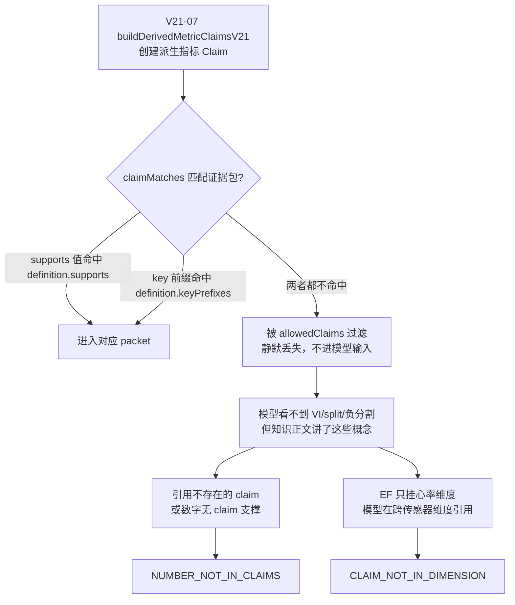

# RIDE-AI-V21 · 派生指标丢失与跨维度引用根因分析

> 日期：2026-10-08 · 分支 `codex/m6-m4-optimization` · 关联：V21-07 派生指标接线 / V21-10 校验器收口
> 结论先行：**不是模型输出不稳定，是 V21-07 接线时派生指标的 supports/key 与证据包定义（`PACKET_DEFINITIONS`）没对齐，导致 VI / 前后半功率差 / 负分割三个派生指标创建后进不了任何证据包、被静默丢弃；EF 只挂心率维度、跨传感器维度引用不到。** 属确定性 bug，已修复。

## 1. 现象（三个真实报错）

| 骑行 | 现象 |
|---|---|
| `demo-ride-2026-07-22` | `REPAIR_FAILED`，`failureCodes: [CLAIM_NOT_IN_DIMENSION, NUMBER_NOT_IN_CLAIMS]` |
| `demo-ride-2026-08-20` | 基本每次都要经过一次模型修复（首轮失败 → 修复轮通过） |
| `upload-0312e501-…` | `REPAIR_FAILED`，`failureCodes: [CLAIM_NOT_IN_DIMENSION, NUMBER_NOT_IN_CLAIMS]` |

## 2. 根因总览



## 3. 根因一：派生指标 Claim 被静默丢弃（确定性 bug）

### 3.1 机制

证据包组装 `ride-analysis-evidence-packets-v2.ts` 用 `claimMatches` 决定每个 Claim 进哪个 packet，**两个条件任一命中即进入**：

```ts
function claimMatches(claim, definition) {
  return claim.supports.some((s) => definition.supports.includes(s))   // 条件①：supports 命中
    || definition.keyPrefixes.some((p) => claim.key.startsWith(p));     // 条件②：key 前缀命中
}
```

`buildDerivedMetricClaimsV21` 给派生指标起的 supports 值和 key，与 `PACKET_DEFINITIONS` 的 supports / keyPrefixes **不对齐**：

| 派生指标 | key | supports | 条件① | 条件② | 结果 |
|---|---|---|---|---|---|
| VI 变速系数 | `pacing.variabilityIndex` | `power_variability` | ✗（无 definition 含） | ✗（无 `pacing.` 前缀） | **丢失** |
| 前后半功率差 | `pacing.splitDifference` | `pacing_split` | ✗ | ✗ | **丢失** |
| 负分割 | `pacing.negativeSplit` | `pacing_negative_split` 等 | ✗ | ✗ | **丢失** |
| 停歇占比 | `pacing.stoppedTimeShare` | `stop_observation` | ✓（pacingExecution 有） | — | 进 pacingExecution ✓ |
| 功率曲线 | `power.curve.5s/…` | `power_curve` | ✗ | ✓（`power.` 前缀） | 进 powerOutput ✓ |
| EF 效率因子 | `heartRate.efficiencyFactor` | `aerobic_efficiency` | ✗ | ✓（`heartRate.` 前缀） | 只进 heartRateLoad |

### 3.2 实证（`demo-ride-2026-07-22`，功率完整）

```
=== snapshot（过滤前）派生指标 ===
CREATED | pacing.variabilityIndex | supports=[power_variability]
CREATED | pacing.stoppedTimeShare  | supports=[stop_observation]
CREATED | pacing.splitDifference   | supports=[pacing_split]
CREATED | pacing.negativeSplit     | supports=[pacing_negative_split]
not-created | heartRate.efficiencyFactor   （该骑行 heartRate: SERIES_MISSING）
CREATED | power.curve.5s           | supports=[power_curve]

=== allowedClaims（过滤后，进模型输入）===
LOST | pacing.variabilityIndex   ← 创建了却进不了任何 packet
LOST | pacing.splitDifference
LOST | pacing.negativeSplit
IN   | pacing.stoppedTimeShare → pacingExecution
IN   | power.curve.5s → powerOutput
```

**结论**：VI / 前后半功率差 / 负分割三个派生指标被 `allowedClaims` 过滤（`packetClaimIds` 不含它们），**模型根本看不到**。但知识正文（`kb-v21-pacingExecution`）明确写了「变速系数 VI 分级」「负分割 2–5%」——模型被引导去解读一个输入里不存在的指标，只能靠编数字或借别的 Claim 硬凑，触发 `NUMBER_NOT_IN_CLAIMS`。

## 4. 根因二：共享指标 EF 维度归属不全

EF 是设计文档明确的**共享指标**（心率负荷 + 跨传感器配合两个维度都讲）。但证据包里 EF 只通过 `heartRate.` key 前缀进了 `heartRateLoad`，`crossSensorCoordination` 的 supports 里没有 `aerobic_efficiency`，于是：

- 知识库 `kb-v21-crossSensorCoordination` 正文写了「效率因子 EF = NP / 平均心率」；
- 模型在 **crossSensorCoordination 维度**想引用 EF Claim；
- 校验器判定 EF 属于 `heartRateLoad`、不属于 `crossSensorCoordination` → **`CLAIM_NOT_IN_DIMENSION`**。

同理 VI 是配速 + 功率的共享指标，之前只该进两个维度却一个都没进（见根因一）。

## 5. 为什么 demo-08-20 表现为"需要一次修复"

`demo-ride-2026-08-20` 的 `power: SERIES_MISSING`（功率序列缺失），所以依赖功率的派生指标**全部正确进 limitation**（`NP_OR_POWER_MISSING` / `INSUFFICIENT_POWER_SAMPLES`），并非丢失 bug。它的"首轮失败"来自另一条链：

1. 历史遗留 `SOFT_QUALITY_NOT_DISCLOSED`（sensorContinuity partial → packet 级 soft，Prompt 未引导披露）——已在 Prompt v2.7.3 修复；
2. 知识正文基准分级范围数字的精确匹配（"2–5%" 拆成边界点）——已在 `extractNumberRanges` 范围语义修复；
3. 模型输出本身的偶发不稳定（低温 0.3 下仍可能首轮不过、修复轮过）。

三者叠加使 demo-08-20 长期呈现"基本都要过一次修复"，但**它不触发硬降级**（修复轮能过）。

## 6. 修复

`ride-analysis-evidence-packets-v2.ts` 的 `PACKET_DEFINITIONS` 补齐派生指标的归属口径：

| 改动 | 内容 | 作用 |
|---|---|---|
| `pacingExecution.keyPrefixes` | 追加 `"pacing."` | VI / split 差 / 负分割进入配速维度 |
| `powerOutput.supports` | 追加 `"power_variability"` | VI 作为共享指标也进功率维度 |
| `crossSensorCoordination.supports` | 追加 `"aerobic_efficiency"` | EF 作为共享指标也进跨传感器维度 |

修复后维度归属（实证）：

```
demo-ride-2026-07-22（功率完整）：
  VI            -> [pacingExecution, powerOutput]   （共享 ✓）
  停歇占比      -> [pacingExecution]
  split 差      -> [pacingExecution]
  负分割        -> [pacingExecution]
  功率曲线      -> [powerOutput, intensityAndTrainingLoad]

demo-ride-2026-08-20（功率缺失）：
  派生指标正确进 limitation（not-created 是预期，非丢失）
```

## 7. 验证

- 新增回归测试 `tests/ride-analysis-evidence-packets-v2.test.ts`：构造功率样本 ≥60s 的记录，断言 VI 进 `pacingExecution` + `powerOutput`、EF 进 `heartRateLoad` + `crossSensorCoordination`、split/负分割进 `pacingExecution`、功率曲线进 `powerOutput`。
- 证据包定向测试 8/8；`tsc --noEmit` 通过；全量测试见提交记录。

## 8. 遗留与建议

1. **`NUMBER_NOT_IN_CLAIMS` 是派生指标丢失的"症状"，不是独立根因**——本次修的是上游"指标该进模型却没进"，而不是继续放宽数字门。数字门的范围语义修复（`extractNumberRanges`）属另一个独立缺陷，两条都已收口。
2. **真实模型复测仍建议做一次**：静态分析 + 离线 dump 已锁定确定性根因，但 demo 效果的最终确认需要真实模型跑通（需 API key，此前余额 402 中断）。
3. **接线自检教训**：给 `buildDerivedMetricClaimsV21` 增加一条"派生指标 supports/key 必须能被 `claimMatches` 命中"的契约校验，可防同类回归——可作为 V21-11 评测前的加固项。

---

## 9. 实测补充（第二轮，2026-10-08 真实模型跑通后）

静态修复后跑真实模型（`scripts/diagnose-v21-number-not-in-claims.ts`，deepseek-ai/DeepSeek-V4-Flash），首轮 issue 从 **9 → 3**，又定位出三个独立根因并修复：

| # | 根因 | 修复 |
|---|---|---|
| 9.1 连字符范围假负号 | 模型把知识正文的 en-dash 范围转成 hyphen（"0.96–1.05" → "0.96-1.05"、"85–95" → "85-95"），`extractNumbers` 的 `-?\d+` 把 "-1.05"、"-95" 误判为负数 → 假 `NUMBER_NOT_IN_CLAIMS` | `extractNumbers` 先剥离 `numberRangePattern`，范围数字只由 `extractNumberRanges` 做区间匹配 |
| 9.2 功率曲线时长标签 | 模型写"5 秒峰值 588 瓦、60 秒 403 瓦…"，时长 5/60/300/1200/3600 是 claim key（`power.curve.5s`）的一部分，但 claim 的 value 是功率，数字门把时长当数据值拦截 | `power.curve.*` claim 增加 `text`（"5s 滑动窗口最大平均功率"），`claimAllowsNumber` 从 text 提取时长放行 |
| 9.3 W/kg 跨维度 | 模型在 climbPerformance 引用 `power.averageWkg`（W/kg），但 W/kg 只属 powerOutput + intensityAndTrainingLoad，知识库爬坡条目却讲"爬坡由 W/kg 主导" → `CLAIM_NOT_IN_DIMENSION` | `climbPerformance.supports` 加 `relative_power_output`（W/kg 共享进爬坡维度） |

**修复后剩 3 个 issue，均为模型输出质量问题（非数字门 bug，走模型修复轮、不硬降级）**：

1. `NUMBER_NOT_IN_CLAIMS`（151、1.31）：模型在 `knowledgeReference` 里写"标准化功率 197W 与平均功率 151W 差异大（VI 1.31）"，却只引了 `power.normalizedW`——把**本次骑行事实数字**（151、VI 1.31）混进"知识转述"断言、没绑定对应 claim。根治靠 Prompt 引导（"knowledgeReference 只转述知识正文，不得写本次事实数字；事实数字须 fact 断言 + 绑定 claim"）。
2. `FACT_WITHOUT_CLAIM`（crossSensorCoordination）：该骑行无心率数据，模型写了 `fact` 断言"缺乏心率数据"但 claimIds 为空。靠 Prompt 引导（"数据缺失维度用 interpretation / knowledgeReference，或引用已有 claim 说明缺失"）。

结论：**确定性 bug 已全部清零；剩余失败是模型低温 0.3 下的引用不完整，属修复轮可收敛的正常范围**。若要进一步压首轮失败率，可选做 Prompt 引导强化（两条，见上）。

