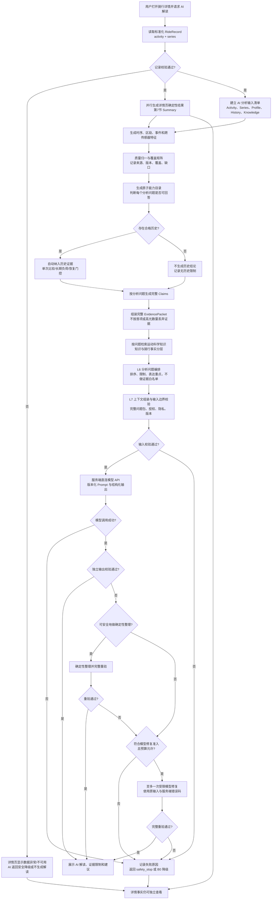

# AI 解读证据体系与上下文重构 PRD

> 任务 ID：`RIDE-AI-CONTEXT-01`
>
> 所属里程碑：`R2-2 AI 解读产品规则重构`
>
> 文档定位：V2 产品需求，产品经理视角。
>
> 状态：`Review`。本 PRD 与业务规则等待产品验收，尚未授权代码实现。
>
> 日期：2026-10-03
>
> 相关文档：[AI 解读分析上下文业务规则说明](AI解读分析上下文业务规则说明.md) · [开发规划](VIBE_CODING_开发规划.md) · [开发进度](开发进度.md) · [V1 事实性 NO-GO 根因分析](../doc_V1/T002-V04-事实性NO-GO根因分析.md)

## 1. 背景与问题

当前骑后 AI 已具备从标准化骑行记录构建事实、特征、能力、Claim、解读计划和模型输入的链路，但 V1 盲评结果为 NO-GO：候选解读的事实忠实度为 2.83，低于 B0 的 5.00，9 个案例中有 8 个出现硬门问题。

主要失效不是“完全没有数据”，而是证据在进入模型前被丢失：

- L5 已生成速度、功率、心率、踏频的波动和阶段变化证据；
- 当前 L6 每个维度通过 `.find()` 只选择第一条事实和表现 Claim；
- 当前 L7 再把未被计划引用的 Claim 从模型输入中裁掉；
- 模型只看到均值类证据，却生成“稳定、平稳、保持良好”等需要波动证据的判断；
- 当前输出校验没有完整阻止稳定性、能力、计划、恢复和因果等无证据定性结论。

此外，现有骑后 API 未稳定传入版本化 Profile 和合格历史快照；时序特征主要是按采样点计算的均值、标准差、CV 和前后四分之一差值，不能充分支持移动区间、爬坡区段、跨传感器配合、长期负荷和恢复判断；运动科学知识也尚未作为可追溯证据进入。

V1 通过 Coze Workflow 调用模型，Prompt 绑定窄化计划并禁止历史比较、强制生成一条建议；现有输出校验缺少完整的定性与建议证据门，输出不通过通常直接尝试一次模型修复。V2 将这些环节与证据输入一起调整，不能只替换模型输入而沿用旧 Prompt 和校验。

因此，本轮不只是“补几条 Claim”，而是重构单次骑行 AI 的证据体系和上下文输入链。

## 2. 产品目标

### 2.1 核心目标

1. 让所有与分析问题相关、通过质量门且可追溯的证据，都能进入对应维度的完整证据包，不再因首项匹配被丢弃。
2. 围绕用户真正关心的骑行表现问题建立分析目录：配速、爬坡、心率、功率、骑行强度与训练负荷、踏频、跨传感器配合、相对历史和长期负荷与恢复。
3. 建立足以支持过程判断的时间或距离对齐特征体系，严谨支撑波动、阶段、峰值、区段和多传感器关系。
4. 显式传入版本化 Profile，使 FTP、NP、IF、TSS、功率区间和功体比只在依赖真实满足时进入 AI。
5. 有可用且可比的历史数据时默认自动使用；没有时不使用，不设置用户开关。
6. 使用 PMC 统计窗口以独立问题包解释长期负荷与恢复信号（恢复措辞在断言中须有 TSB ≥ +5 证据），并给出证据强度匹配的建议，不做医疗或确定性恢复结论。
7. 引入独立的运动科学知识证据层，为解释与建议提供带来源、版本和适用条件的依据。
8. 用新的冻结评测运行验证事实忠实、不确定性、洞察和行动性，不复用旧盲评作为新链路已达标的证明。
9. 服务端直接调用模型 API，移除 Coze Workflow 对 V2 骑后解读的依赖；重写版本化 Prompt 与输出合同，并按错误类型执行独立输出校验、受限修复或安全降级。

### 2.2 一句话价值闭环

用户导入一次骑行后，系统用本次完整证据、合格历史、个人基线和可追溯运动科学知识，解释这次骑行表现、相对变化和下一步建议，同时清楚说明哪些结论不能从当前数据得到。

## 3. 非目标

- 不把完整原始 FIT/GPX 文件或所有时序点无差别发送给模型。
- 不扩展解析器去读取 FIT 规范和 developer fields 中所有可能字段。
- 不改写详情页字段定义或把 AI 输出回写成骑行事实。
- 不用统一 L1/L2/L3 DataLevel 决定话题可用性。
- 不在本 PRD 中承诺训练处方、健康诊断、伤病预测或恢复完成判断。
- 不以增加 Prompt 长度替代确定性的证据、能力和输出校验。
- 不在 PRD 阶段锁定硅基流动或任何供应商/模型为最终选型；也不允许由模型修复缺失的事实或越权输入。
- 不在设计验收前启动代码迁移，也不把现有实现标记为符合目标态。

## 4. 目标用户与使用场景

### 4.1 目标用户

- 导入码表 FIT 或 GPX，希望理解一次骑行过程而不只看数字的骑行者；
- 具备心率、功率或踏频设备，希望分析配速、强度和训练负荷的训练用户；
- 有历史骑行记录，希望了解本次相对过去和近期负荷或恢复信号的用户。

### 4.2 主场景

1. 用户进入骑行详情并请求 AI 解读；
2. 系统读取当前骑行、版本化 Profile 和当前用户的历史记录；
3. 系统校验数据源，生成时序、区段、关系特征和确定性分析；
4. 系统判断可回答的分析问题，并为每个问题组装完整证据包；
5. 如有合格历史则自动纳入，没有则不生成历史结论；
6. 系统按问题检索适用知识证据；
7. 输入组装与边界校验通过后，服务端通过直连模型 API 与版本化 Prompt，只基于完整问题包和适用知识生成结构化解读；
8. 独立的模型输出校验阻止无证据数字、定性、建议、因果、计划、能力和恢复结论；仅可修错误在预算内整理或至多进行一次受限模型修复并完整重验；
9. 用户只看到校验通过的解读、限制和建议；输入不合格、模型调用异常或最终输出不合格时降级，详情事实不受影响。

### 4.3 重构后的骑行解读工作流

下图是 V2 的产品工作流。它描述的是“从一次骑行进入解读，到用户看到结果”的业务链路；其中详情页事实链与 AI 解读链并行，AI 不回写或替代详情页事实。

#### 工作流阶段说明

| 阶段 | 产品动作 | 主要输入 | 主要产出 | 缺失或失败时的产品行为 |
|---|---|---|---|---|
| 1. 进入解读 | 用户在骑行详情页发起 AI 解读 | `rideId`、当前用户权限 | 一次 `analysisRunId` | 请求无效时不启动分析，不影响详情页 |
| 2. 读取标准记录 | 系统读取统一骑行记录 | `RideRecord { activity, series }` | 当前骑行事实源 | 记录校验失败时说明数据不可用，不让模型猜测 |
| 3. 生成详情事实 | 详情页按第 7 节规则生成计时、海拔、地形、爬坡、区间和功率结果 | RideRecord、确定性规则、Profile（如规则需要） | 详情页可展示的 Summary | 某一模块不可用只影响该模块，并显示原因 |
| 4. 建立分析输入 | 系统盘点 AI 可用的数据源 | Activity、Series、Profile、History、Knowledge | `sourceInventory` | 未授权、过期或缺失来源进入限制，不填 0 |
| 5. 生成过程证据 | 将时序点转换为阶段、窗口、事件、峰值和跨传感器特征 | 时间/距离轴、移动状态、传感器序列 | `featureSnapshot`、质量信息 | 没有共同窗口或覆盖不足时，不生成关系结论 |
| 6. 判断分析能力 | 判断每个分析问题能否被严谨回答 | 特征、Summary、Profile、质量门 | 原子能力状态：可用、部分可用、不可用 | 只关闭受影响维度，不阻断独立维度 |
| 7. 纳入历史 | 自动查询并判断历史可比性 | 当前骑行、历史快照、比较规则 | 历史 EvidencePacket 或无历史限制 | 有合格历史自动使用；没有则不出现“进步/退步/恢复”推断 |
| 8. 组织证据包 | 为每个可回答问题保留全部合格证据 | Metric、Feature、Advanced、History、Relation、Limitation Claims | 一个问题一个完整 `EvidencePacket` | 证据不足时降级或省略维度，不硬填内容 |
| 9. 检索知识 | 按问题检索骑行运动科学、数据标准和运动科学知识 | 分析问题、已有 Claims、适用场景 | `knowledgeEvidence` | 无适用知识时不由模型自行编造科学依据 |
| 10. 编排、组装与输入校验 | L6 编排问题；L7 组装完整问题包并校验完整性、来源版本、授权与隐私 | EvidencePacket、适用知识、限制、隐私规则 | 版本化模型输入或可追溯失败原因 | 不再筛选包内合格 Claim；输入失败不调用模型，执行既有降级合同 |
| 11. 生成、校验与受限修复 | 服务端直连模型 API、使用版本化 Prompt；独立校验逐项核对证据；可修错误整理/最多一次模型修复并重验 | 已校验输入、输出合同、模型结果、整体预算 | 合格解读或可追溯降级原因 | 调用异常不修复；无证据或高风险结论不展示；二次仍失败立即降级 |
| 12. 展示结果 | 向用户呈现解读与限制 | 合格 AI 输出、详情页事实 | 标签、整体评价、高光、维度、历史、建议 | AI 失败时保留详情页，展示 B0/safety_stop 状态 |

#### 工作流中的三条产品原则

1. **先确认事实，再组织解释。** 模型只能解释已进入证据包的事实，不能从页面布局、常识或缺失值补齐结论。
2. **先判断可回答范围，再生成内容。** 某个能力不可用只限制对应分析问题；其他独立事实仍可展示和解读。
3. **证据完整与展示重点分离。** 展示层可以选择高光，但选择不能删除其他合格证据；“最多 3 个”只适用于展示排序，不适用于证据保留。

## 5. 用户可见输出合同

### 5.1 固定信息结构

| 输出部分 | 产品目的 | 证据要求 |
|---|---|---|
| 一句话标签 | 用一句可记忆的描述概括本次骑行 | 至少一个高置信维度 Claim，不得只靠知识库 |
| 整体评价 | 总结本次主要表现和限制 | 优先使用两个及以上独立证据包；数据少时明确降级 |
| 当前骑行高光表现 | 指出本次最值得关注的事实优势 | 高置信、非重复、可回溯的本次骑行 Claim |
| 各维度深入解读 | 解释可用的表现维度 | 对应维度完整 EvidencePacket |
| 相对过去的表现 | 解释本次相对个人历史 | 有合格可比历史自动出现；无历史不生成比较结论 |
| 长期负荷与恢复 | 解释长期负荷（CTL/ATL）与负荷平衡信号（TSB） | PMC 窗口门通过时自动出现，不依赖可比单次骑行 |
| 建议 | 给出下一次骑行或恢复关注点 | 当前或历史 Claim + 风险边界；引用知识时须有适用知识证据 |

### 5.2 降级规则

- 单个维度证据不足时省略该维度，或只说明可确认事实和缺失限制；
- 不为了填满固定结构强行生成高光、相对过去或具体训练建议；
- 只有一类有效数据时，整体评价必须明确“本次可用数据有限”；
- AI 调用失败、上下文不合格或输出最终未通过校验时继续使用既有 `source: "b0"` 或 `safety_stop` 降级合同，不能污染详情事实；输出修复仅限第 7 节准入条件，不保证每次失败都再调用模型。

## 6. 分析问题目录

| 维度 | 用户要理解的问题 | 必需能力 | 主要输出 |
|---|---|---|---|
| 配速执行 | 节奏是否合理，停歇和阶段变化怎样影响整体 | distance、timing、speed、continuity | 移动配速、停歇、巡航、前中后段和波动 |
| 爬坡表现 | 主要爬坡段强度和节奏如何 | elevation、climbing、timing | 坡度、净爬升、区段速度、心率或功率响应 |
| 心率负荷 | 心率处于什么负荷，过程变化如何 | heartRate；区间需 maxHeartRateBaseline | 水平、区间、阶段变化、配对响应 |
| 功率输出 | 输出水平、稳定性和峰值如何 | power、continuity | 平均功率、NP、波动、峰值、功体比 |
| 骑行强度与训练负荷 | 这次强度和负荷意味着什么 | power、NP、confirmed FTP、timing | IF、TSS、功率区间和相对历史负荷 |
| 踏频策略 | 踏频分布与输出是否匹配 | cadence、timing | 水平、区间、阶段和功率或速度关系 |
| 跨传感器配合 | 多种传感器是否呈现可解释的共同变化 | crossSensorAlignment | 同窗口或同区段关系，不升级为因果 |
| 相对过去 | 本次与个人历史相比有什么变化 | historyComparison | 单次对比类变化（与可比骑行逐项对比） |
| 长期负荷与恢复 | 长期负荷水平与恢复信号如何 | longTermLoad、recoverySignals | CTL/ATL/TSB 负荷平衡信号及恢复相关提示（仅信号，不做恢复状态断言，见 FR-08） |

完整必需证据、可选证据、质量门、允许结论和禁止结论见《AI 解读分析上下文业务规则说明》第 7 节。

## 7. 功能需求

### FR-01 数据源清单与质量归一

- `RideRecord` 只作为 `{ activity, series }` 标准化输入；[《骑行数据导入与详情页产品规则说明》](/Users/liyining/Documents/ChatGPT/AI骑行伙伴-指导版_0827-m4-refactor-agent-capabilities/doc_V2/骑行数据导入与详情页产品规则说明.md)第 7 节 Summary 在运行时生成，不要求回写或嵌入 `RideRecord`。
- 构建 `sourceInventory`，列出本次可用的 activity、series、Profile、history、deterministic analysis 和 knowledge 数据源。
- 每个来源记录覆盖、时间或距离基准、质量、版本和不可用原因。
- 缺失值不补 0；估算值不冒充记录值；设备汇总和序列重算口径不一致时分别保留。
- 每个详情页已使用且与骑行表现相关的字段，必须映射为 Claim、特征、能力、质量门或 limitation；“页面已显示”与“模型已收到”分别验收。

### FR-02 完整时序特征

- 特征至少覆盖水平与分布、前中后段、移动窗口、停歇或巡航事件、全部合格爬坡区段、功率峰值、连续性和缺口；展示层可另选代表性高光。
- 支持时间或距离加权，不能仅按数组采样点等权。
- 支持多传感器共同窗口和区段对齐；没有共同覆盖时不生成关系 Claim。
- 停止段不参与移动表现统计，但停歇本身作为证据保留。
- 插值只可作为标记明确的估算值，记录插值时长、最大缺口和公式版本。

### FR-03 完整原子能力目录

- 能力目录必须覆盖产品承诺的每个分析问题及关键子能力，如稳定性、峰值、爬坡、强度、训练负荷、跨传感器对齐、长期负荷和恢复信号。
- 每项能力返回可用、部分可用或不可用，说明依赖、证据、质量和原因。
- 一个能力不可用不应阻断其他独立维度。

### FR-04 原子 Claim 与关系 Claim

- 单个 Claim 表达一个可验证事实、关系或限制，并携带来源、质量、规则版本和 evidence ID。
- 关系 Claim 必须记录参与字段、共同窗口或区段、覆盖和允许的关系表述。
- 稳定、阶段保持、峰值、心率漂移、功率或踏频配合等结论必须有对应 Claim，不允许从均值扩写。
- `allowedClaims` 是完整证据包 Claim 的去重索引，不是第二道证据裁剪器。

### FR-05 EvidencePacket 替代窄化计划

- 每个可回答问题生成一个完整 `EvidencePacket`。
- 包含所有相关且通过质量门的 metric、feature、advanced、history、relation 和 limitation Claim。
- 当前 L6 的首项匹配逻辑退出生产目标；保留的编排层只负责问题资格、分组、排序、限制和知识检索主题。
- L7 将当前问题的完整 EvidencePacket、必要限制与适用知识组装为版本化模型输入，并校验必需证据与引用、去重、来源版本、问题归属、授权和隐私；问题归属异常应失败并返回原因，不再筛选合格 Claim。
- 原始轨迹、精确坐标、文件名和未授权字段不得进入输入；`allowedClaims` 与包不一致或体积预算不足时不得静默裁剪，须阻止模型调用并执行既有降级合同。

### FR-06 Profile 与强度或训练负荷

- 骑后 API 显式传入版本化 Profile 快照。
- 用户确认 FTP 才能生成基于 FTP 的功率区间、IF 和 TSS；NP 可按自身质量规则独立存在。
- IF、TSS 必须记录公式、时间口径和 FTP 版本。
- 体重缺失时不得生成 W/kg；最大心率基线来源必须显式。
- 强度和训练负荷为独立解读维度，不附属于“功率均值”一段带过。

### FR-07 历史自动纳入

- 系统在每次骑后解读中默认查询合格历史，不提供“是否使用历史”的用户开关。
- 有可用且可比历史时自动生成历史 EvidencePacket；没有时不生成历史 Claim。
- 可比性至少考虑同指标、时间范围、设备或来源、场景、路线和质量口径。
- 相对过去只使用通过 `comparable` 判断的指标，必须包含 anchor、baseline、变化和证据。

### FR-08 长期负荷、恢复与建议

- 历史包支持规定窗口内的骑行次数、时长、距离、可用 TSS 或负荷总量、最近负荷和休息间隔。
- 长期负荷与恢复统计采用 PMC 模型（PD-AI-14，公式依据 KB-01 冻结条目“体能-疲劳-状态模型”）：每日 TSS 按 42 天时间常数指数加权为 CTL（长期负荷）、7 天为 ATL（短期负荷），TSB = CTL − ATL。仅当 FTP 为用户确认值、统计窗口 ≥ 42 个自然日、窗口内有效负荷日 ≥ 10 且全部 TSS 有限为正时，才产出 `history.pmc.ctl/atl/tsb` 历史 Claim；TSB 是负荷平衡信号，不是生理测量。
- 一条可比历史只支持单次对比；未达到 PMC 门槛时长期负荷与恢复能力不可用，输出对应限制，不伪造负荷数据。
- 长期负荷与恢复单独成包（2026-10-06 用户决策）：PMC 证据进入独立问题包（维度 `longTermLoadRecovery`），准入即 PMC 三道门，不依赖“相对过去”包的可比单次骑行门槛；“相对过去”包只保留单次对比类 Claim。PMC/恢复相关知识的适用维度同步迁移——无 PMC 数据时这些知识不挂载。
- 可以输出“近期负荷增加或减少”“恢复证据有限”“建议结合主观疲劳”等证据匹配的提示。
- “恢复良好”等恢复措辞在事实与历史对比断言中必须引用 `history.pmc.tsb` Claim 且 TSB ≥ +5 才允许；未引用、无该证据或未达阈值时禁止，并作为可定位措辞错误给至多一次受限模型修复（修复失败即降级）。建议与知识转述中的恢复/负荷操作性措辞（如“注意恢复、适当降低负荷”）不构成恢复状态断言，不受此门约束（2026-10-06 用户决策：恢复措辞自全局红线移入断言门）。
- 不得仅凭 TSS、心率或骑行间隔断言恢复完成、过度训练、伤病风险或训练效果；不得把 TSB 当作生理测量、医疗诊断或“恢复完成”的确定性保证。
- 恢复建议必须说明依据的历史窗口、数据覆盖和限制。

### FR-09 知识证据层

- 知识库分为骑行运动科学、骑行数据标准、运动科学三个来源类别。
- 按分析问题检索，不把整库拼接到 Prompt。
- 每条知识证据记录来源、版本或日期、适用场景、证据强度、限制和检索 ID。
- 知识只能解释骑行 Claim 和支持建议，不能补造本次骑行事实或替代 Profile 或历史。
- 输出中的科学解释及引用知识的建议应可在运行记录中追溯到知识条目；没有适用知识时，只允许有事实锚点的低风险建议，不得伪造科学来源或给出需由知识支持的训练处方。

#### FR-09.1 首批知识库内容与引用展示（KB-01 已冻结）

- 首批知识库已冻结：版本 `ride-kb-batch1-1.0.0`（2026-10-05），8 条、五个主题（指标定义、功率区间、训练负荷/PMC、恢复、心率漂移）；来源为 TrainingPeaks 指标术语表（指标定义唯一基准）、《公路车宝典》第 5 版中译本（2023，训练方法论与中文解释）、《Cycling Science》（2017，运动科学深度）。选型依据见《RIDE-AI-KB-01_知识库来源调研报告》。
- 检索采用按维度规则挂载，不使用向量 RAG：知识条目仅当其适用维度与本次已有合格问题包的维度存在交集时进入模型输入；知识库规模化后可引入语义检索筛选，但出处、版本、禁止事实键与安全边界必须完整随行（引用合同不变）。
- 知识的自撰转述正文（`explanation`）随引用合同一起进入模型输入（2026-10-06 用户决策）：知识转述（knowledgeReference）内容只能来自所引知识的解释正文，不得引入输入外的知识或自行补充数字；输出校验对知识转述的数字白名单为所引知识的出处坐标、适用条件与解释正文，白名单外的数字仍按编造拦截。
- 知识条目只存自撰转述与精确出处坐标，不复制来源原文（版权合规）；展示层提供正文随句引用与引用明细（标题、发布方、版本、引用位置），用户可按坐标核对原文。
- 指标口径统一与冲突处理规则见《AI 解读分析上下文业务规则说明》第 11.4 节；冲突修正须升级知识库或规则版本号，并以新评测 Run 重新验证。

### FR-10 独立模型输出校验

- 在模型生成后执行，与 L7 输入边界校验分开；按实际交付的证据包、知识和限制核对每项表达。失败输出不可直接展示；修复路径为确定性整理（schemaVersion 改正、限制原文回填、编造限制过滤、可选片段删除）后完整重验，仍失败且属于可修错误时至多一次受限模型修复（修复失败即降级），全程不修改输入证据包。
- 输出采用版本化结构，逐项提供所属问题、结论类型、Claim ID，并在适用时提供知识 ID、历史窗口和限制引用；结构引用不能代替文字语义核对。校验结构、维度归属、引用、限制、隐私和安全。
- 数字及区段必须命中该项可引用 Claim 的值、单位、来源口径、质量与允许的展示转换。
- 稳定性必须命中对应波动或过程 Claim；单有均值或泛化 performance Claim 不足。阶段、峰值和跨传感器关系需要对应窗口、区段及共同覆盖。
- 能力变化必须命中合格可比历史和适用范围；长期负荷必须满足历史窗口与质量要求，恢复断言必须满足 FR-08 的 TSB 证据门（仅约束事实/历史对比断言，建议中的恢复/负荷操作性措辞豁免）。
- 训练计划或目标完成必须存在明确计划 Claim；当前无此输入时一律禁止。
- 因果表述为全局红线：当前知识库无任何允许因果的知识，一律禁止，只允许"同时出现、相伴变化"级别的关系描述；未来若引入允许因果的知识，必须先满足事实前提并以新评测 Run 重新验证后才可调整。
- 恢复结论必须遵守 FR-08，不得被知识库或模型自由升级。
- 建议的文字本身也须与骑行/历史 Claim、适用知识（如引用）、质量、不确定性和风险强度相符；缺乏可靠依据时可省略。自由文本中无法可靠判定的核心或高风险判断不得仅凭关键词和附带 ID 放行，需收紧为可验证结论类型/表达或拒绝。
- 校验采用"结构化申报 + 确定性规则核对"，不做语义理解；校验门按射程分级（见业务规则说明 14.5.1）：编造引用、建议锚点、限制回填、数据声明、因果为全局红线；数字命中、稳定/历史/计划/恢复表述核对仅作用于事实断言（fact / historyComparison）——恢复按 FR-08 的 TSB 证据门约束断言（2026-10-06 用户决策：自全局红线移入断言门），建议中的目标与操作性措辞、知识转述中的方法论措辞不在射程内；区间代号、分段序号、次数/频次表达不作为数据值，建议类断言豁免数字核对。知识转述（knowledgeReference）的数字须来自所引知识的出处坐标、适用条件或解释正文（解释正文随输入提供，2026-10-06 用户决策），白名单外数字按编造拦截。不可复现的语义判断只能用于额外收紧、不得用于放行；误拦走受限修复与降级，误拦率由新评测 Run 量化后校准词表。

### FR-11 直连模型 API 与渠道选型

- V2 骑后解读的首次生成和可选的一次修复由服务端直接调用模型 API，不经 Coze Workflow；复用现有 Provider 抽象、运行追踪和 `b0`/`safety_stop` 降级合同，但不依赖旧 Workflow 变量或版本。
- 硅基流动列为首个候选，最终渠道和模型按统一骑行样例评测事实忠实、中文解读、结构化输出通过率、数据处理条款、可用性、时延与成本后冻结；具体供应商不改变服务端证据和输出安全边界。
- 仅在 L7 完整性、授权、隐私及上下文预算校验通过后提交版本化输入；密钥保留服务端。限制单次请求与响应体积、超时、整次调用次数、令牌与费用预算；不通过预算时显式降级，不静默裁剪包内合格 Claim。
- 请求关联 `analysisRunId`，记录供应商/模型、Prompt/输入/输出版本、调用次数与请求 ID、令牌用量（若可用）、延迟、错误码和降级原因；不在普通日志保存密钥或未授权敏感原文。供应商返回的结构化结果仍由本地校验。

### FR-12 版本化 Prompt 和输出合同

- 重写 V2 Prompt，不沿用 V1 对历史的全面禁止、只引用窄化计划、固定建议等冲突规则。明确骑行事实、Profile、可比历史、知识解释及限制的不同职责，禁止模型补造事实、因果、计划、医疗或恢复完成结论。
- 输出合同与第 5 节结构一致：标签与整体评价，证据支持时的高光和维度，可比时的历史比较，以及证据允许时的建议；可选项目不得为填满字段而生成。每个可核对断言绑定结论类型与证据引用，建议绑定事实锚点、适用知识（如有）及风险限制。
- Prompt、输入/输出 Schema 和修复指令分别版本化并加入回放与评测记录；知识和修复时的旧输出均视为不可信内容，不能覆盖服务端规则。Prompt 只能改善首轮质量，不能替代 FR-10 的确定性校验。

### FR-13 按错误类型受限修复

- 输入无效、越权/隐私失败、`safety_stop`、模型 API 超时/鉴权/限流/响应异常等，不进入输出修复，直接按既有合同降级。
- 首轮输出校验失败时先分类：无歧义的格式/引用回填或可选高光等局部问题可确定性整理，每次整理后完整重验；不能删除核心问题来掩盖失真。
- 仅当原输入有效、证据足够、错误可定位且非高风险、整次时延与成本预算允许，本地整理仍未通过（或无可做的确定性整理）时，才允许 **至多一次**带服务端错误码的受限模型修复；原输出视为不可信，只有通过脱敏和字段白名单后才可作为修复参考，否则不再发送原文，仅基于原输入与错误码重新生成。修复不能新增事实、Claim、知识、维度或改写输入包。
- 缺失关键事实、越权泄露、医疗/高风险建议及无法可靠定位的核心事实失真不靠反复修复碰运气。可安全删除的可选片段重验后可保留其余输出，否则直接降级；修复后仍用同一套完整输出校验，失败、超时或超预算立即降级，禁止第三次模型调用。

## 8. 数据与隐私规则

- 模型不接收原始轨迹和精确经纬度；路线证据只使用相对形状、签名、地形或区段特征。
- 不发送上传文件名、未受信任自由文本或未授权 Profile 字段。
- Profile、history 和 knowledge 都保存快照版本，确保一次分析可回放。
- 上下文、Claim、知识引用和模型输出使用同一 `analysisRunId` 关联。
- 不保留与本次分析无关的敏感信息。

## 9. 当前实现与迁移范围

### 9.1 V1已有可复用能力

- 标准化 `RideRecord { activity, series }` 和字段级质量元数据；
- Activity metric、Feature、Advanced、History Claim 的基本形态；
- 计时、海拔、地形、爬坡、区间、功率和历史比较等确定性规则；
- 上下文、eligibility、候选解读、Provider 接口、部分输出校验及 fallback 链路；V1 Coze Workflow 实现不作为 V2 的调用路径；
- 隐私排除和可回溯 evidence ID。

### 9.2 必须重构

- 时序特征的加权、窗口、区段、对齐和质量模型；
- 原子能力目录与依赖状态；
- Claim 原子性和关系 Claim；
- L6 首项选择和 L7 硬裁剪；
- Profile 和历史在骑后 API 的显式输入；
- 强度、训练负荷、长期负荷和恢复证据；
- 知识证据检索与引用；
- 模型 API 适配、版本化 Prompt 与输出合同、错误分类及受限修复；
- 输出校验和新的事实性评测。

## 10. 实施拆分建议

本 PRD 验收后再建立代码任务，建议按以下顺序拆分，避免一次修改整条 AI 链：

1. 冻结 Schema、证据矩阵、覆盖矩阵、Prompt/输出合同及测试样例；对硅基流动和其他合适渠道做同集评测并确定直连 API 的安全、预算与运行门槛；
2. 重构时序、区段、关系特征与质量门；
3. 扩展原子能力和 Claim 合同；
4. 用完整 EvidencePacket 替换 L6 首项选择和旧 L7 硬裁剪；L7 组装并校验输入，失败时阻止模型调用；
5. 接入版本化 Profile、确认 FTP、强度与训练负荷；
6. 接入历史自动查询、长期负荷和恢复限制；
7. 接入知识证据层和引用；
8. 将 V1 Coze Workflow 替换为服务端直连模型 API，接入版本化 V2 Prompt、输出合同、独立输出校验与有条件的一次模型修复；运行全新自动评测和盲评。

每一步都需独立测试、预览并进入 `Review`；未经用户验收不自动开始下一步。

## 11. 验收标准

| 编号 | 验收结果 | 验证方式 |
|---|---|---|
| AC-01 | 分析问题目录覆盖配速、爬坡、心率、功率、强度或训练负荷、踏频、跨传感器和历史 | 规则文档和覆盖矩阵检查 |
| AC-02 | 每个合格维度接收完整 EvidencePacket；L7 输入快照包含包内全部合格 Claim，来源版本、授权、隐私和体积校验失败时记录原因并阻止模型调用，不做静默裁剪 | 单元测试、输入快照、失败路径与断点案例 |
| AC-03 | 时序特征按时间或距离、移动状态、窗口、区段和共同覆盖生成，能支撑波动、阶段、峰值和关系结论 | 特征测试和固定样例 |
| AC-04 | FTP、NP、IF、TSS 依赖与来源正确；缺少确认 FTP 时不生成 IF、TSS 或 FTP 区间 | Profile 与功率边界测试 |
| AC-05 | 有合格历史时默认自动纳入；无合格历史时不生成历史、长期负荷或恢复结论，无用户开关 | API 集成测试和两类预览 |
| AC-06 | 长期负荷与恢复单独成包且 PMC 窗口门不依赖可比单次骑行；建议说明窗口、证据和限制；恢复措辞仅在事实/历史对比断言中要求 TSB ≥ +5 的 PMC 证据，无证据恢复断言给一次修复、失败即降级，建议中的恢复/负荷操作性措辞豁免；不输出医疗、恢复完成或过度训练断言 | 输出校验和反例集 |
| AC-07 | 知识证据与骑行事实分层，具备来源、版本、适用条件和引用；知识不能补造骑行事实 | Context Schema 和引用测试 |
| AC-08 | 模型生成后独立校验每项断言与建议的类型、引用、质量及文本：无波动证据不生成稳定性，无历史不生成能力提升，无计划不生成计划完成，相关不升级为因果；不合格输出不展示 | 输出合同测试、反例集、确定性校验与降级测试 |
| AC-09 | 输出按“一句话标签、整体评价、高光、维度、相对过去、建议”组织，并允许证据不足时省略或降级 | 结构校验和 UI 预览 |
| AC-10 | 原始轨迹、精确坐标、文件名和未授权 Profile 不进入模型输入 | 隐私快照和回归测试 |
| AC-11 | 使用新 Run ID 完成自动评测和双人盲评；事实忠实、不确定性、洞察和行动性达到后续冻结门槛 | 新评测报告，不复用 T002-V04 结论 |
| AC-12 | V2 骑后解读首次生成及可选修复均直连选定模型 API、不调用 Coze Workflow；输入失败时零次调用；认证、超时、体积/预算及供应商故障可追溯并降级 | API 适配集成测试、Coze 零调用断言、密钥与日志审查、同集渠道评测 |
| AC-13 | V2 Prompt、输入/输出 Schema 和修复指令可追溯；历史仅在合格时出现，缺依据不强制生成建议；结构化引用和文字均经校验 | Prompt 合同样例、正反例快照、版本记录与 UI 预览 |
| AC-14 | 输出失败按类别分流：确定性整理后重验；仅合格错误在整体预算内最多一次模型修复并重验；不可修失败或二次失败立即降级、不发第三次调用 | 错误分类表、成功/失败/越权/超时/预算用例与调用次数断言 |

## 12. 发布门与成功指标

### 12.1 必须门

- AC-01 至 AC-10 及 AC-12 至 AC-14 自动和人工验收通过；AC-11 的新评测 Run 与双人盲评完成，并满足以下事实质量门；
- 新评测 Run 的事实硬门问题为 0；
- 事实忠实度不得低于确定性 B0 基线；
- 无波动证据的稳定性断言、无历史的提升断言、无 TSB ≥ +5 证据的恢复断言、无计划的计划完成断言均为 0；
- AI 降级不影响详情页事实和既有重试、反馈、观测合同。
- V2 生产调用路径不再经过 Coze Workflow；错误不可修时零次修复，允许修复时总模型调用不超过两次，任何未通过全量输出校验的文本不得展示。

### 12.2 观察指标

- 各分析维度证据包可用率和降级原因分布；
- `source -> feature -> Claim -> dimension -> output` 覆盖率；
- 首轮输出通过率、确定性修复通过率、模型修复通过率、最终拒绝/降级率及各类错误分布；
- 各候选模型的端到端延迟（含修复）、超时/限流率、令牌用量及每次成功解读成本；
- 历史自动纳入率和不可比原因；
- Profile 缺失或过期导致的强度或负荷降级率；
- 知识引用命中率、过期率和无适用知识比例；
- 用户反馈中的“事实不符”“建议无依据”“信息有用”比例。

## 13. 风险与控制

| 风险 | 用户影响 | 控制 |
|---|---|---|
| “完整证据”演变成超长 Prompt | 成本、延迟和噪声增加 | 使用按问题分组的结构化包，不发送原始点；记录体积预算 |
| 第三方模型 API 的隐私或稳定性不满足要求 | 敏感数据外流、解读失败 | 评估供应商数据处理条款；服务端密钥、输入白名单、超时与预算门、故障降级和最小化日志 |
| 旧 Prompt/校验与新证据合同不一致 | 历史被误禁、建议强制填充或无依据结论漏检 | 同步版本化输入/输出/Prompt；结论类型与文字双重校验，迁移前运行反例集 |
| 对每次失败都尝试二次模型修复 | 延迟和费用增加，高风险内容可能重复外发 | 错误分类白名单、整体预算与最多两次调用；越权/高风险直接降级 |
| 时序特征算法不严谨 | 仍产生虚假稳定或漂移 | 冻结加权、窗口、缺口和对齐规则；固定样例测试 |
| Profile 或 FTP 过期 | 强度和负荷误导 | 版本、更新时间、确认状态门控 |
| 历史不可比仍被使用 | 错误进步或恢复判断 | 先可比性判断，再自动纳入；不可比只进 limitation |
| TSS 被当作恢复事实 | 用户得到过强建议 | 明确恢复是信号；输出校验禁止确定性恢复结论 |
| 知识库质量或版本失控 | 建议不可靠 | 受控来源、版本、适用性和引用审计 |
| 一次性重构过大 | 回归难定位 | 按第 10 节拆分，每步独立 Review 和新快照 |

## 14. 产品决策记录

- `PD-AI-01`：去掉 L6 作为证据白名单的职责；保留不丢证据的分析编排。
- `PD-AI-02`：所有合格证据应能被对应分析问题使用，但不把所有原始点直接发送给模型。
- `PD-AI-03`：骑行强度和训练负荷为独立维度，基于确认 FTP、NP、IF、TSS 和时间质量解释。
- `PD-AI-04`：历史有且合格时默认自动使用，没有则不用；用户不选择可不可用。
- `PD-AI-05`：长期负荷和恢复属于历史分析，但只输出信号和限制匹配的建议。
- `PD-AI-06`：知识库作为独立证据层，与骑行事实、历史和 Profile 隔离。
- `PD-AI-07`：目标输出结构固定为一句话标签、整体评价、高光、维度、相对过去和建议，证据不足允许省略或降级。
- `PD-AI-08`：新链路必须使用新评测 Run，旧 NO-GO 只作为问题证据，不作为改造成功证明。
- `PD-AI-09`：V2 骑后解读由服务端直连模型 API，不通过 Coze Workflow；硅基流动是首个待评测渠道，最终模型/供应商在实现前按同集质量、隐私、稳定性与成本冻结。
- `PD-AI-10`：V2 Prompt、输入/输出合同同步版本化；每个可核对的断言与建议绑定类型、证据和限制，可选内容证据不足时省略，不以 Prompt 替代独立输出校验。
- `PD-AI-11`：保留但收紧 V1 的一次模型修复能力：先分类、可确定性处理先重验；仅合格错误且预算允许时至多一次受限模型修复，仍失败直接降级。
- `PD-AI-12`：首批知识库按 KB-01 冻结（`ride-kb-batch1-1.0.0`，8 条五主题）；检索按维度规则挂载而非向量 RAG；知识条目只存转述与出处坐标、不复制原文；指标定义以 TrainingPeaks 术语表为唯一基准，知识与事实或确定性规则冲突时事实优先，修正走内容治理（版本升级 + 新评测 Run）。详见 FR-09.1 与业务规则说明第 11.4 节。
- `PD-AI-13`：输出校验采用"结构化申报 + 确定性规则核对"，不做语义理解；校验门分三级射程（全局红线 / 仅事实断言 / 结构性剥离与豁免），因果为全局红线，恢复措辞按 PD-AI-14 的 TSB 证据门处理且仅约束事实/历史对比断言（建议与知识转述豁免，2026-10-06 用户决策）；不可复现的语义判断只能用于额外收紧、不得用于放行；方向上宁可误拦不可漏拦，误拦率由新评测 Run 量化后校准。详见 FR-10 与业务规则说明第 14.5.1 节。
- `PD-AI-14`（2026-10-06 用户决策，修订 FR-08 与 PD-AI-05 的“恢复只输出信号、一律禁止恢复措辞”表述）：长期负荷与恢复统计按 PMC 模型实现——每日 TSS 按 42 天时间常数指数加权为 CTL、7 天为 ATL，TSB = CTL − ATL（公式依据 KB-01 冻结条目）；FTP 确认、窗口 ≥ 42 自然日、有效负荷日 ≥ 10 全部满足才产出 `history.pmc.ctl/atl/tsb` 历史 Claim。恢复措辞从一律禁止改为证据门：输出引用 `history.pmc.tsb` Claim 且 TSB ≥ +5 时放行“恢复良好”等表述；未引用、无证据或未达阈值按可定位措辞错误给至多一次受限模型修复，失败即降级。TSB 始终只是负荷平衡信号，不得当作生理测量、诊断或确定性保证。2026-10-06 二次修订（用户决策）：① PMC 证据单独成包（维度 `longTermLoadRecovery`），准入即 PMC 三道门、不依赖可比单次骑行，PMC/恢复知识适用维度同步迁移；② 恢复措辞门自全局红线移入断言门——仅约束事实/历史对比断言，建议中的操作性恢复/负荷措辞与知识转述豁免。详见 FR-08 与业务规则说明第 10.3、14.5.1 节。
- `PD-AI-15`（2026-10-06 用户决策）：V2 骑后解读采用确定性自动挂图——展示层按维度固定映射挂载详情页已构建的对应传感器曲线（配速执行→速度、爬坡表现→海拔、心率负荷与跨传感器配合→心率、功率输出与骑行强度和训练负荷→功率、踏频策略→踏频；“相对过去”与“长期负荷与恢复”不挂单次曲线），由服务端完成，模型无权声明图表引用，详情页未构建对应曲线时不挂图、不报错；V1 的模型声明式图表引用（`visual:series:*`）及其引用缺失整体降级机制不迁移。详见业务规则说明第 2.4 节。
- `PD-AI-16`（2026-10-06 用户决策，同日二次修订）：固定窗口关系证据**一律聚合、不设阈值**——固定窗口（30 秒/个）关系 Claim 不再逐条交付，每个传感器对输出 1 条汇总 Claim（窗口总数、共同覆盖率均值/最小/最大、总共享时长、前/中/后三段均值，文本写明聚合性质）+ 最多 3 条确定性挑选的代表窗口 Claim（共享时间最长、覆盖率最高、最反常窗口保底，重复顺延；不设阶段分散约束，阶段形态由汇总 Claim 的前/中/后三段均值承担）；巡航/地形段关系 Claim 数量天然有界、维持逐条。二次修订理由：任何合理阈值下真实骑行（30 分钟以上、多传感器）基本全部超限，逐条模式只剩边缘价值，双模式徒增复杂度；每对 3 条代表已是多传感器最坏情况（4 对 × 4 维度扇出）的预算安全上限。聚合发生在证据生成层（版本化规则、可复现可审计，是该类证据的唯一生成规则），不是 L7 输入门后的删减，L7 预算门行为不变（聚合后仍超预算则整体拦截）；全部窗口信息以统计形式在场，包限制披露聚合事实，输出不得声称逐窗口观察。背景：S6-03 集成发现长骑行（示例 6.6 小时）固定窗口关系 Claim 达 776 条、总输入 137 万字符，超预算 8.6 倍且超出模型上下文物理上限，全量发送不可行。详见业务规则说明第 13.4 节。
- `PD-AI-17`（2026-10-06 用户决策）：时间轴未定位停表时间容忍规则——记录停表总时长中无法定位到具体停歇区间的部分，占骑行总时长 ≤ 10% 时时间轴视为可用，照常产出时序特征、Claim 与问题包；超过 10% 时不产出时间轴相关能力、按数据不足处理。统计分母始终扣除停表总时长（含未定位部分），未定位部分不按骑行时间参与加权。背景：通勤类骑行等红绿灯零碎短停频繁，码表记录了停表总时长但按速度只能定位部分停歇；S6-03 验收后实测 `demo-ride-2026-08-20`（通勤 66 分钟、停表 240 秒、仅定位 41 秒、未定位 199 秒占 5%）被 `UNLOCATED_STOP_TIME` 全维度拦截、无法获得任何 AI 解读。实施为 `RIDE-AI-S2-04`。详见业务规则说明第 8.2 节。
- `PD-AI-18`（2026-10-06 用户决策）：爬坡/地形/海拔衍生数据接入 V2 分析，爬坡段采用代表选择——服务编排将海拔→地形→爬坡衍生链接入时序窗口与 Claim 生成，与详情页展示同源同规则，配速执行等维度可引用地形起伏证据；爬坡段不逐段全量进入模型输入，按"级别（HC/1/2/3/4）→ 难度分 → 距离"确定性排序取最难的前 3 个作为代表段（复用 V1 `representativeClimbs` 先例），按起点距离排序输出，并产出计数披露 Claim（如"3/15"），其余爬坡以计数与披露形式在场、模型不得声称分析了全部爬坡。背景：用户发现示例长骑行详情页展示爬坡/地形/海拔数据，但 V2 解读缺失相应维度且配速执行声称"缺乏地形数据"——逐维度覆盖审计确认服务编排未接线该衍生链。实施为 `RIDE-AI-S2-05`。详见业务规则说明第 9、13 节。
- `PD-AI-19`（2026-10-06 用户决策，修订 PD-AI-16 中"巡航/地形段关系 Claim 维持逐条"的表述）：跨传感器关系证据只保留全骑程固定窗口聚合（"只留全局配合总结"方案）——段级（爬坡/巡航/地形段）的跨传感器配对窗口与关系 Claim 一律不产出；跨传感器维度问题包只接收固定窗口聚合证据（每对传感器 1 条汇总 + 最多 3 条代表窗口），功率/踏频等单维度包仍可引用固定窗口聚合证据。背景：S2-05 接线段级数据后，段级配对窗口与 Claim 经 supports/keyPrefixes 跨问题包扇出，示例长骑行总输入达 523,755 字符（160,000 预算的 3.3 倍）；经爬坡代表 top-3、爬坡事实 Claim 收窄入爬坡维度、移除段级配对三步压缩后回到 136,132 字符。聚合仍发生在证据生成层，L7 预算门行为不变。实施为 `RIDE-AI-S2-05`。详见业务规则说明第 13.4 节。
- `PD-AI-20`（2026-10-06 用户决策）：传感器覆盖质量门从 0.8 下调至 0.7；解析器对序列的 degraded 标记不再单独导致序列不可用，以有效覆盖率（覆盖率 × (1 − 无效采样占比)）是否达到门槛为唯一判据，低于 0.7 仍按 `QUALITY_INSUFFICIENT` 失败关闭。背景：示例长骑行踏频序列被解析器标记 degraded（覆盖率 77.7%），在 0.8 门下一票否决——详情页有踏频数据而 AI 无踏频维度；77.7% 在 0.7 门内、0.8 门外，下调后恢复入场。实施为 `RIDE-AI-S2-05`。详见业务规则说明第 8.3 节。
- `PD-AI-21`（2026-10-06 用户决策，修订 PD-AI-04/PD-AI-07 中单次骑行解读包含历史对比与"相对过去"输出段的表述）：单次骑行解读移除历史对比与长期负荷/恢复（PMC）两个维度，输入做结构性去重——① **维度移除**：历史对比与 PMC 属趋势性解读，不在单次骑行解读中交付；`historicalPerformance` 与 `longTermLoadRecovery` 问题包定义、PMC 统计模块（CTL/ATL/TSB）与历史对比模块全部保留，供后续"多次骑行数据统计"解读复用，届时在该场景内重新接入这两个维度。单次解读的输入不再构建历史对比快照与 PMC 负荷，输出合同删除 `historyComparison` 字段与"相对过去"/"长期负荷与恢复"输出段；防线保留——模型若仍输出该字段或历史对比类型断言，校验器按 `HISTORY_WITHOUT_BASELINE` 拦截，修复编排确定性删除该可选段。② **输入去重**：同一 Claim/知识不再随问题包逐包内联——L7 输入顶层维护唯一保序的 claims/knowledge 清单，各问题包只携带 `claimIds`/`knowledgeIds` 引用；同一条事实无论被多少维度引用都只发送一次。背景：S2-05 修正汇报称 136,132 字符达标系测量口径不全（未计运行时 Profile 确认与知识叠加），实测同骑行完整组装输入 175,571 字符、超 160,000 预算 9.7%，其中 107 条唯一 Claim 中 74 条被多包重复序列化（唯一序列化 80,599 字符 vs 总 175,571）；去重 + 移除两维度后实测 119,878 字符，预算内且低于供应商请求体物理上限。实施为 `RIDE-AI-S2-06`。详见业务规则说明第 2.3、2.4、13.3、14.2 节。
- `PD-AI-22`（2026-10-06 用户决策）：稳定性校验门豁免"稳定区间"官方区间名——"稳定区间"是 Z2 区间的官方名称，输出引用区间名及其占比（如"功率分布主要集中在稳定区间"）属区间汇报，不构成对输出稳定性的断言，不触发 `STABILITY_WITHOUT_VARIANCE`；稳定性门本身保留，其余"稳定/平稳/保持良好"断言仍须有波动或过程证据。背景：S2-06 交付后线上实测发现踏频/功率维度引用 Z2 区间名被稳定性门误拦。同批实施的相关修复：单次骑行输入不再携带历史/PMC"不可用"限制说明（模型不应看到产品有意未纳入数据的提示，否则会把数据缺失翻译成散文触发历史措辞门），Prompt v2.4.1 明确禁跨 Claim 计算派生数字、禁把 claimId 编号内位置数字当数据值。详见业务规则说明第 14.4、14.5.1 节。
- `PD-AI-23`（2026-10-06 用户决策）：V2 模型调用锁定采样参数——请求体固定附加 `temperature: 0.3`（降低输出随机性，配合输出校验 + 单次修复管线依赖稳定输出）与 `enable_thinking: false`（关闭思维链；此前默认开启导致单次调用 95-105 秒耗时）。模型（DeepSeek-V4-Flash）、JSON 模式、超时与体积护栏不变。若 EVAL-01 测评发现关闭思考后解读质量下降，可单独恢复对比。**2026-10-07 部分实证**：关思考链后的真实调用出现结构性遗漏增多（知识转述断言漏 `claimIds`、跨 Claim 相加数字、引用不全），与"无思考链自检"风险预告一致；EVAL-01 的思考对比实验必要性上升。
- `PD-AI-24`（2026-10-07 用户决策）：输入压缩——模型可见投影（Prompt 瘦身）。喂给模型的输入是内存完整 `RideModelInputV2` 的**瘦身投影**，剥离模型推理不需要的追溯字段（Claim 的 `sourceRefs`/`evidenceIds`/`key`/`provenance`/`formulaVersion`/`aggregatedFromCount`/`rideId`，Knowledge 的 `sourceRef`/`applicableDimensions`/`retrievedAt`/`knowledgeBaseVersion`）与元数据（`analysisRunId`/`userScope`/`privacyFlags`/`inputStats` 及各版本号）；这些字段由独立校验器与审计轨迹从内存中的完整对象读取、不依赖 prompt 文本，故瘦身投影零质量风险。同时剥离 `analysisRunId` 与知识 `retrievedAt` 两个"缓存杀手"字段，使同一案例重复跑时 prompt 字节级稳定，命中供应商自动上下文缓存（命中价约为输入价 1/3）。背景：批量评测（9 例 × 9 次、15 例 × 3 次）场景下输入 token 占总成本约 85%，剥离追溯字段可省约 40% 输入。实施为 `RIDE-AI-S2-07`，Prompt 版本 v2.4.1 → v2.5.0。**双臂对照验证（2026-10-07，充值后补跑）**：投影臂 4 次真实运行 3 次首轮通过、全量臂 4 次 2 次通过——投影输入无质量劣化，迹象反而更稳（追溯字段噪声更少）。详见业务规则说明第 14.4 节。
- `PD-AI-25`（2026-10-07 用户决策）：**知识库输入软关**——KB-01 冻结的知识库资产（`ride-kb-batch1-1.0.0`，8 条五主题）保留版本化与冻结状态，但单次骑行解读**不再把知识条目附带进模型输入**（服务编排 `KNOWLEDGE_INPUT_ENABLED = false`，一键可恢复）。背景：①用户实测观感"知识库作用不大"；②2026-10-07 诊断实证——心率骑行附带的 3 条知识被 100% 转述成断言塞进单一维度（无洞察增量），且知识转述断言是首轮校验失败的主要来源（5 个问题中 4 个为知识转述漏 `claimIds`）；软关后同批输入的该类失败全部消失。防线不动：模型若仍输出 `knowledgeReference` 断言，`KNOWLEDGE_REFERENCE_WITHOUT_KNOWLEDGE`/`KNOWLEDGE_NOT_IN_INPUT` 照常拦截。知识层的价值评估（开/关对照盲评）列为 EVAL-01 实验臂。详见业务规则说明第 11 节。
- `PD-AI-26`（2026-10-07 用户决策，修订 PD-AI-22 的豁免射程并扩展 14.5.1 结构性剥离）：**校验器误拦校准（三类）**——①稳定性门豁免扩展：区间名译法从"稳定区间"扩至"稳定踏频/稳定区/平稳+N%"（模型对 `cadence.zone.steady` 的区名译法不可预测，实测出现四种，均属区间份额汇报而非稳定性断言；"平稳"仅在紧跟百分比时豁免，纯"踏频平稳"断言仍拦）；②分段序号剥离改为通用模式"段N"（第3段/巡航段1/爬升段2/代表爬升段 1 均为序号，词表式豁免追不住模型译法）；③爬坡等级代号（"（1 级）""2 级爬升"）按区间代号 Z1-Z7 同类剥离。跨 Claim 相加类数字（如"Z5-Z7 合计占 24%"）**不属误拦**，维持拦截（Prompt 禁令明令禁止，属模型真违规）。背景：2026-10-07 REPAIR_FAILED 诊断四轮真实验证逐一定位。详见业务规则说明第 14.5.1 节。
- `PD-AI-27`（2026-10-07 用户决策）：新增 `interpretation` 结论类型——补齐"骑得怎么样、意味着什么"的**定性解读**层，解决当前输出退化为"摆事实"的问题。根因：输出合同只有 fact / historyComparison / knowledgeReference / suggestion 四种结论类型，无"评价"类型；知识软关（PD-AI-25）后模型想解释表现时既不能写成 fact（纯解释无对应 claim）、又不能写成 knowledgeReference（知识已不附），于是自我收敛到"最安全=纯事实"。**绑定规则（走 A）**：interpretation 断言必须引用至少一条该维度 Claim（claimIds 非空），解读站在事实之上、不得凭空评价。**校验射程（先松表达门、守数字+因果门）**：数字命中门与因果门照常生效；稳定性 / 历史 / 恢复 / 计划四门**先豁免**——该"先松"策略下，interpretation 内无证据的稳定性/恢复/历史类表述占比列为 EVAL-01 观测指标，据实测决定是否把表达门加回、加到什么粒度。`label` 与 `overallAssessment` 仍必须 fact（不变）。实施为 `RIDE-AI-S2-09`，Prompt v2.5.0 → v2.6.0、输出 Schema v2.1.0 → v2.2.0。详见业务规则说明第 14.4、14.5.1 节。
- `PD-AI-28`（2026-10-07 用户决策）：**跨 Claim 计算永久禁止，派生指标走证据层确定性 Claim**。①跨 Claim 运算结果不放行：Claim 组合的验证空间组合爆炸，任何数字几乎都能被某组 Claim 凑出，放行即数字门失效；模型算术不可靠，错算会被"碰巧合法"掩盖。②舍入等价恢复（V1 `claimNumericVariants` 口径迁移）：claim 值的四舍五入（0/1/2 位）表达合法——"0.99 → 接近 1.0" 属确定性单值变换、可枚举白名单，与跨 Claim 组合运算有本质区别；V2 校验器此前只迁移了正负号等价、舍入等价缺失属能力回归，本项补齐。③高频"合计"需求的正道：证据层加确定性派生 Claim（`provenance=calculated` + `formulaVersion`，代码计算保证正确、模型照抄）——如"Z5-Z7 高强度合计占比"应作为派生 Claim 供给，具体补哪些由 EVAL-01 观测模型违规合计形态后批量决定。④Prompt v2.6.1 / 修复 Prompt v2.2.1 补具体反例（"Z5-Z7 合计占 24%"违规、四舍五入允许），属降频手段非根治。背景：S2-09 验收试用 07-22 REPAIR_FAILED 双臂诊断定位两类数字失败——"合计占 24%"（跨 Claim 相加真违规，维持拦截）与"接近 1.0"（舍入误拦，本项修复）。详见业务规则说明第 14.5.1 节。
- `PD-AI-29`（2026-10-07 用户决策，PD-AI-28 ③ 的首批落地 + few-shot 实验前置）：**区间合并派生 Claim 供给 + few-shot 合规示例**。①证据层预计算区间合并份额——功率 `power.zone.highIntensityCombined`（Z5+Z6+Z7 合计占比）与心率 `heartRate.zone.highIntensityCombined`（Z4+Z5 合计占比），`provenance=calculated`、版本随 zone 规则升级（功率区间 v2.1→v2.2、心率/踏频区间 v0.1→v0.2）；依据是当日实证的高频违规形态（"Z5-Z7 合计占 24%"、"Z4+Z5 合计 79%"——模型对聚合总结有系统性偏好），把该需求从"模型违规"转为"合法供给"，同输入实测约 46% 的最终降级率预期显著下降。②Prompt v2.7.0 追加精简合规输出示例（few-shot，测评方案 §8 既有实验项因失败率超阈值提前触发）：演示 fact/interpretation/suggestion 的正确引用、高强度合计直接引用 `highIntensityCombined` 类 Claim、建议中操作性数字合法性；示例中的 claimId 与数字明确标注为虚构、禁止照抄。③实施载体为 `RIDE-AI-S2-09` 追加范围。验证与效果数据见开发规划 S2-09 验收汇报。
- `PD-AI-30`（2026-10-07 用户决策）：**维度包归属与模型直觉对齐——区段传感器观测按传感器归属分发**。根因：S2-02 维度包按 supports 标签或 keyPrefix 双通道收纳 Claim，`heartRateLoad` 的 supports 只带了爬坡段先例（`climb_heart_rate_observation`）而漏了巡航段（`cruise_heart_rate_observation`），且地形段观测（`terrain_*_observation`）无任何传感器维度认领——导致"巡航段心率 Claim 只有配速/功率维度可引（靠 keyPrefix 便车）、心率维度反而不可引"的实现偶然，模型语义正确的引用反复触发 `CLAIM_NOT_IN_DIMENSION`。规则：①区段（巡航/地形/爬坡）传感器观测 Claim 按传感器归属分发到对应维度问题包（心率维度 + 巡航/地形心率观测与时长、功率维度 + 地形功率、踏频维度 + 地形踏频、爬坡维度 + 地形四传感器观测），镜像爬坡段既有先例；②多维度共享维持（配速/功率经 keyPrefix 的既有共享不变）；③Prompt v2.7.1 / 修复 Prompt v2.2.2 强化引用域提醒（硬性禁止事项新增"断言只能引用该维度问题 claimIds 清单内的 Claim，清单外引用即被拒"）；④证据包规则版本 v2.0.0→v2.1.0。S2-06 输入去重下该共享只增加问题包 `claimIds` 引用、不重复序列化（实测 08-20 心率问题包 claimIds +3）。详见业务规则说明第 13.3 节。
- `PD-AI-31`（2026-10-07 用户决策）：**输入预算门改量模型可见投影**。背景：上传山地骑行（56 km / 爬升 904 m / 122 条 Claim，地形+爬坡段证据占 claims 体积 46%）实测完整序列化 168,373 字符、超预算 160,000 仅 5.2% 而被 `INPUT_BUDGET_EXCEEDED` 拦截——但 S2-07 投影上线后模型实际只吃 100,542 字符（预算的 62.8%），预算门仍量含全部追溯字段的完整序列化，属**测量口径滞后**而非证据超载。规则：①预算（默认 160,000）约束**模型可见投影的序列化体积**（模型上下文与 token 成本的真实口径），投影函数 `projectModelVisibleRideInputV2` 自 Prompt 层迁入 domain 层（`ride-model-input-v2.ts`），L7 预算门与 Prompt 构建共用同一实现；②`inputStats` 新增 `modelVisibleCharacters`（判据），`totalCharacters` 保留为全量审计口径，超预算失败原因同时报告两个数值；③超预算行为不变：整体拦截 + 返回 undeliverable 问题清单，不静默删 Claim。版本：输入 Schema v2.3.0→v2.4.0、输入规则 v2.2→v2.3。验证：默认预算下该骑行 ready（122 条 Claim 零删减）、typecheck 与全链路测试通过（含新增回归：全量超/投影内必须放行、投影超仍拦）。详见业务规则说明第 14.2 节。
- `PD-AI-32`（2026-10-07 用户决策）：**Prompt 强化"每个数字必须绑对应 Claim"**。背景：EVAL-01 失败率量化 40 次调用归因诊断（18 条 `NUMBER_NOT_IN_CLAIMS` 逐条分类）显示，约 39% 为"模型说了真数字但引用没绑全"——顺口提坡度（"平均坡度 11.1%"）漏绑 averageGrade、顺口提时长（"20 分钟爬坡段"）漏绑 span、提计数（"3 个代表性爬坡段"）漏绑 representativeClimbCount。规则：硬性禁止事项第 1 条补点名——任何数字写进文本就必须把承载它的 Claim 写进该断言 claimIds（坡度→averageGrade、区段时长→span、爬坡计数→representativeClimbCount，其余同理），并新增【常见违规反例】few-shot（坡度/时长/计数三类漏绑 + 口诀"每个数字都要有承载它的 Claim 在 claimIds 里"）。修复 Prompt 合同要点同步补点名。Prompt v2.7.1 → v2.7.2、修复 Prompt v2.2.2 → v2.2.3。属降频手段，数字门（校验器）仍为硬兜底；其余约 50% 为校验器误拦（已另行修复，见诊断报告）。详见业务规则说明第 14.4 节。
