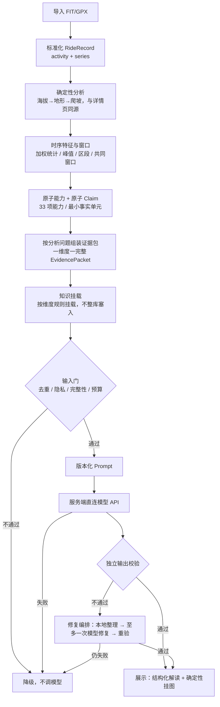

# AI 骑行解读产品设计文档

> 视角：产品经理
> 定位：从 0 设计一款「AI 骑行解读」产品——一次骑行 → 一段可信解读。重点是设计推演过程与产品取舍，具体设计和决策以本项目实际工程实现为准。
> 状态：设计已落地为可运行实现；新评测 Run 是放量前的最后一环。

---

## 1. 背景与目标

### 1.1 产品是什么

骑行者在结束一次骑行后，导入码表 FIT / GPX 记录，希望得到一段**可信的解读**：这次骑得怎么样、节奏合不合理、爬坡和心率/功率负荷如何、下一步注意什么。它不是仪表盘数字的复述，而是"把数据讲成人话"。

### 1.2 从 0 设计面对的核心挑战

设计这款产品，难的不是"让模型说几句话"，而是四个**可信性挑战**——它们决定了后面每一层设计的走向：

| 挑战 | 具体表现 | 对应设计 |
|---|---|---|
| **证据可信** | 模型容易在缺少过程证据时说出"稳定、进步、恢复良好"等它没资格说的话 | 证据化 + 完整证据包 + 独立校验 |
| **隐私边界** | 骑行记录含精确轨迹、经纬度、文件名，不该暴露给模型 | 输入侧隐私门 + 相对路线 |
| **成本与体积** | 时序采样点动辄上万，长骑行原始数据远超模型上下文 | 证据化压缩 + 输入去重 + 瘦身投影 |
| **输出不可靠** | LLM 输出天然有随机性，怎么保证"用户看到的每一句都可信" | 采样锁定 + 独立校验 + 修复降级 |

这四个挑战，本质上对应一个共同的答案：**不要指望模型自律，要用确定性的系统设计把"能说什么"管住。**

### 1.3 设计目标

- **一句话价值闭环**：用本次完整证据 + 个人基线 + 可追溯的运动科学知识，解释这次表现与下一步建议，同时**明确说清哪些结论不能从数据得出**。
- **可量化验收**：新评测 Run 的"事实硬门问题 = 0"、四类无证据断言 = 0、事实忠实度 ≥ 确定性基线；评测不过不放量。

---

## 2. 核心设计原则

面对上述挑战，我确立了六条设计原则，它们是全文所有取舍的总纲：

1. **先确认事实，再组织解释。** 模型只能解释已进入证据包的事实，不能从页面布局、常识或缺失值"脑补"结论。
2. **证据完整与展示重点分离。** 展示层可以挑高光，但"挑"不能"删"；"最多 N 个"只约束展示排序，不约束证据保留。
3. **能力可用性与内容生成分离。** 一个能力不可用只关闭对应分析问题，其他独立事实照常解读——不搞"一票否决"。
4. **宁可误拦、不可漏拦。** 校验器误拦还有"修复/降级"两条退路；漏拦（错误结论展示给用户）没有第二次机会。
5. **降级不污染事实。** AI 怎么失败，详情页的确定性事实都不受影响；失败也绝不静默降级成"假装正常"。
6. **全程可追溯、可回放。** 一次分析关联一个 `analysisRunId`，输入/输出/Prompt/规则全版本化，出问题能定位到"哪个版本的哪条规则"。

---

## 3. 整体工作流架构设计

### 3.1 端到端流程

### 3.2 五层职责划分

整条链拆成五个职责清晰的层，每一层有独立的"失败语义"：

| 层 | 职责 | 失败时的行为 |
|---|---|---|
| **数据层** | 标准化记录 + 确定性分析 | 记录校验失败 → 详情页阻断，AI 不解读 |
| **证据层** | 能力目录 + 原子 Claim + 证据包 | 某能力不可用 → 只关对应维度 |
| **编排/输入层** | 组装 + 边界校验 | 任一门不过 → 阻断模型调用，返回可追溯码 |
| **生成层** | 直连模型 + 版本化 Prompt | 调用失败 → 分类降级，不重试 |
| **校验层** | 独立输出校验 + 修复编排 | 校验不过 → 修复或降级，绝不展示 |

关键对象边界一句话：**详情页和 AI 是同一条 `RideRecord` 的两个消费端**，字段选择、质量门、投影合同都不同——"详情页显示了"≠"模型收到了"。

---

## 4. 输入的设计

输入设计的核心问题只有一个：**给模型看什么、不看他什么，才能让它既答得好、又不乱编、又不泄隐私、又不烧钱。**

### 4.1 从导入数据到"可引用事实"（证据化）

原始记录不能直接喂给模型，原因是三个：体积（时序点动辄上万）、隐私（精确轨迹/坐标/文件名）、不可解释（裸数字没有口径）。所以先做**证据化**——把数据变成带来源、带质量、带口径的"最小事实单元"（Claim）：

| Claim 字段 | 解决什么问题 |
|---|---|
| `value/unit` + `displayValue/displayUnit` | 原值 + 展示值双提供，模型**照抄**而非自己换算 |
| `provenance`（recorded/calculated/estimated） | 设备值、计算值、估算值不混称 |
| `qualityStatus`（valid/soft） | soft 必须降级表达、说明"部分缺失" |
| `formulaVersion` | 计算口径可追溯 |
| `supports/prohibits` | 这条事实**能支持**和**不能支持**哪些结论 |

**缺失不填 0，质量不过不伪装"可能值"**——一律进 `limitations`。这是"幻觉治理"的第一道关：模型从源头上拿不到"看起来合理但其实是编的"数字。

### 4.2 按"分析问题"组织证据包

单次骑行默认回答 **7 个分析问题**。每个可回答的问题生成一个**完整证据包**——包含该问题**全部**合格 Claim，不因"首个匹配"或"默认不展示"删证据。

每个问题由「问题定义 + 必需证据 + 可选证据 + 禁止结论」四部分构成：**必需证据全满足 + 至少一条相关 Claim** 才会生成该问题的证据包；**禁止结论**是该问题绝对不允许输出的定性表述，由输出校验器逐条拦截。

| 分析问题 | 问题定义 | 必需证据（全满足才可回答） | 可选证据 | 禁止结论 |
|---|---|---|---|---|
| 配速执行 `pacingExecution` | 配速执行、停歇、骑行中的分段表现如何？ | 距离、计时、速度、传感器连续性 | 路线、停歇、巡航、速度稳定性、地形 | 训练计划完成、骑行意图、比赛策略成功、因果 |
| 爬坡表现 `climbPerformance` | 合格的爬坡和地形分段显示了什么？ | 海拔、爬坡、计时 | 功率、心率、速度稳定性、跨传感器对齐 | 能力提升、技术/生理诊断、因果 |
| 心率负荷 `heartRateLoad` | 心率水平、分布和骑行中的变化说明了什么？ | 心率 | 最大心率基线、心率区间、心率漂移、跨传感器对齐、计时 | 医疗诊断、恢复完成、因果 |
| 功率输出 `powerOutput` | 功率水平、稳定性、峰值和合格分段显示了什么？ | 功率、传感器连续性 | 功率稳定性、功率峰值、标准化功率（NP）、巡航、跨传感器对齐 | 能力提升、因果、跨越记录缺口 |
| 骑行强度与训练负荷 `intensityAndTrainingLoad` | 有哪些强度与单次骑行训练负荷的事实可支撑？ | 功率、标准化功率（NP）、用户确认的 FTP、计时 | 功率区间、强度、训练负荷、用户资料 | 恢复、伤病风险、训练效果、把估算 FTP 当确认值 |
| 踏频策略 `cadenceStrategy` | 踏频水平、分布和传感器对齐显示了什么？ | 踏频、计时 | 踏频区间、跨传感器对齐、功率、速度 | 无配对证据推断效率、骑姿诊断、因果 |
| 跨传感器配合 `crossSensorCoordination` | 跨传感器观察到了哪些同窗口关系？ | 跨传感器对齐 | 功率、心率、速度、踏频、计时 | 因果、响应先后、趋势 |

历史对比、长期负荷/恢复（PMC）这两类"趋势性解读"**不放进单次解读**：它们属于"多次骑行统计"场景，单次解读就该聚焦单次，不给用户塞他此刻不需要的趋势。对应的统计模块与问题定义保留，供未来场景复用——因此单次解读是 7 个问题，全量分析目录是 9 个。

### 4.3 体积控制（不靠删证据）

长骑行（如 6.6 小时）会产生海量窗口级关系数据。我坚持一条红线：**体积控制在证据生成层解决，绝不在输入门口静默裁剪**。三层手段：

| 手段 | 做法 |
|---|---|
| 固定窗口关系聚合 | 每传感器对 1 条汇总 + 最多 3 条代表窗口（"一律聚合、不设阈值"） |
| 段级关系不产出 | 跨传感器只留"全局配合总结" |
| 爬坡代表选择 | 按"级别→难度→距离"取最难 top-3 + "3/15"计数披露 |
| 输入去重 | 顶层唯一 Claim/知识清单 + 问题包只引 `claimIds`，同一事实只发一次 |
| 瘦身投影 | 剥离追溯字段与元数据，模型只看推理所需 |

实测：长骑行完整输入 **175,571 → 119,878 字符**（去重），Prompt **→ 73,354 字符**（瘦身）。关键承诺：聚合是版本化规则、可复现可审计；全部窗口信息以统计形式在场（不是丢失），并披露"N 个窗口已聚合"，输出不得声称逐窗口观察。

### 4.4 上下文组装与 Prompt 设计

**第一步：把证据上下文组装成结构化模型输入。** 证据层产出的是"按维度组织的证据包"，但直接序列化会造成同一条事实被多个问题包重复内联（实测 107 条唯一 Claim 中 74 条被多包引用）。因此采用**去重结构**组装——同一条事实只发一次：

| 组装产物 | 内容 |
|---|---|
| 顶层 `claims` 清单 | 全部唯一 Claim，按首次出现保序，每条只序列化一次 |
| 顶层 `knowledge` 清单 | 全部唯一知识条目，同样只出现一次 |
| `questions` 问题包 | 只带 `claimIds`/`knowledgeIds` 引用 + 限制 + 允许/禁止结论 + 建议锚点 |
| `inputStats` | 总字符数、预算、问题数、Claim 数、知识数、聚合关系对数与窗口数 |
| `privacyFlags` + 版本栈 | 隐私边界 + 全链路版本号 |

实测：长骑行完整输入 **175,571 → 119,878 字符**（去重）——既不多发、也不漏发。

**第二步：Prompt 只描述表达，不替代证据门。** 分工是：

- 证据门（能不能说）→ 由输入门（见 4.5）+ 输出校验器**用代码**保证；
- Prompt（说得好不好）→ 只负责引导表达。

Prompt 的关键设计：

- **原样照抄 `displayValue`**，禁止模型自行换算单位、跨 Claim 加减、猜缺失值。
- **结论类型声明**：每个断言强制声明 `conclusionType`（fact / knowledgeReference / suggestion）并绑定 `claimIds`，让校验器能"对号入座"。
- **柔性表达建议**：不强制"事实→表现→意义"的硬递进，证据不足就只陈述事实、说明限制，不硬凑评价。
- **瘦身投影**：喂给模型的输入剥离追溯字段与 `analysisRunId`、`retrievedAt` 两个"缓存杀手"——同一案例重复跑 prompt 字节级稳定，命中供应商上下文缓存，**输入成本降约 40%**。

### 4.5 上下文输入校验设计

组装完成后、调用模型**之前**，输入还要过一道完整校验——这是"输入门"，任何一门不过就**阻断模型调用**、返回可追溯失败码，绝不静默裁剪任何合格 Claim：

| 校验门 | 检查内容 | 失败码 |
|---|---|---|
| 参数门 | `analysisRunId`/`userScope` 非空、预算为正整数 | `OPTIONS_INVALID` |
| 范围门 | 输入与证据上下文绑定同一 run 与 scope | `RUN_SCOPE_MISMATCH` |
| 隐私门 | 四项默认排除旗标必须齐备 | `EVIDENCE_CONTEXT_INVALID` |
| 合同复验 | 证据上下文整体合同（去重/来源/版本/数值） | `EVIDENCE_CONTEXT_INVALID` |
| 可回答门 | 至少存在一个合格问题包 | `NO_DELIVERABLE_QUESTIONS` |
| 引用解析 | 问题包引用的每个 Claim/知识都能在顶层清单解析 | `PACKET_CLAIM_UNRESOLVED` / `PACKET_KNOWLEDGE_UNRESOLVED` |
| 隐私复扫 | 组装后的输入不含禁止字段键（轨迹/坐标/文件名/令牌） | `PRIVATE_FIELD_PRESENT` |
| 体积门 | 总字符数 ≤ 预算（超限附逐问题体积清单） | `INPUT_BUDGET_EXCEEDED` |

设计要点：**校验的是"实际要交给模型的输入快照"，而不是 Prompt 遵循度**；体积超预算时整体拦截并列出每个问题的体积，由上层决定降级，而不是偷偷删掉几条证据凑进预算。

---

## 5. 输出的设计

### 5.1 输出结构（可省略，不硬填）

| 字段 | 目的 | 证据要求 |
|---|---|---|
| `label` 一句话标签 | 一句可记忆的概括 | 至少一条高置信、非限制类 Claim |
| `overallAssessment` 整体评价 | 总结表现与限制 | 数据少时写明"本次可用数据有限" |
| `highlights` 高光（可选） | 最值得关注的优势 | 高置信、非重复 |
| `dimensions` 各维度解读 | 逐维度解释 | 对应维度完整证据包 |
| `suggestions` 建议（可选） | 下一步关注点 | 至少一条骑行 Claim 锚点 + 风险说明 |
| `limitations` 限制回填 | 说明数据限制 | 只能原文回填输入出现过的限制 |

设计意图：**宁缺毋滥**。证据不足就省略可选字段，绝不为填满结构硬凑高光/建议——这是"输出质量"的第一性原则。

### 5.2 确定性挂图

各维度解读下方**由服务端按固定映射自动挂**详情页已构建的曲线（配速→速度、爬坡→海拔、心率/跨传感器→心率、功率/强度→功率、踏频→踏频）。模型**无权声明图表引用**——图表是确定性事实，不该交给模型决定。

### 5.3 用户体验要点

- 知识引用以序号角标随句标注（"…[1]"），页面底部列出出处清单，用户可回溯每条专业解释。
- 修复留痕：用户能看到"本地整理后通过 / 模型修复后通过"。
- 降级视图：B0 / 安全停机都有明确的降级文案，不装成正常解读。
- 灰度发布：新解读引擎通过开关控制，默认关闭，评测达标后再放量。

---

## 6. 模型选型

### 6.1 选型方法论（同集评测）

选模型的正确姿势不是"看排行榜"，而是**用同一批样例比同一批维度**。我定义的评测维度：

- 事实忠实（数字/断言能否回指证据）
- 中文解读与结构化输出通过率
- 数据处理条款（隐私合规）
- 时延、可用性、成本

配套设计了**五层样例集 + 反例诱导集、三层评分体系、7 项隐私条款核对清单**，确保选型可复现、可决策。

### 6.2 当前选型与决策依据

- 渠道：**硅基流动**，模型 `deepseek-ai/DeepSeek-V4-Flash`（首选）、GLM-5.2（备选）。
- 决策：当前阶段目标是快速验证端到端体验，故采取**"直选 + 方法论文档化"**策略——直接采用成熟渠道的可用模型，不执行大规模同集实测；评测方法论文档化留存，转正式产品时回溯执行。跳过实测的风险由降级合同兜底，并记录回溯触发条件。
- 这是有意识的**显式取舍**：把"选型严谨性"和"验证速度"的权衡摆到台面上，而不是假装做了实测。

### 6.3 采样参数锁定

`temperature=0.3`（降随机性）+ `enable_thinking=false`（关思维链，单次调用从 95–105 秒降到数十秒）。二者直接服务于"输出稳定性"和"成本/时延"；若评测发现关思考后洞察力下降，可单独恢复对比（数据说话，不拍脑袋）。

---

## 7. 输出校验设计

这是本产品**最核心的差异化能力**——AI 产品经理的真正战场不在 Prompt，而在"怎么让不可信的模型输出变得可信"。

### 7.1 三条设计原则

1. **结构化申报 + 确定性核对**：输出强制声明结论类型与证据引用，校验器只核对"申报与文本是否一致"，不做语义理解——每条判断可复现、可审计。
2. **宁可误拦、不可漏拦**：误拦有修复/降级退路，漏拦没第二次机会；误拦率由新评测 Run 量化后校准词表。
3. **语义判断只能收紧、不能放行**：不可复现的语义判断（如再让模型做语义校验）只能额外收紧，不能用于放行；误拦通过校准确定性规则的射程解决。

### 7.2 检验门（三级射程，27 类失败码）

| 射程 | 检查项 | 作用位置 |
|---|---|---|
| **全局红线** | 引用真实性、建议锚点、限制回填、数据声明、因果表述 | 所有断言 |
| **断言门** | 数字命中、稳定性、历史对比、恢复措辞、计划完成 | 仅 fact / historyComparison |
| **结构性剥离与豁免** | 区间代号 Z1-Z7、分段序号、次数频次不算数据值；建议类豁免数字核对 | 全部 |

### 7.3 检验逻辑（每类门怎么判）

- **数字命中**：文本每个数字必须匹配所引 Claim 的值/单位/展示转换；知识转述的数字白名单 = 所引知识的出处/条件/解释正文。
- **稳定性门**：无波动/过程 Claim 时禁止"稳定/平稳"；但"稳定区间"是 Z2 官方名、属区间汇报，豁免（避免误伤）。
- **历史对比门**：单次解读输入无历史 Claim，任何"进步/退步/相比之前"一律拦截（纯防线）。
- **恢复门**：未引用 `history.pmc.tsb` 且 TSB≥+5 证据时禁止"恢复良好"（PMC 场景）。
- **因果门**：全局红线，"导致/造成/引发"一律禁止，只允许"同时出现、相伴变化"。

### 7.4 修复与兜底编排

校验失败按顺序：**不可修核心错误（编造引用/隐私泄露/医疗建议/核心失真）→ 直接降级**；可修的 → **确定性整理（版本号/限制回填/删违规片段）→ 完整重验**；仍失败且符合准入 → **至多一次受限模型修复**（原输出脱敏后才作参考，禁止新增事实/Claim）→ 完整重验；再失败 → 降级，**禁止第三次调用**。

四种结局：`首轮通过 / 本地整理后通过 / 模型修复后通过 / 修复失败（降级）`，全程留痕。核心承诺：**用户看到的每一句话，要么通过本地独立校验，要么被降级兜底替代，不存在中间态。**

---

## 8. 测评方案设计

评测是设计的**闭环最后一环**，也是放量的唯一依据。设计要点：

### 8.1 样例集（冻结 10 条）

8 条"可解读样例"覆盖：短骑行、长骑行（6.6h、输入预算压力）、通勤（未定位停表容忍）、无功率、踏频覆盖边界、高 TSS 知识引用、峰值高光；另 2 条"预期拦截/降级样例"（停表超限、未配密钥）只验证"该拦就拦"，不评质量。冻结入 git 后不再改动，保证跨 Run 可比。

### 8.2 四项盲评指标（1–7 分）

| 指标 | 阈值（发布门） |
|---|---|
| 事实忠实度 | 硬门问题 = 0；均分 ≥ 确定性基线 |
| 不确定性表达 | 无"无证据确定断言" |
| 洞察价值 | 均分 ≥ 4 |
| 行动性 | 均分 ≥ 4；"建议无依据"计 0 |

**自动指标**（程序统计，不靠人）：首轮通过率、一次修复通过率、最终降级率、四类零容忍断言数（必须为 0）、延迟分布 P50/P95、每次成功解读令牌成本。

### 8.3 偶发失败率量化

8 条可解读样例各连续调用 5 次（40 次真实调用），量化"同输入偶发失败"的真实发生率。三档阈值：最终降级率 ≤5% 放行；5–15% 定处理方案；>15% 停下换模型/加强提示。

### 8.4 反例集（验证"防线不漏"）

构造 6 类已知违规（稳定无波动、提升无历史、恢复无 TSB、计划无计划、因果、历史对比措辞），全部必须被校验器拦截，漏拦 = 0。随全量测试长期运行。

### 8.5 双人盲评 + Run 留痕

8 条样例 × 2 份解读（AI 输出 vs 确定性基线）随机顺序盲评。Run ID 格式 `EVAL-V2-R{序号}-{日期}`；样例集或版本栈任一变化 → 开新 Run，不跨 Run 混用结论。

**发布门**：事实硬门 = 0、事实忠实度 ≥ 基线、四类零容忍断言 = 0、允许修复时总调用 ≤2 次。全达标 → 申请放量；任一不达标 → 按失败类型定方案再开新 Run。

---

## 9. 隐私与安全

- 默认排除四旗标（输入门强制）：原始轨迹、精确坐标、上传文件名、未受信任自由文本。
- 禁止字段键复扫：`filename/latitude/longitude/coordinates/rawtrack/points/accesstoken`。
- 路线只使用相对形状/签名/特征，不还原用户精确位置。
- Profile/历史/知识均存快照版本，保证可回放；密钥与敏感原文不进普通日志。
- `safety_stop` 优先级高于数据充足性。

---

## 10. 成本控制（专项）

| 手段 | 节省/效果 |
|---|---|
| 输入去重（同一事实只发一次） | 长骑行 175,571 → 119,878 字符（−32%） |
| 瘦身投影（剥离追溯字段） | Prompt → 73,354 字符（再 −40%） |
| 剥离缓存杀手字段 | 同案例重复跑命中供应商上下文缓存，输入价约 1/3 |
| 关思维链 | 单次调用 95–105s → 数十秒 |
| 一次修复上限 + 不可修零修复 | 杜绝"反复重试烧钱" |
| 请求/响应体积护栏 + 超时 | 前置拦截，异常不放大 |

成本洞察：批量评测场景下输入 token 占总成本约 85%，所以成本优化的**主战场在输入侧**，而非输出侧。

---

## 11. 兜底与降级（专项）

降级 `source` 有五种明确的结局语义，全部可追溯：

| source | 结局 | 触发 |
|---|---|---|
| `v2` | 校验通过的解读 | 正常 |
| `b0/blocked` | 输入门失败 | 任一门不过（无维度 → 数据不可解读） |
| `b0/notConfigured` | 未配 Provider | 缺密钥，零网络调用 |
| `b0/providerError` | 模型调用失败 | 分类错误码，**不重试** |
| `b0/repairFailed` | 修复后仍失败 | 二次校验失败 |

三条兜底原则：① **降级不污染详情事实**；② **失败绝不静默降级成"假装正常"**（宁可给降级说明，也不伪造解读）；③ **该拦就拦**——记录不可用、安全停止，用显式降级而非硬撑。

---

## 12. 用户体验（专项）

- **宁缺毋滥**：证据不足就省略可选段，不硬凑。
- **限制必回填**：数据缺失要说清楚，但不说"缺少 XX 数据"的空话——只回填真实的限制。
- **图表确定性挂载**：不依赖模型声明，稳定可预期。
- **知识可回溯**：角标 + 底部出处清单，专业解释有据可查。
- **修复留痕**：让用户知道"这段经过修复/本地整理"。
- **AI 与详情页解耦**：AI 挂了，确定性事实照看。

---

## 13. 落地进度与下一步

| 项 | 状态 |
|---|---|
| 数据标准化 + 确定性分析 + 证据化 | ✅ 已落地 |
| 完整证据包 + 能力目录 + 知识层 | ✅ 已落地 |
| 直连模型 + 独立校验 + 修复编排 + 确定性挂图 | ✅ 已落地 |
| 灰度开关（默认关闭） | ✅ 已落地 |
| 输入压缩（瘦身投影） | 收尾中（prompt 实测省约 40%） |
| 新评测 Run（放量发布门） | 设计中 |
| 标签长度门 / 完整度评价禁令 | 待定 |
| 多次骑行统计场景 | 后续 |

**一句话：端到端设计已落地并可运行，但"输出质量是否达到发布标准"必须由新评测 Run 量化，这是设计闭环的最后一环。**

---

## 附录 A：开发过程中的关键决策

> 以下决策均已记录在开发规划中，可逐条回溯；此处按主题归类呈现。

### A.1 数据与证据

| 决策 | 理由 |
|---|---|
| 标准化记录为 `RideRecord{activity, series}`，非 AI 架构单层 | 详情页与 AI 共享同一事实源 |
| 不采用统一数据分级控制话题权限，改用字段级质量规则 | 短骑行可看，损坏记录阻断 |
| 详情页均速 vs 过程均值分开命名、不混用 | 同名不同口径不可混淆 |

### A.2 证据与输入

| 决策 | 理由 |
|---|---|
| 完整证据包替代"首项匹配"，不发原始点 | 证据不丢失，又不超上下文 |
| 输入去重（同一事实只发一次） | 长骑行体积 −32% |
| 固定窗口关系一律聚合、段级关系不产出 | 长骑行证据不丢也不爆预算 |
| 爬坡代表 top-3 + 计数披露 | 控制体积，同时不谎称"分析了全部" |
| 未定位停表 ≤10% 容忍；覆盖门 0.7 | 通勤等碎片停歇不被误杀 |

### A.3 生成与校验

| 决策 | 理由 |
|---|---|
| 服务端直连模型 API（去工作流依赖） | 可控、可审计、可直连 |
| Prompt/输出合同版本化 + 断言绑证据 | 校验有依据 |
| 三级射程校验门（全局红线/断言门/豁免） | 精确控制"拦什么、不拦什么" |
| 恢复措辞 TSB≥+5 证据门（PMC 场景） | 恢复类断言有据可依 |
| 采样锁定（temp 0.3 / 关思考） | 降随机性、降时延 |
| 修复至多一次、不可修零修复 | 控成本、防"反复重试碰运气" |
| "稳定区间"豁免稳定性门 | 避免误伤官方区间名 |

### A.4 知识与测评

| 决策 | 理由 |
|---|---|
| 知识独立证据层，与骑行事实隔离 | 知识≠事实 |
| 知识按维度规则挂载（不用向量 RAG） | 首批 8 条，精确可测优先 |
| 只存转述 + 出处坐标，不复制原文 | 版权合规，可回溯 |
| 新评测 Run 不复用旧结论 | 防止"自己证明自己" |

### A.5 工程与交付

| 决策 | 理由 |
|---|---|
| 隔离开发 + 切片交付，每片独立验收 | 大设计拆成可独立验证的小步 |
| 灰度开关（默认关闭） | 用户行为零变化，评测达标再放量 |
| 全程版本化 + 可回放 | 出问题定位到版本和规则 |

---

## 附录 B：AI 产品经理能力体现（按主题系统梳理）

> 这是本产品"产品判断"的浓缩——每一个主题都对应一类 AI 产品经理必须解决的问题，以及我是怎么决策的。

### B.1 幻觉治理

- **根因判断**：把"模型会编"归因到"系统喂给它的证据不全"，而非"模型太笨"——这决定了治理方向是系统设计而非提示词调优。
- **三层防线**：① 输入侧证据化（缺失不填 0、估算标来源、supports/prohibits 声明）；② 输出侧独立校验（数字/稳定/历史/恢复/计划/因果门）；③ 修复降级（不合格不展示）。
- **引用真实性**：编造 Claim/知识 ID 是全局红线，直接降级，零修复——不跟幻觉"讨价还价"。
- **知识不能当事实**：知识只能解释口径，白名单外的数字按编造拦截。

### B.2 输出稳定性 / 输出质量

- **采样参数锁定**（temp 0.3、关思考）直击"同输入偶发失败根因 = 模型发挥不稳定"。
- **宁可误拦不可漏拦**：稳定性优先于通过率，误拦率用评测量化后校准。
- **原值+展示值双提供**：让模型"照抄"而非"自算"，从源头消灭换算类错误。
- **宁缺毋滥**：证据不足省略可选段，杜绝"为填结构硬凑"。

### B.3 成本控制

- 输入侧是成本主战场（输入 token 占 85%），三层输入压缩（去重→瘦身→缓存命中）省约 60%。
- 修复至多一次、不可修零修复——杜绝重试烧钱。
- 体积护栏 + 超时前置拦截。

### B.4 知识库使用

- 独立证据层，与骑行事实隔离（知识≠事实）。
- 按维度规则挂载（不用向量 RAG）——首批仅 8 条，精确可测优先于检索黑盒。
- 只存自撰转述 + 出处坐标，不复制原文（版权合规）；转述正文随行，模型只能照转述、不能脑补。
- 冲突时事实优先，修正走版本升级 + 新评测 Run（内容治理闭环）。

### B.5 怎么兜底

- 五种明确的降级结局（`v2` / `b0×4`），全可追溯、不重试、不静默降级。
- 降级不污染详情事实；"该拦就拦"用显式降级而非硬撑。
- 安全停机优先级高于数据充足性。

### B.6 怎么测评

- 新 Run 不复用旧结论（防止"自己证明自己"）。
- 样例集冻结 + 反例集 + 双人盲评 + 自动指标，人机结合。
- 发布门量化（硬门=0、四类零容忍=0），评测不过不放量。
- 失败率量化（40 次真实调用）把"偶发失败"变成可决策的数据。

### B.7 用户体验

- 知识角标 + 出处清单；修复留痕；图表确定性挂载；AI 与详情页解耦。
- 场景划分（单次 vs 趋势）——不把用户此刻不需要的趋势解读塞进去。

### B.8 工程与交付管理

- 隔离 + 切片交付，每片独立验收、默认灰度关闭——把大设计拆成"可独立验证、可随时回退"的小步。
- 全程版本化 + 可回放：出问题定位到"哪个版本哪条规则"。

---

*本文档是产品设计的总纲；规则级细节以 PRD 与业务规则说明为准，本文不重复展开。*
