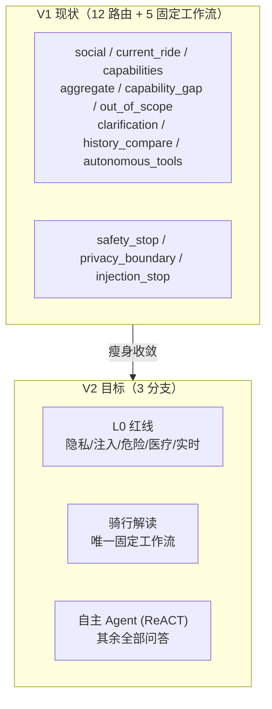
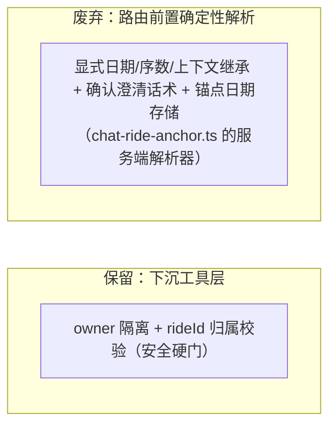

# 对话 Agent（骑行伙伴对话）V2 重构 · 决策清单

> 任务：对话 Agent `ride_chat_v1` 的 V2 重构设计（骑后解读链路已完成 V2 重构，对话链路本轮启动）
> 日期：2026-10-06
> 状态：`Review`（路由收敛决策已拍板，待设计文档细化工具合同 / 上下文 / 迁移切片）
> 依据：V1《AI骑行伙伴_Agent架构设计》v0.4、`src/chat/*` 工程实现、V2《技术方案》《AI解读证据体系与上下文重构 PRD》、V2《开发进度》

## 1. 背景结论（一句话）

V2 重构至今只完成了**骑后解读链路**（`ride_analysis`），**对话链路**（`ride_chat`）尚未重构；本轮将对话 Agent 从「规则路由 + 固定场景工作流」范式整体收敛为「**L0 只做 100% 红线 + 唯一固定工作流（骑行解读）+ 自主 Agent (ReACT) 承接其余全部问答**」，同时把数据层切到 V2 证据体系、渠道切服务端直连硅基流动。

## 2. 路由收敛总图

## 3. 路由改造决策（用户已拍板，2026-10-06）

| # | 决策点 | 现状 | 目标 |
|---|---|---|---|
| 1 | L0 只做 100% 红线 | L0 含红线 + SOCIAL 快路径 + RIDE_IDENTITY + AGGREGATE 快捷 | L0 只留 `MEDICAL/DANGEROUS/REAL_TIME_ROAD/PRIVACY/PROMPT_INJECTION` 五条"单词即红线"正则 |
| 2 | 共现安全不放 L0 | `DANGEROUS_RIDING` 正则内含共现原则（G-SAFETY-FP） | 共现语义安全 + `semantic_safety` 交给语义分类器做意图路由 |
| 3 | 去 aggregate | 零模型确定性直答（累计/本周/最近） | 聚合统计由自主 Agent 调**统计工具** |
| 4 | 去 capability_gap + out_of_scope | 两条固定模板路由（域内能力不足 / 域外） | 能力边界由模型靠工具清单 + prompt 自主判断、诚实拒绝不编造；保留一条**通用兜底话术**（模型未配置/失败） |
| 5 | 骑行解读为唯一固定工作流 | current_ride 走 get_ride_context + 模型表达 | 分类器识别解读意图 → 引导选记录 → **复用 V2 骑后解读** → 卡片展示；已有解读结果直接展示；`current_ride` 并入（解读最新记录是其实例） |
| 6 | 去 history_compare | 独立路由 + 场景化 compare_rides | 比较问答走自主 Agent，模型自主调 `compare_rides`（对齐 V2 可比性口径） |
| 7 | 去 social | L0 快路径 + 独立路由 | 问候/闲聊走自主 Agent，prompt 约束人格与引导 |
| 8 | 去 clarification | 确定性澄清话术一等路径 | 澄清由模型自行生成 |
| 9 | autonomous_tools → 自主 Agent (ReACT) | L2b 是一个路由分支 | 自主 Agent 升格为**默认执行方式** |
| 10 | capabilities 暂不做 | capabilities 路由 + get_capabilities 工具 | 砍掉；能力边界由工具清单 + prompt 承载 |

## 4. 两个待确认问题的建议（待用户确认）

### 4.1 骑乘指涉解析：建议废弃（拆两块分别处置）

- **废弃** `chat-ride-anchor.ts` 的确定性指涉解析：选记录交给模型 + `list_rides` 工具 + 会话上下文；澄清话术由模型生成（与第 8 条一致）。
- **保留** owner 隔离 + rideId 归属校验（权限边界，下沉工具层，非指涉解析）。
- **代价**：指代消解从"确定性 100%"降为"模型判断可能出错"；兜底手段 = `list_rides` 清晰时间排序 + 日期标签、会话上下文携带"当前讨论记录"提示、输出校验数字溯源硬门。

### 4.2 会话上下文：需要重设计，分层处置

| 维度 | 现状 | 目标 | 判断 |
|---|---|---|---|
| 上下文窗口 | 白名单摘要 ≤6 条（question≤120字 + route + rideAnchor） | 滑动窗口 + 近期原文 | 重设计（白名单摘要是为规则路由+单工具设计，撑不起 ReACT 多轮） |
| 压缩 | 无（截断 ≤6） | 早期轮次→模型摘要，近期→原文 | 新增（token 预算 + 8s 超时内平衡） |
| 用户记忆 | 无 | 会话内记忆 + 跨会话长期画像 | 分两层：会话内=窗口重设计；跨会话=复用 V2 Profile 机制，产品范围单独拍板 |

**不变硬约束**：历史轮数字不得成为事实来源、用户原文不落服务端。

## 5. 工具重新设计（按用户对话场景定义，草案供设计文档细化）

用户会通过对话干什么 → 工具映射：

| 场景 | 工具（草案） | 数据层 |
|---|---|---|
| 骑行解读（固定工作流） | 工作流内部调 V2 `ride-interpretation-service-v2`（非自主 Agent 工具） | V2 完整证据体系 |
| 单次骑行问答（这次/某次的距离/心率/功率…） | `get_ride_context` | **切 V2 证据体系**（去 V1 首项裁剪链） |
| 历史比较（比上次快吗/进步吗） | `compare_rides` | 对齐 V2 可比性口径 |
| 跨记录筛选/排名（最远那次/心率超 120 的） | `list_rides`（或保留 `find_ride`，模型拿到列表自行筛） | V2 口径 |
| 聚合统计（累计/本周） | `get_statistics`（替代 aggregate 零模型直答） | V2 口径 |
| 社交/闲聊/澄清/能力边界 | 无工具，prompt 约束 | — |
| 红线 | L0 拦截 | — |

> `get_capabilities` 工具删除（第 10 条）；`find_ride` 与 `list_rides` 是否合并，由设计文档按"模型自主检索"方向定。

## 6. 已拍板决策（累计）

| ID | 决策 |
|---|---|
| G2 | 对话表达层 + 语义分类器**一并脱离 Coze、切服务端直连硅基流动** |
| D6-2 | 对话固定集 AEVAL-M3-CHAT **随重构重评**（不复用 v0.5 27/27 旧结论） |
| R1–R10 | 第 3 节路由改造 10 条（L0 只留红线、去 aggregate/capability_gap/out_of_scope/current_ride/history_compare/social/clarification、骑行解读唯一固定工作流、自主 Agent 升格默认执行、capabilities 暂不做） |

## 7. 待设计文档回答的核心问题

1. **意图分类器标签空间收敛**：从 11 标签收敛为「红线标注（纵深防御）/ `ride_interpretation`（骑行解读）/ 其余（自主 Agent）」，Prompt 重做与直连切分。
2. **自主 Agent 工具合同**：第 5 节工具集 + 输入/输出合同 + 预算 + 输出校验数字溯源硬门（V2 措辞门是否引入、如何适配短回答）。
3. **骑行解读固定工作流的选记录交互**：引导选记录 + 已有解读结果直接展示（需解读结果持久化/缓存查询），与 V2 ride_analysis 的复用接口。
4. **会话上下文重设计**：窗口/压缩/锚点提示槽位的具体合同，隐私边界不变。
5. **迁移切片**：对标骑后 S0–S6 逐切片验收。

## 8. 下一步

1. 用户确认第 4 节两条建议（指涉解析废弃、会话上下文重设计）。
2. 逐项回答第 7 节 5 个问题，产出 V2 对话 Agent 架构设计文档（对标 V1《Agent架构设计》v0.4）。
3. 设计文档评审通过后，按迁移切片逐片实现。
