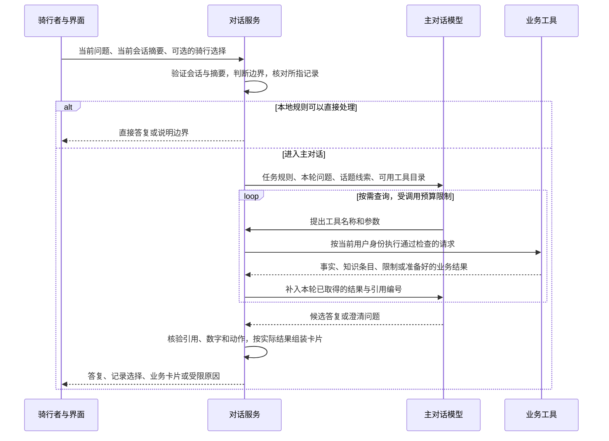

# AI Cycler 的上下文工程与工具设计

骑行者看完今天的训练计划，骑完后问：“我今天骑够计划里的时长了吗？”Cycler 可以从会话摘要接上刚才讨论的计划，再从训练服务读取当天的计划时长，并核对用户关联了哪条骑行记录。评估工具用这条记录的实际移动时长与计划时长作比较。若当天有两条骑行记录且尚未关联，用户先选择用于评估的那一条。

本文对应代码基线 `d8bc8bf`，验证记录见[基线索引](AI_Cycler_基线索引.md)。主线是对话 Agent，同时说明从聊天进入骑后解读、训练计划生成时，上下文如何变化。[Agent 整体结构](AI_Cycler_对话Agent整体结构设计.md) · [项目架构](AI_Cycler_项目架构.md)

## 1. 一轮对话里，模型先知道什么，后来才知道什么

### 系统提示词如何设计

主对话提示词 `ride-chat-prompt-v0.7.0` 给 Cycler 的角色是“教练型骑行伙伴”。它把这个角色落实为五个可以验收的行为。[主对话提示词](../src/chat/chat-workflow-prompt.ts)

| 模型要做的判断 | 提示词怎样规定 | 骑行者看到的结果 |
| --- | --- | --- |
| 用户指的是什么 | 用会话摘要理解“这次”“刚才那个指标”。对象或单位仍有歧义时，提出一个具体问题 | 接着聊已选骑行时可以直接追问，同日有多条候选时可以点选 |
| 需要查哪些工具 | 拆开复合问题，分别取得所需证据。后一个查询依赖前一个查询的结果时，分轮调用 | 两个诉求都能得到回应，查到的路线和用户问的是同一趟骑行 |
| 可以据此说什么 | 个人表现引用本轮工具返回的事实，概念解释引用检索到的知识条目。说明缺失指标和比较限制 | 用户能看出哪些结论有记录支持，以及哪些问题受数据限制 |
| 什么时候算完成 | 准备资料、修改草案和评估执行都要核对对应工具的结果。计划启用以用户在界面确认后的状态为准 | “已生成草案”和“计划已启用”各自对应可核对的业务状态 |
| 下一步交给谁 | 需要取数时输出结构化工具请求。可以作答时输出中文正文、回答或澄清标记，以及使用的证据编号 | 服务端核验后展示正文，并用真实工具结果组装记录选择项或计划卡片 |

**举例。** 用户问“哪次骑得最远？那次爬坡多吗？”第一步用 `find_ride` 按距离筛选，取得匹配记录的 ID。第二步用该 ID 调 `get_route_overview`，读取这条路线的爬坡摘要。若最远记录已找到，但地形数据不足，答复仍可指出是哪次骑行，并说明现有数据难以判断那次的爬坡情况。[复合问题提示规则](../src/chat/chat-workflow-prompt.ts) · [工具用途与调用顺序](../src/chat/chat-tool-orchestration.ts)

**固定规则与每轮输入分别传递。** 硅基流动适配器将上述规则放在 `system` 消息中。本轮问题、会话摘要、骑行引用、带上海日期的工具目录，以及随后取得的工具结果，放在 `user` 消息的 `chat_request` 中。服务端有两种反馈。回复格式或引用错误时，`repair_instruction` 要求模型只用已取到的证据改写答复；例如，重复提交相同安排后把“已更新”改为“周六原本就是这个安排”。如果用户要新计划而助手只读了旧计划，服务端先用 `evidenceRequest` 要求补做；在预算允许的动作修复轮，也可以明确要求发出工具请求，拿到卡片再答复。两种反馈都不授予新的权限。[消息组装](../src/chat/siliconflow-chat-provider.ts) · [补查与修复](../src/chat/chat-agent.ts) · [输出校验](../src/chat/chat-output-validation.ts)

### 主提示词和任务提示词怎样配合

**主提示词的作用范围是主对话的一次模型调用。** 资料、导入、历史查询、训练计划和执行评估的场景规则都写在同一份主提示词里，随主对话请求一起发送。模型结合当前问题与工具目录选择下一步，服务端执行工具，把结果带回下一次调用。下一次仍使用同一份主提示词，增加的是刚查到的事实或刚准备好的草案。[主提示词中的场景规则](../src/chat/chat-workflow-prompt.ts) · [对话循环](../src/chat/chat-agent.ts) · [消息发送](../src/chat/siliconflow-chat-provider.ts)

**独立任务由应用代码触发，每次自行组装指令和输入。** 主提示词、聊天历史和上一轮工具结果都不会自动继承到另一条模型请求。几项任务的衔接方式如下。

| 何时触发 | 哪份指令生效 | 结果交给谁 |
| --- | --- | --- |
| 用户发来消息，本地规则未直接处理，且启用了边界分类器 | 分类提示词只看本轮问题，判断放行、安全停止、隐私边界、指令注入或域外请求 | 分类标签交给对话路由。放行后，主对话才带上会话上下文和工具目录处理“那次呢”之类的追问 |
| 用户在聊天里查询记录、讨论知识或复盘训练 | 主提示词中的对应场景规则生效。比如执行评估工具计算计划与实际的差异，主模型根据工具结果组织反馈 | 服务端核验后，把回复和卡片交给对话界面 |
| 用户在计划信息卡核对信息并首次生成草案 | 计划接口调用专用生成器，以计划生成提示词作为系统消息，输入已核对的信息、近期骑行、训练知识与领域约束 | 生成器返回提案，计划服务校验并保存草案，界面展示新版本。启用另需用户确认 |
| 用户点击某条骑行的“查看深度解读” | 解读界面按骑行 ID 请求独立接口。缓存命中时复用结果。需要生成时，默认 V1 调用 Coze 工作流，V2 将专用解读指令与本次骑行证据拼成一条 `user` 消息 | 解读结果交给骑行详情抽屉 |

[分类提示词](../src/chat/chat-classifier-prompt.ts) · [对话路由](../app/api/chat/route.ts) · [计划生成调用](../src/training/plan-generation.ts) · [计划生成提示词](../src/training/plan-generation-prompt.ts) · [解读界面请求](../app/components/interpretation-view.tsx) · [解读引擎选择](../app/api/ride-analysis/route.ts) · [V2 消息发送](../src/ai/ride-model-provider-v2.ts)

**同一份排期规则在两个入口生效。** 用户第一次点击“核对信息并生成草案”时，专用生成器的系统消息直接包含共享规则。用户随后说“把周六的耐力骑缩短一点”，主对话读取已有草案，工具随结果带回同一段 `schedulingRules` 和按本人基础计算的 `state.constraints`。普通骑行问答无需携带整套排期算法。首次生成、聊天修订和规则拒绝后的重试，都以领域校验通过为提交条件。[共享排期规则与校验](../src/domain/training-plan.ts) · [首次生成提示词](../src/training/plan-generation-prompt.ts) · [聊天计划工具](../src/chat/chat-plan-tools.ts)

例如，周六最多可骑四十五分钟，排三十分钟也合法。若这次调整缩短了一个完整训练周，共享规则会要求按该周实际总量重新核对后续周上限。首版生成器还要解释训练依据并引用所用知识；聊天修订则要确认改的是当前草案版本，并按工具回执告知用户结果。[首次生成](../src/training/plan-generation.ts) · [草案版本与保存](../src/training/plan-service.ts)

### 对话记忆、事实与权限

| 信息来源 | 在产品里解决什么问题 | 使用规则 |
| --- | --- | --- |
| 当前问题与页面选择 | 用户说“这次”时，知道他刚点了哪条记录 | 服务端在用户可见记录中核对 ID。点选与文字指向冲突时，请用户重选。同日多条骑行可以列候选，用记录 ID 区分 |
| 当前会话摘要 | 用户追问“这个指标是什么意思”时能接上话题 | 浏览器保存聊天历史，每次只传当前对话最近最多 6 条摘要，问题片段最多 120 字，答复片段最多 160 字。摘要字段违规时整组舍弃，继续处理当前问题 |
| 已保存资料与业务状态 | 确认当前 FTP、正在执行的计划、选中的计划版本或已关联的训练记录 | 按需通过工具重新读取。身体资料带有来源，最大心率可以标为系统估算。训练目标随具体计划版本读取 |
| 本轮工具证据 | 支撑“骑了多少”“时长是否达标”“这个术语是什么意思” | 个人指标引用本轮实际返回的事实。知识解释引用命中的知识条目。缺测指标保留缺失状态，历史聊天里的数字只能作为话题线索 |
| 用户确认与业务回执 | 判断保存、启用、删除或关联是否真的发生 | 界面选中骑行表示“接下来讨论这条”。将它关联到计划中的某一天，需要在执行界面另行确认。服务端依据实际操作结果更新状态 |

新开对话会建立新的摘要。恢复聊天时，若原会话已闲置 24 小时，也会开启新上下文，旧消息仍可浏览。普通追问可以沿用已选骑行，改问整体表现会切换范围。从计划详情返回讨论时，界面先核对所看版本和日期，再把它作为话题提示，具体日程由工具重新读取。[会话生命周期](../src/chat/chat-session.ts) · [摘要校验](../src/chat/chat-routing.ts) · [记录范围](../src/chat/chat-context.ts) · [计划讨论入口](../app/components/chat-home.tsx)

## 2. 19 个工具如何覆盖用户任务

进入主对话后，各类业务问题共用当前已启用的工具目录。每个工具都说明用途、输入字段和适用范围，服务端另有执行时的参数检查与证据规则。比如“这次爬坡多吗”要读一条骑行的地形摘要，“哪次爬升最多”要跨记录筛选。两个问题都提到爬升，查询对象和结果却不同。[能力注册表](../src/chat/chat-capability-registry.ts) · [模型看到的工具说明](../src/chat/chat-tool-orchestration.ts) · [服务端工具定义](../src/chat/chat-tools.ts)

| 用户任务 | 工具 | 可交付的结果与边界 |
| --- | --- | --- |
| 开始使用、核对资料 | `show_onboarding`、`get_user_context`、`get_health_profile`、`prepare_profile_proposal` | 展示引导，查询已保存资料或指定身体指标。用户明确给出的数值可形成资料提案，由本人核对后保存 |
| 接入骑行 | `prepare_ride_import` | 返回 FIT／GPX 上传入口及本账号各平台的接入模式与连接状态。顽鹿试点支持真实手动同步，有上次尝试结果时返回新增、重复、失败计数；其他模拟入口明确标注 |
| 理解一次骑行 | `get_ride_context`、`get_capabilities`、`get_route_overview` | 返回指定维度的指标、该记录具备的数据、路线与坡段概要。“能分析功率吗”取决于选中记录的数据 |
| 查历史、作比较、看负荷 | `get_ride_history`、`find_ride`、`compare_rides`、`get_training_load` | 分别处理时间范围内的汇总、极值或阈值筛选、历史可比性和训练负荷。汇总由工具计算，比较保留样本与可比性限制 |
| 理解骑行与训练知识 | `search_knowledge_base` | 在内置骑行和训练知识库中按主题标签、维度和关键词匹配排序，最多返回 3 条，附摘录、结论强度和局限。纯知识问题在零骑行记录时也可回答 |
| 制定或调整训练计划 | `get_training_plan_context`、`prepare_training_plan`、`propose_training_plan` | 读取当前或指定版本，准备待核对的信息，或修改已有草案。首次生成由用户核对信息后触发专用生成流程，启用另需确认 |
| 复盘训练执行 | `get_training_execution`、`prepare_training_record_link`、`assess_training_execution` | 读取当天安排与关联状态，准备记录选择入口，对已确认关联计算并保存执行事实。通过校验的文字反馈可随评估保存 |

**判断一项动作是否完成，要看它改变了什么状态。** 准备资料提案只会返回待确认卡片，日程确有变化时，修改训练草案会写入一个待审阅的版本。相同日程返回原版本和 `unchanged=true`，助手据此说明已有安排。规则拒绝时，既有安排和已核对的信息保留。启用或删除计划、关联骑行则使用专用接口，确认凭据绑定用户、目标、版本与幂等键。同一次有效确认重试会返回已有回执。[资料提案](../src/chat/chat-user-capabilities.ts) · [计划工具](../src/chat/chat-plan-tools.ts) · [执行工具](../src/chat/chat-execution-tools.ts) · [确认写入](../src/chat/chat-write-confirmation.ts)

比如问“我可以同步顽鹿的骑行吗？”聊天首页和导入工具使用同一个账号判断。试点用户可以打开入口手动连接和同步，其他账号可以体验模拟流程。即使工具读到“已连接”，仍须查看上一次同步回执才能说导入了多少条；单纯查询和打开入口都不会拉取骑行。[账号能力与连接状态](../src/sync/onelap-access.ts) · [同步接口](../app/api/platform/route.ts)

## 3. 服务端怎样让工具结果成为可信回答

- **先定范围，再查数据。** 用户身份来自服务端会话。单次取数可以按日期、倒数第几次或已获准的记录 ID 定位。模型显式传入的 ID 必须属于本轮允许的集合。需要串联查询时，上一步定位到的记录可供下一步使用。全局知识工具可以直接使用，无需先选骑行。[记录定位](../src/chat/chat-ride-ref.ts) · [工具调用检查](../src/chat/chat-tool-orchestration.ts)
- **把结果整理成能核对的事实。** 例如单次骑行工具按所问维度返回事实、单位和数据局限。服务端为本轮事实分配引用编号，并收集实际检索到的知识 ID。模型输出候选回答后，服务端核对引用、数字来源和动作描述。可点击的候选项与卡片来自已授权的数据和工具产物。[结果整理](../src/chat/chat-agent.ts) · [输出校验](../src/chat/chat-output-validation.ts) · [卡片组装](../src/chat/chat-artifacts.ts)
- **限制查多久，也限制取多少。** 一次主对话循环最多调用 5 次工具、6 次主模型，单批最多 4 次工具调用，循环的时间预算为 90 秒。每批先全部检查参数，再并行执行，按请求顺序回收结果以保持引用稳定。即使本人有大量骑行，历史查询最多返回 20 行明细，汇总仍按符合条件的记录计算。[循环预算与并发](../src/chat/chat-tool-orchestration.ts) · [历史查询实现](../src/chat/chat-tools.ts)
- **失败原因对应不同的下一步。** 指代不清时请用户选记录。知识未命中时说明覆盖范围，指标不可比时说明限制。已注册工具的部分参数错误可以获得一次纠正机会。系统拒绝目录外工具或未授权记录。模型给出无依据的数字时，服务端可要求修复，仍未通过时返回受限答复。[纠正与降级](../src/chat/chat-agent.ts) · [证据与异常场景测试](../tests/scn03-recent-knowledge.test.ts)

## 4. 骑行复盘：今天骑够计划里的时长了吗？

1. **查安排。** 对已有生效计划的骑行者，Agent 可调用 `get_training_execution`，取得计划版本、日期和骑行关联状态。即使聊天里刚出现过某条骑行，系统仍按训练工作区里保存的关联来评估。
2. **确认用哪趟骑行来评估。** 如果当天的训练安排还没有关联骑行记录，Agent 可调用 `prepare_training_record_link` 展示选择入口。比如用户早上和傍晚各骑了一次，可以选中按计划训练的那一趟并确认关联。评估只使用已确认关联的记录。
3. **取得评估事实再解释。** 有了确认关联，`assess_training_execution` 才能按计划版本、日期和关联修订号计算计划时长、实际移动时长及差值等事实。时长达标只支持对时长的评价，间歇完成质量还需要相应证据。
4. **检查结论是否仍然有效。** 保存文字反馈时再次核对关联修订号、评估版本与记录内容。如果用户中途换了关联，旧评估的迟到回复会被拒绝，后续评估使用新记录。[执行服务](../src/training/execution-service.ts) · [评估工具](../src/chat/chat-execution-tools.ts) · [端到端场景测试](../tests/scn05-training-execution.test.ts)

## 5. 离开聊天后，哪些上下文会改变

| AI 入口 | 如何组装输入 | 产品结果 |
| --- | --- | --- |
| 骑后深度解读 | 默认 V1 从单次骑行的分析计划选取允许引用的事实、解读维度、图表引用和局限，交给 Coze。V2 从骑行时间窗、资料、证据包与知识条目构造模型输入，核对运行范围、隐私字段和字符预算 | 深度解读围绕所选骑行生成。V2 缺少合格证据或输入超预算时会在模型调用前停止，界面可据原因降级 |
| 首次生成训练草案 | 用户先确认当前版本的训练信息。生成器取目标、可用时间、训练基础、领域约束、近四周汇总与最多 8 条近期骑行摘要，再按目标和功率条件选择训练知识 | 模型给出带知识引用的提案，领域规则核对可用日、负荷等约束。通过后得到可审阅的草案版本 |

[骑后解读引擎选择](../app/api/ride-analysis/route.ts) · [V1 输入](../src/ai/ride-interpretation-input-v04-candidate.ts) · [V2 输入检查](../src/domain/ride-model-input-v2.ts) · [训练基础与近期记录](../src/training/plan-service.ts) · [草案生成](../src/training/plan-generation.ts)

### 骑后报告遇到数据不足时怎样呈现

V2 的生成和修复使用同一份披露规则。整次骑行中，可完整解读的维度少于两个，整体评价提示“本次可用数据有限”。某个维度仍有可引用的事实，例如功率采集只覆盖部分路段，报告可以说明已有观察，同时在该维度提示覆盖有限。如果完全没有可引用的功率事实，就省略功率判断，把输入给出的具体限制原文放入限制栏。程序核验事实归属与限制原文，必要时可以直接补齐限制栏。[共享披露规则](../src/ai/ride-evidence-disclosure-v2.ts) · [输出校验](../src/ai/ride-output-validator-v2.ts) · [解读修复](../src/ai/ride-output-repair-v2.ts)

### 如何核对一次请求实际用了哪份提示词

- 主对话使用本地 `ride-chat-prompt-v0.7.0`，可选边界分类器使用 `ride-chat-classifier-prompt-v0.5.0`，首次生成计划使用 `training-plan-generation-v1.1`。硅基流动调用日志按请求 ID 记录提供方、模型和提示词标识。计划生成重试沿用同一请求 ID，成功响应的 `X-Request-Id` 可用于查日志。选择自建 HTTP 聊天端点时，远端提示词标为未报告。[主对话调用](../src/chat/siliconflow-chat-provider.ts) · [分类器](../src/chat/chat-classifier.ts) · [计划生成](../src/training/plan-generation.ts)
- V1 响应和运行记录采用部署配置的工作流版本。Coze 内部提示词版本由部署方核对后填写，缺省标为 `unreported`。V2 在本地维护生成提示词 `ride-prompt-v2.9.0` 和修复提示词 `ride-repair-prompt-v2.3.0`，可从版本信息查到两者。[配置示例](../.env.example) · [V1 路由](../app/api/ride-analysis/route.ts) · [V2 版本信息](../src/ai/ride-interpretation-service-v2.ts)

## 产品验收看哪些信号

| 试着这样问或操作 | 应看到的行为 |
| --- | --- |
| 用普通账号和试点账号分别询问顽鹿同步，再连接和同步 | 各自看到对应的模拟或真实入口。已连接和上次同步结果分别可核对 |
| 把草案改成原本就有的安排，再真的缩短周六的骑行 | 第一次返回原草案，第二次返回新的待确认版本。两次都需本人明确启用 |
| 已有草案时要求制定新计划，模型只读取了旧草案便声称已备好核对卡 | 服务端要求补做准备动作；成功后展示真正的核对卡，失败则据实说明 |
| 在历史摘要里留下错误 FTP，再问当前 FTP | 回答读取当前已保存资料，错误旧值无法单凭摘要通过数字校验 |
| 同日有两条骑行，按日期问单次功率，再点选较早那条 | 先得到候选，后续取数使用点选记录。改问一段时间的整体表现后，查询范围切回总览 |
| 在没有骑行记录的账户问骑行原理 | 命中知识库时可回答并附知识依据，未命中时说明知识覆盖缺口 |
| 刚看完训练草案就问“生效了吗”，或更换已关联的骑行后再看评估 | 以当前计划版本和执行状态为准，草案有独立状态，旧关联的评估随记录变化而失效 |

复查一轮体验时，可以沿聊天事件查看摘要是否被丢弃、调用了哪些工具、用了多久、回复是否经修复，以及最终的降级原因。当前聊天事件把 token 和成本记为未观测，工具调用次数可用于定位流程问题，实际费用需另行计量。[聊天事件](../app/api/chat/route.ts) · [上下文验收](../tests/chat-arch03-context.test.ts) · [训练计划验收](../tests/scn04-training-plan.test.ts)
