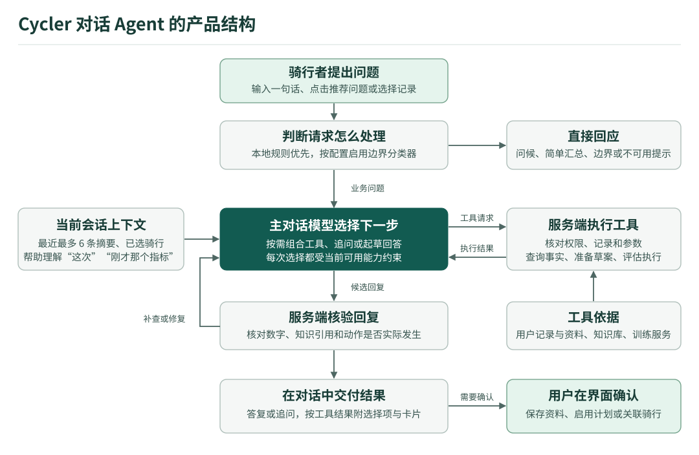

# Cycler 对话 Agent 产品设计

Cycler 把查骑行、问知识和安排训练放进同一个对话入口。骑行者可以先问“我这周骑得怎么样”，选中一条记录追问功率，再打开深度解读。**主对话模型负责理解用户并决定下一步，服务端工具负责取数、计算和准备草案，骑行者掌握会改变正式资料、计划或记录关联的确认权。**

本文描述提交 `135af67` 中已实现的行为。项目部署、存储与外部服务关系见[项目架构](AI_Cycler_项目架构.md)。

## 一次提问由谁处理

1. **入口决定是否需要模型。** 问候、身份问题和部分简单汇总可以直接回答。明确的安全或隐私请求进入对应边界处理。其余问题可由已配置的分类器判断能否继续，放行后进入同一个主对话 Agent。已启用的分类器若调用失败，本轮会提示服务暂不可用。[请求分流](../src/chat/chat-execution.ts) · [边界分类](../src/chat/chat-classifier.ts)
2. **主对话模型决定查什么。** 它可以先定位骑行，再查这次骑行的功率，也可以在同一轮检索知识来解释指标。工具由服务端执行，服务端检查记录是否对用户可见、参数是否合法，并把结果交回模型。一次主对话循环最多执行 5 次工具调用、发起 6 次主模型调用。预算耗尽时，界面提示用户缩小问题范围。[工具编排](../src/chat/chat-tool-orchestration.ts) · [主对话循环](../src/chat/chat-agent.ts)
3. **服务端决定哪些结果能展示。** 回复中的个人指标要能追溯到本轮数据，知识解释要能追溯到检索结果。对“已生成草案”等动作描述，系统还会检查对应工具是否真的生成了产物。检查失败时可在预算内补查或修复。可点击的记录、计划卡及快捷操作由服务端根据工具结果组装。[回复校验](../src/chat/chat-output-validation.ts) · [卡片组装](../src/chat/chat-artifacts.ts)

## 骑行者可以用它完成什么

| 骑行者的任务 | 对话里能得到什么 | 由谁完成下一步 |
| --- | --- | --- |
| 第一次使用，补充个人资料 | 引导入口，或列出原值和拟修改值的资料卡 | 用户核对卡片并点击“确认保存资料”，资料接口写入 |
| 接入或查看骑行 | 导入入口、日期范围内的记录列表、选中骑行的指标与可用数据 | 用户选择文件或触发同步。点击记录上的“查看深度解读”可打开独立的骑后解读流程 |
| 理解表现与骑行知识 | 单次指标、近期汇总、可比记录的变化，或带知识依据的概念解释 | 服务端工具计算、比较或检索，模型用自然语言解释。数据缺项时说明可判断的范围 |
| 制定或修改训练计划 | 训练信息卡，以及对已有草案的修改 | 首次生成前由用户核对目标、时间和身体状况。生成后可审阅这一版，再确认启用 |
| 复盘计划执行 | 某天的计划、关联入口，以及计划与实际骑行的对照 | 用户选择并确认关联的骑行。评估工具计算执行事实，校验通过的文字反馈可随评估保存 |

这五类任务共用一套对话与工具机制。检索骑行、准备资料、修改草案、评估执行等能力分别登记，模型可按问题组合使用。训练目标属于具体计划，因此讨论新目标时，要区分正在执行的版本和正在准备的草案。[能力目录](../src/chat/chat-capability-registry.ts) · [对话界面](../app/components/chat-home.tsx) · [计划工具](../src/chat/chat-plan-tools.ts) · [执行工具](../src/chat/chat-execution-tools.ts)

## 同一天骑了两次，追问“这次”指哪一次

下面的例子取自项目的场景测试。两条骑行及功率数值均为测试样例。[场景测试](../tests/scn03-recent-knowledge.test.ts)

| 用户的操作 | 系统怎样判断 | 用户看到的结果 |
| --- | --- | --- |
| 问“回顾 11 月 1 日的整体骑行表现” | 按日期范围查历史，保留当天两条记录 | 收到当天汇总和记录列表，仍处于总览状态 |
| 选中早上的记录，问“这次的平均功率是多少？” | 用点选的记录 ID 读取本次功率，即使当天还有一条更新的记录 | 回答 **111 瓦**。当天晚些时候那条记录的 **222 瓦** 属于另一次骑行 |
| 追问“这个指标是什么意思？” | 会话摘要帮助识别“这个指标”指平均功率，解释来自本轮知识检索 | 收到功率的含义和知识依据，无需再选一次记录 |

这也是产品里“记住对话”的具体含义。浏览器保存聊天记录，每轮最多携带最近 6 条摘要。摘要能帮助理解话题和用户上次选了哪条骑行。涉及个人数值时，系统会重新取证。若用户点选的记录与文字指定的记录冲突，系统请用户重新选择。[会话存储](../src/chat/chat-session.ts) · [上下文处理](../src/chat/chat-context.ts) · [记录选择与冲突测试](../tests/chat-arch03-context.test.ts)

## 产品验收时看什么

- **问对了对象。** 从日期范围切到单次骑行，再回到整体表现，答案应跟随当前范围。即使某个日期范围只查到一条记录，查询结果也应保留总览语义。[近期表现与知识测试](../tests/scn03-recent-knowledge.test.ts)
- **说得出依据，也说得清缺口。** 没记录的用户仍可问骑行知识。缺失的距离、功率等应按对应指标说明可用性。统计汇总只计有效数据。知识库未覆盖和模型服务不可用应给出各自的原因。[统一执行测试](../tests/chat-arch02-execution.test.ts) · [历史查询与知识测试](../tests/scn03-recent-knowledge.test.ts)
- **分得清草案、确认和生效。** 聊天里出现计划卡时，用户仍能检查、修改草案。启用或删除计划、把实际骑行关联到某天训练，都需要用户在界面明确确认。重复提交同一有效确认时，服务端返回同一次操作的结果。[训练计划测试](../tests/scn04-training-plan.test.ts) · [训练执行测试](../tests/scn05-training-execution.test.ts)
