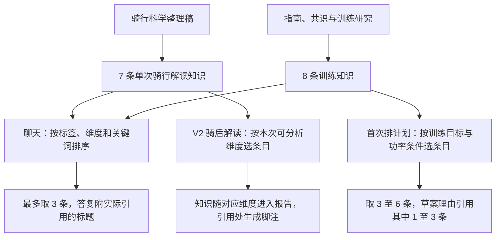

# AI Cycler 知识库如何构建、检索和使用

骑行者问“赛前减量是什么意思”，即使还没上传过骑行，Cycler 也能查知识库解释这个概念。如果接着问“我这周已经减量了吗”，助手还需要查本人的训练安排或骑行记录。**知识条目提供解释，用户数据提供判断这位骑行者实际情况的证据。** [聊天工具](../src/chat/chat-tools.ts) · [回答校验](../src/chat/chat-output-validation.ts)

本文对应代码基线 `d8bc8bf`。当前有两组随代码发布的知识，共 **15 条**。聊天、首次生成训练计划、V2 骑后解读分别决定哪些条目进入模型。运行时直接读取结构化条目，检索依靠标签、文本和维度匹配，无需联网搜索、生成向量或查询向量数据库。[骑行知识库](../src/domain/ride-knowledge-base-v21.ts) · [训练知识库](../src/domain/training-knowledge-base.ts)

## 一、资料怎样变成产品能用的知识

**骑行解读库按“看一趟骑行时要回答什么”组织。** 七个维度各有一条知识，分别是配速执行、爬坡表现、心率负荷、功率输出、强度与训练负荷、踏频策略、跨传感器配合。项目将 TrainingPeaks、Allen 与 Coggan、Joe Friel 等来源整理为骑行科学文档，再把相关内容写成版本化条目。基础指标的定义与计算依赖另有代码规格。例如，如何计算变速系数由指标规格定义；怎样结合地形理解功率波动，则写进配速知识的解释与解读信号。[骑行科学整理稿](../doc_m7_archive/doc_V2.1/cycling_science_knowledge_base.md) · [指标规格](../src/domain/ride-derived-metric-spec-v21.ts) · [七维度条目](../src/domain/ride-knowledge-base-v21.ts)

每条解读知识都有稳定 ID、主题、来源与版本、适用维度和条件、解释正文、结论强度、局限，以及禁止用知识代替的个人指标。条目还列出哪些表现值得肯定、哪些需要谨慎解释。校验会检查重复 ID、必填来源、维度是否合法等；测试还核对七个维度各有一条、解读信号齐全。早期的八条 Batch 1 仍保留供历史复查，当前运行的解读库为 `ride-kb-2.1.0`。[条目校验](../src/domain/ride-analysis-knowledge-v2.ts#L71) · [七维度测试](../tests/ride-knowledge-base-v21.test.ts) · [早期 Batch 1](../src/domain/ride-knowledge-base-batch1-v2.ts)

**训练库按“骑行者要制定或理解决策”组织。** 八个主题覆盖渐进加量、疲劳与恢复、长距离耐力、强度分配、交谈测试、FTP、爬坡和赛前减量。每条记录标题、解释、结论强度、适用局限、触发关键词，以及指南或研究的名称和链接。例如“耐力与长距离骑行”收录了“长骑、百公里、完赛”等说法，方便从用户目标找到条目；同时记下研究对象的限制，约束模型能给出多强的建议。维护者在 TypeScript 条目里更新这些内容，新的聊天和上传记录不会自动写入公共知识库。[训练知识条目](../src/domain/training-knowledge-base.ts)

## 二、聊天怎样从一句话找到知识

1. **主对话把问题变成检索条件。** 用户问骑行原理时，主提示词要求先查 `search_knowledge_base`。模型可以给分析维度、关键词，或同时给两者。两者至少有一个非空；关键词最多 5 个，每个最多 32 个字符。工具不依赖已选骑行，默认最多取 3 条。[主提示词](../src/chat/chat-workflow-prompt.ts) · [模型看到的工具说明](../src/chat/chat-tool-orchestration.ts#L197) · [参数校验](../src/chat/chat-tools.ts#L674)
2. **程序在两组知识里挑候选并排序。** 维度相同，或关键词命中主题、标题、解释正文，或输入词包含条目的预设标签，都可以入选。排序依次优先看预设标签是否命中、维度是否命中、命中了几个输入词；完全相同时沿用条目顺序。只有训练条目设有专门的关键词标签。因此，指定维度可以扩大候选范围，一个词在正文里反复出现也不会累加成多个命中词。[检索与排序](../src/chat/chat-tools.ts#L1271)
3. **模型读到摘录和局限，服务端决定展示的出处。** 每条解释摘录最多 600 个字符，较长时尽量在句末截断。工具原始结果含结论强度，训练条目还含来源链接；传给聊天模型的是 ID、维度、主题、标题、摘录和局限。模型在答复中提交用到的 `knowledgeIds`，服务端核对这些 ID 来自本轮结果，再追加相应条目的标题。用户看到的“知识依据”是条目标题。纯知识查询没有命中时，助手说明当前覆盖范围，并请用户具体说明想了解的概念。[工具结果](../src/chat/chat-tools.ts#L1264) · [模型可见字段](../src/chat/chat-agent.ts#L673) · [出处展示](../src/chat/chat-agent.ts#L969)

**实查“赛前减量”。** 不指定维度，只传关键词 `["赛前减量"]`，本地工具依次返回《结合训练量与恢复判断负荷》和《赛前减量与训练疲劳》。前者命中标签“减量”，后者命中“赛前”和“减量”；排序计算的是命中的**输入词数**，两条都是一个，因此恢复条目按库内顺序在前。回答可以只引用第二条，界面就只展示第二个标题。输入一个未收录的词且不指定维度时，工具返回 `no_match`。[排序实现](../src/chat/chat-tools.ts#L1276) · [赛前减量场景测试](../tests/scn04-training-plan.test.ts) · [未命中场景测试](../tests/scn03-recent-knowledge.test.ts)

## 三、训练计划和骑后报告怎样选知识

**首次生成计划时，程序先选知识，再调用模型。** 每次固定带上“循序增加训练量”和“结合训练量与恢复判断负荷”。第三条依据功率条件选择：已核对有功率计且训练基础中有 FTP 时选 FTP 条目，其他情况选交谈测试。然后用目标文字匹配训练条目的标签，按库内顺序最多再加 3 条。例如，目标为“想完成百公里骑行”、没有可用功率目标时，实际入选的是渐进、恢复、交谈测试和长距离耐力四条。生成器须从候选中引用 1 至 3 个不同 ID，服务端核对后把标题附到草案理由里。聊天修订已有草案走主对话工具，不会自动重跑这次首版选材。[计划选材](../src/domain/training-knowledge-base.ts#L109) · [生成与引用核对](../src/training/plan-generation.ts) · [草案修订入口](../src/chat/chat-plan-tools.ts)

**骑行详情默认使用 V2，先看这趟骑行有什么证据，再附上能解释它的知识。** 程序先生成本次可分析维度的证据包，再取知识条目的适用维度与这些证据包的交集。比如当次有合格的功率输出证据包，功率条目就可以进入报告；缺少相应证据包时，知识条目不会单独开启该维度。条目里的文字适用条件随知识传入，挂载代码实际用来筛选的是维度。模型输入只保留一份知识正文，各维度用 ID 引用；生成后还会检查知识是否属于该维度，最终在“知识出处”显示实际使用的脚注。[匹配与挂载](../src/domain/ride-analysis-knowledge-v2.ts#L179) · [V2 运行入口](../src/ai/ride-interpretation-service-v2.ts#L205) · [输入去重](../src/domain/ride-model-input-v2.ts) · [报告脚注](../src/ai/ride-output-presentation-v2.ts)

## 四、怎样判断一次回答用对了知识

回到“我这周已经减量了吗”。助手可以用《赛前减量与训练疲劳》解释“减量”的含义，但判断这位骑行者这周是否已经减少训练，需要读取相应周期的个人记录或安排，而且需要能比较的参照。复查回答时可以分别追问：**概念解释引用了哪条知识？关于我的结论用了哪些个人事实？** 服务端可以校验 ID 是否来自本轮、数字是否有可引用来源；仅仅通过引用校验，还不足以证明一句话在语义上正确地区分了研究结论和个人表现。[主对话证据规则](../src/chat/chat-workflow-prompt.ts) · [聊天引用校验](../src/chat/chat-output-validation.ts#L229) · [知识摘录的数字边界](../src/chat/chat-tools.ts#L1097)
