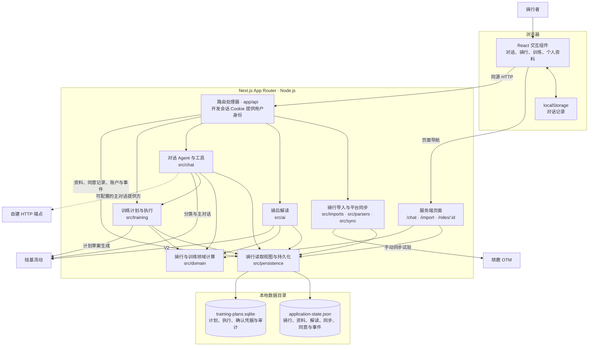
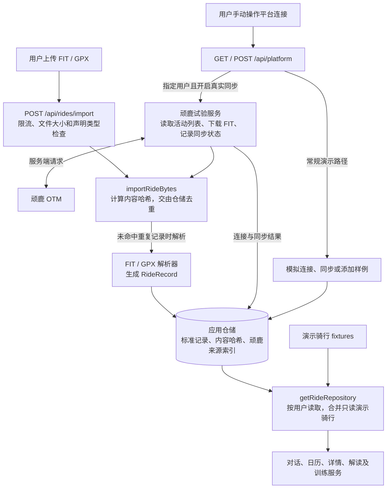
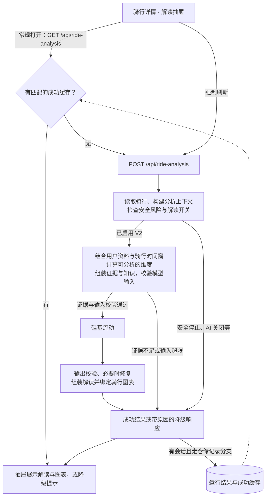
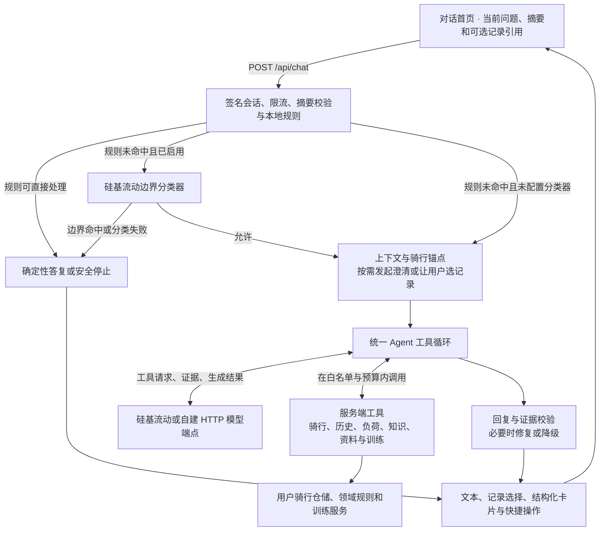
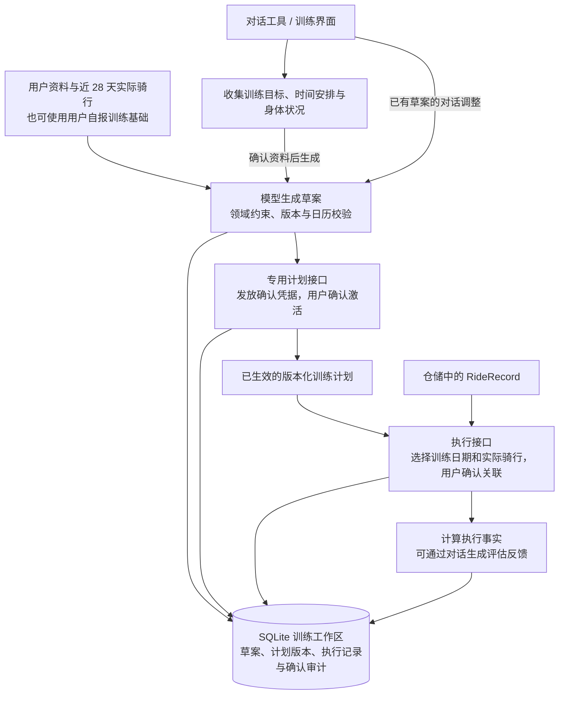

# AI Cycler 项目架构

依据当前工作区源码梳理，提交基点为 `23c4230`。各图描述代码中的调用和数据流向，外部服务分支是否运行取决于会话和部署配置。

## 1. 系统总图

AI Cycler 是一个 Next.js App Router 应用。页面渲染、HTTP 接口、骑行数据处理和 AI 编排都位于同一个 Node.js 应用。首页 `/` 跳转到 `/chat`。对话、骑行日历和详情由服务端页面读取数据，浏览器组件通过同源 API 提交上传、解读、对话和训练操作。

- **页面入口** · [对话首页](../app/chat/page.tsx)、[骑行记录和日历](../app/import/page.tsx)、[骑行详情](../app/rides/[id]/page.tsx)、[平台连接](../app/connections/[provider]/page.tsx)、[训练计划详情](../app/plans/[id]/page.tsx)、[个人资料](../app/profile/page.tsx)。
- **领域层** · 统一的 `RideRecord` 包含活动摘要 `activity` 和时序数据 `series`。功率、心率区间、海拔、坡段、路线、历史比较和负荷等指标由领域代码计算。骑行详情用 `src/ui` 将记录转换为图表和页面视图模型，AI 链路按各自协议投影证据。[骑行数据契约](../src/domain/ride-schema.ts) · [骑行视图模型](../src/ui/ride-view-model.ts)

## 2. 骑行导入与同步

手动上传和顽鹿真实同步复用 `importRideBytes`。仓储按用户与内容哈希去重，顽鹿同步另记来源活动索引。同步响应包含新增、重复和失败数量。真实同步默认关闭，开启后仅对配置指定的本地会话生效，由用户手动触发。演示模式的读取视图会合并仓储和内置演示记录，空白模式的骑行列表仅包含切换后新增的自有记录。

[文件上传路由](../app/api/rides/import/route.ts) · [共享导入服务](../src/imports/ride-import-service.ts) · [解析器入口](../src/parsers/index.ts) · [平台接口](../app/api/platform/route.ts) · [顽鹿同步服务](../src/sync/onelap-sync.ts) · [演示骑行读取视图](../src/persistence/demo-ride-repository.ts) · [同步技术方案](Cycler_第三方骑行自动同步技术方案.md)

## 3. 骑后解读

- **生成解读** · 用户打开抽屉，有匹配的 V2 成功结果就直接展示。首次生成或点击“重新解读”时，V2 将本次骑行证据交给硅基流动。安全停止返回 `safety_stop`，AI 关闭、凭据缺失或生成失败时返回 `b0` 和具体原因。[解读接口](../app/api/ride-analysis/route.ts) · [解读抽屉](../app/components/interpretation-view.tsx)
- **缓存和分析范围** · 服务端按账号读取缓存，核对骑行记录、相关身体指标、模型和 V2 版本。旧版报告会在下次打开时重新生成。单次解读只使用这趟骑行的证据，历史比较和 PMC 负荷由对话工具提供。[缓存指纹](../src/ai/ride-interpretation-cache.ts) · [V2 解读服务](../src/ai/ride-interpretation-service-v2.ts) · [对话工具](../src/chat/chat-tools.ts)

## 4. 骑行对话 Agent

对话历史保存在当前浏览器的 `localStorage`，每轮由客户端发送问题以及允许的会话摘要。服务端依据用户身份读取记录并约束工具输入，模型处理结构化上下文和工具返回的证据。训练工具可读取状态、准备资料或生成草案。激活计划和绑定骑行在专用训练接口完成确认。

[对话入口](../app/api/chat/route.ts) · [会话存储](../src/chat/chat-session.ts) · [边界分类](../src/chat/chat-classifier.ts) · [Agent 与提供方](../src/chat/chat-agent.ts) · [工具循环](../src/chat/chat-tool-orchestration.ts) · [交互产物](../src/chat/chat-artifacts.ts)

## 5. 训练计划与执行

计划接口负责资料确认、草案生成、激活和删除，执行接口负责关联骑行和评估。激活、删除与关联通过确认凭据、版本检查和幂等回执约束写入。SQLite 将业务状态、确认凭据消耗、回执和审计同事务提交。草案生成复用硅基流动对话提供方配置。

[训练计划接口](../app/api/training-plans/route.ts) · [草案生成](../src/training/plan-generation.ts) · [计划服务](../src/training/plan-service.ts) · [训练执行接口](../app/api/training-execution/route.ts) · [执行服务](../src/training/execution-service.ts) · [确认写入](../src/chat/chat-write-confirmation.ts) · [SQLite 仓储](../src/persistence/training-plan-store.ts)

## 6. 运行边界与代码定位

- **会话与存储** · 开发会话使用签名 Cookie，应用仓储按用户 ID 读写数据。默认数据目录为 `.local-data/`，可通过 `LOCAL_DATA_DIR` 覆盖。开启 OIDC 模式会停用开发会话，当前 OIDC 适配器待接入。[会话实现](../src/auth/session.ts) · [应用仓储](../src/persistence/application-repository.ts)
- **配置来源** · 骑后解读由 `AI_ANALYSIS_ENABLED` 控制，启用时读取 `SILICONFLOW_API_TOKEN`。主对话可选硅基流动或自建 HTTP 端点，边界分类器独立启用。[环境示例](../.env.example) · [对话提供方选择](../src/chat/chat-agent.ts) · [分类器配置](../src/chat/chat-classifier.ts)
- **演示与观测** · `/pmc` 是占位页面。符合数据条件时，对话工具可计算 CTL、ATL、TSB。应用通过 `/api/demo-events` 记录或查询演示事件，导入、解读和对话也会记录服务端事件。[PMC 页面](../app/pmc/page.tsx) · [PMC 计算](../src/domain/ride-pmc-load-v2.ts) · [事件接口](../app/api/demo-events/route.ts)
- **验证入口** · `pnpm verify` 运行 TypeScript 检查和 Node 测试。测试覆盖解析导入、路由、仓储、解读、对话与训练。基线说明包含样例和测评资产的位置。[项目命令](../package.json) · [基线索引](AI_Cycler_基线索引.md)
