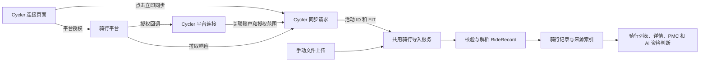

# Cycler 第三方骑行手动同步技术方案

- 方案日期：2026-11-14
- 更新：2026-11-20
- 范围：顽鹿手动同步单账号联调与正式平台接入设计
- 设计基线：[UX 原型开发规划与进度](../doc_m7_archive/doc_Agent/开发规划/UX原型开发规划与进度.md)、[骑行数据导入与详情页规则](../doc_m7_archive/doc_V2/骑行数据导入与详情页产品规则说明.md)

## 顽鹿单账号联调

Cycler 已实现国内顽鹿 OTM 的服务端试验接入，默认关闭。适配器读取活动并下载 FIT，复用 Cycler 导入服务。适用单个 Next.js Node 实例与持久磁盘，由配置绑定的 Cycler 会话手动发起。正式多用户连接仍需顽鹿提供的合作接口和授权契约。[开发进度与验证结果](../doc_m7_archive/doc_Agent/开发规划/Agent改造开发进度.md)

1. 在受控实例的服务端环境中设置独立随机 `SESSION_SECRET`（至少 32 字符）。保留当前开发会话模式，启动 Cycler 并在测试浏览器打开骑行页建立会话。首次更换会话密钥后需要重新建立会话。
2. 将该浏览器会话的 `userId` 设置为 `ONELAP_SYNC_OWNER_ID`。可在浏览器开发者工具中查看 `ai-cycling-buddy-session` 的第一个点号之前的部分，在本机做 Base64URL 解码，从 JSON 读出 `userId`。配置只需要用户 ID，无需复制完整会话 Cookie。
3. 设置 `ONELAP_SYNC_ACCOUNT_ID` 为该顽鹿测试账户的稳定标识，更换账户时使用不同标识。配置该账户有效的 OTM `ONELAP_SYNC_TOKEN` 和经许可用于该接口的 `ONELAP_SYNC_SIGNING_KEY`。上游如果要求同一会话的 Cookie，可选配 `ONELAP_SYNC_COOKIE`。所有凭据存入服务端环境，配置项可参考 [环境变量示例](../.env.example)。
4. 设置 `ONELAP_SYNC_ENABLED=true` 后重启服务。在同一浏览器打开「同步／导入骑行 → 顽鹿」，点击「连接顽鹿」，再点击「立即同步」。每次点击发起一轮检查。连接和查看状态时只读写 Cycler 中的连接信息。
5. 查看真实记录数量与来源，重复同步应跳过已导入活动。连接被拒绝时检查服务端凭据并更新，再重新连接。断开连接会停止导入，已导入的骑行可在记录页管理。

此版本每轮检查前三页，每页最多 20 条。同一账号并发请求在进程内合并。记录按源活动 ID 和文件哈希查重，删除同步记录后保留防重复标记。进程重启后保留连接及去重状态。平台登录态需人工更新。同步上限、响应格式及实际授权有效期要用真实账号确认。

## 1. 实施目标

用户在 Cycler 内完成平台连接后，点击「立即同步」检查新骑行。Cycler 服务端拉取已上传至源平台的活动并写入用户的骑行列表。详情、PMC 与 AI 解读沿用现有数据资格规则。

首期在现有 Cycler 后端实现一个平台适配器，验证授权、后台取数和入库。同步任务与导入服务可以随同一项目部署。实际交付方式和历史范围取决于平台授予的权限。

首期验收要求是**点击「立即同步」后，一条真实骑行进入本人列表，重复同步仍只有一条**。范围包括读取已完成骑行、首次补录、增量同步、结果查询与断开连接。

## 2. 平台接入与实施顺序

### 首个可上线连接

- **行者**优先验证第三方应用授权。官方文档提供 OAuth 2.0 和令牌刷新。拿到开发凭据后验证已完成骑行列表、原始 FIT 或逐点数据，以及可查询时间范围。确认活动读取权限后，可由 Cycler 响应用户操作发起拉取。[行者开发者文档](https://developer.imxingzhe.com/docs/intro/)
- **iGPSPORT**并行申请官方平台。申请材料包含授权回跳地址和运动数据回调地址。根据获准的接口文档确定推送或通知后下载流程，并核对历史补录、签名、重试和原始文件字段。[iGPSPORT 开放平台](https://www.igpsport.com/support/app/openapi)
- **佳明**评估 Business Activity API。Starter 只推送授权后的新数据。要提供用户主动拉取，需向佳明确认 Enterprise 的接口权限、历史窗口和目标区域；也可使用文件导入。[佳明开发者计划](https://developer.garmin.com/gc-developer-program/overview/)
- **顽鹿**核实云端活动读取的合作条件。公开开发者页面描述 FTMS 和蓝牙设备接入。取得云端合作接口前，可提供文件导入。[顽鹿开发者页面](https://www.onelap.cn/developer.html)

### 联调数据来源

优先使用首个平台的正式测试凭据。若申请仍在等待，用已获得的 FIT 样例验证入库。符合 Garmin Personal API 使用范围的单人自测，也可以在只供账号本人使用的 Cycler 开发实例中配置密钥，由 Cycler 后端查询活动并下载 ZIP，再提取 FIT。个人密钥留在该实例的服务端，产品连接采用 Business Activity API。[官方客户端](https://github.com/garmin/connect-personal-api-python) · [个人 API 使用范围](https://developer.garmin.com/gc-developer-program/personal/personal-faq/)

公开参考实现展示了顽鹿通过网页登录态和签名获取 FIT、iGPSPORT 通过登录令牌获取 FIT 的技术路径。这两套自用接口的续期、稳定性与第三方服务使用条件需分别核实，生产适配器按获得许可的接口实施。[顽鹿参考实现](https://github.com/moruoxian/SyncOnelapToXoss/blob/main/SyncOnelapToXoss.py) · [iGPSPORT 参考实现](https://github.com/moruoxian/SyncOnelapToXoss/blob/main/incremental_sync_v2.py)

Cycler 的 AI 用途需要在平台接入时确认。Strava 的常规 API 政策限制将活动及其衍生数据用于 AI 应用，因此本方案排除 Strava API 中转。[Strava API Policy §5.3](https://www.strava.com/legal/api_policy)

## 3. 数据流和仓库改造

手动上传与顽鹿拉取共享 `src/imports/ride-import-service.ts`。服务端校验文件、限制 50 MB、按 SHA-256 查重、解析 `RideRecord` 并保存。同步调用携带持久化连接与活动来源标识；手动上传保留原返回格式及演示模式显式重新导入的行为。[统一记录结构](../src/domain/ride-schema.ts)

顽鹿试验由 `src/sync/onelap-sync.ts` 另存账号关联、同步状态及去重标记。未配置真实路径的会话继续产生模拟样本。正式多实例服务需要事务存储、唯一索引、持久任务和共享限流。[模拟同步实现](../src/ux/platform.ts)

优先获取含传感器采样的原始 FIT。以实际记录字段计算可用能力，缺失的心率、功率或踏频保留为空。摘要或无时间 GPX 的导入成功只表示可用部分已入库。若后续接入只提供 JSON 时序的平台，应补字段映射和来源证据后再开放对应分析。[现有导入与分析规则](../doc_m7_archive/doc_V2/骑行数据导入与详情页产品规则说明.md)

## 4. Cycler 账户授权和同步接口

用户在已登录的 Cycler 页面发起平台连接。Cycler 保存一次性授权请求，关联当前 `ownerId`、平台、回跳地址和有效期。平台回调时校验 `state`，按平台协议换取凭据，查询源账号标识，再保存账户映射与授权范围。平台支持 PKCE 时启用。令牌及刷新凭据存放在服务端，由同步任务按获准范围使用。

现有上传入口依赖浏览器 Cookie，无 Cookie 时会新建本地用户。后台任务根据连接记录读取 `ownerId`，通过服务层入库。上线前接通生产会话，保证用户登录后能持久访问其连接和历史骑行。[当前会话实现](../src/auth/session.ts)

当前顽鹿联调使用 `GET /api/platform?provider=onelap` 读取状态，通过 `POST /api/platform` 的 `sync` 操作拉取。正式接入可采用以下路由，具体授权回调按各家注册要求配置。

- `POST /api/sync/connections` 发起授权。服务端从登录会话确定用户，返回平台授权地址。
- `GET /api/sync/oauth/{provider}/callback` 完成授权并绑定源账户。
- `POST /api/sync/connections/{id}/jobs` 响应用户操作，为支持主动拉取的平台创建同步任务。
- `GET /api/sync/connections/{id}` 返回授权状态、最近同步结果和任务状态。`DELETE` 同一路径用于关闭连接。两者均验证当前用户与连接归属。

共用导入服务返回 `rideId` 和是否重复。同步任务将新增、重复和失败汇总给前端。平台令牌刷新和文件下载在服务端完成。

## 5. 增量、去重与失败恢复

### 手动检查范围

一轮同步由用户点击发起。首次点击可在平台允许的范围内补录历史，后续点击拉取最近活动并按来源去重。每轮限制页数和条数。

有可靠更新时间或游标时，可以保存已发现的位置并保留小范围重叠查询。只有活动开始时间时，下次手动同步回扫此前窗口，兼顾后来才上传的旧活动。

### 来源与幂等

- `connections` 保存 `ownerId`、平台、区域、源账户标识、能力和授权状态。
- `source_activities` 对 `ownerId + platform + region + sourceAccountId + sourceActivityId` 建唯一约束，保存对应 `rideId`、内容哈希与来源版本。重新授权相同账号后继续使用同一来源标识。
- 持久任务需要记录连接、任务状态、游标、失败原因和允许再次发起的时间。

同一活动先按来源 ID 查找，同一用户的相同文件再按 SHA-256 合并，允许平台同步关联到手动导入的现有记录。不同平台或文件编码可能产生不同哈希，基于开始时间、距离和时长只提示疑似重复。正常入库时把骑行与来源映射放在同一事务中，上传确认丢失后重试可返回同一个 `rideId`。首期遇到源平台内容修订时标记待复核，避免静默覆盖既有记录和分析。

### 失败恢复

网络错误和 5xx 提示用户再次同步。遇到 429 时按 `Retry-After` 限制用户再次发起的时间。授权失效时按官方契约尝试刷新，否则暂停连接并提示重新授权。文件未生成或服务重启中断时，由下一次手动同步补查，已提交的骑行通过来源映射去重。

用户断开连接时停止拉取，按平台支持情况撤销授权并清理服务端凭据。取消未完成任务，入库前再次核对连接仍有效。保存或删除既有活动按已告知的保留规则和平台条款执行。用户删除同步记录后，在授权允许的范围内保存最小的防重复标记，避免下次同步将同一记录重新建回。

## 6. 运行和可见状态

连接页显示「立即同步」、最近成功时间和待重试状态。一轮完成后显示新增、重复和失败数量。可选补录范围按平台的主动读取权限确定。

从外部接口下载文件时限制目标域名、重定向、大小和超时。ZIP 只读取预期格式的文件，设置解压总大小上限。按现有 `RideRecord` 规则保留相对路线，日志和模型输入不含令牌、原始 FIT 或精确坐标。使用允许的派生字段执行 AI 解读，数据使用权限跟随来源与用户授权。

监控每个平台的成功率、源平台入账到 Cycler 入库的延迟、重试与重复数量。将“同步完成”和“数据可用于解读”作为两个状态，避免把传感器数据缺失表示为同步失败。

## 7. 实施与验收

1. **先验证文件入库。** 抽出共用导入服务，保留现有手动上传行为。使用同一测试账户从后台任务导入已有 FIT／GPX 样例，检查详情与来源。重复提交仍返回同一条记录。
2. **验证一个真实平台。** 用户在 Cycler 完成绑定后，让源平台产生一条新骑行。打开连接页查看状态，然后点击「立即同步」。验证只有点击后才发起拉取，记录进入本人列表且来源标记正确，对照距离、起始时间和传感器覆盖。
3. **验证重复与失败恢复。** 同一活动多次同步、并发处理或任务完成后响应丢失，最终均只保留一条。覆盖迟到活动、服务重启后的手动重试、429、授权失效和解绑过程中任务终止。
4. **上线首个官方连接。** 验证正式授权范围、设备和账号地区覆盖、字段、限额、数据处理许可和撤销事件。先向少量用户开放，并确认关闭连接时后台任务能停止。获准后再扩展历史窗口和其他品牌。

顽鹿试验的真实账号验收覆盖活动列表、FIT 下载与入库、来源展示、重复同步去重及凭据更新。持久任务、平台授权与撤销属于正式接入设计。[验证记录与待验事项](../doc_m7_archive/doc_Agent/开发规划/Agent改造开发进度.md)
